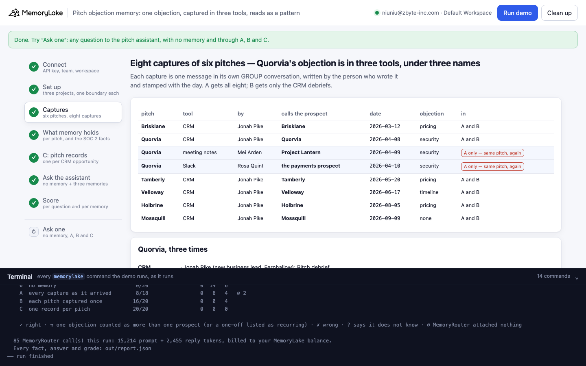
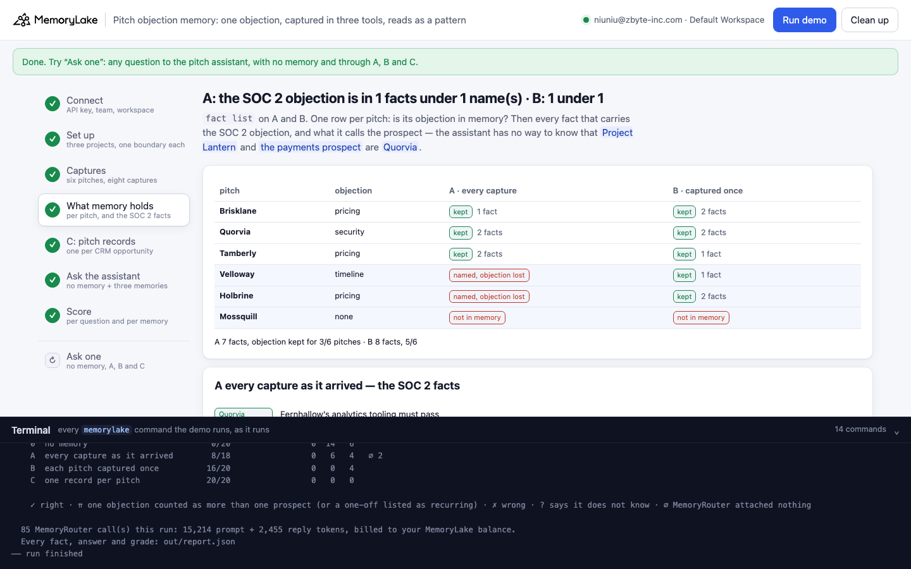
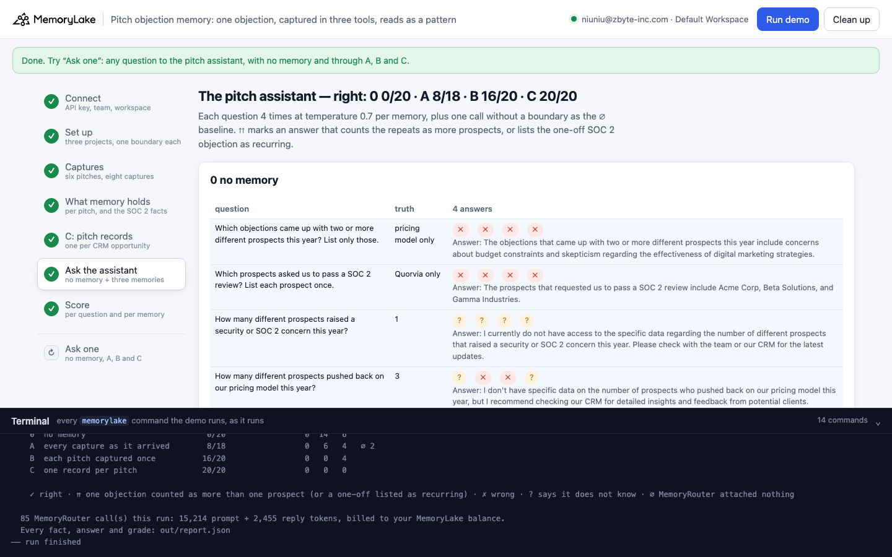
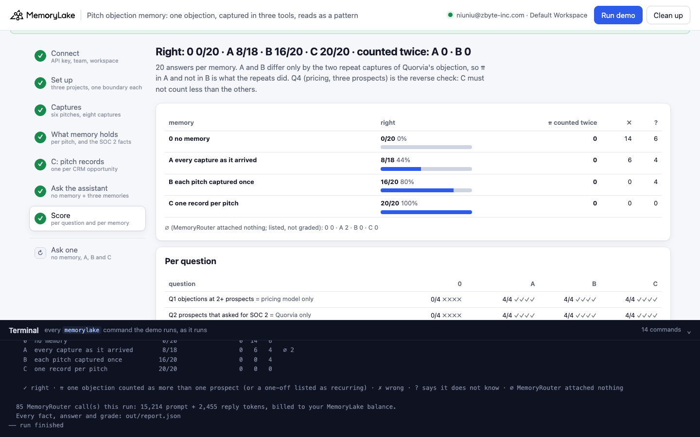
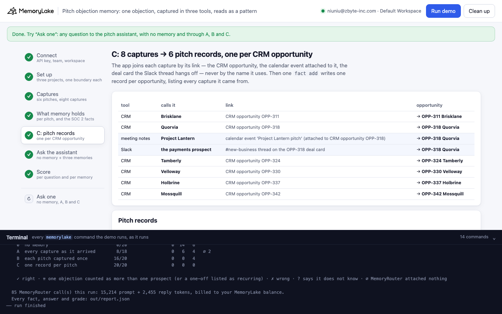
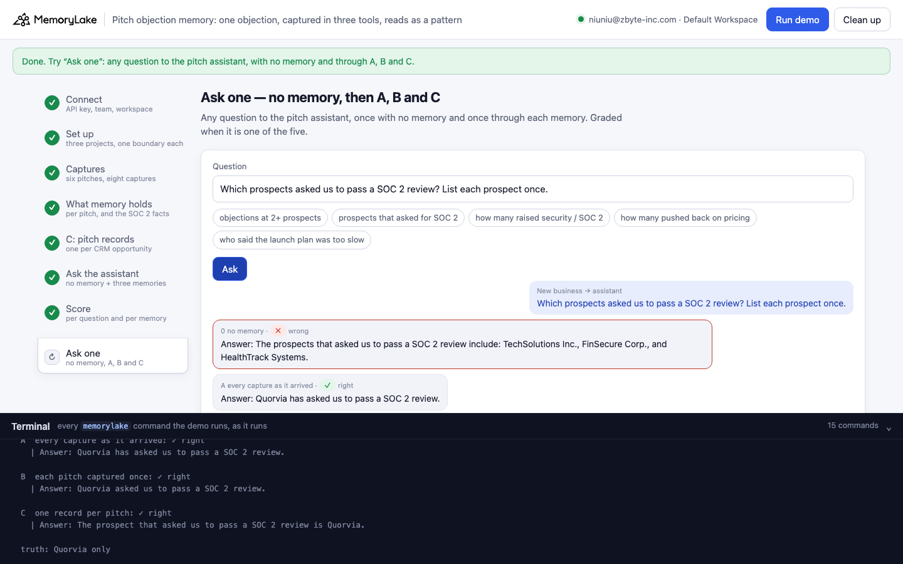

# Pitch objection memory: one objection, captured in three tools, reads as a pattern

A runnable version of the MemoryLake use case
[*New Business Pitch Memory for Agencies*](https://www.memorylake.ai/en/usecase/new-business-pitch-memory-for-agencies),
built entirely on the [`memorylake` CLI](https://github.com/memorylake-ai/memorylake-cli) (v20261015 or later).

**Watch it run:** recording in progress.

**The problem.** Pitch memory is supposed to tell a new business team which objections *keep coming up*. But agency
tools capture the same pitch more than once, and each tool names the prospect its own way:

```
CRM debrief (Jonah)       "Pitch debrief, Quorvia (payments platform). Their head of security said our analytics tooling
                           has to pass their SOC 2 vendor review before we can touch customer data."
meeting notes (Mei)       "Notes from the Project Lantern pitch. The client's security lead raised a data security concern:
                           any tool we use on their customer data must clear a SOC 2 vendor review first."
Slack recap (Rosa)        "Recap for the channel: the payments prospect is blocked on security. They will not move until
                           our tools pass a SOC 2 review."
what memory holds:        "Quorvia requires Fernhallow's analytics tooling to pass a SOC 2 vendor review …"
                          "Any tool used on the client's customer data must clear a SOC 2 vendor review first."
                          "The payments prospect is blocked on security."
asked later:              "How many different prospects raised a security or SOC 2 concern this year?"
the pitch assistant:      "Answer: This year, at least two different prospects have raised a security or SOC 2 concern,
                           specifically the payments prospect and Quorvia."
```

Each capture is extracted on its own, so one objection becomes three facts with three different subjects — and the
model counts subjects as prospects. A one-off objection turns into a "pattern".

**What this demo shows.** Fernhallow (a fictional agency) pitched six SaaS prospects this year. Three pushed back on
the pricing model; one — Quorvia — raised a security objection; one said the launch plan was too slow; one had no
objection. Quorvia's objection was captured three times. The pitch assistant answers through MemoryRouter from one of
three memories:

| | memory | what goes in |
|---|---|---|
| **A** | every capture as it arrived | the 8 captures (6 CRM debriefs + Quorvia's meeting notes and Slack recap), one message each, extracted by MemoryLake |
| **B** | each pitch captured once — **the control** | the 6 CRM debriefs only: the same pitches, the same text, without the two repeats |
| **C** | one record per pitch | the app resolves each capture to its CRM opportunity **by its link** (the calendar event attached to OPP-318, the Slack thread on the OPP-318 deal card), never by the name it uses, and writes one record per opportunity with `fact add` |
| **0** | no memory | the same questions without `--boundary`: what the model says on its own |

Five questions — which objections came up with two or more prospects, which prospects asked for a SOC 2 review, how
many raised a security concern, how many pushed back on pricing, who said the launch plan was too slow — four
answers each per memory, on `gpt-4o-mini` at temperature 0.7.

Over 9 runs (A and B differ **only** by the two repeat captures):

- **A counted the one objection as more than one prospect, or listed it as recurring, 67 times in 177 answers**
  (2×); **B never did** (0 of 171). On the three SOC 2 questions A was right 25/108 times, B 63/103.
- The 2× follows the facts: in the 8 runs where A's memory held the nickname facts, A answered 2× 67 times; in the
  one run where extraction dropped both repeats (browser run 1), 0.
- **C was right 171/177** — Q3 ("how many raised a security concern") 33/33, where B, with one fact, said it did not
  know 34 times out of 35. C still listed SOC 2 among the recurring objections 5 times in 36 (Q1), though its record
  says "one pitch, one prospect".
- Extraction also drops things: the pricing objection of a pitch, or a whole pitch, was missing from A in 15 of 54
  pitch-runs and from B in 13. That is why Q4 (three prospects pushed back on pricing) is A 13/36, B 8/36, C 36/36.

Details in [Measured](#measured).

## Prerequisites

- Python 3.9+ (standard library only)
- The `memorylake` CLI **v20261015 or later** (`memorylake router` arrived in that release):
  ```bash
  curl -fsSL https://raw.githubusercontent.com/memorylake-ai/memorylake-cli/main/scripts/install.sh | sh
  memorylake version
  ```
- A MemoryLake API key ([app.memorylake.ai](https://app.memorylake.ai) → API Keys).
- **Router calls are billed to your MemoryLake balance** (`memorylake billing balance`). One run makes 85 calls on
  `gpt-4o-mini`, about 16,000 prompt + 2,500 reply tokens; the run prints the total. If the balance is empty, the
  router calls print the refusal and are skipped; the memory steps still run.

## Run it

```bash
git clone https://github.com/memorylake-ai/memorylake-usecases.git
cd memorylake-usecases/pitch-objection-memory
export MEMORYLAKE_API_KEY=sk-...
python3 demo.py                     # the whole story, about 4 minutes
python3 demo.py memory              # re-read what A's and B's facts hold about each pitch
python3 demo.py ask 'Which prospects asked us to pass a SOC 2 review? List each prospect once.'
python3 demo.py cleanup             # delete everything the demo created
python3 demo.py selftest            # the grader's offline cases (no account needed)
```

The key is used to log into an isolated CLI profile under `.memorylake-demo/` (git-ignored); your own
`~/.memorylake` is never touched. For the China endpoint, also set
`MEMORYLAKE_BASE_URL=https://app.memorylake.cn/openapi/memorylake`. Every run starts over. Everything it creates is
prefixed `mlu-pom-`. `cleanup` keeps the run's `out/report.json`, moving it to `out/runs/`.

## Or run it in the browser

```bash
python3 web/server.py                # opens http://127.0.0.1:8765
```

Paste the API key and press **Run the demo**. Follow the steps on the left; the terminal drawer shows every
`memorylake` command as it runs. **Ask one** sends any question with no memory and through A, B and C, and grades it
if it is one of the five. **Clean up** removes everything.

| Step 3: the captures | Step 4: what memory holds |
|---|---|
|  |  |
| **Step 6: the assistant's answers** | **Step 7: the score** |
|  |  |
| **Step 5: C, one record per pitch** | **Ask one** |
|  |  |

## What happens, step by step

The output below is from one real run (the "second run" in [Measured](#measured)), trimmed; the step 6–7 marks are
from the final grader.

### Step 2: three projects, three people, one boundary each

```
$ memorylake proj create --name 'Fernhallow new business' --custom-id mlu-pom-captured --description 'Fernhallow new business pitches. Demo data.' --workspace ws-…
  · three projects with the same name: A gets every capture, B one capture per pitch, C the app's pitch records
$ memorylake actor create --custom-id mlu-pom-jonah --display-name 'Jonah Pike' --description 'new business lead, Fernhallow; writes in CRM. Demo data.' --tags demo
  · 3 people who capture pitches: Jonah Pike (CRM), Mei Arden (meeting notes), Rosa Quint (Slack)
$ memorylake boundary create --name 'Pitch assistant (every capture as it arrived)' --custom-id mlu-pom-captured --projects proj-… --workspace ws-…
  · one boundary per project — what the pitch assistant reads through MemoryRouter
```

The three projects share one plain name: a project's name is context for extraction, so it must not differ between
the memories. The arm is in the `custom_id` and the boundary name.

### Step 3: eight captures of six pitches

```
    pitch      tool           by          calls the prospect     date        objection
    Brisklane  CRM            Jonah Pike  Brisklane              2026-03-12  pricing
    Quorvia    CRM            Jonah Pike  Quorvia                2026-04-08  security
    Quorvia    meeting notes  Mei Arden   Project Lantern        2026-04-09  security   ← same pitch, again
    Quorvia    Slack          Rosa Quint  the payments prospect  2026-04-10  security   ← same pitch, again
    Tamberly   CRM            Jonah Pike  Tamberly               2026-05-20  pricing
    Velloway   CRM            Jonah Pike  Velloway               2026-06-17  timeline
    Holbrine   CRM            Jonah Pike  Holbrine               2026-08-05  pricing
    Mossquill  CRM            Jonah Pike  Mossquill              2026-09-09  none
$ memorylake conv create --project proj-… --actors actor-… --kind GROUP --name 'CRM: Brisklane' --custom-id mlu-pom-conv-captured-brisklane-crm --workspace ws-…
$ memorylake conv msg append conv-… --actor actor-… --custom-id mlu-pom-msg-captured-brisklane-crm --timestamp 2026-03-12T09:00:00Z --text 'Jonah Pike (new business lead, Fernhallow): Pitch debrief, Brisklane (HR software). Their CMO pushed back on our pricing model: they want a fixed project fee, not a monthly retainer. Outcome: lost.' --workspace ws-…
$ memorylake conv consumed-messages conv-… --message conv-entry-… --workspace ws-…
  · 14 conversations, 14 messages, all read in 86 s
```

Each capture is one message in its own GROUP conversation, written by the person who wrote it and stamped with the
day. A gets all eight, B the six CRM debriefs. A message is "read" when it appears in its extraction batch
(`conv consumed-messages --message`) and `conv cook-status` reports `cook_finished`.

### Step 4: what memory holds

```
$ memorylake fact list --projects proj-… --page-size 200 --workspace ws-…
    pitch      objection  A  every capture as it arrived   B  each pitch captured once
    Brisklane  pricing    kept (1 fact)                    kept (1 fact)
    Quorvia    security   kept (3 facts)                   kept (2 facts)
    Tamberly   pricing    kept (1 fact)                    kept (2 facts)
    Velloway   timeline   kept (1 fact)                    kept (1 fact)
    Holbrine   pricing    kept (3 facts)                   kept (3 facts)
    Mossquill  none       kept (2 facts)                   NOT IN MEMORY (0 facts)

    A: 3 fact(s) carry the SOC 2 objection; the prospect in them is called: Quorvia, no name, the payments prospect
      · [no name] Any tool used on the client's customer data must clear a SOC 2 vendor review first (as of 2026-04-09).
      · [the payments prospect] The payments prospect is blocked on security (as of 2026-04-10).
      · [Quorvia] Quorvia requires Fernhallow's analytics tooling to pass a SOC 2 vendor review before Fernhallow can
        access Quorvia customer data (as of 2026-04-08).

    B: 1 fact(s) carry the SOC 2 objection; the prospect in them is called: Quorvia
      · [Quorvia] The Quorvia head of security requires Fernhallow’s analytics tooling to pass Quorvia’s SOC 2 vendor
        review before Fernhallow can touch customer data (as of 2026-04-08).
```

Nothing in A's facts says that "the client", "the payments prospect" and Quorvia are one company. The census reads
the facts, not the answers: "kept" means a fact names the pitch and its objection.

### Step 5: C — one record per pitch

```
    The app resolves every capture to a CRM opportunity by its link, not by the name it uses:
      CRM           “Quorvia”               CRM opportunity OPP-318                                     → OPP-318 Quorvia
      meeting notes “Project Lantern”       calendar event 'Project Lantern pitch' (attached to CRM op  → OPP-318 Quorvia
      Slack         “the payments prospect” #new-business thread on the OPP-318 deal card               → OPP-318 Quorvia
      …
$ memorylake fact add 'Pitch record (CRM opportunity OPP-311): Brisklane, HR software, pitched 2026-03-12. Objection: pricing model - wants a fixed project fee, not a monthly retainer. Source: CRM. Outcome: lost.' … 4 more texts --project proj-… --workspace ws-…
  · C: 8 captures → 6 pitch records, one per opportunity (`fact add`, verbatim)
      · Pitch record (CRM opportunity OPP-318): Quorvia, payments platform, pitched 2026-04-08. Objection: security -
        our tools must pass their SOC 2 vendor review before touching customer data. Captured 3 times (CRM, meeting
        notes (Project Lantern), Slack (the payments prospect)): one pitch, one prospect. Outcome: pending.
```

### Step 6: ask the pitch assistant

```
  0  no memory
    prospects that asked for SOC 2         ✗ ✗ ✗ ✗      The prospects that requested a SOC 2 review are: Tech Innovations, Secur…
  A  every capture as it arrived
    objections at 2+ prospects             2× 2× 2× 2×  The objections that came up with two or more different prospects this ye…
    prospects that asked for SOC 2         2× ✓ ✓ ✓     The prospects that asked us to pass a SOC 2 review are Quorvia and the p…
    how many raised security / SOC 2       2× 2× 2× 2×  This year, at least two different prospects have raised a security or SO…
  B  each pitch captured once
    prospects that asked for SOC 2         ✓ ✓ ✓ ✓      Quorvia has requested that Fernhallow's analytics tooling pass their SOC…
    how many raised security / SOC 2       ? ? ? ?      I don't have the exact number of different prospects that raised a secur…
  C  one record per pitch
    how many raised security / SOC 2       ✓ ✓ ✓ ✓      Only one prospect, Quorvia, raised a security or SOC 2 concern this year.
```

`router chat --boundary <memory>`, system prompt "Answer from the team's pitch memory. Reply in one or two sentences,
starting with 'Answer:'". Each question also runs once without a boundary: a boundary call with exactly as many
prompt tokens had nothing attached (∅, not graded).

### Step 7: the score

```
                                                        0               A               B               C
      Q1 objections at 2+ prospects = pricing model onl 0/4 ✗✗✗✗        0/4 2×2×2×2×    3/4 ✗✓✓✓        2/4 ✗✓✓2×
      Q2 prospects that asked for SOC 2 = Quorvia only  0/4 ✗✗✗✗        3/4 2×✓✓✓       4/4 ✓✓✓✓        4/4 ✓✓✓✓
      Q3 how many raised security / SOC 2 = 1           0/4 ????        0/4 2×2×2×2×    0/4 ????        4/4 ✓✓✓✓
      Q4 how many pushed back on pricing = 3            0/4 ✗✗✗✗        4/4 ✓✓✓✓        4/4 ✓✓✓✓        4/4 ✓✓✓✓
      Q5 who said the launch plan was too slow = Vellow 0/4 ✗✗✗✗        4/4 ✓✓✓✓        4/4 ✓✓✓✓        4/4 ✓✓✓✓

                                          right  2× counted twice   ✗   ?
    0  no memory                          0/20                 0  16   4
    A  every capture as it arrived       11/20                 9   0   0
    B  each pitch captured once          15/20                 0   1   4
    C  one record per pitch              18/20                 1   1   0
```

**2×** = the answer counts a nickname as another prospect ("Quorvia and the payments prospect", "at least two"), or
lists the one-off SOC 2 objection among those that came up with two or more prospects. Naming only the nickname, or
listing the one-off *timeline* objection as recurring, is ✗ — wrong, but not double counting. With no memory, an
inflated number is invented, so it is ✗ too. The grader's rules and 29 offline cases are in `demo.py`
(`grade()`, `CASES`; `python3 demo.py selftest`).

## Measured

Per run, graded from the saved `out/report.json` with the current grader. Columns 2–3 are read from the saved facts.

| run | A: facts with the SOC 2 objection · what they call the prospect | objection in memory, A · B | 0 no memory | A every capture | B captured once | C one record per pitch |
|---|---|---|---|---|---|---|
| first run | 3 · Quorvia, no name, the payments prospect | 2/6 · 5/6 | 1/20 (✗ 15 · ? 4) | 0/20 (2× 12 · ✗ 7 · ? 1) | 10/20 (✗ 6 · ? 4) | 19/20 (2× 1) |
| PREFIX copy 1 | 3 · Quorvia, no name, the payments prospect | 6/6 · 4/6 | 0/20 (✗ 16 · ? 4) | 9/20 (2× 10 · ? 1) | 8/17 (✗ 5 · ? 4 · ∅ 3) | 20/20 |
| PREFIX copy 2 | 3 · Quorvia, no name, the payments prospect | 2/6 · 5/6 | 1/20 (✗ 16 · ? 3) | 0/20 (2× 12 · ✗ 5 · ? 3) | 10/20 (✗ 6 · ? 4) | 19/20 (2× 1) |
| PREFIX copy 3 | 3 · Quorvia, no name, the payments prospect | 6/6 · 5/6 | 0/20 (✗ 17 · ? 3) | 11/20 (2× 8 · ? 1) | 12/19 (✗ 4 · ? 3 · ∅ 1) | 18/18 (∅ 2) |
| PREFIX copy 4 | 3 · Quorvia, no name, the payments prospect | 5/6 · 4/6 | 1/20 (✗ 14 · ? 5) | 6/20 (2× 10 · ✗ 4) | 8/16 (✗ 5 · ? 3 · ∅ 4) | 19/19 (∅ 1) |
| PREFIX copy 5 | 2 · no name, the payments prospect | 5/6 · 4/6 | 0/20 (✗ 15 · ? 5) | 4/20 (2× 4 · ✗ 8 · ? 4) | 8/19 (✗ 6 · ? 5 · ∅ 1) | 20/20 |
| browser run 1 | 1 · Quorvia | 3/6 · 5/6 | 0/20 (✗ 14 · ? 6) | 8/18 (✗ 6 · ? 4 · ∅ 2) | 16/20 (? 4) | 20/20 |
| second run | 3 · Quorvia, no name, the payments prospect | 6/6 · 5/6 | 0/20 (✗ 16 · ? 4) | 11/20 (2× 9) | 15/20 (✗ 1 · ? 4) | 18/20 (2× 1 · ✗ 1) |
| PREFIX copy 6 | 2 · Quorvia, the payments prospect | 4/6 · 4/6 | 1/20 (✗ 14 · ? 5) | 9/19 (2× 2 · ✗ 6 · ? 2 · ∅ 1) | 12/20 (✗ 4 · ? 4) | 18/20 (2× 2) |
| **total (9 runs)** | alias facts in 8/9 runs | 39/54 · 41/54 | **4/180 (✗ 137 · ? 39)** | **58/177 (2× 67 · ✗ 36 · ? 16 · ∅ 3)** | **99/171 (✗ 37 · ? 35 · ∅ 9)** | **171/177 (2× 5 · ✗ 1 · ∅ 3)** |

Per question, all runs:

| question (truth) | 0  no memory | A  every capture as it arrived | B  each pitch captured once | C  one record per pitch |
|---|---|---|---|---|
| Q1 Which objections came up with two or more different prospects this year? List only those. (pricing model only) | 1/36 (✗ 35) | 12/36 (2× 24) | 27/32 (✗ 5 · ∅ 4) | 30/36 (2× 5 · ✗ 1) |
| Q2 Which prospects asked us to pass a SOC 2 review? List each prospect once. (Quorvia only) | 0/36 (✗ 36) | 11/36 (2× 21 · ✗ 4) | 36/36 | 36/36 |
| Q3 How many different prospects raised a security or SOC 2 concern this year? (1) | 0/36 (✗ 4 · ? 32) | 2/36 (2× 22 · ? 12) | 0/35 (✗ 1 · ? 34 · ∅ 1) | 33/33 (∅ 3) |
| Q4 How many different prospects pushed back on our pricing model this year? (3) | 3/36 (✗ 26 · ? 7) | 13/36 (✗ 20 · ? 3) | 8/36 (✗ 28) | 36/36 |
| Q5 Which prospect said our launch plan was too slow? (Velloway) | 0/36 (✗ 36) | 20/33 (✗ 12 · ? 1 · ∅ 3) | 28/32 (✗ 3 · ? 1 · ∅ 4) | 36/36 |

The PREFIX copies are the same demo run side by side under another prefix (`mlu-pom1-` … `mlu-pom6-`). The first run
was graded with an earlier grader and re-graded here.

## What else we measured

Probes before the demo (the same six pitches, 2026-10-18):

- **A yes/no question gets "Yes" anyway.** "Did more than one prospect ask us to pass a SOC 2 review?" was answered
  "Yes" with Quorvia captured three times (8/8), with Quorvia captured **once** (4/4: "Yes, Quorvia has requested
  …"), and with **no memory at all** (4/4: "multiple prospects have requested"). The demo asks list and count
  questions instead, and grades which prospects the answer names.
- **Naming the prospect the same way in all three captures is not enough.** With "Quorvia" in every capture, the
  count question came out right in 2 of 3 answers (probe 1), but "Which objections have come up with more than one
  SaaS prospect?" still listed SOC 2 in 3 of 3: three facts about one objection still read as three mentions. With
  the demo's sharper wording (probe 2) that copy said "I don't know" to the count question 4 times in 4.
- **Extraction sometimes resolves the nickname itself** ("The payments prospect (Quorvia) is blocked on security"),
  once in three probes. You cannot count on it.

## Use it in your own agent

- **Deduplicate on the way in, by a link, not by a name.** Every capture in an agency stack is attached to something
  with an id — the CRM opportunity, the calendar event, the deal card a Slack thread hangs off. Resolve the capture
  to it, and write **one record per pitch** that lists where it was captured (`fact add`). That took the SOC 2
  questions from 25/108 (A) to 99/105 (C).
- **Do not let the model count raw captures.** Even one clean fact per pitch (B) left "how many raised X" at "I don't
  know" 34 times in 35; one record per pitch with the objection in a fixed place answered it 33/33. For anything
  that matters, count in code with `fact list --query` and hand the model the number.
- **Ask lists, not yes/no.** "Did more than one prospect …?" gets "Yes" from the model on its own — with no memory at
  all. Ask "which prospects", and check the names.
- **Expect drops, too.** Extraction lost a pitch's objection in about a quarter of pitch-runs. Pinning the record
  yourself (C) is what made the pricing count (Q4) right every time.

## Troubleshooting

- **`this memorylake CLI has no router command`**: upgrade the CLI (install line above).
- **MemoryRouter refused the call for lack of balance**: top up in the console; `memorylake billing balance` shows it.
  Steps 2–5 do not need the Router.
- **`still extracting after 420 s`**: once in a while a message takes longer to read; the demo carries on with what
  memory holds. Run `python3 demo.py memory` a few minutes later to re-read the facts.
- **A looks right this time**: if extraction drops the two repeat captures, there is nothing to double-count (browser
  run 1 above). Step 4 shows how many SOC 2 facts A holds and what they call the prospect.
- **The question in `ask` contains a `$`**: quote it with single quotes, or the shell expands `$…` before the demo sees it.
- **`the demo memory does not exist yet`**: `memory` and `ask` need a full run first (and `cleanup` removes it).
- **A run was interrupted**: run again; it deletes what the previous run left and starts over.

## Files

| File | What it is |
|---|---|
| `demo.py` | The demo: CLI wrapper, setup, the captures (`captures()`, `ingest_one()`, `wait_read()`), the census (`census_copy()`, `subject_of()`), C's join and records (`resolve()`, `record_text()`), Router questions, the grader (`grade()`, `CASES`, `selftest`), `memory`, `ask`, cleanup (facts before the actors) |
| `data/pitches.json` | The six pitches (opportunity, vertical, objection, outcome), the eight captures (tool, author, the name it uses, its link, text), the questions, the system prompt |
| `web/server.py`, `web/static/` | Browser companion (standard library server, no build step) |
| `out/` | `report.json` with every fact, the app's join, every answer and grade; `out/runs/` keeps earlier runs' reports (git-ignored) |
