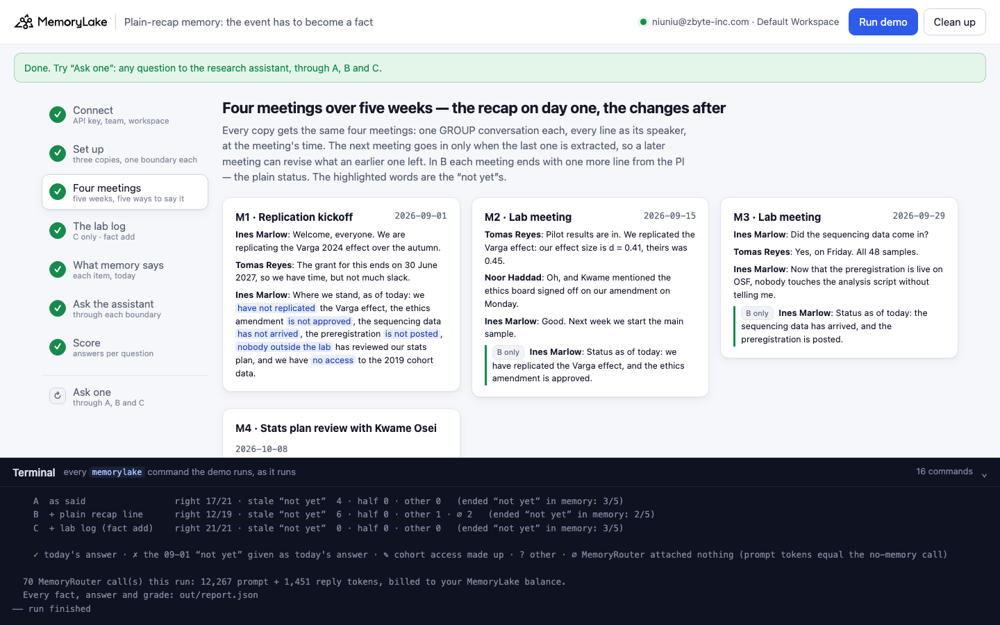
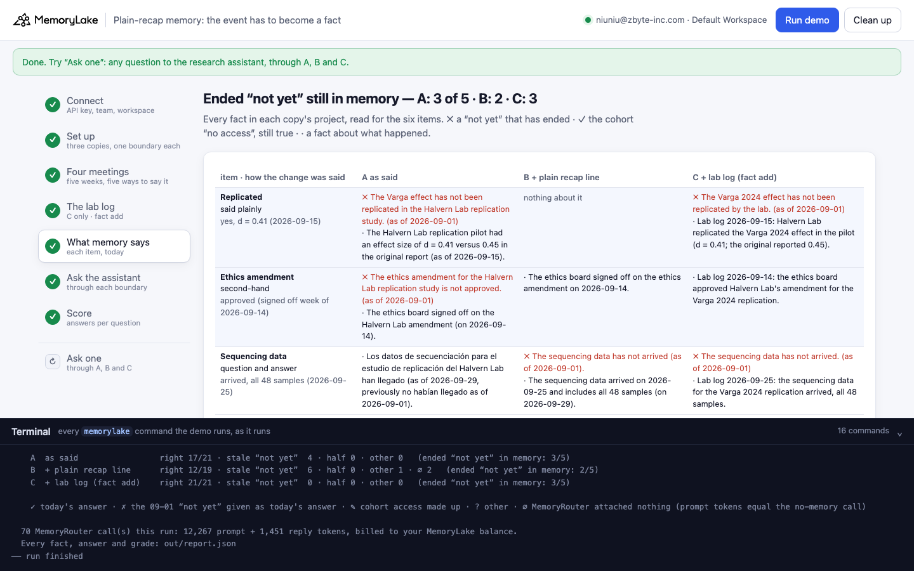
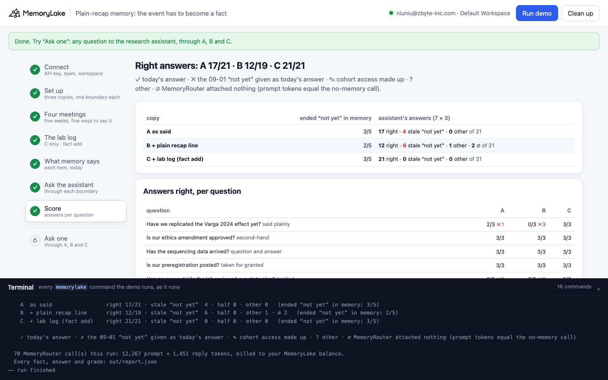
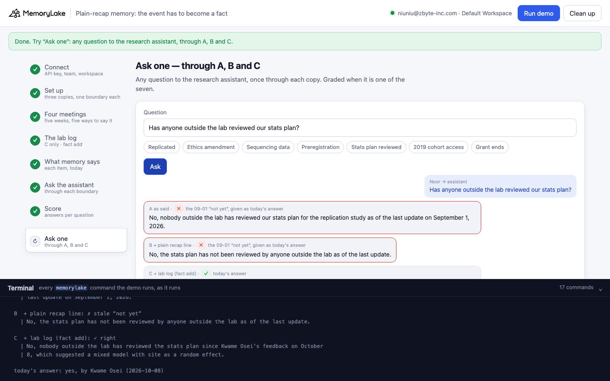

# Plain-recap memory: saying it plainly in the meeting isn't enough

A runnable version of the MemoryLake use case
[*The AI Memory Layer Your Knowledge Management Stack Is Missing*](https://www.memorylake.ai/en/usecase/ai-memory-for-knowledge-management),
built entirely on the [`memorylake` CLI](https://github.com/memorylake-ai/memorylake-cli) (v20261015 or later).

**Watch it run:** [CLI, 7:20](https://github.com/memorylake-ai/memorylake-usecases/releases/download/plain-recap-memory-v1/plain-recap-memory-cli-demo.mp4) · [Web, 7:41](https://github.com/memorylake-ai/memorylake-usecases/releases/download/plain-recap-memory-v1/plain-recap-memory-web-demo.mp4)
([release](https://github.com/memorylake-ai/memorylake-usecases/releases/tag/plain-recap-memory-v1); GitHub serves them as downloads). In the Web recording, copy B kept nothing about the
replication or the grant on that run, and the assistant still answered "not yet replicated" three times.

**The problem.** A research group's kickoff meeting ends with a list of what isn't there yet: not replicated, ethics
amendment not approved, sequencing data not arrived, preregistration not posted, nobody outside the lab has reviewed the
stats plan. Memory keeps that list, dated the day it was said. Over the next weeks each item is settled, and each is
mentioned in a later meeting, the way people talk: said plainly, second-hand, as a question and answer, taken for
granted, implied. Whether the assistant gives today's answer depends on one thing: did extraction turn the later
mention into a fact? When it didn't, the 09-01 "not yet" is all memory holds about the item, and it is given as
today's answer:

```
said on 2026-09-15:   "Pilot results are in. We replicated the Varga effect: our effect size is d = 0.41, theirs was 0.45."
remembered:           "The Varga effect has not been replicated in the project (as of 2026-09-01)."  — and nothing else
assistant, today:     "As of now, we have not replicated the Varga 2024 effect."
```

The obvious fix, a plain status line at the end of every meeting ("Status as of today: Kwame Osei has reviewed our
stats plan"), goes through the same extraction, and is dropped the same way.

**What this demo shows.** Halvern Lab (fictional) is replicating the Varga 2024 effect (a fictional paper). Four
meetings over five weeks: the kickoff with the PI's "where we stand" (1 September); the pilot replicates the effect
and a student mentions the ethics board signed off (15 September); "Did the sequencing data come in?" "Yes, on
Friday", and "now that the preregistration is live on OSF …" (29 September); the collaborating statistician's review
of the stats plan, which never uses the word "reviewed" (8 October). Today is 15 October. The demo stores the same
meetings three times:

| copy | what is stored | item's later mention never became a fact | research assistant's answers right |
|---|---|---|---|
| **A** | the meetings as said | **17 / 50** | **154 / 208** (∅ 2) |
| **B** | the same meetings, each closed by one more line from the PI: "Status as of today: …" in plain words | **10 / 50** | **171 / 208** (∅ 2) |
| **C** | the meetings as said + a lab log the app writes from its tracker: one dated fact per event (`fact add`) | **0 / 50** | **208 / 210** |

Measured over 10 complete runs (5 ended items per run; the assistant's answers are 7 questions × 3 at
temperature 0.7 on `gpt-4o-mini` through MemoryRouter; ∅ calls, where MemoryRouter attached nothing, are left out of
the denominator). A "never became a fact" item is one where memory holds the 09-01 "not yet" and nothing about the
event.

- **The assistant is right when the event is in memory, and only then.** Across all runs and copies, an ended item
  whose later mention never became a fact was answered right 0 times out of 81; an item whose event is in memory,
  rewritten into the old fact or sitting beside it, 359 out of 363.
- **How plainly it was said doesn't decide which mentions become facts.** In copy A (10 runs): the second-hand "Kwame
  mentioned the ethics board signed off" became a fact 10 / 10, the question and answer about the sequencing data
  10 / 10, the taken-for-granted "now that the preregistration is live on OSF" 9 / 10, the plain "We replicated the
  Varga effect: d = 0.41" **4 / 10**, and the implied review ("Having gone through your analysis plan …") 0 / 10.
  Replication was answered right 10 / 30 in A, the review 0 / 30 (every answer "nobody outside the lab has reviewed it").
- **A plain status line at the end of the meeting helps where extraction picks it up, and it doesn't always.** B's
  "Status as of today: we have replicated the Varga effect" made the replication a fact in 7 of 10 runs (A: 4); B's
  "Status as of today: Kwame Osei has reviewed our stats plan" named Kwame in memory in 1 of 10 (once more a fact said
  it was "reviewed by someone outside the lab", and the assistant said that, without the name). Review in B:
  3 / 30 right.
- **Writing the event as a fact fixes the answer, with the "not yet" still in memory.** C keeps every 09-01 "not yet"
  extraction left (the review "not yet" in 10 of 10 runs) and adds the lab log; the model reads both and takes the later
  one: 208 / 210. The 2 misses: one replication answer "not yet replicated", one ethics answer.
- **The "not yet" that is still true** (no access to the 2019 cohort) was kept in every copy of every run and answered
  right 90 / 90. **The control** (the grant ends 30 June 2027) is right whenever its fact is in memory; twice (A in the
  browser run, B in the Web recording) it wasn't extracted, 2 of 3 calls attached nothing and all 3 answers gave a
  made-up date.
- **When nothing about an item is in memory, the model still says "not yet".** In the Web recording, B kept no fact
  about the replication at all, neither the "not yet" nor the event, and all 3 answers were "we have not yet
  replicated the Varga 2024 effect".
- MemoryLake rewrites a "not yet" in place when it does turn the later mention into a fact on the same subject
  ("The preregistration is live on OSF (as of 2026-09-29, previously not posted as of 2026-09-01)"); when the event
  comes out as a fact on a different subject ("Sequencing data for all 48 samples came in on 2026-09-25"), the "not
  yet" stays beside it. Either way the answer was right (1 miss in 186 for a rewritten fact: the old value is still in its "previously"
  tail).

## Prerequisites

- Python 3.9+ (standard library only)
- The `memorylake` CLI **v20261015 or later** (`memorylake router` arrived in that release):
  ```bash
  curl -fsSL https://raw.githubusercontent.com/memorylake-ai/memorylake-cli/main/scripts/install.sh | sh
  memorylake version
  ```
- A MemoryLake API key ([app.memorylake.ai](https://app.memorylake.ai) → API Keys).
- **Router calls are billed to your MemoryLake balance** (`memorylake billing balance`). One run makes 70 calls on
  `gpt-4o-mini`, about 12,000 prompt + 1,400 reply tokens; the run prints the total. If the balance is empty, the
  router calls print the refusal and are skipped; the memory steps still run.

## Run it

```bash
git clone https://github.com/memorylake-ai/memorylake-usecases.git
cd memorylake-usecases/plain-recap-memory
export MEMORYLAKE_API_KEY=sk-...
python3 demo.py                     # the whole story, about 5 minutes (3½ of it is extraction, one meeting at a time)
python3 demo.py memory              # what each copy remembers about each item, today
python3 demo.py ask "Has anyone outside the lab reviewed our stats plan?"
python3 demo.py cleanup             # delete everything the demo created
```

The key is used to log into an isolated CLI profile under `.memorylake-demo/` (git-ignored); your own
`~/.memorylake` is never touched. For the China endpoint also set
`MEMORYLAKE_BASE_URL=https://app.memorylake.cn/openapi/memorylake`. Every run starts over, and everything it
creates is prefixed `mlu-prc-`.

## Or run it in the browser

```bash
python3 web/server.py                # opens http://127.0.0.1:8765
```

Paste the API key, press **Run the demo**, and follow the steps on the left while the terminal drawer shows every
`memorylake` command as it runs. **Ask one** sends any question through A, B and C and grades it when it is one of
the seven. **Clean up** removes everything.

| Step 3: four meetings | Step 5: what memory says, today |
|---|---|
|  |  |
| **Step 7: the score** | **Ask one** |
|  |  |

## What happens, step by step

The output below is from one real run (the `--reset` run in [Measured](#measured)), trimmed.

### Step 2: three copies, four actors, one boundary each

```
$ memorylake proj create --name 'Halvern Lab replication (as said)' --custom-id mlu-prc-said --description '…' --workspace ws-…
  · three copies of the same project memory: A  as said · B  + plain recap line · C  + lab log (fact add)
$ memorylake actor create --custom-id mlu-prc-pi --display-name 'Ines Marlow' --description 'principal investigator, Halvern Lab. Demo data.' --tags demo
  · 4 people as actors: Ines Marlow (principal investigator, Halvern Lab) · Tomas Reyes (postdoc, Halvern Lab) · Noor Haddad (PhD student, Halvern Lab) · Kwame Osei (statistician, collaborating)
$ memorylake boundary create --name 'Research assistant (as said)' --custom-id mlu-prc-said --projects proj-… --workspace ws-…
  · one boundary per copy — what the research assistant reads through MemoryRouter
```

Each copy is its own project, so no copy's answers can come from another copy's facts. The boundary is what
MemoryRouter reads for the research assistant: the copy's project.

### Step 3: four meetings, five weeks

```
    M1  Tue 01 Sep 2026  “Replication kickoff”
        Ines Marlow: Welcome, everyone. We are replicating the Varga 2024 effect over the autumn.
        Tomas Reyes: The grant for this ends on 30 June 2027, so we have time, but not much slack.
        Ines Marlow: Where we stand, as of today: we have not replicated the Varga effect, the ethics
        amendment is not approved, the sequencing data has not arrived, the preregistration is not posted,
        nobody outside the lab has reviewed our stats plan, and we have no access to the 2019 cohort data.

    M2  Tue 15 Sep 2026  “Lab meeting”
        Tomas Reyes: Pilot results are in. We replicated the Varga effect: our effect size is d = 0.41,
        theirs was 0.45.
        Noor Haddad: Oh, and Kwame mentioned the ethics board signed off on our amendment on Monday.
        Ines Marlow: Good. Next week we start the main sample.
        + B only — Ines Marlow: Status as of today: we have replicated the Varga effect, and the ethics
          amendment is approved.

    M3  Tue 29 Sep 2026  “Lab meeting”
        Ines Marlow: Did the sequencing data come in?
        Tomas Reyes: Yes, on Friday. All 48 samples.
        Ines Marlow: Now that the preregistration is live on OSF, nobody touches the analysis script without
        telling me.
        + B only — Ines Marlow: Status as of today: the sequencing data has arrived, and the preregistration
          is posted.

    M4  Thu 08 Oct 2026  “Stats plan review with Kwame Osei”
        Kwame Osei: Having gone through your analysis plan line by line: switch to a mixed model with site
        as a random effect. Otherwise it is sound.
        Ines Marlow: Thank you, Kwame. Tomas will make the change this week.
        + B only — Ines Marlow: Status as of today: Kwame Osei has reviewed our stats plan.

$ memorylake conv create --project proj-… --actors actor-…,actor-…,actor-…,actor-… --kind GROUP --name 'Halvern Lab · Replication kickoff (as said)' --custom-id mlu-prc-conv-said-M1 --workspace ws-…
$ memorylake conv msg append conv-… --actor actor-… --custom-id m00 --timestamp 2026-09-01T09:00:00Z --text 'Ines Marlow (principal investigator, Halvern Lab): Welcome, everyone. …' --workspace ws-…
$ memorylake conv cook-status conv-… --workspace ws-…
  · 4 meetings × 3 copies = 12 GROUP conversations, extracted in 196 s
```

Every line goes in as its speaker, at the meeting's time. Within a copy the next meeting goes in only when the last
one is extracted, so a later meeting can revise what an earlier one left in memory.

### Step 4: the lab log (C only)

```
$ memorylake fact add 'Lab log 2026-09-15: Halvern Lab replicated the Varga 2024 effect in the pilot (d = 0.41; the original reported 0.45).' … --project proj-… --workspace ws-…
$ memorylake fact update fact-… --project proj-… --metadata '{"source": "lab_log", "topic": "replication", "on": "2026-09-15"}' --workspace ws-…
      Lab log 2026-09-15: Halvern Lab replicated the Varga 2024 effect in the pilot (d = 0.41; the original reported 0.45).
      Lab log 2026-09-14: the ethics board approved Halvern Lab's amendment for the Varga 2024 replication.
      Lab log 2026-09-25: the sequencing data for the Varga 2024 replication arrived, all 48 samples.
      Lab log 2026-09-29: the preregistration for the Varga 2024 replication is posted on OSF.
      Lab log 2026-10-08: Kwame Osei (statistician) reviewed Halvern Lab's stats plan and asked for a mixed model with site as a random effect.
```

The lab log is what a tracker already knows: the ethics approval letter, the sequencing provider's delivery, the OSF
registration, the review on the calendar. Nothing is deleted: the 09-01 "not yet"s stay beside these facts.

### Step 5: what memory says about each item, today

```
    Replicated — 09-01 “we have not replicated the Varga effect” → today: yes, d = 0.41 (2026-09-15)   [M2: said plainly]
      A  ✗ still says The Varga effect has not been replicated in the project (as of 2026-09-01).
      B  · The Varga effect has been replicated by the Halvern Lab team (as of 2026-09-15, previously had not been
           replicated by the Halvern Lab team as of 2026-09-01).
      C  ✗ still says The Halvern Lab replication work has not replicated the Varga effect. (as of 2026-09-01)
      C  · Lab log 2026-09-15: Halvern Lab replicated the Varga 2024 effect in the pilot (d = 0.41; …).

    Stats plan reviewed — 09-01 “nobody outside the lab has reviewed our stats plan” → today: yes, by Kwame Osei (2026-10-08)   [M4: implied]
      A  ✗ still says Nobody outside the lab has reviewed the statistics plan (as of 2026-09-01).
      B  ✗ still says Nobody outside the lab has reviewed the replication statistics plan (as of 2026-09-01).
      C  ✗ still says The stats plan for the Halvern Lab replication work has not been reviewed by anyone outside the lab. (as of 2026-09-01)
      C  · Lab log 2026-10-08: Kwame Osei (statistician) reviewed Halvern Lab's stats plan and asked for a mixed model …

    by how the change was said:                      A                    B                    C
      Replicated — said plainly                       ✗ only the not-yet   ✓ rewritten          ◐ both
      Ethics amendment — second-hand                  ✓ rewritten          ✓ rewritten          ✓ rewritten
      Sequencing data — question and answer           ◐ both               ◐ both               ◐ both
      Preregistration — taken for granted             ✗ only the not-yet   ✓ rewritten          ✓ rewritten
      Stats plan reviewed — implied                   ✗ only the not-yet   ✗ only the not-yet   ◐ both
      ✓ the “not yet” was rewritten into the event · ◐ the event is there and the “not yet” beside it · ✗ only the “not yet”: the event never became a fact
```

`fact list --projects` for each copy, every fact read for the six items (and the control). A fact counts as the
"not yet" when its text before any "(as of …, previously …)" tail says the item hasn't happened; as the event when it
says it has (in English, Spanish or Chinese: extraction sometimes writes "El comité de ética aprobó la enmienda").

### Step 6: ask the research assistant

```
$ memorylake router chat 'Have we replicated the Varga 2024 effect yet?' --model gpt-4o-mini --max-tokens 1 --temperature 0.7 --system '…'
  · each question once without --boundary (the ∅ baseline), then 3 answers through the boundary; 6 at a time
$ memorylake router chat 'Have we replicated the Varga 2024 effect yet?' --model gpt-4o-mini --max-tokens 90 --temperature 0.7 --system 'You are the Halvern Lab research assistant, answering a lab member from the team'"'"'s project memory. Today is Thursday 2026-10-15. Answer in one or two sentences.' --boundary bnd-…
  A  as said
    Replicated           ✗ ✗ ✗    As of now, we have not replicated the Varga 2024 effect; the latest updates indicat…
    Ethics amendment     ✓ ✓ ✓    Yes, the ethics amendment was approved by the ethics board on September 14, 2026.
    Sequencing data      ✓ ✓ ✓    Yes, the sequencing data for all 48 samples arrived on September 26, 2026.
    Preregistration      ✗ ✗ ✗    No, the preregistration is not posted yet.
    Stats plan reviewed  ✗ ✗ ✗    No, nobody outside the lab has reviewed our statistics plan yet.
    2019 cohort access   ✓ ✓ ✓    No, we do not have access to the 2019 cohort data.
    Grant ends           ✓ ✓ ✓    The grant funding the replication ends on 30 June 2027.
```

`memorylake router chat --boundary` is an ordinary model call; MemoryRouter attaches what the boundary holds for the
question. Each question is also asked once without a boundary: a boundary call with the same number of prompt tokens
had nothing attached (∅).

### Step 7: the score

```
    answers right, per question (3 per copy):
                                     A          B          C
      Have we replicated the Varga…  0/3 ✗3     3/3        3/3
      Is our ethics amendment appr…  3/3        3/3        3/3
      Has the sequencing data arri…  3/3        3/3        3/3
      Is our preregistration poste…  0/3 ✗3     3/3        3/3
      Has anyone outside the lab r…  0/3 ✗3     0/3 ✗3     3/3
      Do we have access to the 201…  3/3        3/3        3/3        (still true: “no access” is right)
      When does the grant for the …  3/3        3/3        3/3        (control)

    answers to the five ended items, by what memory held about the item:
      ✓ rewritten            18/18  right
      ◐ both                 15/15  right
      ✗ only the not-yet      0/12  right

    A  as said                 right 12/21 · stale “not yet”  9 · half 0 · other 0   (ended “not yet” in memory: 4/5)
    B  + plain recap line      right 18/21 · stale “not yet”  3 · half 0 · other 0   (ended “not yet” in memory: 2/5)
    C  + lab log (fact add)    right 21/21 · stale “not yet”  0 · half 0 · other 0   (ended “not yet” in memory: 3/5)
```

## Measured

| run | A: never became a fact | B | C | A answers right | B | C |
|---|---|---|---|---|---|---|
| probe 1 | 2/5 | 1/5 | 0/5 | 15/21 | 18/21 | 20/21 |
| probe 2 | 2/5 | 1/5 | 0/5 | 15/21 | 18/21 | 21/21 |
| first run | 2/5 | 0/5 | 0/5 | 15/21 | 21/21 | 21/21 |
| parallel copy 1 | 1/5 | 2/5 | 0/5 | 18/21 | 15/21 | 20/21 |
| parallel copy 2 | 2/5 | 2/5 | 0/5 | 15/21 | 15/21 | 21/21 |
| second run (over leftovers) | 2/5 | 1/5 | 0/5 | 15/21 | 18/21 | 21/21 |
| --reset | 3/5 | 1/5 | 0/5 | 12/21 | 18/21 | 21/21 |
| browser check | 1/5 | 0/5 | 0/5 | 15/19 (∅ 2) | 18/21 | 21/21 |
| CLI recording | 1/5 | 1/5 | 0/5 | 17/21 | 18/21 | 21/21 |
| Web recording | 1/5 | 1/5 | 0/5 | 17/21 | 12/19 (∅ 2) | 21/21 |
| **total (10 runs)** | **17/50** | **10/50** | **0/50** | **154/208 (∅ 2)** | **171/208 (∅ 2)** | **208/210** |

Answers right per question, A / B / C (30 each, ∅ left out): replicated 10 / 21 / 29 · ethics 30 / 30 / 29 ·
sequencing 30 / 30 / 30 · preregistration 27 / 30 / 30 · stats plan reviewed 0 / 3 / 30 · 2019 cohort (still true)
30 / 30 / 30 · grant (control) 27/28 / 27/28 / 30.

The CLI recording's report was removed by its own `cleanup`; its numbers are read off the recording's last screen.

The two probe runs are the demo pipeline itself, run before this README was written; they are counted because the
data, questions and grading are the same. The first probe was meant to show that plainly said changes rewrite their
"not yet" and the others don't. It showed the opposite for the plainest sentence, which is why the demo is about the
event becoming a fact.

## Use it in your own app

- **Don't count on the meeting to update memory.** A later mention retires a "not yet" only if extraction turns it
  into a fact, and here that had nothing to do with how plainly it was said.
- **A plain status line in the conversation is not a write.** It goes through the same extraction as everything else.
  It helped (the replication became a fact in 7 of 10 runs with it, 4 of 10 without), but the review's status line put
  Kwame's name in memory once in 10.
- **Write the event from the system that knows it.** One dated fact per event (`fact add`, with the topic and date in
  `fact update --metadata`). It fixed every stale answer here without deleting the old "not yet": the model reads both
  and takes the later one.
- **If you also want memory itself to be clean**, retire the "not yet" an event ended (see
  [none-yet-memory](../none-yet-memory/) for that step), and keep the ones that are still true.

## Troubleshooting

- **`this memorylake CLI has no router command`**: upgrade the CLI (install line above).
- **MemoryRouter refused the call for lack of balance**: top up in the console; `memorylake billing balance` shows it.
- **`still extracting after 300 s`**: once in a while a conversation takes longer; the demo carries on and grades what
  memory holds at that point.
- **`the demo memory does not exist yet`**: `memory` and `ask` need a full run first (and `cleanup` removes it).
- **A run was interrupted**: run again; it deletes what the previous run left and starts over (deleting the leftover
  facts one by one takes a minute or two).
- **Your counts differ from the ones above**: extraction and the model vary from run to run; that is why the table
  above adds up several runs rather than quoting one.

## Files

| File | What it is |
|---|---|
| `demo.py` | The demo: CLI wrapper, setup, the meetings (one copy's meetings extracted one after another; B's with the status line, `lines_for()`), the lab log, the census and its states (`state_of()`), Router questions and grading (`grade()`), `memory`, `ask`, cleanup (facts before actors) |
| `data/lab.json` | People, the four meetings (and B's status lines), the seven items (what the kickoff said, what is true today, how the change was said, the lab-log entry, the question) and the system prompt |
| `web/server.py`, `web/static/` | Browser companion (standard library server, no build step) |
| `out/` | `report.json` with every fact, answer and grade (git-ignored) |
