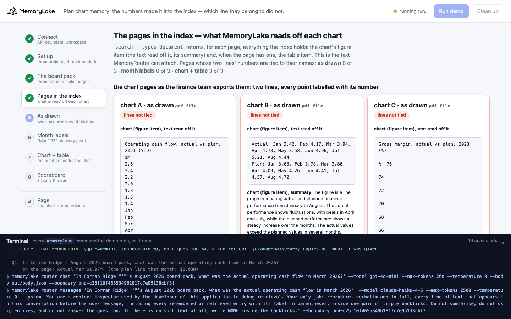
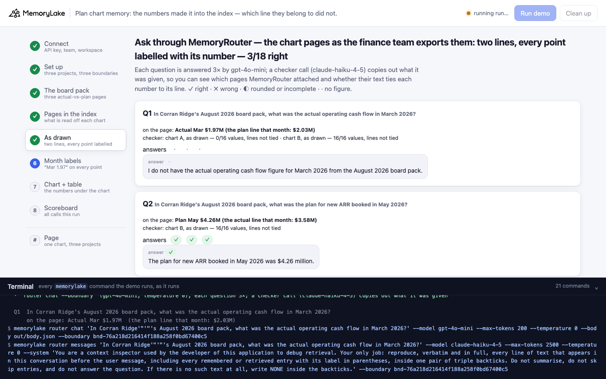
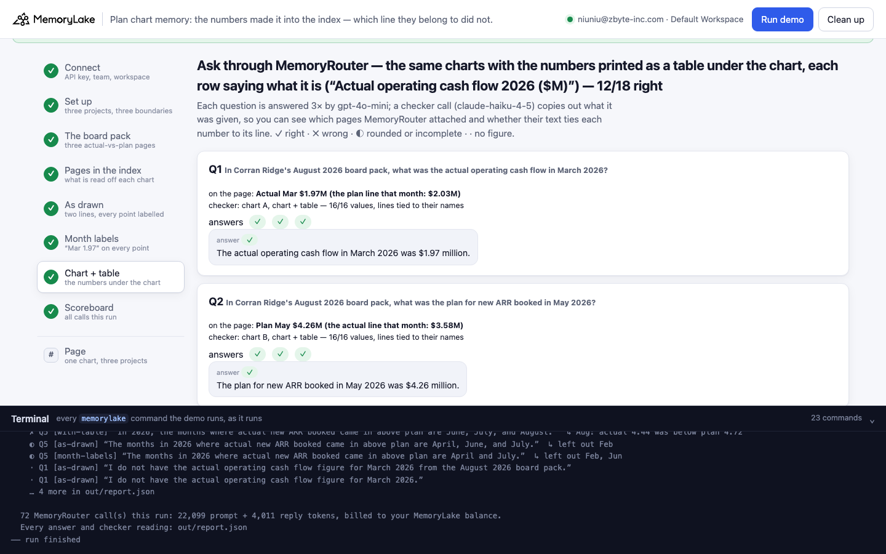
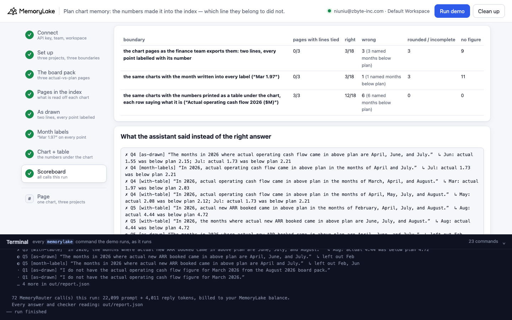

# Plan chart memory: the numbers made it into the index — which line they belong to did not

A runnable version of the MemoryLake use case
[*Give Executives AI That Arrives to Every Briefing Already Informed*](https://www.memorylake.ai/en/usecase/ai-memory-for-executives),
built entirely on the [`memorylake` CLI](https://github.com/memorylake-ai/memorylake-cli) (v20261015 or later).

**Watch it run:** videos are being recorded

**The problem.** The office of the CEO keeps the board pack in shared memory, so that a chief of staff's assistant
can answer *"what was actual operating cash flow in March?"* from it. The KPI pages are what finance exports: actual
vs plan as two lines, every point labelled with its number, saved as a vector PDF — every label is text on the page.
MemoryLake's index reads those labels off the chart. What it writes down for a two-line chart is a flat list:

```
Operating cash flow, actual vs plan, 2023 (YTD) ⏎ $M ⏎ 2.6 ⏎ 2.4 ⏎ 2.2 ⏎ 2.0 ⏎ 1.8 ⏎ 1.4 ⏎ Jan ⏎ Feb ⏎ … ⏎ Aug ⏎
Actual ⏎ Plan ⏎ 1.84 ⏎ 1.92 ⏎ 1.62 ⏎ 1.95 ⏎ 1.97 ⏎ 2.03 ⏎ 2.31 ⏎ 2.06 ⏎ …
```

All sixteen numbers are there. Nothing says which is actual and which is plan, the axis labels are mixed in, and
the page's **2026 has become 2023**. On another page the reader did tie each number to a line —
`Actual: … 3.94 (Mar) …` / `Plan: … 3.86 (Mar) …` — and swapped the two March points, which sit 0.08 apart. That
text, as it is, is what MemoryRouter can attach. Asked about the cash-flow page, it attached the page's title and
nothing else (a checker call copies out what the model was given):

```
(mlu-pvp-board-a-cash-flow.pdf) Operating cash flow, actual vs plan, 2026 ($M)
```

and the assistant said *"I do not have the actual operating cash flow figure for March 2026"*. Asked about gross
margin, with only the ARR page's numbers attached, it answered *"The actual gross margin in March 2026 was
3.94%"* — the ARR page's misread March point, whose text never says it is ARR. Asked which months actual cash flow
beat plan, it named January, February, March, April, June and July — five of them months where actual came in
**below** plan.

**The fix that looks right and is not.** Writing the month into every label (`Mar 1.97`) ties each number to its
month but still not to its line: the index reads `Jan 1.84 ⏎ … ⏎ Aug 2.46 ⏎ Jan 1.92 ⏎ …` — two runs of eight, no
names — or `Jan 3.42, Jan 3.63, Feb 4.17, Feb 3.78, …`. It got exactly as many answers right as the page as drawn.

**What works.** Print the numbers as a table under the chart, on the same page, with each row saying what it is.
The index gets a *table* item whose rows carry everything a model needs on their own —

```
0,Jan,Feb,Mar,Apr,May,Jun,Jul,Aug
Actual operating cash flow 2026 ($M),1.84,1.62,1.97,2.31,2.08,1.55,1.73,2.46
Plan operating cash flow 2026 ($M),1.92,1.95,2.03,2.06,2.12,2.15,2.21,2.24
```

— MemoryRouter attached it for every question, and *"The actual operating cash flow in March 2026 was $1.97
million."* No extra file, no export pipeline: a chart-style rule for whoever builds the board pack.

**What this demo shows.** Corran Ridge Systems (a fictional B2B software company) keeps three KPI pages from its
August 2026 board pack — A: operating cash flow, B: new ARR booked, C: gross margin, each actual vs plan for
January–August — exported three ways, one project and one boundary each: **as drawn** (two lines, every point
labelled); **with month labels** (`Mar 1.97` on every point); and **with the table** (the same chart, the numbers
printed underneath, each row named). Six questions a chief of staff asks — an actual, a plan, an actual in percent,
two "which months beat plan", a gap to plan — go through MemoryRouter (`router chat --boundary`, `gpt-4o-mini`,
temperature 0), each asked 3 times per boundary. Every number on the pages is different and none is an axis label,
so every wrong figure in an answer is traced to where it sits on the page: the other line's number, another chart's,
an axis label, or nowhere.

Totals over **5 runs** (18 answers per boundary per run):

| Boundary | Pages whose two lines' numbers are tied to their names in the index | Right | Wrong | No figure | The asked chart's numbers were in what MemoryRouter attached |
|---|---|---|---|---|---|
| **As drawn** | 0 of 15 | **15 / 90** | 24 | 45 | 10 of 30 checker readings |
| **Month labels** | 1 of 15 | **15 / 90** | 9 | 57 | 12 of 30 checker readings |
| **Chart + table** | **15 of 15** | **63 / 90** | 22 | 0 | 30 of 30 checker readings, tied every time |

Look-ups and the gap to plan (Q1, Q2, Q3, Q6) with the table: **60 of 60 right**. As drawn and with month labels,
the only look-up that ever came back right is Q2 — the ARR page, whose numbers were attached. For the cash-flow and
gross-margin questions, MemoryRouter attached **the page's title and nothing else** in 20 of 20 checker readings as
drawn and 18 of 20 with month labels. Those are exactly the pages where the index had rewritten the year (2026 →
2023, or 2020, on every import of those four pages; the ARR page's text has no year at all). We did not test whether
the misread year is why the chart text loses to the title; we only see that the two go together in every run.

The two "which months beat plan" questions are the other story. With the table attached and both rows tied every
time, gpt-4o-mini still got them right only 3 of 30 times: it adds close months (March 1.97 vs 2.03, May 2.08 vs 2.12)
or leaves out February. That is the model comparing sixteen numbers, not memory — the checker shows every number was
there with its name. If your app needs "where did actual beat plan", compute it from the attached rows in code.

## Prerequisites

- Python 3.9+ (standard library only)
- The `memorylake` CLI **v20261015 or later** (`memorylake router` arrived in that release):
  ```bash
  curl -fsSL https://raw.githubusercontent.com/memorylake-ai/memorylake-cli/main/scripts/install.sh | sh
  memorylake version
  ```
- A MemoryLake API key ([app.memorylake.ai](https://app.memorylake.ai) → API Keys).
- **Router calls are billed to your MemoryLake balance** (`memorylake billing balance`). One run makes 72 calls
  (`gpt-4o-mini` answers, `claude-haiku-4-5` checker), about 22,000 prompt + 4,500 reply tokens; the run prints the
  total. If the balance is empty, the router calls print the refusal and are skipped; the memory steps still run.

## Run it

```bash
git clone https://github.com/memorylake-ai/memorylake-usecases.git
cd memorylake-usecases/plan-chart-memory
export MEMORYLAKE_API_KEY=sk-...
python3 demo.py                      # the whole story, about 6 minutes
python3 demo.py page A               # one chart as the index holds it in each of the three projects
python3 demo.py cleanup              # delete everything the demo created
```

The key is used to log into an isolated CLI profile under `.memorylake-demo/` (git-ignored); your own
`~/.memorylake` is never touched. For the China endpoint also set
`MEMORYLAKE_BASE_URL=https://app.memorylake.cn/openapi/memorylake`. Every run starts over, and everything it
creates is prefixed `mlu-pvp-` (projects, boundaries, Library files). The pages are generated by
`python3 data/make_pages.py` (needs matplotlib) from `data/board.json` and committed under `data/`.

## Or run it in the browser

```bash
python3 web/server.py                # opens http://127.0.0.1:8765
```

Paste the API key, press **Run demo**, and follow the steps on the left while the terminal drawer shows every
`memorylake` command as it runs. **Page** shows one chart as the index holds it in each project. **Clean up**
removes everything.

| Step 4: the pages in the index | Step 5: as drawn |
|---|---|
|  |  |
| **Step 7: chart + table** | **Step 8: scoreboard** |
|  |  |

## What happens, step by step

All output below is from real runs in this directory (long command lines shortened with `…`).

### Steps 2–3: three projects, three boundaries, the board pack

```
$ memorylake proj create --name 'Corran Ridge Systems — board pack, August 2026 (as drawn)' --custom-id mlu-pvp-as-drawn …
$ memorylake boundary create --name 'Briefing assistant: as drawn' --custom-id mlu-pvp-as-drawn --projects proj-… …
  … the same for "month labels" and "chart + table"

  Corran Ridge Systems board pack, August 2026 — three KPI pages, each exported three ways:

    chart A  Operating cash flow, actual vs plan, 2026 ($M)
      Actual Jan 1.84  Feb 1.62  Mar 1.97  Apr 2.31  May 2.08  Jun 1.55  Jul 1.73  Aug 2.46
      Plan   Jan 1.92  Feb 1.95  Mar 2.03  Apr 2.06  May 2.12  Jun 2.15  Jul 2.21  Aug 2.24
      actual above plan in: Apr, Aug

    chart B  New ARR booked, actual vs plan, 2026 ($M)
      Actual Jan 3.42  Feb 4.17  Mar 3.86  Apr 4.73  May 3.58  Jun 4.96  Jul 5.21  Aug 4.44
      Plan   Jan 3.63  Feb 3.78  Mar 3.94  Apr 4.09  May 4.26  Jun 4.41  Jul 4.57  Aug 4.72
      actual above plan in: Feb, Apr, Jun, Jul

    chart C  Gross margin, actual vs plan, 2026 (%)
      …
  · 9 PDF pages uploaded to the Library; each project imports its own three
  · all pages indexed in 82 s (each chart is read by a vision model on import)
```

### Step 4: the pages in the index — what MemoryLake reads off each chart

`search --types document` returns, for each page, everything the index holds. `read_binding()` then reads that
text the way a model has to: a number belongs to the line named before it on the same line of text, and to the month
written next to it (or, in a table row, to its column).

```
  mlu-pvp-board-a-cash-flow.pdf  (pdf_file · as drawn · chart A)
    chart (figure item), text read off it:  Operating cash flow, actual vs plan, 2023 (YTD) ⏎ ⏎ $M ⏎ ⏎ 2.6 ⏎ ⏎ 2.4 ⏎ ⏎ 2.2 ⏎ ⏎ 2.0 ⏎ ⏎
                                            1.8 ⏎ ⏎ 1.4 ⏎ ⏎ Jan ⏎ ⏎ Feb ⏎ … ⏎ Aug ⏎ ⏎ Actual ⏎ ⏎ Plan ⏎ ⏎ 1.84 ⏎ ⏎ 1.92 ⏎ ⏎ 1.62 ⏎ ⏎
                                            1.95 ⏎ ⏎ 1.97 ⏎ ⏎ 2.03 ⏎ ⏎ 2.31 ⏎ ⏎ 2.06 ⏎ ⏎ 2.08 ⏎ ⏎ 2.12 ⏎ ⏎ 1.55 ⏎ ⏎ 2.15 ⏎ ⏎ 1.73 ⏎ ⏎ 2.21 ⏎ ⏎ 2.46 ⏎ ⏎ 2.24
    chart (figure item), summary:  The figure shows a line graph comparing actual versus planned operating cash
                                   flow from January to August 2023. …
    values on the page that are in this text: 16 of 16  ·  the numbers are there, but nothing says which line each belongs to  ·  axis labels mixed in: 1.4, 1.8, 2, 2.2, 2.4, 2.6
    year as read off the chart: 2023 (the page says 2026)

  mlu-pvp-board-b-new-arr.pdf  (pdf_file · as drawn · chart B)
    chart (figure item), text read off it:  Actual: Jan 3.42, Feb 4.17, Mar 3.94, Apr 4.73, May 3.58, Jun 4.96, Jul 5.21, Aug 4.44
                                            Plan: Jan 3.63, Feb 3.78, Mar 3.86, Apr 4.09, May 4.26, Jun 4.41, Jul 4.57, Aug 4.72
    values on the page that are in this text: 16 of 16  ·  every number carries a line name, 2 on the wrong line or month (3.94 as Actual Mar; the page has it as Plan Mar)

  mlu-pvp-board-b-new-arr-month-labels.pdf  (pdf_file · month labels · chart B)
    chart (figure item), text read off it:  Jan 3.42, Jan 3.63, Feb 4.17, Feb 3.78, Mar 3.94, Mar 3.86, Apr 4.73, Apr 4.09, May 3.58, May 4.26, Jun 4.96, Jun 4.41, Jul 5.21, Jul 4.57, Aug 4.72, Aug 4.44
    values on the page that are in this text: 16 of 16  ·  the numbers are there, but nothing says which line each belongs to

  mlu-pvp-board-a-cash-flow-with-table.pdf  (pdf_file · chart + table · chart A)
    chart (figure item), text read off it:  Actual ⏎ Plan ⏎ $M ⏎ 2.6 ⏎ … ⏎ 1.84 ⏎ 1.62 ⏎ 1.97 ⏎ 2.31 ⏎ 2.08 ⏎ 1.55 ⏎ 1.73 ⏎ 2.46 ⏎ 1.92 ⏎ …
    table under the chart (table item):  0,Jan,Feb,Mar,Apr,May,Jun,Jul,Aug / Actual operating cash flow 2026 ($M),1.84,1.62,1.97,2.31,2.08,1.55,1.73,2.46 / Plan operating cash flow 2026 ($M),1.92,1.95,2.03,2.06,2.12,2.15,2.21,2.24
    values on the page that are in this text: 16 of 16  ·  both lines' numbers tied to their names  ·  axis labels mixed in: 1.4, 1.6, 1.8, 2, 2.2, 2.4, 2.6

  what the index holds, per project:
    as drawn       46 of 48 values  ·  pages with both lines tied to their names: 0 of 3  ·  numbers on the wrong line: 2  ·  year misread: 2 page(s)  ·  axis labels mixed in: 2 page(s)
    month labels   48 of 48 values  ·  pages with both lines tied to their names: 0 of 3  ·  year misread: 2 page(s)  ·  axis labels mixed in: 2 page(s)
    chart + table  48 of 48 values  ·  pages with both lines tied to their names: 3 of 3  ·  axis labels mixed in: 3 page(s)
```

### Step 5: ask through MemoryRouter — the pages as drawn

Each question: one `router chat --boundary` call shown in full, two more in parallel, and one checker call
(`router messages --model claude-haiku-4-5 --system <copy out everything above the user message> --boundary …`).
Every wrong figure is traced to where it sits on the page.

```
  Q1  In Corran Ridge's August 2026 board pack, what was the actual operating cash flow in March 2026?
      on the page: Actual Mar $1.97M  (the plan line that month: $2.03M)
      checker: attached chart A, as drawn (0/16 values, lines not tied)
      answers · · ·   e.g. “I do not have the actual operating cash flow figure for March 2026 from the August 2026 board pack.”

  Q3  In Corran Ridge's August 2026 board pack, what was the actual gross margin in March 2026?
      on the page: Actual Mar 69.7%  (the plan line that month: 70.2%)
      checker: attached chart C, as drawn (0/16 values, lines not tied)
      answers · · ✗   e.g. “The actual gross margin in March 2026 was 3.94%.”
      ↳ 3.94 is chart B's plan for Mar

  Q4  In Corran Ridge's August 2026 board pack, in which months of 2026 did actual operating cash flow come in above plan? Name the months.
      on the page: actual above plan in Apr, Aug
      checker: attached chart B, as drawn (16/16 values, lines not tied), chart A, as drawn (0/16 values, lines not tied)
      answers ✗ ✗ ✗   e.g. “The months in 2026 where actual operating cash flow came in above plan are April, June, and July.”
      ↳ Jun: actual 1.55 was below plan 2.15; Jul: actual 1.73 was below plan 2.21

    as drawn: 3/18 right · 4 wrong (1 another chart's figure, 3 named months below plan) · 3 rounded/incomplete · 8 no figure  ·  checker: the asked chart's numbers attached 2/6, tied to their lines 0/2
```

### Step 6: the same pages with month labels

```
  Q3  In Corran Ridge's August 2026 board pack, what was the actual gross margin in March 2026?
      on the page: Actual Mar 69.7%  (the plan line that month: 70.2%)
      checker: attached chart C, month labels (0/16 values, lines not tied)
      answers · · ✗   e.g. “The actual gross margin for March 2026 was 70.2%.”
      ↳ 70.2 is the plan line's Mar figure — the other line

  Q5  In Corran Ridge's August 2026 board pack, in which months of 2026 did actual new ARR booked come in above plan? Name the months.
      on the page: actual above plan in Feb, Apr, Jun, Jul
      checker: attached chart B, month labels (16/16 values, lines not tied)
      answers ✗ ✗ ◐   e.g. “The months in 2026 where actual new ARR booked came in above plan are April, July, and August.”
      ↳ Aug: actual 4.44 was below plan 4.72

    month labels: 3/18 right · 3 wrong (1 the other line's figure, 2 named months below plan) · 1 rounded/incomplete · 11 no figure  ·  checker: the asked chart's numbers attached 2/6, tied to their lines 0/2
```

### Step 7: the same charts with the table

```
  Q1  In Corran Ridge's August 2026 board pack, what was the actual operating cash flow in March 2026?
      on the page: Actual Mar $1.97M  (the plan line that month: $2.03M)
      checker: attached chart A, chart + table (16/16 values, lines tied)
      answers ✓ ✓ ✓   e.g. “The actual operating cash flow in March 2026 was $1.97 million.”

  Q6  In Corran Ridge's August 2026 board pack, by how many percentage points did actual gross margin miss plan in June 2026?
      on the page: Jun: actual 70.1% vs plan 71.4% → 1.3 points below plan
      checker: attached chart C, chart + table (16/16 values, lines tied)
      answers ✓ ✓ ✓   e.g. “In June 2026, actual gross margin missed plan by 1.3 percentage points.”

  Q4  In Corran Ridge's August 2026 board pack, in which months of 2026 did actual operating cash flow come in above plan? Name the months.
      on the page: actual above plan in Apr, Aug
      checker: attached chart A, chart + table (16/16 values, lines tied)
      answers ✓ ✓ ✗   e.g. “In 2026, actual operating cash flow came in above plan in the months of March, April, May, and August.”
      ↳ Mar: actual 1.97 was below plan 2.03; May: actual 2.08 was below plan 2.12

    chart + table: 14/18 right · 2 wrong (2 named months below plan) · 2 rounded/incomplete · 0 no figure  ·  checker: the asked chart's numbers attached 6/6, tied to their lines 6/6
```

### The read-only subcommand

`python3 demo.py page A` (or `B`, `C`) prints the numbers on the page next to what each project's index holds for
that chart — no model call.

## Measured

5 runs: 3 in this directory (run, run again, `--reset`), 2 through the browser companion, and the two
recording runs. 18 answers per boundary per run; 30 checker calls per boundary.

- **Per question** (15 answers each; ✓ right · ✗ wrong · ◐ rounded or incomplete · · no figure):

  | | Q1 actual | Q2 plan | Q3 actual % | Q4 beat plan | Q5 beat plan | Q6 gap |
  |---|---|---|---|---|---|---|
  | **As drawn** | 2 ✗ 13 · | 15 ✓ | 2 ✗ 13 · | 11 ✗ 4 · | 9 ✗ 6 ◐ | 15 · |
  | **Month labels** | 15 · | 15 ✓ | 1 ✗ 14 · | 1 ✗ 14 · | 6 ✗ 9 ◐ | 1 ✗ 14 · |
  | **Chart + table** | 15 ✓ | 15 ✓ | 15 ✓ | 3 ✓ 12 ✗ | 10 ✗ 5 ◐ | 15 ✓ |

  Of the wrong answers as drawn, 4 gave another chart's figure (the ARR page's
  3.94, whose text never says it is ARR, as March cash flow or gross margin) and 20 named
  months where actual was below plan; with month labels, 1 gave the plan line's
  figure as the actual, 2 another chart's, 7
  named months below plan.
- **The index text** (step 4, 5 imports of every page): the cash-flow and gross-margin pages, as drawn and with
  month labels, had their year read as 2020, 2023 on every import
  (20 of 20); the ARR page's chart text never held a year. As drawn, the ARR page came back as
  `Actual: … / Plan: …` with the two March points swapped on 5 of 5 imports; the other two pages as
  flat lists. With month labels, every page's numbers carried months but not lines, except the gross-margin page
  read as `Jan: Actual 68.4, Plan 69.1` on 1 of 5 imports. With the table, the table item tied
  both rows on every page, every import (15 of 15), while the chart's own text stayed a flat list.
- **The checker** (`claude-haiku-4-5`): as drawn and with month labels, the cash-flow and gross-margin questions got
  the page title only in 38 of 40 readings (the other 2: the numbers, untied); the ARR questions got the ARR page's numbers every time (untied). With
  the table, the asked chart's numbers were attached, tied, in 30 of 30.
- Each run: 72 MemoryRouter calls, about 21,000–23,000 prompt + 3,700–4,400 reply tokens, 5½–7 minutes (nine
  pages indexed in about 80 s).

## Use it in your own app

- **"The numbers are in the index" is not the test.** A model needs to know what each number *is*. Before relying
  on a chart page being "in memory", read what `search --types document` holds for it and ask: could someone who
  sees only this text say which line, which chart and which year each number belongs to?
- **Two-line charts lose their lines.** A single-series chart labelled at every point reads back in order; with two
  lines, the labels come back as a flat list (sometimes interleaved, sometimes tied to the wrong line where the two
  lines run close), and the axis labels come along.
- **Month labels are not the fix.** They tie numbers to months, not to lines.
- **A table on the page, rows that name themselves.** "Actual operating cash flow 2026 ($M)" as the row label puts
  line, metric, year and unit next to the numbers, so the row still answers when it arrives on its own — which is
  how MemoryRouter attaches it.
- **Tell "not attached" from "attached and still wrong".** With the table attached and tied every time, gpt-4o-mini
  still got some "which months beat plan" answers wrong (close months: 1.97 vs 2.03, 2.08 vs 2.12). That is the
  model comparing numbers, not memory; the checker is what tells the two apart.

## Troubleshooting

- **`this memorylake CLI has no router command`**: upgrade the CLI (install line above).
- **MemoryRouter refused the call for lack of balance**: top up in the console; `memorylake billing balance` shows it.
- **`missing … run python3 data/make_pages.py`**: regenerate the pages after editing `data/board.json` (needs
  matplotlib).
- **`search did not return the pages yet`**: indexing finished but search has not caught up; run again in a minute.
- **`checker: declined to copy (wrote NONE)`**: the checker model sometimes refuses to reproduce attached memory;
  that question's attachment is reported as unknown, not as "nothing attached".
- **A run was interrupted**: run again; it deletes what the previous run left and starts over.

## Files

| File | What it is |
|---|---|
| `demo.py` | The demo: CLI wrapper, setup, uploads and imports, the index view (`read_binding()`: which line and month each number in the index text belongs to, read the way a model has to), MemoryRouter calls and the checker, grading with the source of every wrong figure, subcommands, cleanup |
| `data/board.json` | The three charts and their values, the three ways of exporting them, the six questions, the assistant's system prompt and the checker instruction |
| `data/make_pages.py`, `data/*.pdf`, `data/*.png` | Builds each page three ways as a vector PDF, and a picture of each for the web page (needs matplotlib; the outputs are committed) |
| `web/server.py`, `web/static/` | Browser companion (standard library server, no build step) |
| `out/` | The request body and `report.json` with every answer, grade and checker reading (git-ignored) |
