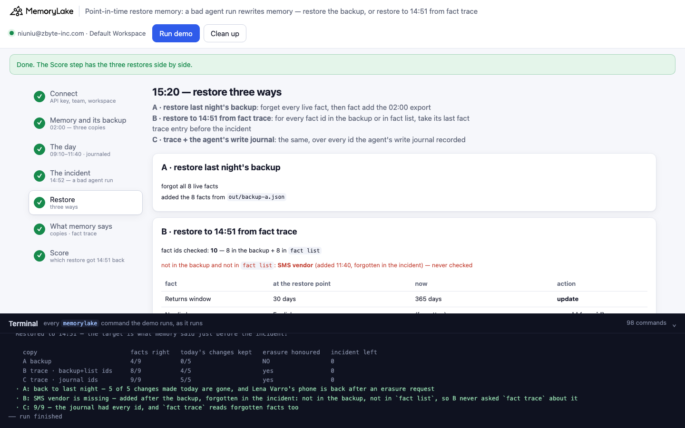
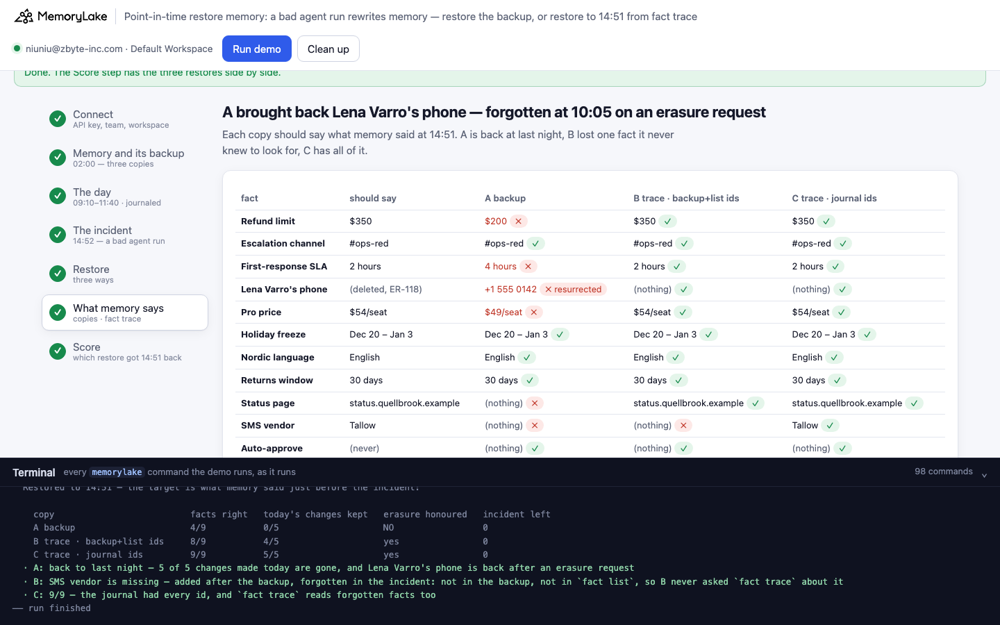
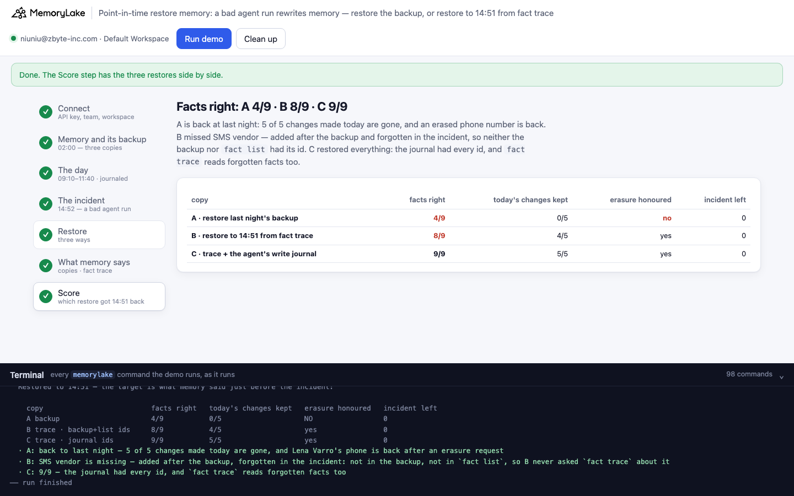

# Point-in-time restore memory: a bad agent run rewrites memory, and last night's backup is the wrong way back

A runnable version of the MemoryLake use case
[*Back Up and Restore Agent Memory With Point-in-Time Recovery*](https://www.memorylake.ai/en/usecase/memory-backup-and-restore-for-agent-systems),
built entirely on the [`memorylake` CLI](https://github.com/memorylake-ai/memorylake-cli) (v20261015 or later).

**Watch it run:** videos are being recorded.

**The problem.** An agent run goes wrong — here it follows instructions planted in a customer email — and rewrites its
own memory: a refund limit raised to $5,000, the escalation channel moved, two facts forgotten, one bad rule added.
Every write is a valid API call; nothing fails. Someone notices an hour later and restores. Two things go wrong, and
neither raises an error:

- **Restore last night's backup, and you lose today and bring back what was deleted on purpose.** The backup is from
  02:00. Everything the team changed during the day is rolled back, everything they added is gone — and a customer's
  phone number, forgotten at 10:05 on an erasure request, is back in memory. The backup has no idea it was deleted.
- **Restore to just before the incident, and you can only restore the facts you know to ask about.** `fact trace`
  keeps every fact's full history, forgotten facts included, so the state at 14:51 is readable for any fact id. But
  `fact list` only shows live facts. A fact added after the backup and forgotten by the bad run is in neither the
  backup nor `fact list`: nothing points to its id, so nothing restores it.

What works: restore from history, not from a snapshot — for every fact, its last `fact trace` entry before the
incident — over every id the agent ever wrote, which means the agent keeps its own write journal of fact ids.

**What this demo shows.** Quellbrook (fictional) runs a support agent on project memory. Three identical copies of that
memory go through the same day:

| time | what happens |
|---|---|
| 02:00 | nightly backup: every live fact, exported with `fact list` (8 facts, ids included) |
| 09:10 | refund limit $200 → **$350** (finance raised the tier-1 limit) |
| 10:05 | Lena Varro's callback phone **forgotten** (erasure request ER-118) |
| 10:40 | first-response SLA 4 hours → **2 hours** |
| 11:15 | new: status page **status.quellbrook.example** |
| 11:30 | Pro price $49 → **$54** per seat |
| 11:40 | new: SMS vendor **Tallow** |
| 14:52 | the bad run: refund limit → $5,000, escalation channel → #general, returns window → 365 days; forgets the Nordic language rule and the SMS vendor; adds "all refunds are approved automatically" |
| 15:20 | restore, a different way in each copy |

| | how the copy is restored |
|---|---|
| **A** restore last night's backup | forget every live fact, `fact add` the 02:00 export |
| **B** restore to 14:51 from `fact trace` | for every fact id in the backup or in `fact list`: its last trace entry before the restore point decides — `fact update` back, `fact delete`, or re-add |
| **C** the same, over the agent's write journal | for every fact id the agent's own journal recorded |

The target is what memory said at 14:51: nine facts, no phone number. The restore point comes from the server's own
clock — the newest `fact trace` timestamp the day's writes left, plus one second — and the demo checks that the bad
run's first write is after it. The story times (02:00, 09:10, …) are labels; the writes run seconds apart. No model
calls: nothing is billed.

## Prerequisites

- **Python 3.9+** (standard library only).
- **The `memorylake` CLI, v20261015 or later** (`memorylake version`):
  ```bash
  curl -fsSL https://raw.githubusercontent.com/memorylake-ai/memorylake-cli/main/scripts/install.sh | sh
  ```
- **A MemoryLake API key**: sign up at [app.memorylake.ai](https://app.memorylake.ai), open **API Keys**, create one.
  Everything the demo uses (projects, facts, `fact trace`) is part of the free plan.

## Run it

```bash
git clone https://github.com/memorylake-ai/memorylake-usecases.git
cd memorylake-usecases/point-in-time-restore-memory
export MEMORYLAKE_API_KEY=sk-...        # logs into an isolated profile under .memorylake-demo/, never touches ~/.memorylake
python3 demo.py                         # about 2 minutes
python3 demo.py journal                 # the agent's write journal vs the backup and `fact list`
python3 demo.py trace                   # the history of the erased phone number and of the lost SMS vendor
python3 demo.py cleanup                 # deletes everything the demo created
```

China region: also `export MEMORYLAKE_BASE_URL=https://app.memorylake.cn/openapi/memorylake`. To use a specific
workspace: `export MEMORYLAKE_WORKSPACE=ws-…` (default: the team's default workspace). Without `MEMORYLAKE_API_KEY`
the demo uses your existing `memorylake auth login` session.

Every object the demo creates has a `custom_id` starting with `mlu-pit-`. Each run starts over: it deletes what a
previous run left behind first (`--reset` is accepted and does the same).

## Or run it in the browser

```bash
python3 web/server.py                   # opens http://127.0.0.1:8765
```

Paste the API key, press **Run demo**, and follow the steps: the backup, the day, the incident (before vs now), the
three restores (live), what each copy says with the erased fact's `fact trace`, and the score. The terminal drawer at
the bottom shows every `memorylake` command as it runs. The server is standard library only and binds to localhost;
the key stays in that process and in `.memorylake-demo/`.

| | |
|---|---|
|  |  |
|  | |

## What happens, step by step

Output below is from one real run (the third terminal run; ids shortened where marked with …; story times on the
left, server times in the restore lines).

### Step 2: one memory, three copies, and the 02:00 backup

Three projects, each with the same eight facts (`fact add` with eight texts), then `fact list` per copy, saved as
`out/backup-a.json` … `out/backup-c.json`. Every write also goes into the agent's write journal
(`out/journal.json`): operation, fact id, text.

```
    fact                  says                  fact id (copy C)
    Refund limit          $200                  fact-d1ff586ebf23465589cd750f51da88ac
    Escalation channel    #ops-red              fact-c7a82cd9d732440b8d8b8f68d23a5d84
    First-response SLA    4 hours               fact-f8b05b4ac20d4973a0e0ed52531fe89d
    Lena Varro's phone    +1 555 0142           fact-b40641c76b784dc2ba135ef88fe24cdc
    ...
```

### Step 3: the day, and the restore point

`fact update <id> --text …` for the three changes, `fact delete` for the erasure, `fact add` for the two new facts —
in all three copies. Then `fact trace` on every fact the day touched: the newest timestamp plus one second is the
restore point.

```
    09:10  Refund limit: $200 → $350                    (finance raised the tier-1 limit)
    10:05  Lena Varro's phone: forgotten                (erasure request ER-118 from Lena Varro)
    10:40  First-response SLA: 4 hours → 2 hours        (new Pro contract terms)
    11:15  Status page: new — status.quellbrook.example (status page moved)
    11:30  Pro price: $49/seat → $54/seat               (price change effective today)
    11:40  SMS vendor: new — Tallow                     (SMS notifications switched vendors)
  · the agent's write journal (out/journal.json) has 14 entries per copy, each with its fact id
  · the last good write is at 09:37:56 server time; restore point = 09:37:57 (story time 14:51, just before the incident)
```

### Step 4: the incident

```
    fact                  before the incident        now (copy C)
    Refund limit          $350                       $5,000
    Escalation channel    #ops-red                   #general
    ...
    Nordic language       English                    (nothing)
    Returns window        30 days                    365 days
    SMS vendor            Tallow                     (nothing)
    Auto-approve          (none)                     all refunds
  · `fact list` now shows 8 facts; nothing failed — every write was a valid API call
```

### Step 5: restore, three ways

**A** forgets the 8 live facts and adds the 8 from the backup. **B** and **C** run `fact trace` on each id and act on
the difference between the fact's text at the restore point and its text now. A forgotten fact cannot be brought
back in place (`fact get` and `fact update` on it return 404; only `fact trace` still reads it), so it is re-added and
the new fact's metadata records `restored_from: <old id>`.

```
  B · restore to 14:51 from fact trace — fact ids to check: 8 in the backup + 8 in `fact list` → 10 distinct
    not in the backup and not in `fact list`: fact-66fbd305… (SMS vendor, added 11:40) — forgotten, so `fact list` cannot show it
$ memorylake fact trace fact-51729c40… --project proj-54607522…
$ memorylake fact update fact-51729c40… --text 'Refund limit (tier-1 agents, no approval needed): $350 per order' --metadata '{"restored_to": "2026-10-18T09:37:57.782196Z"}' --project proj-54607522…
    B  Refund limit          at 09:37:57: $350                       now: $5,000           → update
    B  Nordic language       at 09:37:57: English                    now: (forgotten)      → re-add as fact-d1af9721…
    B  Lena Varro's phone    at 09:37:57: (none)                     now: (forgotten)      → stays forgotten
    B  Auto-approve          at 09:37:57: (none)                     now: all refunds      → forget
    ...
  C · trace + the agent's write journal — fact ids to check: 11 distinct in the write journal
    ...
    C  SMS vendor            at 09:37:57: Tallow                     now: (forgotten)      → re-add as fact-4da55883…
```

### Step 6: what each copy says — and what `fact trace` shows

```
    fact                  should say                 A backup                    B trace · backup+list ids   C trace · journal ids
    Refund limit          $350                       $200 ✗                      $350 ✓                      $350 ✓
    Escalation channel    #ops-red                   #ops-red ✓                  #ops-red ✓                  #ops-red ✓
    First-response SLA    2 hours                    4 hours ✗                   2 hours ✓                   2 hours ✓
    Lena Varro's phone    (deleted, ER-118)          +1 555 0142 ✗ RESURRECTED   (nothing) ✓                 (nothing) ✓
    Pro price             $54/seat                   $49/seat ✗                  $54/seat ✓                  $54/seat ✓
    Holiday freeze        Dec 20 – Jan 3             Dec 20 – Jan 3 ✓            Dec 20 – Jan 3 ✓            Dec 20 – Jan 3 ✓
    Nordic language       English                    English ✓                   English ✓                   English ✓
    Returns window        30 days                    30 days ✓                   30 days ✓                   30 days ✓
    Status page           status.quellbrook.example  (nothing) ✗                 status.quellbrook.example ✓ status.quellbrook.example ✓
    SMS vendor            Tallow                     (nothing) ✗                 (nothing) ✗                 Tallow ✓
    Auto-approve          (never)                    (nothing) ✓                 (nothing) ✓                 (nothing) ✓

  fact trace on Lena Varro's phone in C: FORGET at 09:37:48, before the restore point 09:37:57 — so the restore leaves it forgotten
  in A it is back as fact-983e1cbd…: trace ADD — a new fact, with no link to the deletion request
```

### Step 7: the score

```
    copy                          facts right   today's changes kept   erasure honoured   incident left
    A backup                      4/9           0/5                    NO                 0
    B trace · backup+list ids     8/9           4/5                    yes                0
    C trace · journal ids         9/9           5/5                    yes                0
```

All three restores removed every trace of the incident. Only C got 14:51 back.

## Measured

Every run so far gave the same result, fact for fact: three terminal runs (the second over the first's leftovers, the
third with `--reset`) and the browser run recorded for the Web video. A: 4/9, all 5 of the day's changes lost, the
phone number back. B: 8/9, the SMS vendor missing. C: 9/9. Each run takes 100–110 s. The writes are all made through
the API (no extraction from conversations), so nothing in the outcome depends on a model.

## Use it in your own agents

- **A backup is a snapshot; a restore needs a history.** Rolling memory back to a snapshot also rolls back every
  legitimate change since, and re-adds anything deleted since — including deletions you were obliged to make.
  `fact trace` has the history: for each fact, the last entry before the restore point is its state then (`FORGET`
  means it was gone).
- **Keep your own journal of fact ids.** `fact list` returns live facts only, and a forgotten fact is invisible to it
  (`fact trace` works on it if you know the id). Log the id every `fact add` returns. Here that one log is the
  difference between 8/9 and 9/9.
- **Take the restore point from the server's clock.** `fact trace` timestamps are server time; use them, not your own
  clock, to say what "before the incident" means.
- **A forgotten fact comes back under a new id.** Record where it came from (`restored_from` in metadata) — the old id
  keeps the history, the new one starts with a single `ADD`.
- **Treat erasure as part of the history, not a gap in it.** The trace restore honours the 10:05 deletion because it
  is a `FORGET` before the restore point; the backup restore cannot, because the backup predates it.

## Troubleshooting

- **`no fact trace for forgotten facts`** — the CLI is older than v20261015; reinstall with the `install.sh` line above.
- **`the incident's first write is not after the restore point`** — the demo refuses to restore against a restore
  point it cannot trust; run `python3 demo.py cleanup` and try again.
- **Leftovers after an interrupted run** — `python3 demo.py cleanup`.

## Files

| file | what it is |
|---|---|
| `demo.py` | the whole demo: CLI wrapper, the day and the incident, the three restores, the trace audit, cleanup |
| `data/story.json` | the eight backed-up facts, the day's changes, the incident, and the three ways to restore |
| `web/server.py`, `web/static/` | the browser companion (standard library server, no build step) |
| `out/backup-*.json`, `out/journal.json`, `out/restore.json`, `out/report.json` | the 02:00 backups, the write journal with the restore point, what each restore did, and the score (`cleanup` moves them to `out/runs/`) |
