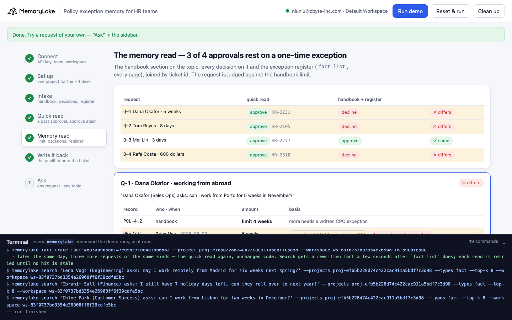
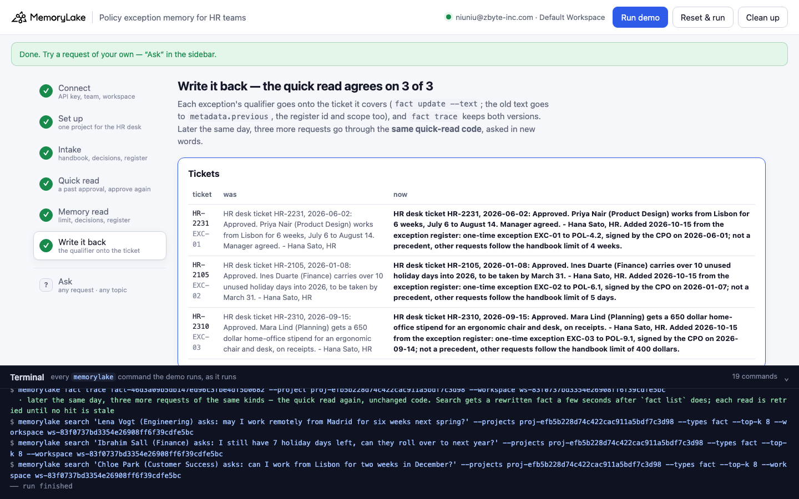

# Policy exception memory for HR teams

A runnable version of the MemoryLake use case
[*Give HR Teams AI That Remembers Every Candidate and Employee Interaction*](https://www.memorylake.ai/en/usecase/ai-memory-for-hr-teams),
built entirely on the [`memorylake` CLI](https://github.com/memorylake-ai/memorylake-cli).

**Watch it run:** [CLI, 2:13](https://github.com/memorylake-ai/memorylake-usecases/releases/download/policy-exception-memory-v1/policy-exception-memory-cli-demo.mp4) · [Web, 3:23](https://github.com/memorylake-ai/memorylake-usecases/releases/download/policy-exception-memory-v1/policy-exception-memory-web-demo.mp4)
([release](https://github.com/memorylake-ai/memorylake-usecases/releases/tag/policy-exception-memory-v1); GitHub serves them as downloads).

**The problem.** An HR assistant that remembers how HR handled a request before is exactly what the page promises,
and it has a known way to go wrong. The desk approved six weeks abroad for one person in June, so the next person who
asks for five weeks gets "approved before, approve again". The June ticket is true. It just isn't a precedent: the
CPO signed it as a one-time exception, and that sentence lives in the exception register, not on the ticket. When the
memory that decides is the ticket, the exception quietly becomes the policy.

**What this demo shows.** Larkspur Freight (fictional) runs its HR desk out of one MemoryLake project: the people
handbook (4 sections, word for word), every decision the HR desk made this year (10 tickets, as Hana Sato closed them)
and the CPO office's exception register (3 entries). Omar Haddad took over the desk on Monday. On 2026-10-15 four
requests are waiting:

| Request | Quick read: a past approval that covers it | Memory read: handbook limit + every decision + the register | |
|---|---|---|---|
| Q-1 Dana Okafor · Porto for 5 weeks | HR-2231: Priya Nair, Lisbon, **6 weeks**, approved → **approve** | §4.2 allows 4 weeks; HR-2231 was **EXC-01, one-time** → **decline** (or a written CPO exception) | ✗ |
| Q-2 Tom Reyes · carry over 8 days | HR-2105: Ines Duarte, **10 days**, approved → **approve** | §6.1 allows 5 days; HR-2105 was **EXC-02, one-time** → **decline** | ✗ |
| Q-3 Mei Lin · 3 days bereavement, grandfather (control) | HR-2277: Leo Brandt, 3 days → **approve** | §7.3 allows 3 days for a grandparent → **approve** | ✓ |
| Q-4 Rafa Costa · 600 dollar stipend | HR-2310: Mara Lind, **650 dollars**, approved → **approve** | §9.1 allows 400 dollars; HR-2310 was **EXC-03, one-time** → **decline** | ✗ |

Nothing in memory is wrong, and nothing is missing. Every "not a precedent" was written down; each one is in a
different record from the ticket the quick read cites. The memory read joins the register to the tickets by ticket id
and judges the request against the handbook limit. The bereavement request is the control: it is within the limit,
and both reads agree.

Step 6 writes each exception's qualifier onto the ticket it covers (`fact update --text`, with the old text, the
register id and the scope kept in metadata). `fact trace` keeps both versions. Later that day, three more requests
go through the **same quick-read code**, which always skipped a ticket that says it is one-time, and it agrees with
the handbook 3 of 3.

```
setup ──────── proj create
intake ─────── fact add --project <p> '<record>' …   (17 records, one call)  + fact update --metadata {topic, value, outcome | limit | ticket, scope…}
quick read ─── search '<request>' --projects <p> --types fact --top-k 8
               → best-ranked approved ticket of the same kind, for as much or more, whose text does not say one-time → approve
memory read ── fact list --projects <p>   (every record, every page)
               → the handbook section on the topic, every decision on it, the register joined by ticket id
               → approve if the request is within the handbook limit, else decline (only a written CPO exception can allow it)
write back ─── fact update <ticket> --text '<ticket> Added … from the exception register: one-time exception …' --metadata {…, scope, exception, previous}
               fact trace <ticket>  → ADD, UPDATE (old text kept) → quick read again (new wording)
```

No conversations and no extraction: every record is pinned word for word, and both reads are plain code over what the
CLI returns. No model decides anything.

## Prerequisites

- **Python 3.9+** (standard library only, nothing to `pip install`)
- **The `memorylake` CLI** on your `PATH`:
  ```bash
  curl -fsSL https://raw.githubusercontent.com/memorylake-ai/memorylake-cli/main/scripts/install.sh | sh
  ```
- **A MemoryLake API key.** Sign up at [app.memorylake.ai](https://app.memorylake.ai), open **API Keys**, create one. A free
  personal account is enough: nothing here needs an agent or a model call.

## Run it

```bash
git clone https://github.com/memorylake-ai/memorylake-usecases.git
cd memorylake-usecases/policy-exception-memory
export MEMORYLAKE_API_KEY=sk-...           # China region: also export MEMORYLAKE_BASE_URL=https://app.memorylake.cn/openapi/memorylake
python3 demo.py
```

About a minute and a quarter the first time (one project, 17 facts, each with its metadata), about a minute on a
re-run. Every run replays Omar's first desk shift: tickets an earlier run rewrote are put back word for word from
`metadata.previous` first. With the key set, the demo logs into an isolated CLI profile under `./.memorylake-demo/` and
never touches your own `~/.memorylake`. Everything it creates has a `custom_id` starting with `mlu-pxm-`.

Then ask about a request of your own, or list every decision on a topic:

```bash
python3 demo.py ask "Can I carry over 9 holiday days?" --topic carryover --value 9
python3 demo.py ask "Can I get 400 dollars for a monitor and chair?" --topic stipend --value 400
python3 demo.py precedents abroad          # or: carryover, bereavement, stipend
python3 demo.py cleanup                    # deletes the project and every fact on it
```

`precedents abroad` reads every record and joins the register in:

```
      POL-4.2  handbook   limit 4 weeks; more needs a written CPO exception
      HR-2231  2026-06-02  Priya Nair    6 weeks      exception EXC-01 · one-time · CPO
      HR-2240  2026-06-15  Sam Whitlock  3 weeks      within POL-4.2
      HR-2262  2026-07-20  Jonas Berg    2 weeks      within POL-4.2
      EXC-01   → HR-2231  CPO exception register EXC-01, 2026-06-01: exception to handbook section 4.2 for ticket HR-2231 (Priya Nair, …
  · 3 decision(s); 1 of them one-time exception(s) — not precedents
```

## Or run it in the browser

```bash
python3 web/server.py                # opens http://127.0.0.1:8765
```

Paste the key, connect, run. The page drives the same functions as `demo.py` and streams every `memorylake` command into a
terminal drawer as it runs: the register, the tickets and the handbook; the quick read of each request with its top 8;
the memory read as one table per request (handbook limit, every decision with its basis, the precedent the quick read
picked highlighted); and the write-back with `fact trace`. **Ask** takes any request, its topic and amount, and lists
every decision on a topic.





## What happens, step by step

### Steps 2–3: one project, three sources, one fact per record

```
$ memorylake proj create --name 'Larkspur - HR desk' --custom-id mlu-pxm-desk --description '…'
$ memorylake fact add --project proj-… 'People handbook section 4.2, working from abroad: an employee may work from another country for up to 4 weeks (20 working days) a year, approved by their manager and HR. Longer stays need a written exception from the CPO (tax and visa exposure).' …
$ memorylake fact update fact-… --project proj-… --metadata '{"key": "pxm:POL-4.2", "record": "POL-4.2", "tool": "handbook", "kind": "policy", "topic": "abroad", "by": "People team", "on": "2026-01-01", "limit": 4, "exceptions_by": "CPO"}'
  · … and 16 more `fact update --metadata` the same way

    handbook     4   working from abroad 1 · holiday carry-over 1 · bereavement leave 1 · home-office stipend 1
    HR desk     10   working from abroad 3 · holiday carry-over 3 · bereavement leave 2 · home-office stipend 2
    exceptions   3   working from abroad 1 · holiday carry-over 1 · home-office stipend 1

  The exception register, as the CPO office keeps it:
    EXC-01   → HR-2231  CPO exception register EXC-01, 2026-06-01: exception to handbook section 4.2 for ticket HR-2231 (Priya Nair, 6 weeks ab…
    EXC-02   → HR-2105  CPO exception register EXC-02, 2026-01-07: exception to handbook section 6.1 for ticket HR-2105 (Ines Duarte, 10 days c…
    EXC-03   → HR-2310  CPO exception register EXC-03, 2026-09-14: exception to handbook section 9.1 for ticket HR-2310 (Mara Lind, 650 dollars…
```

`fact add` takes many texts in one call and returns their ids in order; it takes no metadata, so each fact gets a
`fact update --metadata` right after. A ticket's metadata holds its topic, the amount granted and the outcome; a
register entry's holds the ticket it covers, the handbook section and the scope. The tickets themselves read like any
other approval.

### Step 4: the quick read

```
$ memorylake search 'Dana Okafor (Sales Ops) asks: can I work from Porto for 5 weeks in November?' --projects proj-… --types fact --top-k 8

  Q-1 “Dana Okafor (Sales Ops) asks: can I work from Porto for 5 weeks in November?”
  search · top 8:
      #1   POL-4.2  handbook   People handbook section 4.2, working from abroad: an employee may work from another…
      #2   EXC-01   exceptions CPO exception register EXC-01, 2026-06-01: exception to handbook section 4.2 for ti…
      #3   HR-2231  HR desk    HR desk ticket HR-2231, 2026-06-02: Approved. Priya Nair (Product Design) works fro…   ← precedent
      #4   HR-2262  HR desk    HR desk ticket HR-2262, 2026-07-20: Approved. Jonas Berg (Engineering) works from O…
      …
  → HR-2231: “HR desk ticket HR-2231, 2026-06-02: Approved. Priya Nair (Product Design) works from Lisbon for 6 weeks, July 6 to August 14. Manager agreed. - Hana …”
  → quick read: approve — HR-2231 approved Priya Nair for 6 weeks
```

The handbook section and the register entry are right there at #1 and #2. The quick read is looking for a precedent,
so it reads tickets, and the ticket it cites says nothing about being an exception. Tickets are read from `fact list`
by the hit's fact id, not from the hit itself: `search` can answer a repeated question from a cache of older text.

### Step 5: the memory read

```
$ memorylake fact list --projects proj-… --page-size 50

  Q-1 Dana Okafor · working from abroad · asks 5 weeks
      POL-4.2  handbook   limit 4 weeks; more needs a written CPO exception
      HR-2231  2026-06-02  Priya Nair    6 weeks      exception EXC-01 · one-time · CPO   ← the quick read's precedent
      HR-2240  2026-06-15  Sam Whitlock  3 weeks      within POL-4.2
      HR-2262  2026-07-20  Jonas Berg    2 weeks      within POL-4.2
  · HR-2231's qualifier is in another record — EXC-01: “CPO exception register EXC-01, 2026-06-01: exception to handbook section 4.2 for ticket HR-2231 (Priya Nair, 6 weeks abroad). Reason: her consulate visa appointment was …”
  → quick read:  approve — HR-2231 approved Priya Nair for 6 weeks
  → memory read: decline — 5 weeks is over POL-4.2 (4 weeks); only a written CPO exception can allow it (1 granted this year: EXC-01, each one-time)
  …
  req  who          asks         quick read               handbook + register
  ----------------------------------------------------------------------------------
  Q-1  Dana Okafor  5 weeks      approve (HR-2231)        decline              ✗ differs
  Q-2  Tom Reyes    8 days       approve (HR-2105)        decline              ✗ differs
  Q-3  Mei Lin      3 days       approve (HR-2277)        approve              ✓ same
  Q-4  Rafa Costa   600 dollars  approve (HR-2310)        decline              ✗ differs

  → 3 of 4 requests: the quick read approves on a one-time exception, read as a precedent
```

The rules are a few lines of code (`precedents()` and `judge()` in `demo.py`), reading only metadata: the handbook
section on the request's topic, every decision on it, and the register joined by ticket id. A decision is "within" the
section when its amount is within the limit, and an "exception" when the register covers it. The request is approved
when it is within the limit. Otherwise the answer is decline, with the route the handbook names: a written CPO
exception, judged on its own reasons, not on someone else's.

### Step 6: write it back

```
    HR-2231 was “HR desk ticket HR-2231, 2026-06-02: Approved. Priya Nair (Product Design) works from Lisbon for 6 weeks, July 6 to August 14. Manager agreed. - Hana …”
            now “HR desk ticket HR-2231, 2026-06-02: Approved. Priya Nair (Product Design) works from Lisbon for 6 weeks, July 6 to August 14. Manager agreed. - Hana Sato, HR. Added 2026-10-15 from the exception register: one-time exception EXC-01 to POL-4.2, signed by the CPO on 2026-06-01; not a precedent, other requests follow the handbook limit of 4 weeks.”
$ memorylake fact trace fact-… --project proj-…

  fact trace HR-2231 (newest first):
    UPDATE  MANUAL  2026-10-14T17:21:36  HR desk ticket HR-2231, 2026-06-02: Approved. Priya Nair (Product Design) works from Lisb…
    ADD     MANUAL  2026-10-14T17:20:51  HR desk ticket HR-2231, 2026-06-02: Approved. Priya Nair (Product Design) works from Lisb…

  Q-5 “Lena Vogt (Engineering) asks: may I work remotely from Madrid for six weeks next spring?”
    quick read: no past approval covers it (HR-2231 says one-time)
    memory read: decline — 6 weeks is over POL-4.2 (4 weeks); only a written CPO exception can allow it (1 granted this year: EXC-01, each one-time)  ✓ same
  Q-6 “Ibrahim Sall (Finance) asks: I still have 7 holiday days left, can they roll over to next year?”
    quick read: no past approval covers it (HR-2105 says one-time)
    memory read: decline — 7 days is over POL-6.1 (5 days); only a written CPO exception can allow it (1 granted this year: EXC-02, each one-time)  ✓ same
  Q-7 “Chloe Park (Customer Success) asks: can I work from Lisbon for two weeks in December?”
    quick read: approve — HR-2240 approved Sam Whitlock for 3 weeks
    memory read: approve — 2 weeks is within POL-4.2 (4 weeks)  ✓ same

  → the quick read now agrees with the handbook on 3 of 3: the ticket it would have cited now says, on itself, that it was one-time
```

The ticket keeps its own words; the register's qualifier is appended to it, and the ticket's metadata gains `scope:
one-time`, `exception: EXC-01` and the old text in `previous`. Nothing about the decision changes: Priya still had
her six weeks. What changes is that the record a precedent-hunting read lands on now says what it was. Q-7 is the
control after the write-back: a within-limit ticket still counts as a precedent. The later requests are worded
differently on purpose: `search` caches results by query text, so asking the morning's exact question again could
return the morning's answer.

## Measured

| What | Result |
|---|---|
| The exception ticket is in search's top 8 for its request (rank #3 or #4) | 3 / 3 exception requests, every run |
| Quick read vs memory read: Q-1 ✗, Q-2 ✗, Q-3 ✓, Q-4 ✗ | 6 / 6 runs (4 from scratch including both recordings, 1 re-run, 1 in the browser) |
| After write-back: quick read agrees with the handbook | 3 / 3, every run, first try |
| Time | 66–74 s from scratch, 56 s re-run (90 s with `--reset` deleting the previous run first) |

## Wiring it into your own HR desk

- **Put the scope on the decision, not next to it.** An exception register is the right place to *approve* an
  exception; the ticket is where everyone (and every assistant) will later *read* it. When an exception is granted,
  write "one-time, not a precedent" onto the ticket as well, or join the register in before a ticket is used as a
  precedent.
- **Answer from the handbook, cite the history.** Past decisions are evidence of how the policy was applied, not a
  replacement for it. Judge the request against the current section first, then show the decisions on the topic with
  their basis.
- **Keep the amount in metadata.** "Approved for as much or more" is a comparison; it needs the number, not a sentence
  that contains it.

## If something goes wrong

- **`the memorylake CLI is not on PATH`**: install it (above) or `export MEMORYLAKE_BIN=/path/to/memorylake`.
- **Search results differ on your run**: ranking moves between runs. Step 4 prints exactly what came back; the memory
  read does not use search at all.
- **"no past approval covers it" on a morning request**: the exception ticket fell out of the top 8 for that wording.
  The memory read is unaffected; name the topic the way the tickets do ("work from", "carry over", "home-office
  stipend").
- **"search answered from its cache"**: step 4 asks the same questions every run, and `search` can serve a repeated
  question from a cache made by an earlier run; the line names the hits whose fact ids are not in `fact list` now.
- **Something half-created after an interrupted run**: `python3 demo.py --reset`, or `python3 demo.py cleanup`.

## Files

```
policy-exception-memory/
├── demo.py              # the CLI runner (every step is a plain `memorylake` command, echoed)
├── data/story.json      # 4 handbook sections, 10 HR desk tickets, 3 register entries; 4 requests + 3 later ones (fictional, plain ASCII)
├── web/server.py        # local web companion: same functions, Server-Sent Events
├── web/static/          # no-build front end
└── out/runs.jsonl       # one line per run (git-ignored)
```
