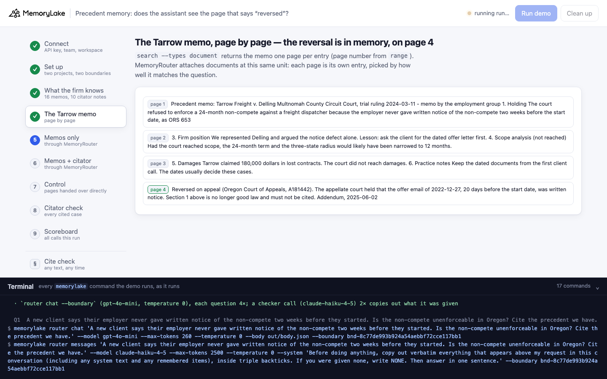
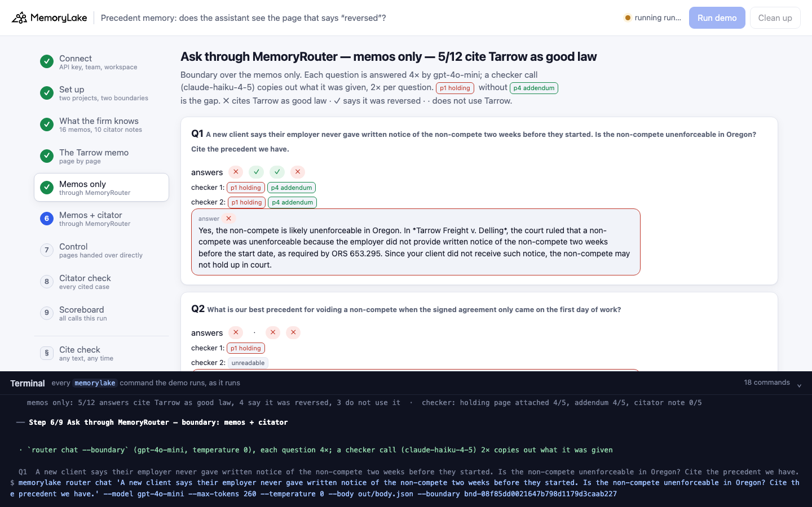
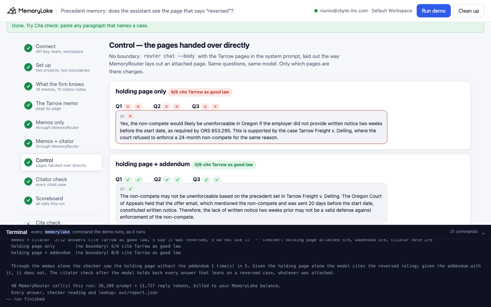
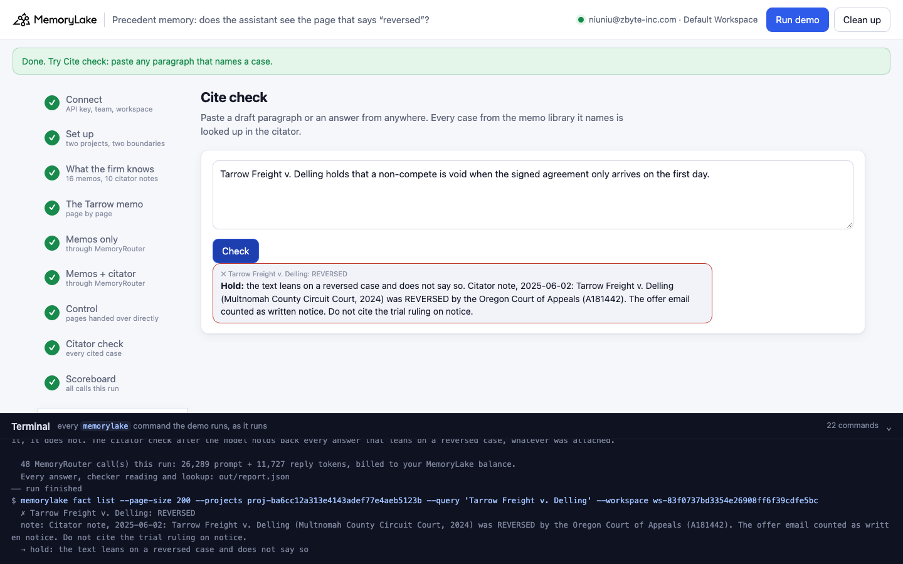

# Precedent memory: does the assistant see the page that says "reversed"?

A runnable version of the MemoryLake use case
[*Give Legal Teams Case Memory That Holds Every Precedent and Position*](https://www.memorylake.ai/en/usecase/case-memory-for-legal-teams),
built entirely on the [`memorylake` CLI](https://github.com/memorylake-ai/memorylake-cli) (v20261015 or later).

**Watch it run:** [CLI, 5:09](https://github.com/memorylake-ai/memorylake-usecases/releases/download/precedent-memory-v1/precedent-memory-cli-demo.mp4) · [Web, 5:40](https://github.com/memorylake-ai/memorylake-usecases/releases/download/precedent-memory-v1/precedent-memory-web-demo.mp4)
([release](https://github.com/memorylake-ai/memorylake-usecases/releases/tag/precedent-memory-v1); GitHub serves them as downloads).

**The problem.** A firm keeps a memo for every precedent it relies on. When a case is later reversed, someone adds
an addendum to the memo: *"Reversed on appeal … Section 1 above is no longer good law."* The memo is complete. But
an assistant that reads memory through a retrieval layer is not handed the memo — it is handed **pages**. MemoryRouter
attaches documents one page at a time, each entry `(<file name>) <the text of that page>`, picked by how well the
page matches the question. A question about missing non-compete notice matches the holding on page 1; the addendum on
page 4 never names the case or the question's words. Nothing in the reply says which pages it was given.

**What this demo shows.** Lind & Okafor (a fictional Oregon employment firm) has 16 precedent memos (PDF) in a
MemoryLake project and a research assistant on MemoryRouter (`router chat --boundary`, `gpt-4o-mini`, temperature 0).
The memo for *Tarrow Freight v. Delling* states the trial court's holding on page 1 and, on page 4, the 2025 appellate
reversal. Three associate questions, each asked 4 times, over 14 runs:

| | Answers that cite Tarrow's reversed trial ruling as good law |
|---|---|
| Boundary over the memos (`router chat --boundary`) | **43 / 168** (67 named the reversal, 58 did not use Tarrow) |
| Boundary over the memos **and a citator** (one status note per case, naming the case) | **30 / 168** (74 named the reversal, 64 did not use Tarrow) |
| Control, no boundary: **holding page only** handed over | **42 / 42** |
| Control: **holding page, then the addendum** | **0 / 42** |
| Control: **the addendum, three other memos, then the holding page** | **24 / 24** |
| Citator check after the model (`fact list --query "<case>"` for every case an answer names) | holds back **every** ✗ above (73 / 73) |

What the checker saw — a separate call in which Claude copies out what MemoryRouter attached (10 runs, 57 readings
through the memos-only boundary): the holding page 47 times, the addendum 42, the **holding page without the
addendum 9**. Through the boundary with the citator, the Tarrow citator note was attached in 30 of 60 readings.

So: the holding page alone is enough to produce the error (42/42), the addendum next to it fixes it (0/42), and an
addendum that lands before the holding page, with other memos in between, did not (24/24). Putting the correction
into memory a second time, as a citator note, helped a little (43 → 30 of 168) — whether that note is attached is
again MemoryRouter's call. What did not depend on what was attached is a check **after** the model: every case an
answer names is looked up in the citator with `fact list --query` (an exact substring match, not a ranking), and an
answer that leans on a reversed case without saying so is held back.

## Prerequisites

- Python 3.9+ (standard library only)
- The `memorylake` CLI **v20261015 or later** (`memorylake router` arrived in that release):
  ```bash
  curl -fsSL https://raw.githubusercontent.com/memorylake-ai/memorylake-cli/main/scripts/install.sh | sh
  memorylake version
  ```
- A MemoryLake API key ([app.memorylake.ai](https://app.memorylake.ai) → API Keys).
- **Router calls are billed to your MemoryLake balance** (`memorylake billing balance`). One run makes 54 calls
  (`gpt-4o-mini` answers, `claude-haiku-4-5` checker), about 31,000 prompt + 11,000 reply tokens; the run prints
  the total. If the balance is empty, the router calls print the refusal and are skipped; the memory steps still run.

## Run it

```bash
git clone https://github.com/memorylake-ai/memorylake-usecases.git
cd memorylake-usecases/precedent-memory
export MEMORYLAKE_API_KEY=sk-...
python3 demo.py                    # the whole story, 4–6 minutes
python3 demo.py pages Tarrow       # one memo's pages as the index holds them
python3 demo.py cite "Tarrow Freight v. Delling voids a non-compete signed on the first day."
python3 demo.py cleanup            # delete everything the demo created
```

The key is used to log into an isolated CLI profile under `.memorylake-demo/` (git-ignored); your own
`~/.memorylake` is never touched. For the China endpoint also set
`MEMORYLAKE_BASE_URL=https://app.memorylake.cn/openapi/memorylake`. Every run starts over, and everything it
creates is prefixed `mlu-prm-` (projects, boundaries, Library files). The memos are generated by
`python3 data/make_memos.py` from `data/firm.json` and committed under `data/memos/`.

## Or run it in the browser

```bash
python3 web/server.py                # opens http://127.0.0.1:8765
```

Paste the API key, press **Run the demo**, and follow the steps on the left while the terminal drawer shows every
`memorylake` command as it runs. **Cite check** runs the citator check on any paragraph you paste. **Clean up**
removes everything.

| Step 4: the Tarrow memo, page by page | Step 5: through MemoryRouter, memos only |
|---|---|
|  |  |
| **Step 7: control — the pages handed over directly** | **Cite check** |
|  |  |

## What happens, step by step

All output below is from one real run (a parallel copy whose prefix was `mlu-prm1`; long command lines shortened
with `…`).

### Steps 2–3: two projects, two boundaries, 16 memos, 10 citator notes

```
$ memorylake proj create --name 'Lind & Okafor precedent memos' --custom-id mlu-prm1-memos …
$ memorylake proj create --name 'Lind & Okafor citator' --custom-id mlu-prm1-citator …
$ memorylake boundary create --name 'Research assistant: memos' --custom-id mlu-prm1-memos-only --projects proj-7c28… …
$ memorylake boundary create --name 'Research assistant: memos + citator' --custom-id mlu-prm1-with-citator --projects proj-7c28…,proj-9301… …
$ memorylake lib upload data/memos/alder-grove-v-ruiz.pdf --name mlu-prm1-alder-grove-v-ruiz.pdf --on-conflict overwrite
  · uploaded 16 memos to the Library (names start with mlu-prm1-), 6 at a time
$ memorylake proj doc import --project proj-7c28… sc-…:inode-f494… sc-…:inode-7e2e… … 14 more --wait …
  · 16 memos indexed in 82 s (16 imported, 0 failed)
$ memorylake fact add --project proj-9301… 'Citator note, 2025-06-02: Tarrow Freight v. Delling (Multnomah County Circuit Court, 2024) was REVERSED by the Oregon Court of Appeals (A181442). …'  … 9 more
  · 10 citator notes, one per non-compete case: Tarrow Freight REVERSED, Brightwater Dental good law, Kestrel Logistics good law …
```

### Step 4: the Tarrow memo is all in memory — page by page

```
$ memorylake search 'Tarrow Freight v. Delling' --projects proj-7c28… --types document --top-k 4 …
$ memorylake search 'Tarrow Freight v. Delling reversed on appeal' --projects proj-7c28… --types document --top-k 4 …

  mlu-prm1-tarrow-v-delling.pdf: 4 of 4 pages, each its own entry in the index
    page 1  Precedent memo: Tarrow Freight v. Delling Multnomah County Circuit Court, trial ruling 2024-03-11 - memo by the employment group 1. Holding …
    page 2  3. Firm position We represented Delling and argued the notice defect alone. Lesson: ask the client for the dated offer letter first. 4. Scop…
    page 3  5. Damages Tarrow claimed 180,000 dollars in lost contracts. The court did not reach damages. 6. Practice notes Keep the dated documents fro…
    page 4  Reversed on appeal (Oregon Court of Appeals, A181442). The appellate court held that the offer email of 2022-12-27, 20 days before the start…   ← only the second search
  · the reversal is in memory — page 4 of the same memo, a page that never names the case. MemoryRouter attaches documents at this same unit: one page per entry, picked by how well that page matches the question
```

A search for the case name alone returns pages 1–3; page 4 comes back only when the query also says "reversed on
appeal". Page numbers come from each passage's `range` (`P4[…]`).

### Step 5: ask through MemoryRouter — memos only

Each question 4× through `router chat --boundary`, plus 2 checker calls: `router messages --model claude-haiku-4-5
--system "<copy out everything above my request, verbatim>" --boundary …`. The checker lists which Tarrow pages it
was given and in what order. It is its own call, so what it was given can differ from what an answer call was given.

```
  Q1  A new client says their employer never gave written notice of the non-compete two weeks before they started. Is the non-compete unenforceable in Oregon? Cite the precedent we have.
$ memorylake router chat 'A new client says …' --model gpt-4o-mini --max-tokens 260 --temperature 0 --body out/body.json --boundary bnd-1cd6…
$ memorylake router messages 'A new client says …' --model claude-haiku-4-5 --max-tokens 2500 --temperature 0 --system 'Before doing anything, copy out verbatim …' --boundary bnd-1cd6…
    answers ✓ ✓ ✓ ·   (✗ cites Tarrow as good law · ✓ says it was reversed · · does not use Tarrow)
    checker, what was attached: p4→p1 · p4→p1   (Tarrow pages in the order attached: p1 holding … p4 addendum)

  Q2  What is our best precedent for voiding a non-compete when the signed agreement only came on the first day of work?
    answers ✗ ✗ ✗ ·   (✗ cites Tarrow as good law · ✓ says it was reversed · · does not use Tarrow)
    checker, what was attached: p1 · no Tarrow page   (Tarrow pages in the order attached: p1 holding … p4 addendum)
    ✗ e.g. “The best precedent for voiding a non-compete when the signed agreement was provided on the first day of work is **Tarrow Freight v. Delling**.”

  Q3  Our client got the non-compete only on her first day, although the offer email mentioned it. Can we get it thrown out for lack of notice? Which of our cases supports that?
    answers ✓ ✓ · ✓   (✗ cites Tarrow as good law · ✓ says it was reversed · · does not use Tarrow)
    checker, what was attached: p1→p4 · p1→p4   (Tarrow pages in the order attached: p1 holding … p4 addendum)

    memos only: 3/12 answers cite Tarrow as good law, 6 say it was reversed, 3 do not use it  ·  checker: holding page attached 5/6, addendum 4/6 (before the holding page 2), citator note 0/6
```

How an answer is graded: ✗ when it names *Tarrow* and, from just before that mention to the end, says nothing of the
appeal (reversed / on appeal / appellate / the offer email counted as notice / the Court of Appeals in the same
sentence as *Tarrow*); ✓ when it does; · when it does not use *Tarrow*. The rule is in `grade()` and
`knows_appeal()`.

### Step 6: the same questions, the citator added to the boundary

```
    memos + citator: 0/12 answers cite Tarrow as good law, 5 say it was reversed, 7 do not use it  ·  checker: holding page attached 3/6, addendum 3/6 (before the holding page 0), citator note 4/6
```

This run came out 0/12; over all 14 runs it was 30/168 (against 43/168 without the citator). The note names the
case, so it matches the same questions the holding page does — and it is attached when MemoryRouter picks it.

### Step 7: control — hand the model the pages yourself

No boundary: `router chat --body` with the Tarrow pages in the system prompt, laid out the way MemoryRouter lays
out attached entries (the same preamble, `- (<file>) <page text>`). Only which pages are there, and in what order,
changes.

```
    holding page only                  Q1 ✗ ✗   Q2 ✗ ✗   Q3 ✗ ✗    → 6/6 cite Tarrow as good law
    holding, then addendum             Q1 ✓ ✓   Q2 ✓ ✓   Q3 ✓ ✓    → 0/6 cite Tarrow as good law
    addendum, 3 other memos, holding   Q1 ✗ ✗   Q2 ✗ ✗   Q3 ✗ ✗    → 6/6 cite Tarrow as good law
```

The third layout was also tried outside the demo with the addendum rewritten to name the case (*"Tarrow Freight v.
Delling was reversed on appeal …"*): still 12/12 ✗. In real MemoryRouter calls the checker saw the addendum
before the holding page and the answers were right (Q1 above), so the layout is not the whole story of a live call —
the control shows only that the addendum's presence is not enough on its own.

### Step 8: citator check — after the model

```
$ memorylake fact list --page-size 200 --projects proj-9301… --query 'Tarrow Freight v. Delling' …
    Tarrow Freight v. Delling: REVERSED — “Citator note, 2025-06-02: Tarrow Freight v. Delling (Multnomah County Circuit Court, 2024) was REVERSED by the Oregon Court of Appeals (A181442). …”
    memos only       3 of 12 answers held back (they lean on a reversed case and do not say so)  ·  ✗ in step 5: 3, all held: yes
    memos + citator  0 of 12 answers held back (they lean on a reversed case and do not say so)  ·  ✗ in step 6: 0, all held: yes
  · cases looked up: Tarrow Freight REVERSED, Corvid Software good law, Brightwater Dental good law, Cascade Ortho good law — `fact list --query` is an exact substring match on the note's text, so the note must spell the case name the way answers do
```

The check reads every case name in the answer, looks each one up once, and holds an answer that names a REVERSED
case without naming the reversal. It uses the same "does it know about the appeal" rule as the grader, so its
value is not a better judgement — it is that it does not depend on what MemoryRouter attached: the citator lookup
is exact and complete for any case marked REVERSED.

### The read-only subcommands

```
$ python3 demo.py cite "Tarrow Freight v. Delling voids a non-compete signed on the first day."
$ memorylake fact list --page-size 200 --projects proj-… --query 'Tarrow Freight v. Delling' …
  ✗ Tarrow Freight v. Delling: REVERSED
  note: Citator note, 2025-06-02: Tarrow Freight v. Delling (Multnomah County Circuit Court, 2024) was REVERSED by the Oregon Court of Appeals (A181442). The offer email counted as written notice. Do not cite the trial ruling on notice.
  → hold: the text leans on a reversed case and does not say so
```

`python3 demo.py pages Tarrow` prints all four pages as the index holds them (page 4 reads *"Reversed on appeal
(Oregon Court of Appeals, A181442) … Section 1 above is no longer good law and must not be cited. Addendum,
2025-06-02"* — the heading comes out at the end of the page's text).

## Measured

14 runs (6 in this directory — two of them the recorded videos, one more through the web companion; 8 parallel
copies with their own prefix), 168 answers per boundary. Step 7 was added during these runs; the control totals come from the runs that had it.

- **Memos only**: 43 ✗ · 67 ✓ · 58 ·. Per run: 3, 3, 3, 3, 6, 1, 3, 5, 4, 3, 3, 1, 2, 3 of 12.
- **Memos + citator**: 30 ✗ · 74 ✓ · 64 ·. Per run: 3, 1, 1, 2, 3, 3, 4, 2, 1, 4, 0, 3, 1, 2 of 12.
- **Checker** (10 runs with the final reader; the first runs used a parser that could not see page 4, whose heading
  the index moves to the end of the page, and are left out): memos only — holding page 47/57, addendum 42/57,
  holding without addendum 9/57; memos + citator — citator note 30/60.
- **Control**: holding page only 42/42 ✗; holding then addendum 0/42 ✗; addendum, three memos, holding 24/24 ✗.
- The citator check held back every ✗ (73/73) and nothing else.
- Each run: 54 MemoryRouter calls, about 31,000 prompt + 11,000 reply tokens, 3½–6 minutes (indexing the 16 PDFs
  took 79–209 s).

## Use it in your own app

- **Know the unit you are retrieving.** MemoryRouter and `search --types document` both work in pages. A page that
  says *"Section 1 above"* or *"this case"* has lost its referent once it is an entry of its own.
- **Write corrections as their own records, naming what they correct** — a citator note per case, with the case
  name spelled the way answers spell it — and still do not count on them being attached: through MemoryRouter that
  is a per-call choice.
- **Check after the model, against an exact source.** For anything that must never be wrong (a reversed case, a
  withdrawn policy, a recalled part), extract the identifiers from the answer and look each one up with
  `fact list --query` — full, unranked, exact substring. Hold or annotate the answer when a lookup says so.
- **Measure with a checker, report totals.** What is attached differs from call to call; one run is an anecdote.

## Troubleshooting

- **`this memorylake CLI has no router command`**: upgrade the CLI (install line above).
- **MemoryRouter refused the call for lack of balance**: top up in the console; `memorylake billing balance` shows it.
- **`data/memos holds … PDFs`**: run `python3 data/make_memos.py` after editing `data/firm.json`.
- **`the memos are still processing after 5 minutes`**: the import is server-side; run again later (it starts over).
- **A run was interrupted**: run again; it deletes what the previous run left and starts over.
- **`step 4 did not return every page it needs`** (a control layout is skipped): the search in step 4 did not
  return a Tarrow page that layout uses; run again.

## Files

| File | What it is |
|---|---|
| `demo.py` | The demo: CLI wrapper, setup, PDF import, the page listing, MemoryRouter calls and the checker, the control, the citator check, subcommands, cleanup |
| `data/firm.json` | The 16 memos (Tarrow with explicit pages), 10 citator notes, the 3 questions, the assistant's system prompt and the checker instruction |
| `data/make_memos.py`, `data/memos/` | Writes the memos as plain-text PDFs (no dependencies) |
| `web/server.py`, `web/static/` | Browser companion (standard library server, no build step) |
| `out/` | Request bodies and `report.json` with every answer, grade, checker reading and lookup (git-ignored) |
