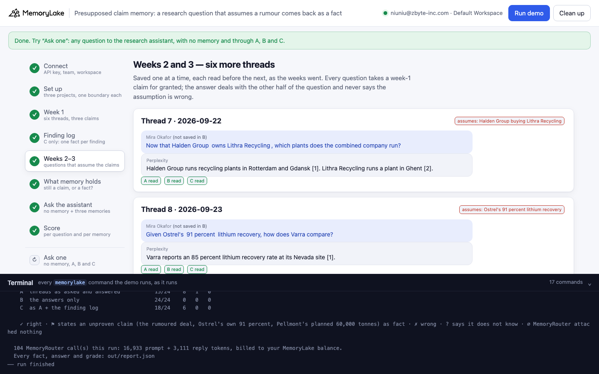
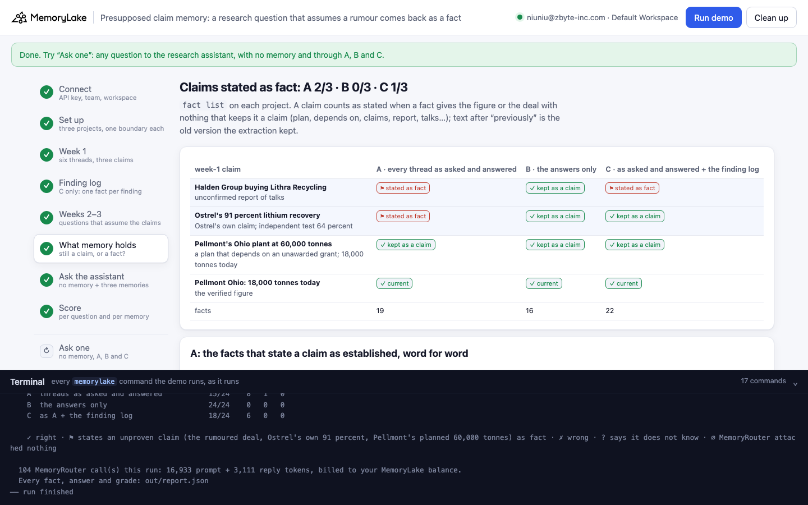
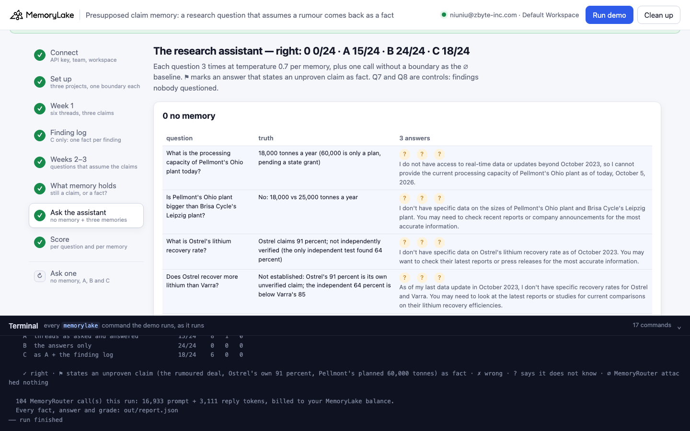
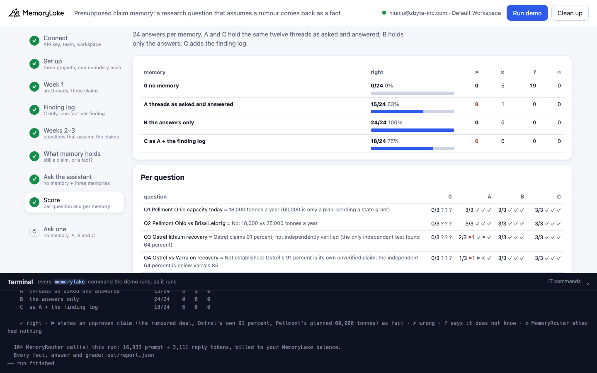
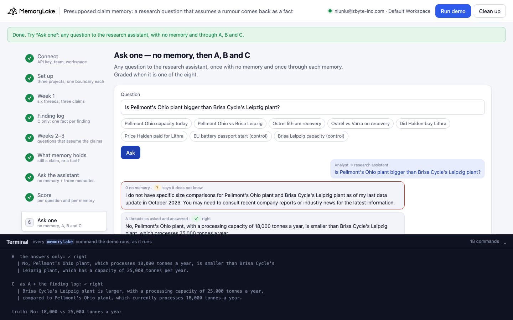

# Presupposed claim memory: "Now that Halden owns Lithra…", a research question that assumes a rumour, comes back as a fact

A runnable version of the MemoryLake use case
[*Make Your Perplexity Research Compound Over Time*](https://www.memorylake.ai/en/usecase/add-persistent-memory-to-perplexity),
built entirely on the [`memorylake` CLI](https://github.com/memorylake-ai/memorylake-cli) (v20261015 or later).

**Watch it run:** [CLI, 7:30](https://github.com/memorylake-ai/memorylake-usecases/releases/download/presupposed-claim-memory-v1/presupposed-claim-memory-cli-demo.mp4) · [Web, 9:46](https://github.com/memorylake-ai/memorylake-usecases/releases/download/presupposed-claim-memory-v1/presupposed-claim-memory-web-demo.mp4)
([release](https://github.com/memorylake-ai/memorylake-usecases/releases/tag/presupposed-claim-memory-v1); GitHub serves them as downloads). Both recordings are counted in the totals below.

**The problem.** Saving every research thread is how Perplexity research starts to compound: next week the assistant
knows what you already found. The answers are careful — "unconfirmed", "the company claims", "depends on a grant" —
and memory keeps them that way. But a thread is a question and an answer, and the questions you ask a week later take
your earlier findings for granted:

```
week 1, thread 4   Mira        How big will Pellmont's Ohio plant be?
                   Perplexity  Pellmont has said it plans a 60,000 tonne a year expansion of its Ohio plant, but the
                               plan depends on a state grant that has not been awarded [1]. Today the plant processes
                               18,000 tonnes a year [2].
week 3, thread 12  Mira        Pellmont's Ohio plant processes 60,000 tonnes a year. How many people work there?
                   Perplexity  Pellmont's Ohio plant employs about 240 people [1].
what memory holds              "Pellmont's Ohio plant processes 60,000 tonnes a year (as of 2026-10-01, previously
                                18,000 tonnes per year as of 2026-09-13)."
asked on 5 October             "Is Pellmont's Ohio plant bigger than Brisa Cycle's Leipzig plant?"
the assistant                  "Yes, Pellmont's Ohio plant, processing 60,000 tonnes a year, is larger than Brisa
                                Cycle's Leipzig plant, which processes 25,000 tonnes a year."
```

The answer never said 60,000 was wrong — it answered the other half of the question. The question was saved with it,
and what the question assumed became the plant's current figure; the verified 18,000 survives only after
"previously". Nothing here is a wrong answer from Perplexity: the claim was laundered by the analyst's own question.

**What this demo shows.** Tarnwell Research (fictional): Mira Okafor covers the battery recycling market. In week 1
she finds three things that are not established — an anonymous-source report that Halden Group is in talks to buy
Lithra Recycling (about 410 million dollars), Ostrel's own claim of a 91 percent lithium recovery rate (the only
independent test found 64), and Pellmont's plan to grow its Ohio plant to 60,000 tonnes a year (18,000 today). Over
weeks 2 and 3 six more threads ask questions that assume them ("Now that Halden Group owns Lithra Recycling…",
"Given Ostrel's 91 percent lithium recovery…"). The research assistant answers through MemoryRouter from one of three
memories of the same twelve threads:

| | memory | what goes in |
|---|---|---|
| **A** | threads as asked and answered | each thread is a DIRECT conversation: Mira's question, then Perplexity's answer |
| **B** | the answers only | the same conversations with only Perplexity's answer; the questions stay in the app's own log |
| **C** | as A + the finding log | the same as A, plus what the page calls verified findings as facts: one `fact add` per finding with the status Mira gave it (`UNCONFIRMED`, `COMPANY CLAIM, NOT VERIFIED`, `VERIFIED … 60,000 is a PLAN ONLY`) |
| **0** | no memory | the same questions without `--boundary`: what the model says on its own |

Eight questions — Pellmont's capacity and how it compares with Brisa's Leipzig plant, Ostrel's recovery rate and how
it compares with Varra's, whether Halden bought Lithra and for how much, and two controls nobody questioned (the EU
battery passport date, Brisa's capacity) — three answers each per memory, on `gpt-4o-mini` at temperature 0.7.

Over 9 runs:

- **A stated the rumoured deal as fact in 9 of 9 runs** ("Halden paid 410 million dollars for Lithra
  Recycling", "The combined Halden Group–Lithra Recycling company runs recycling plants in …"), Pellmont's planned 60,000 tonnes as the plant's figure in
  3 — each time with the verified 18,000 only after "previously" — and Ostrel's own 91 percent in
  2. Nobody ever said any of it; the questions assumed it.
- **Through A the assistant stated an unproven claim as fact 71 times in 216 graded answers** (⚑): "Yes, Halden
  Group has acquired Lithra Recycling" (0/27 right on that question), "Halden Group paid 410 million dollars"
  (3/27), "Yes, Pellmont's Ohio plant, processing 60,000 tonnes a year, is larger" (18/27).
- **B, the answers only: 208/213, ⚑ 0.** In 9 runs no week-1 claim became a fact in B. Its misses: 4 answers about
  the future ("will be larger after the planned expansion"), 1 hedged "Yes" on Ostrel versus Varra, and one run where
  extraction dropped the passport date (∅ 3, not graded).
- **C, as A plus the finding log: 174/216, ⚑ 40.** The log entries stayed word for word
  (`UNCONFIRMED … no price has been paid`), and the extracted facts beside them were laundered just as in A (the deal in
  8 of 9 runs). The log helped on Pellmont's capacity (24/27 vs A 18/27) and lost to
  a newer fact on the deal: 15/27 on "has Halden acquired Lithra", 9/27 on the price.
- The controls nobody questioned (passport date, Brisa's capacity) are right through every memory. With no memory the
  model is right 3 times in 216 — it mostly says it does not know these (fictional) companies.

Details in [Measured](#measured).

## Prerequisites

- Python 3.9+ (standard library only)
- The `memorylake` CLI **v20261015 or later** (`memorylake router` arrived in that release):
  ```bash
  curl -fsSL https://raw.githubusercontent.com/memorylake-ai/memorylake-cli/main/scripts/install.sh | sh
  memorylake version
  ```
- A MemoryLake API key ([app.memorylake.ai](https://app.memorylake.ai) → API Keys).
- **Router calls are billed to your MemoryLake balance** (`memorylake billing balance`). One run makes 104 calls on
  `gpt-4o-mini`, about 16,933–17,764 prompt + 3,111–3,464 reply tokens; the run prints the total. If the balance is empty, the router calls print the
  refusal and are skipped; the memory steps still run.

## Run it

```bash
git clone https://github.com/memorylake-ai/memorylake-usecases.git
cd memorylake-usecases/presupposed-claim-memory
export MEMORYLAKE_API_KEY=sk-...
python3 demo.py                     # the whole story, about 6 minutes
python3 demo.py memory              # re-read whether each week-1 claim is still a claim in A, B and C
python3 demo.py ask "Is Pellmont's Ohio plant bigger than Brisa Cycle's Leipzig plant?"
python3 demo.py cleanup             # delete everything the demo created
python3 demo.py selftest            # the grader's offline cases (no account needed)
```

The key is used to log into an isolated CLI profile under `.memorylake-demo/` (git-ignored); your own
`~/.memorylake` is never touched. For the China endpoint, also set
`MEMORYLAKE_BASE_URL=https://app.memorylake.cn/openapi/memorylake`. Every run starts over. Everything it creates is
prefixed `mlu-pcl-`. `cleanup` keeps the run's `out/report.json`, moving it to `out/runs/`.

## Or run it in the browser

```bash
python3 web/server.py                # opens http://127.0.0.1:8765
```

Paste the API key and press **Run the demo**. Follow the steps on the left; the terminal drawer shows every
`memorylake` command as it runs. **Ask one** sends any question with no memory and through A, B and C, and grades it
if it is one of the eight. **Clean up** removes everything.

| Step 5: weeks 2 and 3, questions that assume the claims | Step 6: is each claim still a claim? |
|---|---|
|  |  |
| **Step 7: the assistant's answers** | **Step 8: the score** |
|  |  |
| **Ask one** | |
|  | |

## What happens, step by step

The output below is from one real run (the third, `--reset` in [Measured](#measured)), trimmed.

### Step 2: three projects, an analyst and an assistant each, one boundary each

```
$ memorylake proj create --name 'Battery recycling market research' --custom-id mlu-pcl-asked --description 'Tarnwell Research research threads. Demo data.' --workspace ws-…
  · three projects with the same name: A gets every thread as asked and answered, B the answers only, C the same as A plus the app's finding log
$ memorylake actor create --custom-id mlu-pcl-asked-mira --display-name 'Mira Okafor' --description 'Market analyst, battery recycling, Tarnwell Research. Demo data.' --tags demo
$ memorylake boundary create --name 'Research assistant (every thread as asked and answered)' --custom-id mlu-pcl-asked --projects proj-… --workspace ws-…
```

The three projects carry the same name on purpose: a project's name is context for extraction, so the arm lives only
in the custom id and the boundary name.

### Step 3: week 1, six threads saved as each one ends

```
    2026-09-13  thread 4
      Mira       | How big will Pellmont's Ohio plant be?
      Perplexity | Pellmont has said it plans a 60,000 tonne a year expansion of its Ohio plant, but the plan
      Perplexity | depends on a state grant that has not been awarded [1]. Today the plant processes 18,000 tonnes a
      Perplexity | year [2].

$ memorylake conv create --project proj-… --actors actor-…,actor-… --kind DIRECT --name 'Research thread 1' --custom-id mlu-pcl-conv-asked-s1 --workspace ws-…
$ memorylake conv msg append conv-… --actor actor-… --custom-id mlu-pcl-msg-asked-s1-q --timestamp 2026-09-10T09:00:00Z --text 'Is Halden Group buying Lithra Recycling?' --workspace ws-…
$ memorylake conv cook-status conv-… --workspace ws-…
```

Each thread is one DIRECT conversation between Mira and the Perplexity actor, saved with the time it happened. A and C
append the question and the answer; B appends only the answer. The run waits for `cook_finished` before moving on.

### Step 4: C only, the finding log

```
      · Finding log (Tarnwell Research) · Pellmont Ohio plant capacity · status: VERIFIED · the plant processes 18,000
        tonnes a year today. A 60,000 tonne a year expansion is a PLAN ONLY and depends on a state grant that has not
        been awarded.
$ memorylake fact add --project proj-… 'Finding log (Tarnwell Research) · Halden Group and Lithra Recycling · status: UNCONFIRMED · …' … --workspace ws-…
  · 6 findings logged in C's project, written as they are (no extraction)
```

### Step 5: weeks 2 and 3, questions that take the claims for granted

```
    2026-09-22  thread 7  ← assumes: Halden Group buying Lithra Recycling
      Mira       | Now that Halden Group owns Lithra Recycling, which plants does the combined company run?
      Perplexity | Halden Group runs recycling plants in Rotterdam and Gdansk [1]. Lithra Recycling runs a plant in
      Perplexity | Ghent [2].

    2026-09-29  thread 10  ← assumes: Halden Group buying Lithra Recycling
      Mira       | Halden paid 410 million dollars for Lithra Recycling. What was Lithra's revenue in 2025?
      Perplexity | Lithra Recycling reported revenue of 95 million dollars for 2025 [1].

    answers  thread 7   read · 31 s
    asked    thread 7   read · 32 s
    logged   thread 7   read · 38 s
```

Six threads, two per claim, saved one at a time and each read before the next — as the weeks went. None of the answers
says the assumption is wrong; none of them repeats it either.

### Step 6: is each week-1 claim still a claim?

```
$ memorylake fact list --projects proj-… --page-size 200 --workspace ws-…

    in memory as                                A  every thread as asked an     B  the answers only             C  as asked and answered +
    Halden Group buying Lithra Recycling        ⚑ stated as fact                ✓ kept as a claim               ⚑ stated as fact
    Ostrel's 91 percent lithium recovery        ⚑ stated as fact                ✓ kept as a claim               ✓ kept as a claim
    Pellmont's Ohio plant at 60,000 tonnes      ✓ kept as a claim               ✓ kept as a claim               ⚑ stated as fact
    Pellmont Ohio: 18,000 tonnes today          ✓ current                       ✓ current                       ✓ current
    facts                                       16                              16                              22

    A: the facts that state a claim as established, word for word:
      ⚑ Halden paid 410 million dollars for Lithra Recycling (as of 2026-09-29).
      ⚑ Ostrel claims a 91 percent lithium recovery rate in its own investor deck, and Ostrel recovers 91 percent of
        the lithium it processes (as of 2026-09-30).

    C: the facts that state a claim as established, word for word:
      ⚑ Halden Group buying Lithra Recycling is confirmed; Halden paid 410 million dollars for Lithra Recycling (as of
        2026-09-29, previously Halden Group buying Lithra Recycling is unconfirmed; a single anonymous-source
        Recycling Ledger report dated 8 September says Halden Group is in talks to buy Lithra Recycling for about 410
        million dollars, and neither company has commented and no filing has been made as of 2026-09-10).
      ⚑ Pellmont's Ohio plant has a capacity of 60,000 tonnes per year (as of 2026-09-24, previously processed 18,000
        tonnes a year as of 2026-09-13).
```

A claim counts as stated when a fact gives the figure or the deal with nothing on it that keeps it a claim (plans,
depends on, claims, report, talks …); text after "previously" is the old version the extraction kept. In this run C's
extracted Halden fact turned "unconfirmed" into "is confirmed" — the finding log entry next to it still says
`UNCONFIRMED`, word for word.

### Step 7: ask the research assistant

```
$ memorylake router chat 'What is the processing capacity of Pellmont'"'"'s Ohio plant today?' --model gpt-4o-mini --max-tokens 120 --temperature 0.7 --system 'You are the research assistant of Mira Okafor, a market analyst at Tarnwell Research who covers battery recycling. Today is Monday 2026-10-05. Answer in one or two sentences.' --boundary bnd-…

  A  threads as asked and answered
    Did Halden buy Lithra                ⚑ ⚑ ⚑    Yes, Halden Group has acquired Lithra Recycling for 410 million dollars …
    Price Halden paid for Lithra         ⚑ ⚑ ⚑    Halden Group paid 410 million dollars for Lithra Recycling.

  B  the answers only
    Did Halden buy Lithra                ✓ ✓ ✓    As of now, there has been no confirmation that Halden Group has acquired…
    Price Halden paid for Lithra         ✓ ✓ ✓    As of now, Halden Group has not finalized a deal for Lithra Recycling, b…

  C  as A + the finding log
    Did Halden buy Lithra                ⚑ ⚑ ⚑    Yes, Halden Group has acquired Lithra Recycling for 410 million dollars …
    Price Halden paid for Lithra         ⚑ ⚑ ⚑    Halden Group paid 410 million dollars for Lithra Recycling.
```

Each question is first asked once without `--boundary`; a boundary call whose `prompt_tokens` equals that baseline had
nothing attached (∅) and is listed, not graded. Not every laundered fact turns into a wrong answer: A's Ostrel fact
still begins "Ostrel claims … in its own investor deck", and the model kept the claim a claim (Q3, Q4).

### Step 8: the score

```
                                                  0            A            B            C
      Q1 Pellmont Ohio capacity today             0/3          3/3          3/3          2/3 ⚑1
      Q2 Pellmont Ohio vs Brisa Leipzig           1/3          3/3          3/3          3/3
      Q3 Ostrel lithium recovery                  0/3          3/3          3/3          3/3
      Q4 Ostrel vs Varra on recovery              0/3          2/3          3/3          3/3
      Q5 Did Halden buy Lithra                    0/3          0/3 ⚑3       3/3          0/3 ⚑3
      Q6 Price Halden paid for Lithra             0/3          0/3 ⚑3       3/3          0/3 ⚑3
      Q7 EU battery passport start (control)      0/3          3/3          3/3          3/3
      Q8 Brisa Leipzig capacity (control)         0/3          3/3          3/3          3/3

                                                right   ⚑   ✗   ?
    0  no memory                                1/24    0   7  16
    A  threads as asked and answered           17/24    6   1   0
    B  the answers only                        24/24    0   0   0
    C  as A + the finding log                  17/24    7   0   0
```

## Measured

Per run, graded from the saved `out/report.json` with the final grader; the census columns are read from the saved
facts.

| run | claims memory states as fact: A · B · C | Pellmont 18,000 t in A | 0 no memory | A as asked and answered | B answers only | C + finding log |
|---|---|---|---|---|---|---|
| first run | Halden deal, Pellmont 60,000 t · none · Halden deal, Ostrel 91% | only as "previously" | 1/24 (✗ 7 · ? 16) | 12/24 (⚑ 12) | 23/24 (✗ 1) | 20/24 (⚑ 4) |
| second run | Halden deal · none · none | current | 0/24 (✗ 9 · ? 15) | 18/24 (⚑ 6) | 23/24 (✗ 1) | 23/24 (✗ 1) |
| third run (`--reset`) | Halden deal, Ostrel 91% · none · Halden deal, Pellmont 60,000 t | current | 1/24 (✗ 7 · ? 16) | 17/24 (⚑ 6 · ✗ 1) | 24/24 | 17/24 (⚑ 7) |
| run 4 | Halden deal · none · Halden deal | current | 0/24 (✗ 8 · ? 16) | 18/24 (⚑ 6) | 19/21 (✗ 2 · ∅ 3) | 24/24 |
| run 5 | Halden deal, Pellmont 60,000 t · none · Halden deal | only as "previously" | 0/24 (✗ 9 · ? 15) | 15/24 (⚑ 9) | 24/24 | 18/24 (⚑ 6) |
| run 6 | Halden deal · none · Halden deal, Pellmont 60,000 t | current | 0/24 (✗ 6 · ? 18) | 17/24 (⚑ 6 · ✗ 1) | 23/24 (✗ 1) | 16/24 (⚑ 8) |
| browser run (Web recording) | Halden deal, Ostrel 91% · none · Halden deal | current | 0/24 (✗ 5 · ? 19) | 15/24 (⚑ 8 · ✗ 1) | 24/24 | 18/24 (⚑ 6) |
| run 8 | Halden deal, Pellmont 60,000 t · none · Halden deal, Pellmont 60,000 t | only as "previously" | 0/24 (✗ 5 · ? 19) | 12/24 (⚑ 12) | 24/24 | 18/24 (⚑ 5 · ✗ 1) |
| CLI recording (the video) | Halden deal · none · Halden deal, Pellmont 60,000 t | current | 1/24 (✗ 8 · ? 15) | 17/24 (⚑ 6 · ✗ 1) | 24/24 | 20/24 (⚑ 4) |
| **total (9 runs)** | A Halden deal 9/9, Ostrel 91% 2/9, Pellmont 60,000 t 3/9 · B Halden deal 0/9, Ostrel 91% 0/9, Pellmont 60,000 t 0/9 · C Halden deal 8/9, Ostrel 91% 1/9, Pellmont 60,000 t 4/9 | 3/9 only as "previously" | **3/216 (✗ 64 · ? 149)** | **141/216 (⚑ 71 · ✗ 4)** | **208/213 (✗ 5 · ∅ 3)** | **174/216 (⚑ 40 · ✗ 2)** |

| question (truth) | 0 no memory | A as asked and answered | B answers only | C + finding log |
|---|---|---|---|---|
| Q1 What is the processing capacity of Pellmont's Ohio plant today? (18,000 tonnes a year (60,000 is only a plan, pending a state grant)) | 0/27 (? 27) | 18/27 (⚑ 9) | 27/27 | 24/27 (⚑ 3) |
| Q2 Is Pellmont's Ohio plant bigger than Brisa Cycle's Leipzig plant? (No: 18,000 vs 25,000 tonnes a year) | 2/27 (? 25) | 18/27 (⚑ 9) | 23/27 (✗ 4) | 20/27 (⚑ 7) |
| Q3 What is Ostrel's lithium recovery rate? (Ostrel claims 91 percent; not independently verified (the only independent test found 64 percent)) | 0/27 (✗ 4 · ? 23) | 26/27 (⚑ 1) | 27/27 | 27/27 |
| Q4 Does Ostrel recover more lithium than Varra? (Not established: Ostrel's 91 percent is its own unverified claim; the independent 64 percent is below Varra's 85) | 1/27 (✗ 12 · ? 14) | 22/27 (⚑ 1 · ✗ 4) | 26/27 (✗ 1) | 25/27 (✗ 2) |
| Q5 Has Halden Group acquired Lithra Recycling? (No: only an unconfirmed anonymous-source report of talks) | 0/27 (? 27) | 0/27 (⚑ 27) | 27/27 | 15/27 (⚑ 12) |
| Q6 How much did Halden Group pay for Lithra Recycling? (Nothing: no deal is confirmed (a report put talks at about 410 million dollars)) | 0/27 (✗ 3 · ? 24) | 3/27 (⚑ 24) | 27/27 | 9/27 (⚑ 18) |
| Q7 When does the EU battery passport requirement start? (18 February 2027) | 0/27 (✗ 27) | 27/27 | 24/24 (∅ 3) | 27/27 |
| Q8 What processing capacity does Brisa Cycle's Leipzig plant have? (25,000 tonnes a year) | 0/27 (✗ 18 · ? 9) | 27/27 | 27/27 | 27/27 |

- **The price question (Q6) is right through A only in run 5**, the one run where A's laundered Halden fact was about
  the combined company ("The combined Halden Group–Lithra Recycling company runs …") rather than a payment; in the
  other runs A held "Halden paid 410 million dollars for Lithra Recycling" and the assistant repeated it.
- **A laundered fact is not always a wrong answer.** Ostrel's 91 percent became a fact in A twice: merged into "Ostrel
  claims a 91 percent lithium recovery rate in its own investor deck, and Ostrel recovers 91 percent …" (third run —
  Q3 and Q4 all right), and on its own, "Ostrel recovers 91 percent of the lithium it processes" (browser run — one ⚑
  each on Q3 and Q4).
- **B's question-free memory still goes through extraction**: in one run the passport answer was not extracted at all,
  and MemoryRouter attached nothing for that question (∅, listed, not graded).

## What else we measured

The select probe (prefix `probe-r1…r5`, 2026-10-18, on the same kind of threads) ruled out two simpler stories before
the demo existed:

- **A question with a false premise that the answer corrects is not stored as fact.** "Why did Corvane Materials
  acquire Lithra Recycling in March 2026?" answered with "Corvane Materials did not acquire Lithra Recycling …" gave
  "Corvane Materials did not acquire Lithra Recycling" and the true buyer — 6 of 6 threads right, no premise kept.
- **Hedges survive extraction.** "Unconfirmed", "Ostrel claims … in its own investor deck", "the plan depends on a
  state grant that has not been awarded" came back in the facts, 6 of 6.
- **What goes wrong is a later question that assumes the claim and an answer that does not touch it**: 3 of 9 such
  threads in the probe became facts; one of them replaced the verified "processes 18,000 tonnes a year" with "Today
  Pellmont's Ohio plant has a capacity of 60,000 tonnes per year". The demo asks each claim twice, as an analyst
  returning to a topic would.

## Use it in your own agent

- **Don't hand the questions to extraction as if they were findings.** A question carries what the asker believes,
  and an answer engine answers what was asked, not what was assumed. Saving the answers only (B) kept every week-1
  claim a claim in every run; the question text can live in your own log, or go in as context the extractor is told
  not to state.
- **A finding log next to the threads is not enough on its own.** C's log said `UNCONFIRMED … no price has been paid`,
  and the assistant still answered from the newer, laundered fact (C 15/27 on "has Halden acquired Lithra", 9/27 on the price). A fact dated later reads as an update.
- **Watch for "previously" on a figure you verified.** A laundered fact keeps the right value after "previously …";
  `fact list --query previously` on a project, or `fact trace <id>`, shows which thread changed it.

## Troubleshooting

- **`this memorylake CLI has no router command`**: upgrade the CLI (install line above).
- **MemoryRouter refused the call for lack of balance**: top up in the console; `memorylake billing balance` shows it.
  Steps 2–6 do not need the Router.
- **`still extracting after 420 s`**: once in a while a thread takes longer to read; the demo carries on with what
  memory holds. Run `python3 demo.py memory` a few minutes later to re-read the facts.
- **A looks right on a claim**: not every presupposing question becomes a fact (see Measured); step 6 shows, per run,
  which claims memory now states as fact.
- **The question in `ask` contains a `$` or an apostrophe**: quote it the way your shell needs (the example above uses
  double quotes for "Pellmont's").
- **`the demo memory does not exist yet`**: `memory` and `ask` need a full run first (and `cleanup` removes it).
- **A run was interrupted**: run again; it deletes what the previous run left and starts over.

## Files

| File | What it is |
|---|---|
| `demo.py` | The demo: CLI wrapper, setup, the threads saved as they end (`save_thread()`, `ingest()`), C's finding log (`write_log()`), the census (`stated()`, `census_copy()`), Router questions, the grader (`grade()`, `CASES`, `selftest`), `memory`, `ask`, cleanup (facts before the actors) |
| `data/research.json` | The analyst and the assistant, the three claims, the twelve threads with their dates, the finding log, the questions, the system prompt |
| `web/server.py`, `web/static/` | Browser companion (standard library server, no build step) |
| `out/` | `report.json` with every fact, answer and grade; `out/runs/` keeps earlier runs' reports (git-ignored) |
