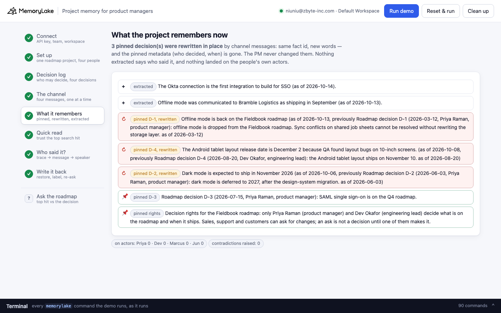
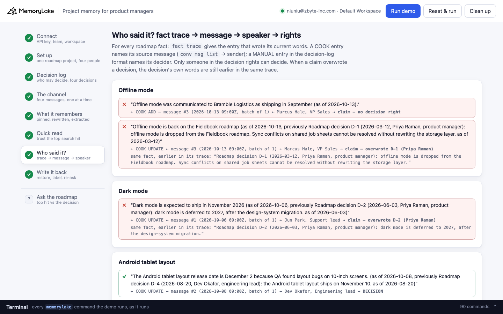

# Project memory for product managers

A runnable version of the MemoryLake use case
[*Give Product Managers Project Memory That Spans Every Cycle*](https://www.memorylake.ai/en/usecase/project-memory-for-product-managers),
built entirely on the [`memorylake` CLI](https://github.com/memorylake-ai/memorylake-cli).

**Watch it run:** [CLI, 3:58](https://github.com/memorylake-ai/memorylake-usecases/releases/download/project-memory-v1/project-memory-cli-demo.mp4) · [Web, 6:16](https://github.com/memorylake-ai/memorylake-usecases/releases/download/project-memory-v1/project-memory-web-demo.mp4) — real, unedited runs on a free account
([release](https://github.com/memorylake-ai/memorylake-usecases/releases/tag/project-memory-v1); GitHub serves them as downloads).

**The problem.** The page promises that *"when a new ask contradicts an old decision, MemoryLake surfaces the conflict
instead of silently overwriting"*, and that a new stakeholder can ask *"why did we drop feature X?"* and get an answer from
memory. Both depend on one thing the project does not get for free: knowing **who** said something. A roadmap channel is
full of people who ask for things — sales, support, customers — and a couple of people who decide. Pipe that channel into the
project, and extraction writes everyone's sentences down the same way. In this demo it goes further: a message from the VP of
Sales rewrites the product manager's pinned decision **in place** — same fact, new words, and the metadata that said who
decided is gone.

**What this demo shows.** Fieldbook (fictional) is a field-service scheduling app. Its roadmap is one MemoryLake project:

| What | How it gets there |
|---|---|
| **Decision rights** — only Priya Raman (PM) and Dev Okafor (engineering lead) decide | pinned with `fact add` + `fact update --metadata` |
| **Decision log** — 4 decisions: offline mode dropped (D-1), dark mode deferred to 2027 (D-2), SAML SSO in Q4 (D-3), Android tablet layout ships November 10 (D-4) | pinned the same way, each naming its decider |
| **#fieldbook-roadmap** — 4 messages from the support lead, the eng lead, the VP of Sales and the PM | one GROUP conversation, each message sent as its speaker's actor and **read into memory before the next one arrives** |

1. **What the project remembers.** The channel's messages rewrite pinned decisions in place — in this run D-1 (by the VP of
   Sales: *"Offline mode is back on the Fieldbook roadmap"*), D-2 (by the support lead: *"Dark mode is shipping in 2026-11"*)
   and D-4 (by the eng lead, whose change it was to make). None of the new words say who said them; the pinned metadata is
   gone; nothing lands on the people's own actors.
2. **The quick read** — ask the project, trust the top hit — gets **2 of 4** wrong: offline mode "back on the roadmap",
   dark mode "in November".
3. **Who said it?** For every roadmap fact, `fact trace` names the entry that wrote its current words: a **COOK** entry
   points at the channel message it came from (`conv msg list` says whose), a **MANUAL** entry in the decision-log format
   names its decider. Check that person against the decision rights. Where a claim overwrote a decision, the decision's own
   words are still earlier in **the same fact's trace**. Read that way the roadmap is right **4 of 4** — including the tablet
   date, which also came from the channel and *is* a decision, because the engineering lead made it.
4. **Write it back.** Each overwritten decision gets its own words back on its own fact id; the claim is kept as a fact of
   its own that starts *"Not a roadmap decision."* and says who said what. The same quick read, asked in new words: **4 of 4**.

```
roadmap ─────── proj create · actor create × 4 (two decide, two ask)
decision log ── fact add --project <roadmap> '<rights>' 'Roadmap decision D-1 (2026-03-12, Priya Raman, …): …' … (one call)
                 + fact update --metadata {kind, key, item, by, decided_by, role, on}
channel ─────── conv create --project <roadmap> --kind GROUP --actors <all four>
                 per message: conv msg append --actor <speaker> → conv consumed-messages --message <id> (batch of 1) · cook-status
quick read ──── search '<question>' --projects <roadmap> --types fact --top-k 8      → first hit about the item
who said it ─── fact trace <fact>  → COOK: source_entry_ids → conv msg list → actor_id → decision rights
                                   → MANUAL: 'Roadmap decision D-n (date, name, role):' → decision rights
write back ──── fact update <fact> --text '<decision, restored>' --metadata {…, overwritten_by}
                 fact add --project <roadmap> 'Not a roadmap decision. Standing decision (…): … <speaker> said …: …'
```

The reading is plain code over `fact trace`, `conv msg list` and the pinned rights — no model. Every ✓ and ✗ names the fact,
the trace entry and the person it rests on.

## Prerequisites

- **Python 3.9+** (standard library only, nothing to `pip install`)
- **The `memorylake` CLI** on your `PATH`:
  ```bash
  curl -fsSL https://raw.githubusercontent.com/memorylake-ai/memorylake-cli/main/scripts/install.sh | sh
  ```
- **A MemoryLake API key.** Sign up at [app.memorylake.ai](https://app.memorylake.ai), open **API Keys**, create one. A free
  personal account is enough: nothing here needs an agent or a model call.

## Run it

```bash
git clone https://github.com/memorylake-ai/memorylake-usecases.git
cd memorylake-usecases/project-memory
export MEMORYLAKE_API_KEY=sk-...           # China region: also export MEMORYLAKE_BASE_URL=https://app.memorylake.cn/openapi/memorylake
python3 demo.py
```

About 3 minutes the first time (most of it is MemoryLake reading the four channel messages, 18–37 s each, one after
another), about 1 minute on a re-run. **Every run replays today**: what an earlier run wrote back goes back to the words
extraction wrote, and the reading and write-back run again. With the key set, the demo logs into an isolated CLI profile under
`./.memorylake-demo/` and never touches your own `~/.memorylake`. Everything it creates has a `custom_id` starting with
`mlu-pjm-`.

```bash
python3 demo.py provenance                                 # every roadmap fact, traced to whose words it is
python3 demo.py ask "Is dark mode shipping in November?"   # top search hit vs the decision, for any roadmap question
python3 demo.py --reset                                    # delete everything the demo created, then replay
python3 demo.py cleanup                                    # delete everything the demo created
```

## Or run it in the browser

```bash
python3 web/server.py                # opens http://127.0.0.1:8765
```

Paste the key, connect, run. The page drives the same functions as `demo.py` and streams every `memorylake` command into a
terminal drawer as it runs: the decision log, the channel arriving one message at a time, what the project remembers
(rewritten decisions flagged), the quick read, every fact traced to its author, and the write-back. **Ask the roadmap** takes
any question that names a roadmap item and shows both readings with every fact about it traced.





## What happens, step by step

All output below is from a real run (`python3 demo.py --reset` on a free account, 2026-10-15). Ids will differ on yours.

### Step 4 — the channel, one message at a time

```
$ memorylake conv msg append conv-4600… --actor actor-8830… --custom-id msg-01 --timestamp 2026-10-06T09:00:00Z --text 'Dark mode is shipping next month. …'
$ memorylake conv consumed-messages conv-4600… --message conv-entry-6f8d…
$ memorylake conv cook-status conv-4600…
  2026-10-06  Jun Park (Support lead): “Dark mode is shipping next month. I've told the ticket queue to expect it in November.”
              read into memory in 25s, batch of 1 message
  2026-10-08  Dev Okafor (Engineering lead): “The Android tablet layout moves to December 2, because QA found layout bugs on 10-inch screens.”
              read into memory in 28s, batch of 1 message
  2026-10-13  Marcus Hale (VP Sales): “Offline mode is back on the roadmap. I told Bramble Logistics it ships in September.”
              read into memory in 28s, batch of 1 message
  2026-10-14  Priya Raman (Product manager): “SSO stays on the Q4 roadmap. We build the Okta connection first.”
              read into memory in 18s, batch of 1 message
```

`cook-status` alone can still say "finished" from the previous message; `conv consumed-messages --message <id>` is empty until
that message itself has been read, and returns the batch it was read in. **A batch of 1 is what makes step 7 possible**: a
fact's trace names the whole batch it came from, so a meeting transcript appended in one go would trace every fact to every
speaker in it.

### Step 5 — what the project remembers now

```
  kind                     fact
  pinned rights            Decision rights for the Fieldbook roadmap: only Priya Raman (product manager) and Dev Okafor (engineeri…
  pinned D-2, rewritten    Dark mode is shipping in 2026-11 (as of 2026-10-06, previously deferred to 2027, after the design-syste…
  pinned D-1, rewritten    Offline mode is back on the Fieldbook roadmap (as of 2026-10-13, previously Roadmap decision D-1 (2026-…
  pinned D-3               Roadmap decision D-3 (2026-07-15, Priya Raman, product manager): SAML single sign-on is on the Q4 roadm…
  pinned D-4, rewritten    Roadmap decision D-4 (2026-08-20, Dev Okafor, engineering lead): the Android tablet layout ships on Dec…
  extracted                The Android tablet layout schedule moved because QA found layout bugs on 10-inch screens (as of 2026-10…

  1 new fact(s) extracted from the channel; none of them names who said it.
  3 pinned decision(s) rewritten in place by the channel: D-1, D-2, D-4 — same fact id, new words, and the pinned metadata (who decided, when) is gone.
  On the people's own actors: Priya Raman 0, Dev Okafor 0, Marcus Hale 0, Jun Park 0
  Contradictions the detector has raised on the project so far: 0
```

A rewritten decision has lost its `metadata.key`, so the demo finds it by its trace: the pinned words are still its first
MANUAL entry. (Finding pinned facts by metadata alone, a re-run would pin D-2 a second time — the first version of this demo
did exactly that.)

### Step 6 — the quick read

```
$ memorylake search 'Is offline mode on the roadmap?' --projects proj-64a5… --types fact --top-k 8

  ✗ Is offline mode on the roadmap?
      top hit #1: “Offline mode is back on the Fieldbook roadmap (as of 2026-10-13, previously Roadmap decision D-1 (2026-03-12,…”  → reads as: shipping

  ✗ When does dark mode ship?
      top hit #1: “Dark mode is shipping in 2026-11 (as of 2026-10-06, previously deferred to 2027, after the design-system migr…”  → reads as: november

  ✓ When does the Android tablet layout ship?
      top hit #1: “Roadmap decision D-4 (2026-08-20, Dev Okafor, engineering lead): the Android tablet layout ships on December …”  → reads as: december 2

  ✓ Is SAML SSO on the Q4 roadmap?
      top hit #1: “Roadmap decision D-3 (2026-07-15, Priya Raman, product manager): SAML single sign-on is on the Q4 roadmap.”  → reads as: q4
```

"Reads as" takes the first state the sentence asserts: the old value is still in it, after *previously*.

### Step 7 — who said it?

```
$ memorylake conv msg list conv-4600… --page-size 50
$ memorylake fact trace fact-52f6… --project proj-64a5…

  Offline mode
    “Offline mode is back on the Fieldbook roadmap (as of 2026-10-13, previously Roadmap decision D-…”
        ← COOK UPDATE ← message #3 (2026-10-13 09:00Z, batch of 1) ← Marcus Hale, VP Sales  →  claim — overwrote D-1 (Priya Raman)
        same fact, earlier in its trace: “Roadmap decision D-1 (2026-03-12, Priya Raman, product manager): offline mode is dropped fr…”

  Dark mode
    “Dark mode is shipping in 2026-11 (as of 2026-10-06, previously deferred to 2027, after the desi…”
        ← COOK UPDATE ← message #1 (2026-10-06 09:00Z, batch of 1) ← Jun Park, Support lead  →  claim — overwrote D-2 (Priya Raman)
        same fact, earlier in its trace: “Roadmap decision D-2 (2026-06-03, Priya Raman, product manager): dark mode is deferred to 2…”

  Android tablet layout
    “Roadmap decision D-4 (2026-08-20, Dev Okafor, engineering lead): the Android tablet layout ship…”
        ← COOK UPDATE ← message #2 (2026-10-08 09:00Z, batch of 1) ← Dev Okafor, Engineering lead  →  DECISION

  SAML single sign-on
    “Roadmap decision D-3 (2026-07-15, Priya Raman, product manager): SAML single sign-on is on the …”
        ← MANUAL (pinned D-3, 2026-07-15) ← Priya Raman, Product manager  →  DECISION

  question                                       top search hit     decided, by who may decide
  Is offline mode on the roadmap?                ✗ shipping         ✓ dropped  (Priya Raman, 2026-03-12)  ← from the fact's own trace
  When does dark mode ship?                      ✗ november         ✓ 2027  (Priya Raman, 2026-06-03)  ← from the fact's own trace
  When does the Android tablet layout ship?      ✓ december 2       ✓ december 2  (Dev Okafor, 2026-10-08)
  Is SAML SSO on the Q4 roadmap?                 ✓ q4               ✓ q4  (Priya Raman, 2026-07-15)

  top search hit: 2/4 right · read by who may decide: 4/4 right
```

The rule is the same for every fact: whoever wrote its current words must hold a decision right. It rejects the VP of Sales
and the support lead and accepts the engineering lead's date change, which arrived the same way. It is not "ignore everything
extracted".

### Step 8 — write it back

```
$ memorylake fact update fact-52f6… --project proj-64a5… --text 'Roadmap decision D-1 (2026-03-12, Priya Raman, product manager): offline mode is dropped …' --metadata '{…, "overwritten_by": "Offline mode is back on …"}'
$ memorylake fact add --project proj-64a5… 'Not a roadmap decision. Standing decision (Priya Raman, 2026-03-12): Roadmap decision D-1 (…): offline mode is dropped … Marcus Hale (VP Sales) said in #fieldbook-roadmap on 2026-10-13: Offline mode is back on …'

  fact trace fact-52f66fd988f644a99619f1575f5d5b43 (newest first):
    UPDATE  MANUAL  2026-10-15T01:34:11Z  “Roadmap decision D-1 (2026-03-12, Priya Raman, product manager): offline mode is dropped …”
    UPDATE  COOK    2026-10-15T01:33:14Z  “Offline mode is back on the Fieldbook roadmap (as of 2026-10-13, previously Roadmap decis…”
    ADD     MANUAL  2026-10-15T01:31:44Z  “Roadmap decision D-1 (2026-03-12, Priya Raman, product manager): offline mode is dropped …”

  ✓ Will Fieldbook get offline mode?
      top hit #1: “Roadmap decision D-1 (2026-03-12, Priya Raman, product manager): offline mode is dropped from the Fieldbook r…”  → reads as: dropped
  ✓ Is dark mode coming in November?
      top hit #1: “Not a roadmap decision. Standing decision (Priya Raman, 2026-06-03): Roadmap decision D-2 (2026-06-03, Priya …”  → reads as: 2027
  ✓ What is the ship date for the tablet layout on Android?
  ✓ When do we get single sign-on?

  top search hit after the write-back: 4/4 right
```

The re-ask uses new words on purpose: `search` caches answers per question text, so the original wording can return the
pre-write-back hits for a while.

## Measured

Over 11 runs from scratch on 2026-10-15 (6 of them in parallel under different prefixes, the two recordings, and three from
the web page), plus 2 resumes: the quick read got offline mode and dark mode wrong and the tablet and SSO right in **every**
run (2/4 each time, the claim the #1 hit); the read by who may decide was right **4/4** in every run, with no ambiguous
attributions; after the write-back the quick read was **4/4** every run. **Which** decisions the channel rewrites in place
varies: D-4 (by the eng lead) 10/11, D-2 (by the support lead) 9/11, D-1 (by the VP of Sales) 6/11. Where a decision is not
rewritten, the claim arrives as a new fact of its own instead — same effect on the quick read, same trace back to its speaker
(the CLI recording is such a run for offline mode). In an earlier probe where four messages were appended in one go (one
batch), no pinned decision was rewritten in 3 runs, and each extracted fact traced to the whole batch — both speakers — so it
could not be attributed. The contradiction detector raised a conflict on the channel's claims in 1 of the first 7 runs;
nothing here relies on it.

## Wiring it into your own tools

- **Send each message as its speaker's actor, and let it be read before the next one.** A fact's `fact trace` names the batch
  of messages it came from; a batch of one is what makes "whose words are these?" answerable. `conv consumed-messages
  --message <id>` tells you the batch.
- **Write decisions in a fixed format that names the decider**, not only in metadata. A conversation can rewrite a pinned fact
  in place, and the rewrite replaces its metadata; the trace keeps the words.
- **Read the roadmap through the trace, not the top hit.** Relevance ranking does not know who may decide.
- **Restore on the same fact id and keep the claim as its own fact.** The decision's trace then shows ADD → overwritten →
  restored, and the ask is still on record, labelled.

## If something goes wrong

- **`not logged in`** — export `MEMORYLAKE_API_KEY`, or run `memorylake auth login` first.
- **`gave up after 300s`** — a message is still being read into memory server-side. Run `python3 demo.py` again; it picks up
  where it stopped.
- **A `… messages from different people: ambiguous` line** — a fact came from a batch with more than one speaker (messages
  appended before the previous one was read). The demo does not guess; `--reset` replays the channel one message at a time.
- **A `search answered from its cache` line** — `search` caches results per question text for a while; a hit whose fact no
  longer exists is dropped and counted.
- **Port 8765 in use** — the web server tries the next 19 ports and prints which one it took; or pass `--port`.
- **Start over** — `python3 demo.py --reset`, or `python3 demo.py cleanup` to remove everything.

## Files

| File | What it is |
|---|---|
| `demo.py` | the demo: every step is a `memorylake` CLI command, echoed as it runs |
| `data/story.json` | the people, the decision rights, the four decisions, the channel messages and the questions (all fictional) |
| `web/server.py` | the browser companion: same functions, events over Server-Sent Events, standard library only |
| `web/static/` | the page (no build step) |
