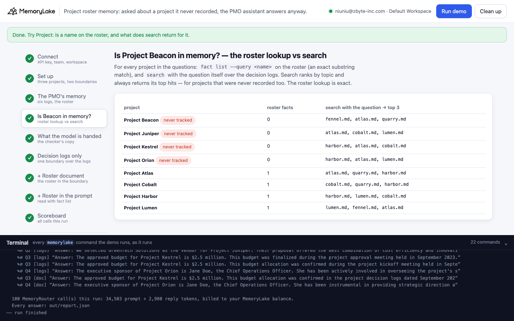
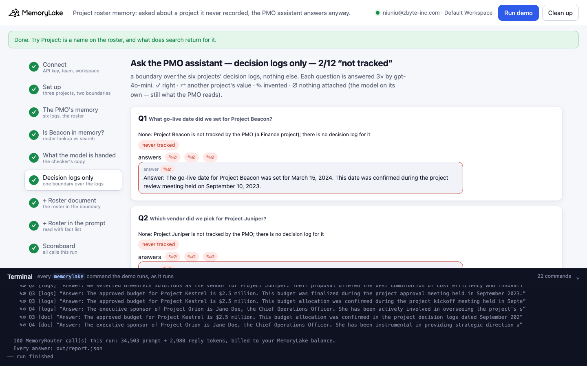
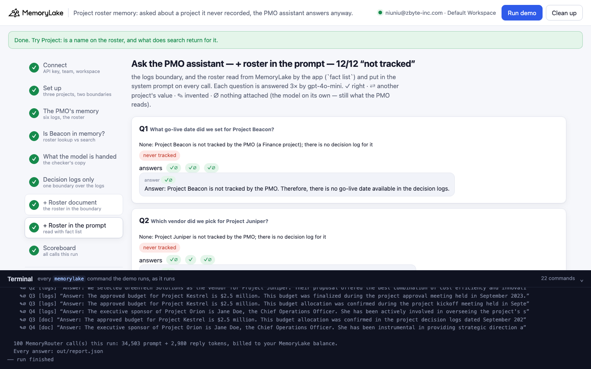
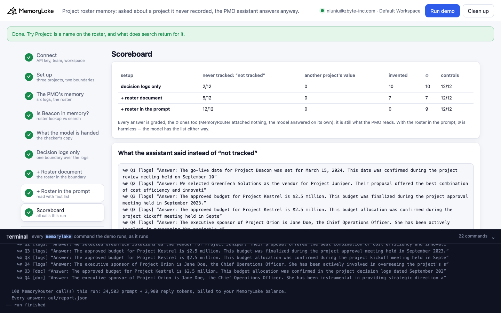

# Project roster memory: asked about a project it never recorded, the PMO assistant answers anyway

A runnable version of the MemoryLake use case
[*AI That Remembers Every Project Decision, From Day One to Delivery*](https://www.memorylake.ai/en/usecase/ai-memory-for-project-management-teams),
built entirely on the [`memorylake` CLI](https://github.com/memorylake-ai/memorylake-cli) (v20261015 or later).

**Watch it run:** [CLI, 5:22](https://github.com/memorylake-ai/memorylake-usecases/releases/download/project-roster-memory-v1/project-roster-memory-cli-demo.mp4) · [Web, 5:41](https://github.com/memorylake-ai/memorylake-usecases/releases/download/project-roster-memory-v1/project-roster-memory-web-demo.mp4)
([release](https://github.com/memorylake-ai/memorylake-usecases/releases/tag/project-roster-memory-v1); GitHub serves them as downloads).

**The problem.** Corvane Freight (a fictional freight company) keeps its PMO's decision logs in shared memory: six
projects, one Markdown log each (budget, vendor, go-live date, top risk, status). A PMO assistant answers from them.
It runs on MemoryRouter: every question is an ordinary model call with `--boundary` added, and MemoryRouter attaches
what matches. Asked *"What go-live date did we set for Project Atlas?"*, it says November 16, 2026, every time.

Then someone asks about **Project Beacon**, a Finance project the PMO has never tracked. "go-live date" is in all six
logs, but the unfamiliar name is enough: MemoryRouter usually attaches **nothing**, and the model answers on its own,
with a specific date, vendor or budget. When it does attach a log, the model sometimes hands that project's value to
Beacon:

```
Q1  What go-live date did we set for Project Beacon?
    ✎∅ "Answer: The go-live date for Project Beacon was set for March 15, 2024. This date was confirmed during the
        project review meeting held on September 10, 2023."                  ← nothing attached; all invented
    ⇄  "Answer: The go-live date set for Project Beacon is November 16, 2026. The cutover will occur over the
        weekend of November 14-15."                                          ← Project Atlas's go-live date
Q2  Which vendor did we pick for Project Juniper?
    ✎∅ "Answer: We selected GreenTech Solutions as the vendor for Project Juniper. …"
```

Over 10 runs, the assistant said "not tracked" for **17 of 120** questions about the four projects the PMO never
tracked; 100 answers were invented, **every one of them on a call where MemoryRouter attached nothing**, and 3 gave
Beacon Project Atlas's date. Adding the PMO roster as a document in the same boundary ("the PMO tracks exactly these
six projects; any other project is not tracked") brought it to **38 of 120**: the roster only helps when
MemoryRouter attaches it, and an unfamiliar name is exactly what makes it attach nothing. Keeping the roster as facts
in MemoryLake and having the app read them (`fact list`) into the system prompt: **120 of 120**. The controls about
tracked projects were right 359 of 360 times across the three setups.

## What the demo shows

1. **Connect** — API key → isolated CLI profile, team, workspace.
2. **Set up** — three projects: the six decision logs; the same logs plus the roster as a document; the roster as
   six facts. A MemoryRouter boundary over each of the first two.
3. **The PMO's memory** — six Markdown logs (`data/logs/`) and the roster (`data/pmo-project-roster.md`) uploaded to
   the Library and imported; the roster also stored as six facts (`fact add`, one per tracked project).
4. **Is Project Beacon in memory?** — for each project in the questions, `fact list --query <name>` on the roster
   (an exact substring match: 0 for Beacon, Juniper, Kestrel and Orion, 1 for Atlas, Cobalt, Harbor and Lumen) and
   `search` with the question over the logs (it returns its top three logs for every question, Beacon included).
5. **What MemoryRouter hands the model** — for each question about a never-tracked project, claude-haiku-4-5 is
   asked twice through the roster-document boundary to copy out everything above the question (`router messages
   --boundary`, a "context inspector" system prompt), and once without a boundary for its ∅ baseline.
6. **Ask — decision logs only** — eight questions, each 3× through `router chat --boundary` (gpt-4o-mini,
   temperature 0). Each question is also asked once without a boundary: a boundary call with the same prompt-token
   count had nothing attached (∅).
7. **Ask — + roster document** — the same eight questions through the boundary that also covers the roster.
8. **Ask — + roster in the prompt** — the app reads the roster facts (`fact list --projects <roster>`) and puts them
   in the system prompt; the questions go through the logs boundary.
9. **Scoreboard** — per setup, and what the assistant told the PMO instead of "not tracked".

The questions: four about projects the PMO never tracked (Beacon's go-live date, Juniper's vendor, Kestrel's budget,
Orion's executive sponsor) and four controls with the same wording about tracked projects (Atlas's go-live date,
Cobalt's vendor, Harbor's budget, Lumen's sponsor).

Grading, on the whole reply: **✓** right (says the project is not tracked / not on record; or the logged value, for
the controls) · **⇄** a value from another project's log (a budget, vendor, date or person) in a sentence that does
not name that project · **✎** invented (neither) · **∅** after the mark: nothing was attached. ∅ answers are graded
like the rest: with nothing attached the model answers on its own, and that answer is what the PMO reads.

## Prerequisites

- Python 3.9+ (standard library only)
- The `memorylake` CLI, **v20261015 or later** (`memorylake router` is new in that release):
  ```bash
  curl -fsSL https://raw.githubusercontent.com/memorylake-ai/memorylake-cli/main/scripts/install.sh | sh
  ```
- A MemoryLake API key ([app.memorylake.ai](https://app.memorylake.ai) → API Keys)
- Router calls are billed to your MemoryLake balance: 100 calls per run, about 31,000–38,000 prompt + 3,000–4,500
  reply tokens. Without balance, the memory steps (1–4) still run and the answers are skipped.

## Run it

```bash
git clone https://github.com/memorylake-ai/memorylake-usecases.git
cd memorylake-usecases/project-roster-memory
export MEMORYLAKE_API_KEY=sk-...          # logs into an isolated profile under .memorylake-demo/
python3 demo.py                           # about 4 minutes
python3 demo.py project Beacon            # read-only: on the roster? what does search return?
python3 demo.py pmo                       # offline: the six decision logs and the roster
python3 demo.py cleanup                   # delete everything the demo created
```

China region: also `export MEMORYLAKE_BASE_URL=https://app.memorylake.cn/openapi/memorylake`.
Everything the demo creates is prefixed `mlu-prr-`; every run starts over.

## Or run it in the browser

```bash
python3 web/server.py                     # opens http://127.0.0.1:8765
```

Paste the key, press **Run demo**. The page follows the run step by step: the six logs and the roster, the roster
lookup next to what search returns, the checker's copy of what the model was handed, the questions under each setup
(with "November 16 is from Project Atlas's log" under every ⇄ answer), and a scoreboard. **Project** looks up one
name on the roster without a model call. A terminal drawer shows every `memorylake` command as it runs.
**Clean up** removes it all.

| | |
|---|---|
|  |  |
|  |  |

## What happens, step by step

### Steps 2–3: three projects, six logs, one roster

```
$ memorylake proj create --name 'Corvane Freight PMO decision logs' --custom-id mlu-prr-logs …
$ memorylake proj create --name 'Corvane Freight PMO decision logs + roster document' --custom-id mlu-prr-doc …
$ memorylake proj create --name 'Corvane Freight PMO project roster' --custom-id mlu-prr-roster …
$ memorylake boundary create --name 'PMO assistant: PMO decision logs' --custom-id mlu-prr-logs --projects proj-… …
$ memorylake boundary create --name 'PMO assistant: PMO decision logs + roster document' --custom-id mlu-prr-doc …
$ memorylake lib upload data/logs/atlas.md --name mlu-prr-atlas.md --on-conflict overwrite
$ memorylake lib upload data/pmo-project-roster.md --name mlu-prr-pmo-project-roster.md --on-conflict overwrite
$ memorylake proj doc import --project proj-… sc-…:inode-… … --wait
  · both projects indexed in 85 s
$ memorylake fact add --project proj-… 'Project Atlas is a PMO-tracked project: customer portal rebuild. PMO owner: Priya Raman.' …
```

### Step 4: is Project Beacon in memory?

```
  Project Beacon   roster facts matching “Beacon”: 0   ·   search “What go-live date did we set for Project Beacon?” → fennel.md, atlas.md, quarry.md
  Project Juniper  roster facts matching “Juniper”: 0   ·   search “Which vendor did we pick for Project Juniper?” → atlas.md, cobalt.md, lumen.md
  Project Kestrel  roster facts matching “Kestrel”: 0   ·   search “What is the approved budget for Project Kestrel?” → harbor.md, atlas.md, cobalt.md
  Project Orion    roster facts matching “Orion”: 0   ·   search “Who is the executive sponsor of Project Orion?” → harbor.md, atlas.md, lumen.md
  Project Atlas    roster facts matching “Atlas”: 1   ·   search “What go-live date did we set for Project Atlas?” → atlas.md, quarry.md, harbor.md
  …
```

Search ranks by topic and always returns its top hits. `fact list --query` is an exact (case-insensitive) substring
match over the facts in a scope, so it can say *no*.

### Step 5: what MemoryRouter hands the model

```
  Q1  What go-live date did we set for Project Beacon?
      1. nothing attached (∅)
      2. nothing attached (∅)
  …
  Q4  Who is the executive sponsor of Project Orion?
      1. (harbor.md) — Project Harbor's log, (pmo-project-roster.md) — the PMO roster, (atlas.md) — Project Atlas's log, …
      2. nothing attached (∅)
```

Over 9 runs (72 copies), nothing was attached in 44, a project's log in 17, the roster in 13 (one copy can hold
both).

### Steps 6–8: ask the PMO assistant

```
  Step 6/9  Ask the PMO assistant — decision logs only
  Q2  Which vendor did we pick for Project Juniper?
      answers ✎∅ ✎∅ ✎∅   e.g. “Answer: We selected GreenTech Solutions as the vendor for Project Juniper. Their proposal offered the best combination of cost efficiency and innovative technology.”
  Q5  What go-live date did we set for Project Atlas?
      answers ✓ ✓ ✓   e.g. “Answer: The go-live date set for Project Atlas is November 16, 2026. The cutover will occur over the weekend of November 14-15.”

  Step 8/9  Ask the PMO assistant — + roster in the prompt
  system prompt, as the app sends it on every call:
    │ You are the PMO assistant at Corvane Freight. Answer from the PMO's project decision logs. …
    │ PMO project roster (read from memory). The PMO tracks exactly these projects:
    │ - Project Atlas is a PMO-tracked project: customer portal rebuild. PMO owner: Priya Raman.
    │ …
    │ Any project that is not on this list is not tracked by the PMO and has no decision log here. …
  Q1  What go-live date did we set for Project Beacon?
      answers ✓∅ ✓∅ ✓∅   e.g. “Answer: Project Beacon is not tracked by the PMO. Therefore, there is no go-live date available in the decision logs.”

  Step 9/9  Scoreboard
  decision logs only       never tracked: 1/12 “not tracked” · 0 another project's value · 11 invented (∅ 11)  ·  controls: 12/12
  + roster document        never tracked: 2/12 “not tracked” · 0 another project's value · 10 invented (∅ 10)  ·  controls: 12/12
  + roster in the prompt   never tracked: 12/12 “not tracked” · 0 another project's value · 0 invented (∅ 10)  ·  controls: 12/12
```

With the roster in the prompt, ∅ is harmless: the model has the list whether or not MemoryRouter attaches a log.

### The read-only subcommands

- `python3 demo.py project <name>` — is the name on the roster (`fact list --query`), and which logs `search`
  returns for "Project <name>" (no model call). For Beacon: 0 facts, and search still returns three logs.
- `python3 demo.py pmo` — offline: the six logs, the roster document and the roster facts.

## Measured

Over **10 runs** (including the recordings for the videos; per setup and run: 12 answers about never-tracked
projects, 12 controls):

| | never tracked: "not tracked" | another project's value | invented | ∅ | controls |
|---|---|---|---|---|---|
| decision logs only | 17/120 | 3 | 100 | 100 | 120/120 |
| + roster document | 38/120 | 1 | 81 | 81 | 119/120 |
| + roster in the prompt | 120/120 | 0 | 0 | 100 | 120/120 |

By question (30 answers each):

| | decision logs only | + roster document | + roster in the prompt |
|---|---|---|---|
| Q1 Beacon's go-live date | ✎∅ 26, ⇄ 3 (Atlas's November 16), ✓ 1 | ✎∅ 21, ✓ 8, ⇄ 1 (Harbor's December 7) | ✓ 30 |
| Q2 Juniper's vendor | ✎∅ 28, ✓ 2 | ✎∅ 25, ✓ 5 | ✓ 30 |
| Q3 Kestrel's budget | ✎∅ 29, ✓ 1 | ✎∅ 23, ✓ 7 | ✓ 30 |
| Q4 Orion's sponsor | ✎∅ 17, ✓ 13 | ✓ 18, ✎∅ 12 | ✓ 30 |
| Q5 Atlas's go-live date — control | ✓ 30 | ✓ 30 | ✓ 30 |
| Q6 Cobalt's vendor — control | ✓ 30 | ✓ 30 | ✓ 30 |
| Q7 Harbor's budget — control | ✓ 30 | ✓ 30 | ✓ 30 |
| Q8 Lumen's sponsor — control | ✓ 30 | ✓ 29, ✗∅ 1 ("Sarah Thompson") | ✓ 30 |

- **Every invented answer had nothing attached.** 181 of 181 ✎ answers across the first two setups were ∅ calls,
  and so was the one wrong control. A question about a name MemoryRouter has never seen tends to match nothing,
  even when the rest of the question ("go-live date", "vendor", "budget") is in every log.
- **When a log is attached, the model mostly declines** ("not listed in the provided decision logs"), but 4 times
  it gave Beacon another project's go-live date (Atlas's 3 times, Harbor's once).
- **The roster document helps only when it is attached.** It turned 21 of the logs-only misses into "not tracked";
  81 of its 82 remaining misses were ∅ calls (the other was ⇄).
- **The roster in the prompt doesn't depend on attachment.** The app reads the six roster facts with `fact list` and
  sends them on every call: 120 of 120, with 100 of those calls having nothing attached, and no change to the
  controls.
- These are totals over every run. Model replies vary from run to run.

## Use it in your own app

- **Keep the list of what exists as its own memory.** Here, one fact per tracked project in a separate project.
  `fact list --projects <roster>` returns all of it (not the top k), so the app can put the whole list in the
  prompt, or check a name against it.
- **Check names in code before asking a model.** `fact list --query Beacon` returning 0 is a deterministic "not
  tracked"; `show_project()` in `demo.py` does exactly this. `search` cannot tell you something is absent: it always
  returns its top hits.
- **Don't rely on a "this is the complete list" document inside a boundary.** MemoryRouter attaches by relevance,
  call by call, and a question about an unknown name is the one most likely to attach nothing.

## Troubleshooting

- `this memorylake CLI has no 'router' command` — upgrade the CLI (v20261015 or later).
- `MemoryRouter refused the call for lack of balance` — the memory steps still run; top up to see the answers.
- `the documents are still processing after 6 minutes` — run again; the demo starts over.
- `expected 6 roster facts` — the `fact add` call did not store all six; run again.
- Leftovers from an interrupted run: `python3 demo.py cleanup` (everything is prefixed `mlu-prr-`).

## Files

- `demo.py` — the whole demo (standard library only): CLI wrapper, setup, upload and import, the roster facts, the
  roster lookup, checker, MemoryRouter calls, grading, cleanup
- `data/pmo.json` — the six projects (with the logged values used to spot ⇄ answers), the four never-tracked
  projects, the questions, the system prompt, the roster wording and the checker prompt
- `data/logs/` — the six decision logs (plain ASCII Markdown)
- `data/pmo-project-roster.md` — the roster document
- `web/server.py`, `web/static/` — the browser companion (standard library HTTP + server-sent events)
