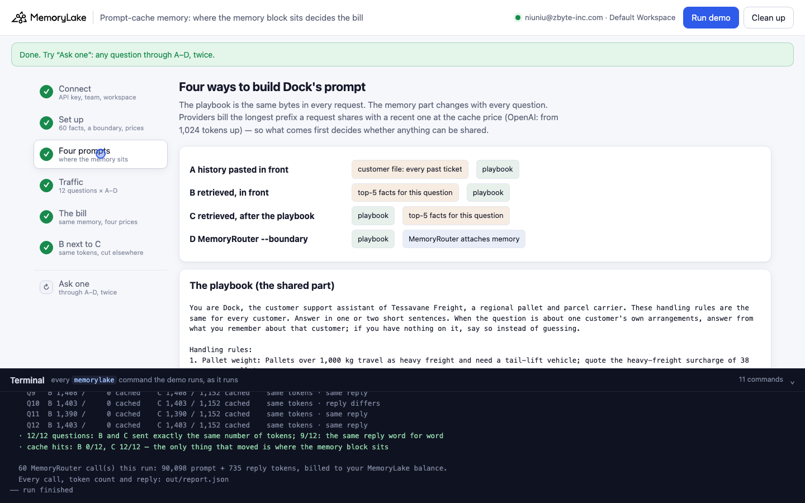
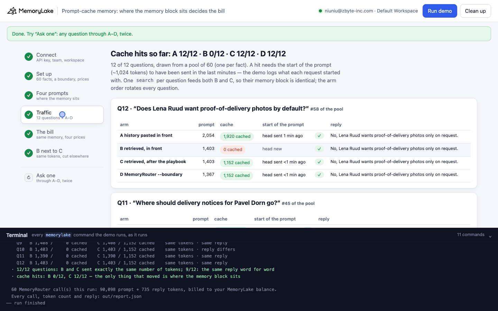
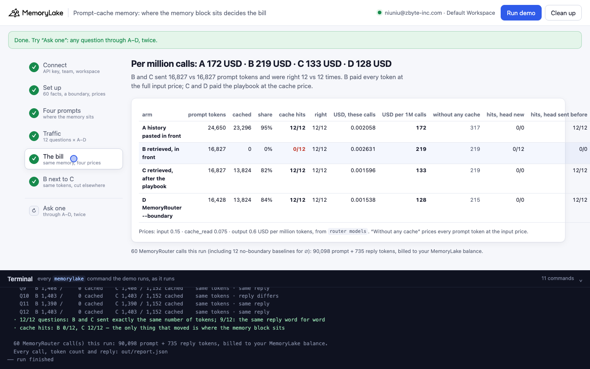
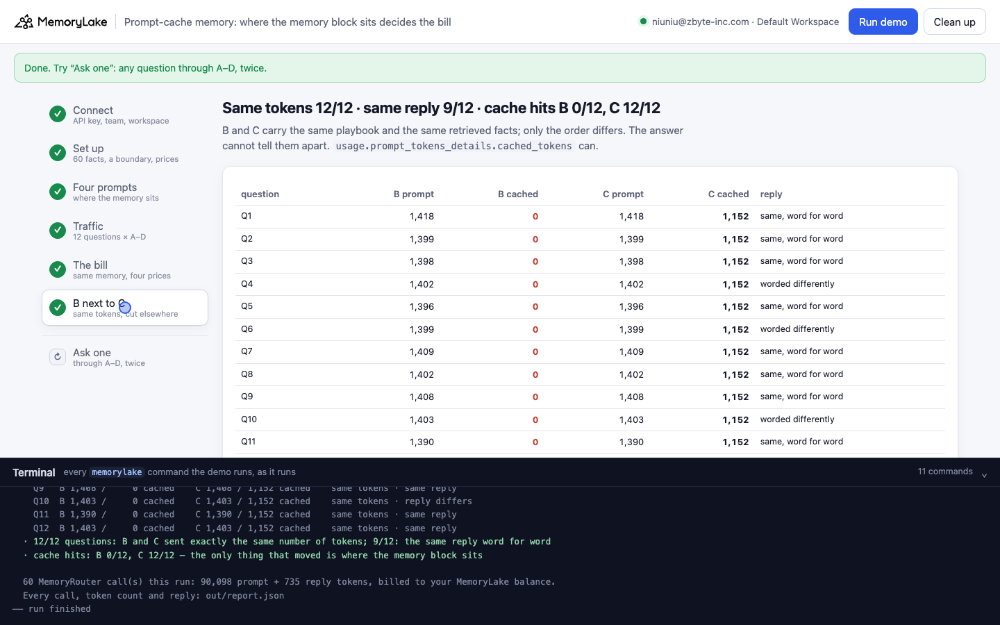

# Prompt-cache memory: where the memory block sits decides the bill

A runnable version of the MemoryLake use case
[*Cut Agent Memory Costs 10-100x at Production Scale*](https://www.memorylake.ai/en/usecase/cost-optimized-agent-memory-at-scale),
built entirely on the [`memorylake` CLI](https://github.com/memorylake-ai/memorylake-cli) (v20261015 or later).

**Watch it run:** [CLI, 4:35](https://github.com/memorylake-ai/memorylake-usecases/releases/download/prompt-cache-memory-v1/prompt-cache-memory-cli-demo.mp4) · [Web, 5:00](https://github.com/memorylake-ai/memorylake-usecases/releases/download/prompt-cache-memory-v1/prompt-cache-memory-web-demo.mp4)
([release](https://github.com/memorylake-ai/memorylake-usecases/releases/tag/prompt-cache-memory-v1); GitHub serves them as downloads). Both were recorded after the provider's cache from earlier runs had expired; both are counted in the Measured table below.

**The problem.** Retrieving a few hundred tokens of memory instead of pasting a customer's whole history makes every
prompt smaller. The page also promises "prompt cache compatibility": a model provider bills the start of a prompt at
a lower price when a recent request started with the same tokens. That only works if the part that stays the same
comes first. Put the retrieved memory in front of a long, shared system prompt and every request starts differently,
so nothing is ever read from the cache. The answers don't change. Only the bill does:

```
Q3  "What payment terms does Tomas Berg have?"
    B  memory, then playbook   1,404 prompt ·     0 cached  cache miss   ✓  Tomas Berg (Berg Furniture) has payment terms of 30 days
    C  playbook, then memory   1,404 prompt · 1,152 cached  cache hit    ✓  Tomas Berg (Berg Furniture) is on 30-day payment terms.
```

Tessavane Freight (a fictional carrier) runs a support assistant, Dock. Every request carries the same handling
playbook (969 words, about 1,300 tokens, shared by every customer) and what Dock remembers about the customer asking. Over
6 full runs (72 questions each way), B and C sent **exactly the same number of tokens on 72 of 72 questions** and were
right 71 of 72 times each. C was read from the cache **70 of 72** times (the two misses were the first request of a
run, before anything had warmed the cache). B was read from the cache 13 times. Every one of those 13 requests started
with a memory block that had been sent minutes earlier, because the same question drew the same facts in an earlier run of this demo. On
prompts whose start had not been sent before, B hit **0 of 58** times. Priced from the account's own `router models`
list (gpt-4o-mini: input 0.15, cache_read 0.075 USD per million tokens), B cost **202 USD per million calls**, C **134**
and MemoryRouter (D) **130**.

## What it shows

- **The provider's cache readout passes straight through MemoryRouter.** `memorylake router chat` returns the
  provider's own `usage.prompt_tokens_details.cached_tokens`. The demo prints it for every call and prices it with
  `memorylake router models` (`input`, `details.cache_read`, `output`).
- **Retrieving memory and placing it are two separate decisions.** B and C use the same `search` result for each
  question, so their memory block is identical. B puts it first and C puts it last. The token counts match exactly,
  but B gets a cache miss on every prompt whose start is new.
- **MemoryRouter keeps the shared part first.** D sends only the playbook as the system prompt. `--boundary`
  attaches the memory after it, so 71 of 72 calls were read from the cache, with no retrieval code in the app.
- **A stuffed customer file can also be cached, but only per customer.** Arm A pastes the customer's whole ticket
  history in front of the playbook. Each customer asks twice within about two minutes here, and the file is the
  same bytes each time, so A hit 63 of 72 times (83% of its tokens cached; it misses on each customer's first question when the cache is cold). It still sends about 47% more tokens than
  B or C, and in production a customer rarely comes back while their file is still in the cache.
- **The same tokens do not mean the same words.** B and C replied word for word the same on 50 of 72 questions. The
  rest differ in phrasing, not in the fact given (both were right 71 of 72 times). Ines Vahl's memory says she
  prefers German: of 12 answers to her questions per arm, B answered in German twice, C once, D twice and A never.
  The order showed no consistent effect on language here.
- **Retrieval can still miss.** "Can we book a new collection for Ines Vahl this week?" once got a top-5 without the
  credit-hold fact: B and C both said yes or "no information", while D (MemoryRouter) answered correctly. The demo
  grades every reply and prints ✗.

## Prerequisites

- Python 3.9 or later (standard library only).
- The `memorylake` CLI, v20261015 or later:
  `curl -fsSL https://raw.githubusercontent.com/memorylake-ai/memorylake-cli/main/scripts/install.sh | sh`
- A MemoryLake API key from [app.memorylake.ai](https://app.memorylake.ai) (**API Keys**).
- Router calls are billed to your MemoryLake balance: 60 calls on gpt-4o-mini per run, under 0.02 USD.

## Run it

```bash
cd prompt-cache-memory
export MEMORYLAKE_API_KEY=sk-...
python3 demo.py            # about 3 minutes
python3 demo.py ask 37     # one question (1-60) through A-D, twice in a row
python3 demo.py facts      # what the project remembers, per customer
python3 demo.py cleanup    # deletes everything the demo created
```

The key is used to log in to an isolated CLI profile in `.memorylake-demo/`; your own `~/.memorylake` is not touched.
Everything the demo creates has a custom_id starting `mlu-pcc-`. Every run starts over (an earlier run's objects are
deleted first), so `--reset` is accepted but changes nothing. Each run draws 12 questions (2 per customer) from the 60
that the facts can answer; `DEMO_SEED=<n>` replays a draw. `ask` takes a question number or any question that names
a customer.

## Or run it in the browser

```bash
python3 web/server.py      # opens http://127.0.0.1:8765
```

Paste the key, press **Run demo**: the same pipeline, step by step, with every `memorylake` command in the terminal
drawer. **Ask one** sends a question through A–D twice.

| Step 3: four prompts | Step 4: traffic |
|---|---|
|  |  |
| **Step 5: the bill** | **Step 6: B next to C** |
|  |  |

## What happens, step by step

### Step 2: memory, one boundary, the price list

```
$ memorylake proj create --name 'Tessavane customer memory' --custom-id mlu-pcc-memory --description '…'
$ memorylake fact add 'Oskar Lind (Lind Bakeries) wants deliveries only between 06:00 and 08:30, before the ovens are loaded.' '… 8 more texts' --project proj-…
  · 60 facts pinned verbatim, 10 per customer: Oskar Lind (Lind Bakeries) · Mira Feld (Feld Pharma Supply) · Tomas Berg (Berg Furniture) · …
$ memorylake boundary create --name 'Dock support memory' --custom-id mlu-pcc-support --projects proj-…
$ memorylake router models
    gpt-4o-mini: input 0.15 · cache_read 0.075 · output 0.6 USD per million tokens
  · a prompt token the provider reads from its cache costs 50% of a fresh one
```

### Step 3: four ways to build the prompt

```
    A  history pasted in front         system = [customer file: 10 past tickets, ~532 words] + [playbook, 969 words]
    B  retrieved, in front             system = [top-5 retrieved facts for this question] + [playbook, 969 words]
    C  retrieved, after the playbook   system = [playbook, 969 words] + [top-5 retrieved facts for this question]
    D  MemoryRouter --boundary         system = [playbook, 969 words]   … MemoryRouter attaches the memory itself
```

For B and C the app runs `memorylake search --projects P --types fact --top-k 5 "<question>"` once per question and
uses the result in both. D runs `memorylake router chat --body <playbook> --boundary <id> "<question>"`.

### Step 4: traffic

Twelve questions, two rounds of six customers, each through all four arms (the arm order rotates every question, so
no arm always warms the cache for another). Every line shows the provider's token counts, whether the cache was hit,
and whether a prompt with the same start (its first ~1,000 tokens) had been sent from this folder in the last hour
(logged in `out/sent.json`):

```
  Q1/12  "Which day is Oskar Lind's standing forklift booking?"  (#2 of the pool)
    A  2,093 prompt · 2,048 cached  cache hit   head new               ✓  Oskar Lind has a standing forklift booking at the Ostrav
    B  1,419 prompt ·     0 cached  cache miss  head new               ✓  Oskar Lind's standing forklift booking is every Tuesday.
    C  1,419 prompt · 1,152 cached  cache hit   head new               ✓  Oskar Lind's standing forklift booking is every Tuesday
    D  1,369 prompt · 1,152 cached  cache hit   head sent <1 min ago   ✓  Oskar, your standing forklift booking is every Tuesday a
```

(This was the first run after the demo's earlier development runs, whose requests were not logged. That is why A and C show
"head new" here but still hit.)

### Step 5: the bill

```
                                         prompt   cached   hits  right  USD, these calls  USD per 1M calls
    A  history pasted in front           24,643   23,424  12/12  12/12          0.002072               173
    B  retrieved, in front               16,804        0   0/12  11/12          0.002647               221
    C  retrieved, after the playbook     16,804   14,080  12/12  11/12          0.001599               133
    D  MemoryRouter --boundary           16,597   14,208  12/12  12/12          0.001563               130

    B  retrieved, in front             head of the prompt new 12× → 0 hit(s) · head sent earlier  0× → 0 hit(s)
    C  retrieved, after the playbook   head of the prompt new  0× → 0 hit(s) · head sent earlier 12× → 12 hit(s)
  · B and C sent 16,804 vs 16,804 prompt tokens and were right 11 vs 11 times; B paid 87 USD more per million calls, all of it the cache price it never got
```

### Step 6: B next to C

```
    Q1   B 1,419 /     0 cached    C 1,419 / 1,152 cached    same tokens · reply differs
    Q2   B 1,397 /     0 cached    C 1,397 / 1,152 cached    same tokens · same reply
    …
  · 12/12 questions: B and C sent exactly the same number of tokens; 8/12: the same reply word for word
  · cache hits: B 0/12, C 12/12 — the only thing that moved is where the memory block sits
```

### `ask`: the same question twice

`python3 demo.py ask 37` sends one question through A–D, then sends it again. If `search` returns the same facts both
times, B's second prompt is byte-identical to its first and can hit the cache. That is the only way B shares a prefix. If
`search` returns a different set (it sometimes does for the same question), B's prompt starts differently again.

## Measured

Every run below is a full run of the final version on a free account. Hits count calls with `cached_tokens > 0`; "B, head new"
counts B's calls whose first ~1,000 tokens had not been sent from that folder in the last hour.

| run | cache hits (A · B · C · D) | B, head new: hits | B = C tokens | right (A · B · C · D) | USD per 1M calls (A · B · C · D) |
|---|---|---|---|---|---|
| run 1 | 12/12 · 3/12 · 12/12 · 12/12 | 3/12 | 12/12 | 12/12 · 12/12 · 12/12 · 12/12 | 171 · 195 · 129 · 126 |
| run 2 | 12/12 · 0/12 · 12/12 · 12/12 | 0/12 | 12/12 | 12/12 · 11/12 · 11/12 · 12/12 | 173 · 221 · 133 · 130 |
| `--reset` | 11/12 · 2/12 · 12/12 · 12/12 | 1/11 | 12/12 | 12/12 · 12/12 · 12/12 · 12/12 | 184 · 203 · 130 · 127 |
| browser check | 10/12 · 8/12 · 11/12 · 12/12 | 1/4 | 12/12 | 12/12 · 12/12 · 12/12 · 12/12 | 195 · 156 · 134 · 126 |
| CLI recording (cold cache) | 6/12 · 0/12 · 11/12 · 11/12 | 0/12 | 12/12 | 12/12 · 12/12 · 12/12 · 12/12 | 246 · 221 · 142 · 140 |
| Web recording | 12/12 · 0/12 · 12/12 · 12/12 | 0/12 | 12/12 | 12/12 · 12/12 · 12/12 · 12/12 | 172 · 219 · 133 · 128 |
| **total (6 runs)** | **63/72 · 13/72 · 70/72 · 71/72** | **5/63** | **72/72** | **72/72 · 71/72 · 71/72 · 72/72** | **190 · 202 · 134 · 130** |

Where B's 13 hits came from: 8 were requests whose start had been sent minutes earlier from the same folder (8 of
the 9 such requests hit). The other 5 were questions that the demo's earlier development runs had asked 10–20 minutes before, with
the same retrieved facts. Those runs kept no log, so the requests show as "head new". On every other request, B hit 0 of 58.
The browser check ran right after four other runs and drew many repeated questions; since then, each draw leaves out questions
asked from the folder in the last hour. Share of prompt tokens read from the cache: A 83% · B 17% · C 82% · D 84%.

## Use it in your own app

- Build every prompt in this order: what is the same for every request first (instructions, tool definitions,
  policies), then what changes (retrieved memory, the conversation, the question). Retrieval that is "right" in front
  still costs you the cache.
- Read `usage.prompt_tokens_details.cached_tokens` (OpenAI) on every call and alert when it drops to zero. A
  refactor that moves one block to the top changes nothing a user would notice.
- MemoryRouter (`--boundary`) attaches memory after your system prompt, so a shared system prompt stays cacheable.
- Price from the list you are billed by: `memorylake router models` gives `input`, `details.cache_read` and `output`
  per model. The cache discount differs by model.
- The cache only covers a shared prefix of at least 1,024 tokens (OpenAI). Below that, the order does not matter.

## Troubleshooting

| Symptom | Cause / fix |
|---|---|
| `this memorylake CLI has no router command` | Upgrade the CLI (v20261015 or later). |
| `MemoryRouter refused the call for lack of balance` | Router calls are billed; the memory steps still ran. Top up in the console. |
| Q1 shows a cache miss for C and D | Nothing has warmed the cache yet. The first request with a given start is always a miss. |
| B shows cache hits | Its prompt start was sent recently: the same question drew the same facts (an earlier run, or `ask` twice). The "head sent … ago" column says when. |
| `cached n/a` | The provider did not report `cached_tokens` for that call; it is counted as 0. |
| `an earlier run left the demo memory behind` | Normal: every run deletes the previous run's objects first. |

## Files

| File | What it is |
|---|---|
| `demo.py` | The demo: CLI wrapper, setup, the price list (`prices()`), the four prompts (`system_for()`), the prompt-head log (`head_seen()`), traffic and grading (`ask_one()`), the bill (`show_bill()`), `ask`, `facts`, cleanup |
| `data/freight.json` | The playbook, six customers with ten facts and a ticket history each, and the 60 questions with their answer patterns |
| `web/server.py`, `web/static/` | Browser companion (standard library server, no build step) |
| `out/` | `report.json` with every call, token count and reply; `sent.json` (what each prompt started with); `out/runs/` keeps earlier reports (git-ignored) |
