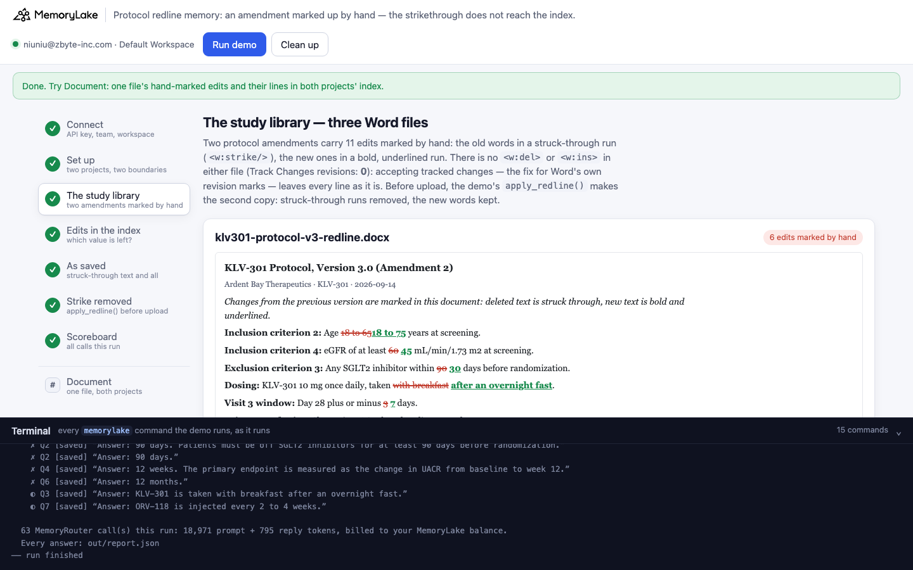
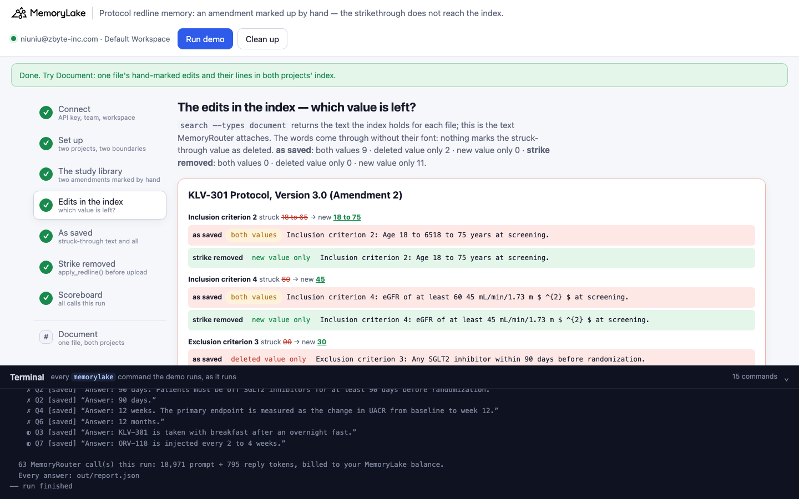
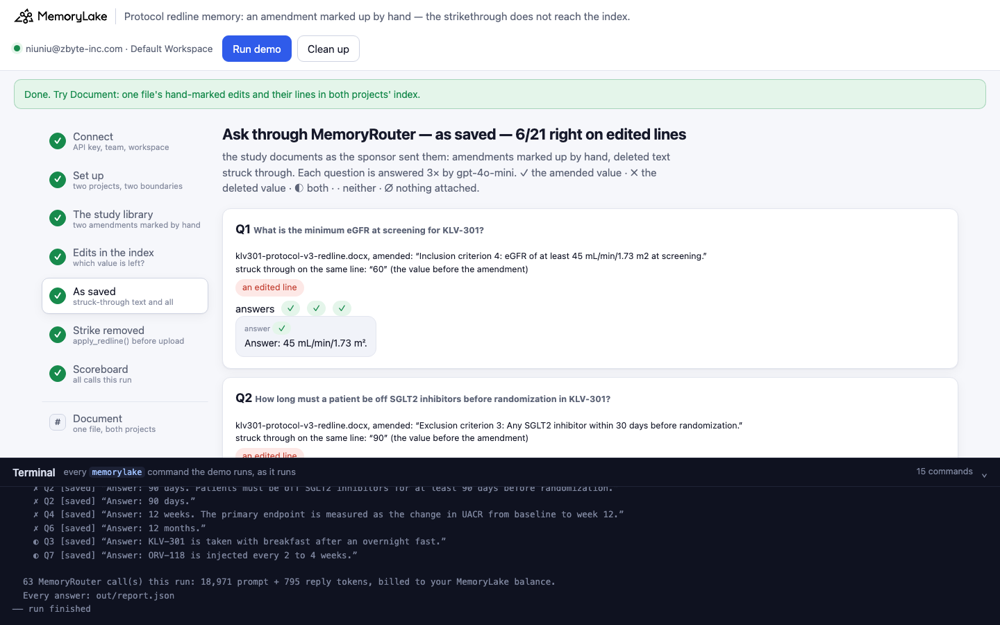
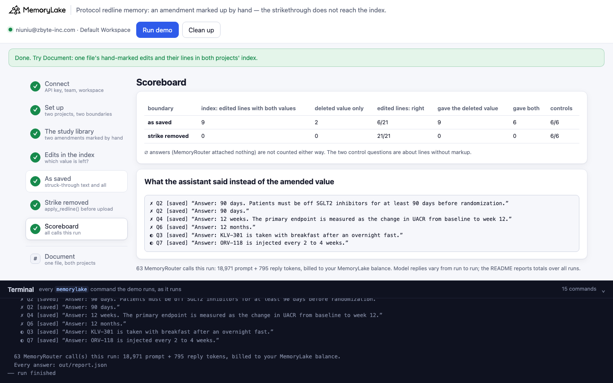

# Protocol redline memory: an amendment marked up by hand — the strikethrough does not reach the index

A runnable version of the MemoryLake use case
[*Give Healthcare Researchers AI That Retains Clinical Context Across the Full Study*](https://www.memorylake.ai/en/usecase/ai-memory-for-healthcare-researchers),
built entirely on the [`memorylake` CLI](https://github.com/memorylake-ai/memorylake-cli) (v20261015 or later).

**Watch it run:** [CLI, 5:19](https://github.com/memorylake-ai/memorylake-usecases/releases/download/protocol-redline-memory-v1/protocol-redline-memory-cli-demo.mp4) · [Web, 6:42](https://github.com/memorylake-ai/memorylake-usecases/releases/download/protocol-redline-memory-v1/protocol-redline-memory-web-demo.mp4)
([release](https://github.com/memorylake-ai/memorylake-usecases/releases/tag/protocol-redline-memory-v1); GitHub serves them as downloads).

**The problem.** Northfield Clinical Research Unit (a fictional research site) keeps its study documents in shared
memory, so that a study assistant can answer *"what's the minimum eGFR at screening?"* while a coordinator
pre-screens a patient. The sponsor sends each protocol amendment as a Word file **marked up by hand**, the way many
sponsors do: the deleted words struck through, the new words bold and underlined.

```
Exclusion criterion 3: Any SGLT2 inhibitor within ~~90~~ __30__ days before randomization.
                                   (~~struck through~~, __bold and underlined__)
```

That is not Word's Track Changes. There is no `<w:del>` in the file — the strikethrough is only a font setting on a
run of text (`<w:strike/>`). The usual fix for marked-up Word files, accepting all changes, finds nothing to accept.

MemoryLake's index reads the words on the page **without their font**. The strikethrough is gone, so the old and the
new value stand side by side — and on two lines the new value is not in the index text at all:

```
Inclusion criterion 2: Age 18 to 6518 to 75 years at screening.
Exclusion criterion 3: Any SGLT2 inhibitor within 90 days before randomization.        ← 30 is gone; 90 was deleted
Primary endpoint: Change in UACR from baseline to week 12 24.
Inclusion criterion 1: Adults 18 years or older with a diagnosis of asthma for at least 12 months.   ← 6 is gone
```

MemoryRouter attaches that text, and the assistant answers with criteria the amendment deleted: *"Answer: 90 days."*
— 21 times out of 21. Where both values survive, which one it picks is not predictable: it took the new eGFR (45)
from `60 45`, but the old endpoint (week 12) from `week 12 24`, and merged *"with breakfast after an overnight
fast"* into a dosing instruction that is neither.

**The fix** is a 20-line function in `demo.py`, run before upload: `apply_redline()` removes every struck-through run
and takes the bold and underline off the new words, so each line reads as amended. The same files then come back
right, every time.

## What the demo shows

1. **Connect** — API key → isolated CLI profile, team, workspace.
2. **Set up** — two projects (*as saved* / *strike removed*), a MemoryRouter boundary over each.
3. **The study library** — three Word files: the KLV-301 protocol v3.0 (6 hand-marked edits), the ORV-118 protocol
   v2.0 (5 edits), and a pharmacy manual with no markup (the control). The demo reads each edit from the file
   itself (struck-through run → bold + underlined run), shows that `accept_changes()` finds 0 tracked changes and
   leaves every line as it is, makes the second copy with `apply_redline()`, uploads both sets and imports each
   into its project.
4. **The edits in the index** — `search --types document` per file and project: each edited line as the index holds
   it, and which value is left — both, the deleted one only, or the new one only — plus the index's own summary
   of the file.
5. **Ask through MemoryRouter — as saved** — nine questions, each 3× through `router chat --boundary`
   (gpt-4o-mini, temperature 0). Each question is also asked once without a boundary: a boundary call with the
   same prompt-token count had nothing attached (∅, not graded).
6. **Ask through MemoryRouter — strike removed** — the same nine questions through the other boundary.
7. **Scoreboard** — per boundary: what the index kept, and right / deleted value / both, for the edited lines and
   the controls.

The questions: seven about edited lines (two where the new value is gone from the index, five where both survive),
two controls — an unedited line of the KLV-301 protocol, and the pharmacy manual.

## Prerequisites

- Python 3.9+ (standard library only)
- The `memorylake` CLI, **v20261015 or later** (`memorylake router` is new in that release):
  ```bash
  curl -fsSL https://raw.githubusercontent.com/memorylake-ai/memorylake-cli/main/scripts/install.sh | sh
  ```
- A MemoryLake API key ([app.memorylake.ai](https://app.memorylake.ai) → API Keys)
- Router calls are billed to your MemoryLake balance: 63 calls per run, about 19,000 prompt + 800 reply tokens.
  Without balance, the memory steps (1–4) still run and the answers are skipped.

## Run it

```bash
git clone https://github.com/memorylake-ai/memorylake-usecases.git
cd memorylake-usecases/protocol-redline-memory
export MEMORYLAKE_API_KEY=sk-...          # logs into an isolated profile under .memorylake-demo/
python3 demo.py                           # about 4–5 minutes
python3 demo.py doc orv                   # read-only: one file's edits and their lines in both projects' index
python3 demo.py redlines                  # offline: the markup the .docx files hold, accept_changes() vs apply_redline()
python3 demo.py cleanup                   # delete everything the demo created
```

China region: also `export MEMORYLAKE_BASE_URL=https://app.memorylake.cn/openapi/memorylake`.
Everything the demo creates is prefixed `mlu-prl-`; every run starts over.

## Or run it in the browser

```bash
python3 web/server.py                     # opens http://127.0.0.1:8765
```

Paste the key, press **Run demo**. The page follows the run step by step: the documents laid out as Word shows them
(old words struck through in red, new words bold and underlined), each edited line in the index of both projects
with what it kept, the questions under each boundary, and a scoreboard. **Document** looks up one file in both
projects without a model call. A terminal drawer shows every `memorylake` command as it runs. **Clean up** removes
it all.

| | |
|---|---|
|  |  |
|  |  |

## What happens, step by step

### Steps 2–3: two projects, two boundaries, one study library

```
$ memorylake proj create --name 'Northfield Clinical Research Unit — Study document library (as saved)' --custom-id mlu-prl-saved …
$ memorylake boundary create --name 'Study assistant: as saved' --custom-id mlu-prl-saved --projects proj-… …
$ memorylake proj create --name 'Northfield Clinical Research Unit — Study document library (strike removed)' --custom-id mlu-prl-applied …
$ memorylake boundary create --name 'Study assistant: strike removed' --custom-id mlu-prl-applied --projects proj-… …
```

The edits, read from the files themselves:

```
  klv301-protocol-v3-redline.docx — KLV-301 Protocol, Version 3.0 (Amendment 2), from Ardent Bay Therapeutics, 2026-09-14
    6 edits marked by hand — struck-through run (deleted) → bold + underlined run (new):
      Inclusion criterion 2  struck “18 to 65” → new “18 to 75”
      Inclusion criterion 4  struck “60” → new “45”
      Exclusion criterion 3  struck “90” → new “30”
      Dosing                 struck “with breakfast” → new “after an overnight fast”
      Visit 3 window         struck “3” → new “7”
      Primary endpoint       struck “12” → new “24”

  orv118-protocol-v2-redline.docx — ORV-118 Protocol, Version 2.0 (Amendment 1), from Ardent Bay Therapeutics, 2026-08-27
    5 edits marked by hand — struck-through run (deleted) → bold + underlined run (new):
      Inclusion criterion 1  struck “12” → new “6”
      Inclusion criterion 3  struck “80” → new “85”
      Exclusion criterion 2  struck “10” → new “20”
      Run-in                 struck “14” → new “21”
      Dosing                 struck “2” → new “4”

  klv301-pharmacy-manual.docx — KLV-301 Pharmacy Manual, Version 1.0, from Ardent Bay Therapeutics, 2026-07-02
    no markup (the control)
  · Word's Track Changes in these files: 0. accept_changes() — Review › Accept All Changes, the fix for tracked edits — leaves every line exactly as it was: the strikethrough is only a font setting
  · the fix, before upload: apply_redline() removes the 11 struck-through runs and takes the bold and underline off the new words; each line now reads as amended → out/current/*.current.docx
$ memorylake lib upload data/klv301-protocol-v3-redline.docx --name mlu-prl-klv301-protocol-v3-redline.docx --on-conflict overwrite
$ memorylake lib upload out/current/klv301-protocol-v3-redline.current.docx --name mlu-prl-klv301-protocol-v3-redline.current.docx --on-conflict overwrite
$ memorylake proj doc import --project proj-… <item> <item> <item> --wait …
```

### Step 4: the edits in the index

```
  klv301-protocol-v3-redline — each edited line as the index text holds it
    Inclusion criterion 4  struck “60” → new “45”
        as saved        both      “Inclusion criterion 4: eGFR of at least 60 45 mL/min/1.73 m $ ^{2} $ at screening.”
        strike removed  new only  “Inclusion criterion 4: eGFR of at least 45 mL/min/1.73 m $ ^{2} $ at screening.”
    Exclusion criterion 3  struck “90” → new “30”
        as saved        old only  “Exclusion criterion 3: Any SGLT2 inhibitor within 90 days before randomization.”
        strike removed  new only  “Exclusion criterion 3: Any SGLT2 inhibitor within 30 days before randomization.”
    Dosing                 struck “with breakfast” → new “after an overnight fast”
        as saved        both      “Dosing: KLV-301 10 mg once daily, taken with breakfast after an overnight fast.”
        strike removed  new only  “Dosing: KLV-301 10 mg once daily, taken after an overnight fast.”
    Primary endpoint       struck “12” → new “24”
        as saved        both      “Primary endpoint: Change in UACR from baseline to week 12 24.”
        strike removed  new only  “Primary endpoint: Change in UACR from baseline to week 24.”
  …
  orv118-protocol-v2-redline — each edited line as the index text holds it
    Inclusion criterion 1  struck “12” → new “6”
        as saved        old only  “Inclusion criterion 1: Adults 18 years or older with a diagnosis of asthma for at least 12 months.”
    …
    the index's own summary of the as-saved file: “… It includes revised inclusion and exclusion criteria, a 14-21 day placebo run-in period, dosing schedule, primary endpoint, and sample size.”

  as saved        edited lines in the index: both values 9 · old only 2 · new only 0
  strike removed  edited lines in the index: both values 0 · old only 0 · new only 11
```

Nothing in the as-saved text says which value was deleted. The index's own summary of the ORV-118 amendment turns
the struck 14 and the new 21 into *"a 14-21 day placebo run-in period"*.

### Steps 5–6: ask through MemoryRouter, under each boundary

```
$ memorylake router chat 'How long must a patient be off SGLT2 inhibitors before randomization in KLV-301?' --model gpt-4o-mini --max-tokens 120 --temperature 0 --system '…' --boundary bnd-…

  Q2  How long must a patient be off SGLT2 inhibitors before randomization in KLV-301?
      klv301-protocol-v3-redline.docx, amended: “Exclusion criterion 3: Any SGLT2 inhibitor within 30 days before randomization.”
      struck through on the same line: “90” (the value before the amendment)
      answers ✗ ✗ ✗   e.g. “Answer: 90 days. Patients must be off SGLT2 inhibitors for at least 90 days before randomization.”
```

Under the *strike removed* boundary the same question gets *"Answer: 30 days."* The scoreboard of one run:

```
  as saved        in the index: edited lines with both values 9 · the deleted value only 2 · the new value only 0
                  edited lines: 6/21 right · 9 gave the deleted value · 6 gave both · 0 other  ·  controls: 6/6
  strike removed  in the index: edited lines with both values 0 · the deleted value only 0 · the new value only 11
                  edited lines: 21/21 right · 0 gave the deleted value · 0 gave both · 0 other  ·  controls: 6/6

  what the assistant said instead of the amended value (✗ the deleted value · ◐ both · · neither):
    ✗ Q2 [saved] “Answer: 90 days.”
    ✗ Q4 [saved] “Answer: 12 weeks. The primary endpoint is measured as the change in UACR from baseline to week 12.”
    ✗ Q6 [saved] “Answer: 12 months.”
    ◐ Q3 [saved] “Answer: KLV-301 is taken with breakfast after an overnight fast.”
    ◐ Q7 [saved] “Answer: ORV-118 is injected every 2 to 4 weeks.”
```

### The read-only subcommands

- `python3 demo.py doc <klv|orv|pharm>` — one file's hand-marked edits and each edited line in the index text of
  both projects (searches only, no model call).
- `python3 demo.py redlines` — offline: every edit the `.docx` files hold, the number of Track Changes revisions
  (0), and each line after `apply_redline()`.

## Measured

Over **7 runs** (including the recordings for the videos; per boundary and run: 21 answers about edited lines, 6 about the controls):

| | edited lines: right | gave the deleted value | gave both | other | controls |
|---|---|---|---|---|---|
| as saved | 42/146 | 63 | 41 | 0 | 42/42 |
| strike removed | 147/147 | 0 | 0 | 0 | 42/42 |

By question (21 answers each):

| | as saved | strike removed |
|---|---|---|
| Q1 KLV-301 minimum eGFR (45; struck 60) — index: `60 45` | 21/21 | 21/21 |
| Q2 KLV-301 SGLT2 washout (30; struck 90) — index: `90` only | 0/21 — 21 gave the deleted value | 21/21 |
| Q3 KLV-301 dosing (after an overnight fast; struck with breakfast) — index: both | 0/21 — 21 gave both | 21/21 |
| Q4 KLV-301 primary endpoint (week 24; struck 12) — index: `12 24` | 0/21 — 21 gave the deleted value | 21/21 |
| Q5 ORV-118 upper FEV1 (85; struck 80) — index: `80 85` | 21/21 | 21/21 |
| Q6 ORV-118 asthma history (6 months; struck 12) — index: `12` only | 0/21 — 21 gave the deleted value | 21/21 |
| Q7 ORV-118 dosing interval (every 4 weeks; struck 2) — index: `2 4` | 0/20 — 20 gave both, 1 ∅ | 21/21 |
| Q8 KLV-301 sample size (no markup on the line) | 21/21 | 21/21 |
| Q9 pharmacy manual storage (no markup in the file) | 21/21 | 21/21 |

- **The index**: in all 7 runs (each a fresh import), the as-saved text held both values on 9 of the 11 edited lines
  and **only the deleted value on 2** (Exclusion criterion 3 `within 90 days`, ORV-118 Inclusion
  criterion 1 `at least 12 months`) — the same lines, the same text, every time. The strike-removed text held only
  the new value on 11/11. The rule for which new values disappear is not something we found: in an earlier
  probe with plain (not bold) labels, the eGFR line came out as `$ 60 \times 10^{5} $` — the 45 gone, too.
- **Where both values survive, the model's pick is not a rule.** It took the later number for eGFR (`60 45` → 45)
  and FEV1 (`80 85` → 85), the earlier one for the endpoint (`week 12 24` → week 12), and merged the dosing
  line and the injection interval into instructions that are neither (*"with breakfast after an overnight fast"*,
  *"every 2 to 4 weeks"*).
- **∅**: 1 of 378 boundary calls came back with exactly the prompt-token count of the same call without a
  boundary — MemoryRouter attached nothing, and the model answered on its own (Q7 in the CLI recording: *"once every 28
  days"*). Not graded either way.
- Model replies vary from run to run in principle; here every graded answer got the same verdict as the others for
  its question, run after run. These are totals over every run.

## Use it in your own app

- **Apply the markup before you import.** `apply_redline()` in `demo.py` is the whole fix: in `word/document.xml`,
  drop every `<w:r>` whose run properties carry `<w:strike/>` or `<w:dstrike/>`, and remove `<w:b/>` and `<w:u/>`
  from the runs that had both. It checks itself: every line must then equal the amended text.
- **Don't count on accepting changes.** `accept_changes()` — Word's Review › Accept All Changes, the fix for tracked
  edits — has nothing to act on in a hand-marked file: no `<w:del>`, no `<w:ins>`.
- **Ask the sponsor for the clean version too.** If a clean copy comes with the marked-up one, the clean one is
  what belongs in memory. Keep the marked-up copy out of the boundary, or apply it first.
- **Look at what the index read.** `memorylake search "<protocol> criteria" --projects <p> --types document` shows
  the text MemoryRouter will attach. Two numbers side by side (`week 12 24`, `60 45`) are a struck value and its
  replacement, and nothing in the text says which is which — sometimes the replacement is missing altogether.

## Troubleshooting

- `this memorylake CLI has no 'router' command` — upgrade the CLI (v20261015 or later).
- `MemoryRouter refused the call for lack of balance` — the memory steps still run; top up to see the answers.
- `the documents are still processing after 6 minutes` — run again; the demo starts over.
- `search did not return the documents yet` — the index can lag a few seconds behind the import; run again.
- Leftovers from an interrupted run: `python3 demo.py cleanup` (everything is prefixed `mlu-prl-`).

## Files

- `demo.py` — the whole demo (standard library only): CLI wrapper, `.docx` markup reader, `accept_changes()` (the
  control) and `apply_redline()` (the fix), setup, index view, MemoryRouter calls, grading, cleanup
- `data/protocols.json` — the three documents (each line, with its struck-through and new parts), the questions with
  their grading patterns, and the system prompt
- `data/*.docx` — the three documents as saved (two marked up by hand); `data/make_protocols.py` regenerates them
  from `protocols.json` (standard library only, same bytes every time)
- `web/server.py`, `web/static/` — the browser companion (standard library HTTP + server-sent events)
