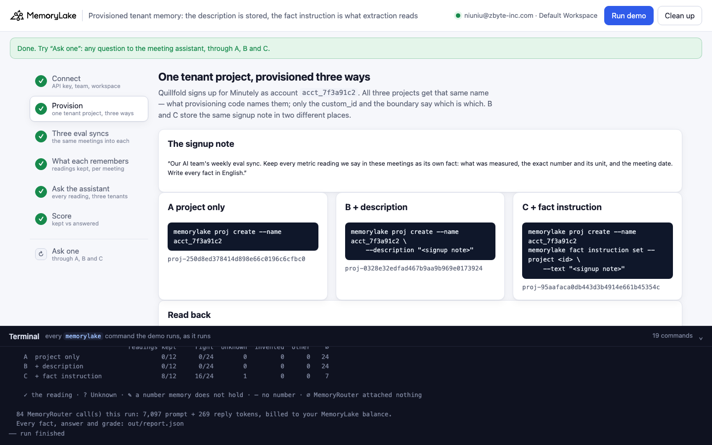
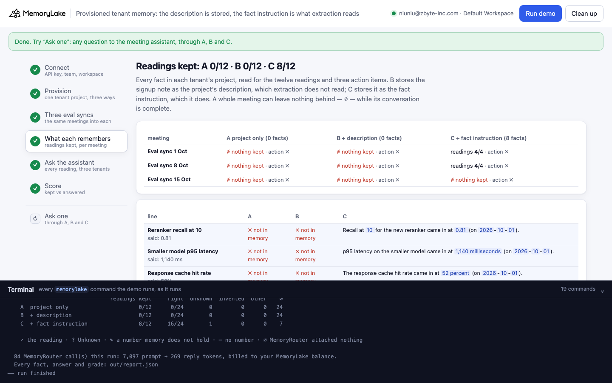
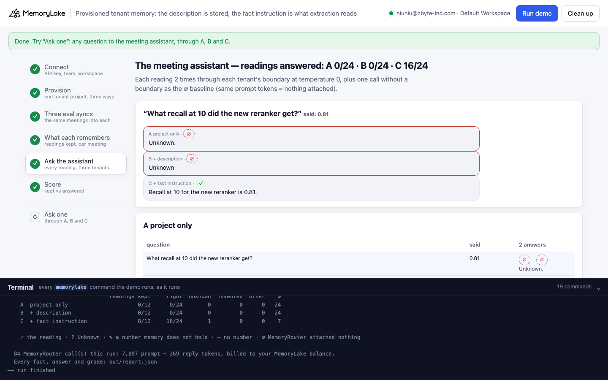
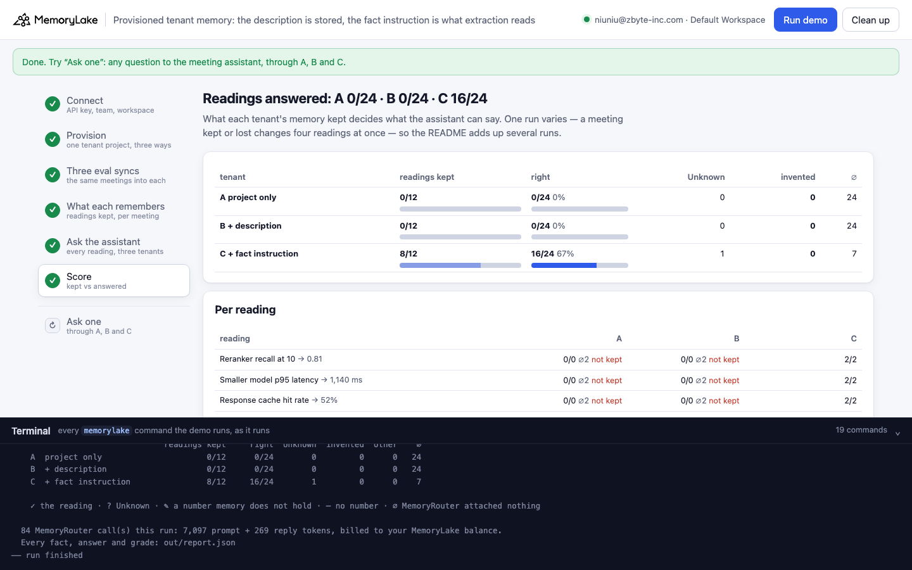

# Provisioned tenant memory: the description is stored, the fact instruction is what extraction reads

A runnable version of the MemoryLake use case
[*Run AI SaaS on Memory Infrastructure That Scales With You*](https://www.memorylake.ai/en/usecase/memory-infrastructure-for-ai-saas),
built entirely on the [`memorylake` CLI](https://github.com/memorylake-ai/memorylake-cli) (v20261015 or later).

**Watch it run:** [CLI, 4:30](https://github.com/memorylake-ai/memorylake-usecases/releases/download/provisioned-tenant-memory-v1/provisioned-tenant-memory-cli-demo.mp4) · [Web, 5:16](https://github.com/memorylake-ai/memorylake-usecases/releases/download/provisioned-tenant-memory-v1/provisioned-tenant-memory-web-demo.mp4)
([release](https://github.com/memorylake-ai/memorylake-usecases/releases/tag/provisioned-tenant-memory-v1); GitHub serves them as downloads).

**The problem.** An AI SaaS gives every customer team its own MemoryLake project, created by its provisioning code.
The project gets named after the account id, and what the customer said at signup about their meetings has to go
somewhere. The project description looks like the right place:

```
memorylake proj create --name acct_7f3a91c2 \
    --description "Our AI team's weekly eval sync. Keep every metric reading we say in these meetings as its own fact: …"
```

Then the team's meetings flow in. Each eval sync reads out four metrics the way people do —
"Recall at 10 for the new reranker came in at 0.81." — and MemoryLake's extraction often keeps nothing from a whole
meeting of sentences like that. The description does not change it: extraction never reads the description. The same
sentence written as the project's **fact instruction** does:

```
memorylake fact instruction set --project <id> --text "Our AI team's weekly eval sync. Keep every metric reading …"
```

**What this demo shows.** Minutely (a fictional AI meeting-notes SaaS) provisions the tenant project for its customer
Quillfold three ways. The three projects have the same name, `acct_7f3a91c2`, and get the same three conversations:

| | how the tenant project is provisioned | what extraction is told |
|---|---|---|
| **A** | `proj create --name acct_7f3a91c2` | nothing beyond the built-in default |
| **B** | the same, plus the signup note as `--description` | the same as A: the description is stored and never read |
| **C** | the same as A, plus the signup note as the project's `fact instruction` | the signup note |

Three eval syncs (1, 8 and 15 October), each with four bare metric readings and one action item. Then Quillfold's
meeting assistant is asked for each of the twelve readings through MemoryRouter (`router chat --boundary`, one
boundary per tenant project), twice per tenant, on `gpt-4o-mini` at temperature 0.

Over 6 runs, readings kept in the tenant's project: **A 5/72 · B 9/72 · C 60/72**; meetings that left
nothing at all: **A 16/18 · B 15/18 · C 3/18**. The assistant answered the readings right:
**A 10/144 · B 18/144 · C 120/144**; it never invented a number (temperature 0, "say Unknown"), it said
Unknown or got nothing attached. Details in [Measured](#measured).

## Prerequisites

- **Python 3.9+** (standard library only).
- **The `memorylake` CLI, v20261015 or later** (`memorylake version`):
  ```bash
  curl -fsSL https://raw.githubusercontent.com/memorylake-ai/memorylake-cli/main/scripts/install.sh | sh
  ```
- **A MemoryLake API key**: sign up at [app.memorylake.ai](https://app.memorylake.ai), open **API Keys**, create one.
- **Balance for MemoryRouter**: about 85 calls on `gpt-4o-mini` per run (12 baseline calls with `--max-tokens 1`,
  72 answers). Everything else the demo does (projects, conversations, extraction, fact instructions) is part of
  the free plan.

## Run it

```bash
git clone https://github.com/memorylake-ai/memorylake-usecases.git
cd memorylake-usecases/provisioned-tenant-memory
export MEMORYLAKE_API_KEY=sk-...        # logs into an isolated profile under .memorylake-demo/, never touches ~/.memorylake
python3 demo.py                         # about 5 minutes
python3 demo.py memory                  # per meeting and line: what each tenant's project kept
python3 demo.py ask "What recall at 10 did the new reranker get?"
python3 demo.py cleanup                 # deletes everything the demo created
```

China region: also `export MEMORYLAKE_BASE_URL=https://app.memorylake.cn/openapi/memorylake`. To use a specific
workspace: `export MEMORYLAKE_WORKSPACE=ws-…` (default: the team's default workspace). Without `MEMORYLAKE_API_KEY`
the demo uses your existing `memorylake auth login` session.

Every object the demo creates has a `custom_id` starting with `mlu-ptm-`. Each run starts over: it deletes what a
previous run left behind first.

## Or run it in the browser

```bash
python3 web/server.py                   # opens http://127.0.0.1:8765
```

Paste the API key, press **Run demo**, and follow the steps: the three provisioning calls and what each stored, the
meetings, what each tenant kept, the assistant's answers and the score. **Ask one** sends any question through all
three tenants. The terminal drawer at the bottom shows every `memorylake` command as it runs. The server is standard
library only and binds to localhost; the key stays in that process and in `.memorylake-demo/`.

| | |
|---|---|
|  |  |
|  |  |

## What happens, step by step

Output excerpts below are from real runs (ids shortened).

### Step 2: one tenant project, provisioned three ways

```
$ memorylake proj create --name acct_7f3a91c2 --custom-id mlu-ptm-plain
$ memorylake proj create --name acct_7f3a91c2 --custom-id mlu-ptm-described --description 'Our AI team'"'"'s weekly eval sync. Keep every metric reading …'
$ memorylake proj create --name acct_7f3a91c2 --custom-id mlu-ptm-instructed
$ memorylake fact instruction set --project proj-9228… --text 'Our AI team'"'"'s weekly eval sync. Keep every metric reading …'

    Read back — the signup note is stored in both B and C:
$ memorylake proj get proj-cbb5…
      B  description: “Our AI team's weekly eval sync. Keep every metric reading we say in these meetings as
      its own fact: what was measured, the exact number and its unit, and the meeting date. Write every fact
      in English.”
$ memorylake fact instruction get --project proj-9228…
      C  fact_instruction: “Our AI team's weekly eval sync. Keep every metric reading we say …”
```

The three projects have the same name on purpose: the project name is context for extraction, so it must not differ
between the arms. Which arm is which lives in the `custom_id` and in the boundary's name. Each copy also gets its own
two speakers (`actor create` + `actor bind`) and one boundary over its project (`boundary create --projects`).

### Step 3: three eval syncs, the same conversations into each tenant

```
    Thu 01 Oct 2026  “Eval sync 1 Oct”
        reading Priya Natarajan: Recall at 10 for the new reranker came in at 0.81.
        reading Jonah Park: p95 latency on the smaller model came in at 1,140 milliseconds.
        reading Priya Natarajan: The response cache hit rate came in at 52 percent.
        reading Jonah Park: Token cost per session with the compaction job came in at 2.6 cents.
        action Jonah Park: I will rerun the latency eval on the larger GPU pool before next week's sync.
    …
$ memorylake conv create --project proj-4d5c… --actors actor-845a…,actor-60ec… --kind GROUP --name 'Quillfold · Eval sync 1 Oct' …
$ memorylake conv msg append conv-653a… --actor actor-845a… --custom-id m00 --timestamp 2026-10-01T09:00:00Z --text 'Priya Natarajan (ML lead, Quillfold): Recall at 10 …'
$ memorylake conv cook-status conv-653a…
```

Each meeting is one GROUP conversation, every line as its speaker a minute apart; the demo waits for `cook_finished`
on all nine conversations (about 1–3 minutes).

### Step 4: what each tenant remembers

```
                            A  project only           B  + description          C  + fact instruction
    Eval sync 1 Oct         ⌀ readings 0/4 · action ✗ ⌀ readings 0/4 · action ✗   readings 4/4 · action ✗
    Eval sync 8 Oct         ⌀ readings 0/4 · action ✗ ⌀ readings 0/4 · action ✗   readings 4/4 · action ✗
    Eval sync 15 Oct        ⌀ readings 0/4 · action ✗   readings 4/4 · action ✗   readings 4/4 · action ✗

    A  project only           0 facts in the project · readings 0/12 · action items 0/3 · meetings with nothing kept 3/3
    B  + description          4 facts in the project · readings 4/12 · action items 0/3 · meetings with nothing kept 2/3
    C  + fact instruction    12 facts in the project · readings 12/12 · action items 0/3 · meetings with nothing kept 0/3
    C, a reading as kept: “Recall at 10 for the new reranker was 0.81 …”
```

`fact list --projects` per tenant, read for each line: a reading counts when its number is in a fact. ⌀ marks a
meeting that left nothing in the project although its conversation is complete. A line kept only on a speaker is
shown as `·`: MemoryRouter reads the project through the boundary, not the speakers.

### Step 5: ask the meeting assistant

```
$ memorylake router chat 'What recall at 10 did the new reranker get?' --model gpt-4o-mini --max-tokens 60 --temperature 0 --system '…' --boundary bnd-…

  A  project only
    Reranker recall at 10           ✓ ✓    The new reranker achieved Recall@10 of 0.81.
    Response cache hit rate         ? ∅    Unknown
    Token cost with compaction      ∅ ∅    Unknown
    …
  C  + fact instruction
    Response cache hit rate         ✓ ✓    The response cache hit rate was 52 percent.
    Token cost with compaction      ✓ ✓    The token cost per session with the compaction job was 2.6 cents.
    …
```

Each of the twelve readings twice per tenant, plus each question once without `--boundary`: a boundary call with the
same prompt tokens as that baseline had nothing attached (∅). The grader (`grade()`) looks for the reading's value
after removing dates and the numbers the question itself says; it checks itself against 18 cases on every run.

### Step 6: the score

```
                                readings kept     right  Unknown  invented  other    ∅
    A  project only                      0/12      0/24        0         0      0   24
    B  + description                     4/12      8/24        1         0      0   15
    C  + fact instruction               12/12     24/24        0         0      0    0
```


## Measured

6 full runs (first run, a second run, `--reset`, the browser run, the Web recording, the CLI recording), all exit 0.
Readings kept per run (in brackets: meetings that left nothing):

| run | A project only | B + description | C + fact instruction |
|---|---|---|---|
| 1 | 2/12 (2) | 2/12 (2) | 12/12 (0) |
| 2 | 0/12 (3) | 4/12 (2) | 12/12 (0) |
| 3 | 0/12 (3) | 0/12 (3) | 12/12 (0) |
| 4 | 3/12 (2) | 3/12 (2) | 8/12 (1) |
| 5 | 0/12 (3) | 0/12 (3) | 8/12 (1) |
| 6 | 0/12 (3) | 0/12 (3) | 8/12 (1) |
| **total** | **5/72** (16/18) | **9/72** (15/18) | **60/72** (3/18) |

The assistant, 144 answers per tenant:

| | right | Unknown | invented | MemoryRouter attached nothing (∅) |
|---|---|---|---|---|
| **A** | 10/144 | 9 | 0 | 125 |
| **B** | 18/144 | 7 | 0 | 119 |
| **C** | 120/144 | 6 | 0 | 18 |

- **The description is not what extraction reads.** A and B differ only by `--description`; they kept 5/72 and
  9/72. In our probes before the demo (one eval sync, three projects each), a description saying what to keep
  left 0 of 18 readings; a fact instruction saying the same thing, 18 of 18.
- **The fact instruction is not a guarantee.** C lost one whole meeting in 3 of 18 meetings. Count what
  each meeting left, as `census()` does.
- **Action items were kept nowhere** (0 of 54 across all three tenants). The instruction asks for readings only, and
  "I will rerun the latency eval …" is not one; nor did the default extraction keep it.
- **The project name was not the lever.** Before settling on this demo we also tried naming the project after the
  team and its topic ("Quillfold agent evals"): 10 of 18 readings kept once and 0 of 18 the next time, against 1 and
  6 of 18 for the account id. Whole meetings come or go together, so single runs swing; only the fact instruction
  held up.

## Use it in your own SaaS

- **Provision the fact instruction with the project.** Whatever your customer tells you about their data at signup
  (what the meetings are, what must be kept, the language to write in) goes into
  `memorylake fact instruction set --project <id>`. The description is for people browsing projects; extraction does
  not read it.
- **Say what to keep, not only what the project is.** The instruction here names the thing that gets lost: "every
  metric reading … as its own fact: what was measured, the exact number and its unit". A sentence that only carries a
  number is exactly what the default extraction drops.
- **Check per meeting, not per project.** A meeting can leave nothing at all while the conversation is complete and
  `cook-status` reports `cook_finished: true`. Count facts per conversation after each import (this demo's
  `census()` does it per meeting) and alert on a meeting that left zero.
- **Action items are a separate concern.** None of the three tenants kept the action items in our runs; the
  instruction here only asks for readings. Add what else you need to the instruction, and measure it the same way.

## Troubleshooting

- **`this memorylake CLI has no router command`**: upgrade the CLI (install line above).
- **MemoryRouter refused the call for lack of balance**: top up in the console; `memorylake billing balance` shows it.
  The memory steps (1–4) still run.
- **`still extracting after 420 s`**: once in a while a meeting takes longer; the demo carries on and counts what
  memory holds at that point.
- **A or B kept a whole meeting this time**: extraction varies; some runs keep one meeting of bare readings, rarely
  more. That is why the table above adds up several runs rather than quote one.
- **`the demo memory does not exist yet`**: `memory` and `ask` need a full run first (and `cleanup` removes it).
- **A run was interrupted**: run again; it deletes what the previous run left and starts over.

## Files

| File | What it is |
|---|---|
| `demo.py` | The demo: CLI wrapper, provisioning (`setup()`), the meetings (`ingest_copy()`), the per-meeting census (`census()`), Router questions, the grader (`grade()`, self-checked against `GRADER_CASES` on every run), `memory`, `ask`, cleanup (facts before actors) |
| `data/tenant.json` | The SaaS, the account, the signup note, the two speakers, the three meetings and their fifteen lines (twelve readings with value patterns and questions, three action items), the system prompt |
| `web/server.py`, `web/static/` | Browser companion (standard library server, no build step) |
| `out/` | `report.json` with every fact, answer and grade; `out/runs/` keeps earlier runs' reports (git-ignored) |
