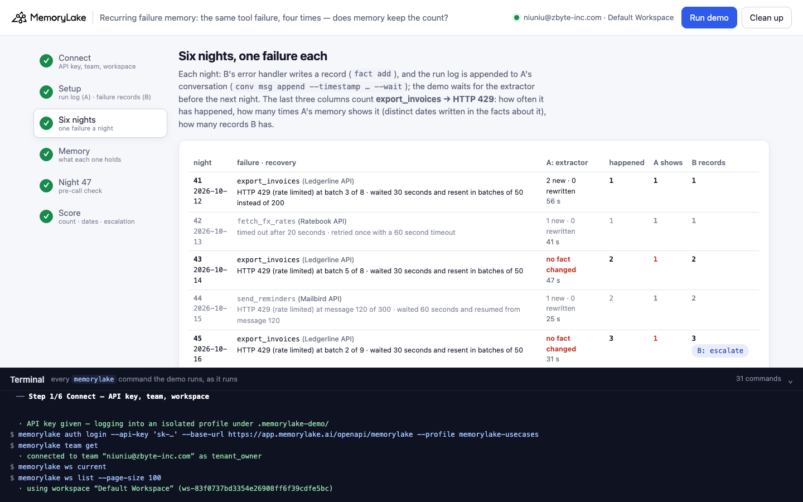
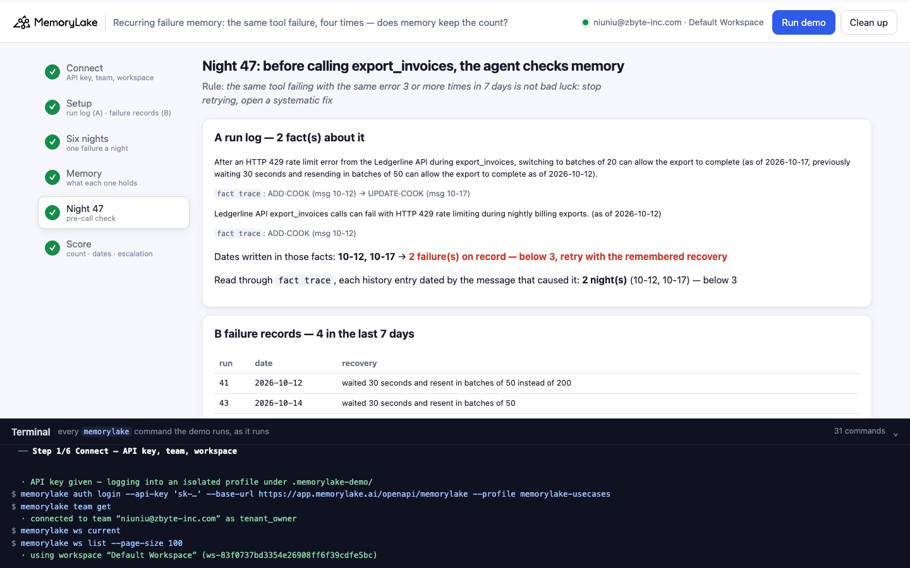
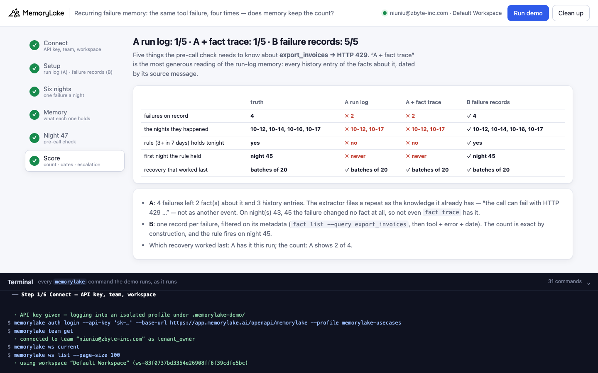

# Recurring failure memory: the same tool failure, four times in a week — memory keeps the lesson, not the count

A runnable version of the MemoryLake use case
[*Give Agents Memory of Tool Failures So They Recover Instead of Spiral*](https://www.memorylake.ai/en/usecase/memory-for-agents-that-recover-from-tool-failures),
built entirely on the [`memorylake` CLI](https://github.com/memorylake-ai/memorylake-cli) (v20261015 or later).

**Watch it run:** videos are being recorded.

**The problem.** An agent's tool fails — a rate limit, a timeout — and it recovers. Remembering *how* it recovered
helps next time. But one failure is bad luck; the same failure every other night is a pattern, and a pattern needs a
fix, not another retry. "Has this failed three times this week?" is a question about **events**: how many, and when.

- **Send the run log to memory** — the obvious move: each night's run log goes into a conversation and MemoryLake's
  extractor turns it into memory. The extractor is built to keep **knowledge**: "the export_invoices call can fail
  with HTTP 429 …; waiting 30 seconds and resending in batches of 50 lets it complete". When the same failure comes
  back, that knowledge is already there — so the repeat is merged into it, or changes nothing at all. Four failures
  left one to three facts and three or four history entries. In 6 of 8 runs the count came out short; in 4 of 8 the
  rule never fired.
- **Write a typed failure record** — the tool error handler writes one record per failure (`fact add`, then
  `fact update --metadata` with run, date, tool, error, recovery, outcome). Four failures, four records, every run.
  The rule fires on the third.

**What this demo shows.** Copperleaf Billing (fictional) runs a nightly billing agent, Tally. Six nights, three
tools:

| night | date | tool | failure | recovery |
|---|---|---|---|---|
| 41 | 2026-10-12 | `export_invoices` (Ledgerline API) | **HTTP 429** at batch 3 of 8 | wait 30 s, resend in batches of 50 instead of 200 |
| 42 | 2026-10-13 | `fetch_fx_rates` (Ratebook API) | timed out after 20 s | retry once with a 60 s timeout |
| 43 | 2026-10-14 | `export_invoices` (Ledgerline API) | **HTTP 429** at batch 5 of 8 | wait 30 s, batches of 50 |
| 44 | 2026-10-15 | `send_reminders` (Mailbird API) | HTTP 429 at message 120 of 300 | wait 60 s, resume from message 120 |
| 45 | 2026-10-16 | `export_invoices` (Ledgerline API) | **HTTP 429** at batch 2 of 9 | wait 30 s, batches of 50 |
| 46 | 2026-10-17 | `export_invoices` (Ledgerline API) | **HTTP 429** at batch 4 of 8 | batches of 50 did not help; **batches of 20** did |

Each failure is remembered two ways, side by side, each on its own project:

| | what it does each night |
|---|---|
| **A run log** | appends the night's run log to a conversation on the runs project (`conv msg append --timestamp <night> --wait`); the extractor turns it into memory |
| **B failure records** | the error handler writes one record on the records project: `fact add "Tool failure record - run 43 (2026-10-14): tool export_invoices …"` + `fact update --metadata '{"run":43,"date":"2026-10-14","tool":"export_invoices","error":"HTTP 429 (rate limited)",…}'` |

Before night 47 the agent checks memory for earlier failures of `export_invoices` and applies one rule: **the same
tool failing with the same error 3 or more times in 7 days — stop retrying, open a systematic fix.** It should
fire tonight (4 failures), and it should already have fired on night 45 (the third).

A is read as generously as it can be, two ways: every distinct date written in the facts about the failure (also
inside "previously …"), and — "A + fact trace" — every history entry of those facts (`fact trace`), dated by the
message that caused it. No model calls: nothing is billed to your MemoryLake balance.

## Prerequisites

- **Python 3.9+** (standard library only).
- **The `memorylake` CLI, v20261015 or later** (`memorylake version`):
  ```bash
  curl -fsSL https://raw.githubusercontent.com/memorylake-ai/memorylake-cli/main/scripts/install.sh | sh
  ```
- **A MemoryLake API key**: sign up at [app.memorylake.ai](https://app.memorylake.ai), open **API Keys**, create one.
  Everything the demo uses (projects, facts, conversations, `fact trace`) is part of the free plan.

## Run it

```bash
git clone https://github.com/memorylake-ai/memorylake-usecases.git
cd memorylake-usecases/recurring-failure-memory
export MEMORYLAKE_API_KEY=sk-...        # logs into an isolated profile under .memorylake-demo/, never touches ~/.memorylake
python3 demo.py                         # about 4 minutes: six nights, each waits for the extractor
python3 demo.py history                 # every failure of the week: can each night still be found in A? in B?
python3 demo.py cleanup                 # deletes everything the demo created
```

China region: also `export MEMORYLAKE_BASE_URL=https://app.memorylake.cn/openapi/memorylake`. To use a specific
workspace: `export MEMORYLAKE_WORKSPACE=ws-…` (default: the team's default workspace). Without `MEMORYLAKE_API_KEY`
the demo uses your existing `memorylake auth login` session.

Every object the demo creates has a `custom_id` starting with `mlu-rfm-`. Each run starts over: it deletes what a
previous run left behind first (`--reset` is accepted and does the same).

## Or run it in the browser

```bash
python3 web/server.py                   # opens http://127.0.0.1:8765
```

Paste the API key, press **Run demo**, and follow the steps: the two projects, the six nights as they happen (with a
running count per memory), what each memory holds, night 47's pre-call check, and the score. The terminal drawer at
the bottom shows every `memorylake` command as it runs. The server is standard library only and binds to localhost;
the key stays in that process and in `.memorylake-demo/`.

| | |
|---|---|
|  |  |
|  | |

## What happens, step by step

Output below is from one real run (the third terminal run, with `--reset`; ids shortened, long commands cut).

### Step 2: setup

Two projects (`proj create`), the agent as an actor (`actor create`, `actor bind`), and its run-log conversation on
the runs project (`conv create --project <runs> --actors <tally> --kind DIRECT`). The records project gets no
conversation: only the error handler writes to it, so the extractor never touches a record.

### Step 3: six nights

Each night, B's record first, then A's run log, then the demo waits for the extractor (it watches the facts and
`conv cook-status`; a repeat may change nothing, so "cook finished three polls running and 25 s passed" ends the
wait too). The last line of each night counts `export_invoices → HTTP 429`:

```
  night 43 · 2026-10-14 · export_invoices (Ledgerline API): HTTP 429 (rate limited) at batch 5 of 8
      recovery: waited 30 seconds and resent in batches of 50; the export completed
$ memorylake fact add 'Tool failure record - run 43 (2026-10-14): tool export_invoices (Ledgerline API); error: HTTP 429 (rate limited) at batch 5 of 8; …' --project proj-cca3… --workspace ws-83f0…
$ memorylake conv msg append conv-4e34… --actor actor-39a4… --custom-id run-43 --timestamp 2026-10-14T09:00:00Z --text 'Tally (nightly billing agent, run log): Nightly run 43: the export_invoices call to the Ledgerline API failed with HTTP 429 …' --wait --workspace ws-83f0…
      … waiting for the extractor (20 s)
      … waiting for the extractor (25 s)
      A run log: extractor done in 30 s — no fact changed
      export_invoices → HTTP 429 so far: happened 2 · A remembers 1 · B has 2 record(s)
  …
  night 45 · 2026-10-16 · export_invoices (Ledgerline API): HTTP 429 (rate limited) at batch 2 of 9
      A run log: extractor done in 26 s — 1 new fact(s), 0 rewritten
      export_invoices → HTTP 429 so far: happened 3 · A remembers 2 · B has 3 record(s)   ← B reaches 3 in 7 days: escalate

  night 46 · 2026-10-17 · export_invoices (Ledgerline API): HTTP 429 (rate limited) at batch 4 of 8
      A run log: extractor done in 26 s — 0 new fact(s), 1 rewritten
      export_invoices → HTTP 429 so far: happened 4 · A remembers 3 · B has 4 record(s)   ← A reaches 3
```

Night 43's failure changed **no fact**: the extractor already knew the call can fail that way.

### Step 4: what each memory holds

```
  A — the runs project: 4 fact(s) from 6 run logs
   ▸ The Ledgerline API rate-limited the export_invoices call with HTTP 429 when invoices were sent in
     batches of 200, and recovery requires waiting 30 seconds and resending in batches of 20 because
     resending in batches of 50 did not resolve the rate limiting (as of 2026-10-17, previously the recovery
     was to wait 30 seconds and resend in batches of 50 as of 2026-10-12)
   ▸ Nightly run 45: the export_invoices call to the Ledgerline API failed with HTTP 429 (rate limited) on
     batch 2 of 9, and waiting 30 seconds and resending in batches of 50 allowed the export to complete (on
     2026-10-16)
     The send_reminders call to the Mailbird API can fail with HTTP 429 (rate limited), and recovery is to
     wait 60 seconds and resume from the failed message (as of 2026-10-15).
     The fetch_fx_rates call to the Ratebook API can time out after 20 seconds, and retrying once with a
     60-second timeout can succeed (as of 2026-10-13)

  B — the records project: 6 record(s)
     run  date        tool             error
   ▸ 41   2026-10-12  export_invoices  HTTP 429 (rate limited)
     42   2026-10-13  fetch_fx_rates   timed out after 20 seconds
   ▸ 43   2026-10-14  export_invoices  HTTP 429 (rate limited)
     44   2026-10-15  send_reminders   HTTP 429 (rate limited)
   ▸ 45   2026-10-16  export_invoices  HTTP 429 (rate limited)
   ▸ 46   2026-10-17  export_invoices  HTTP 429 (rate limited)
```

A's memory is good knowledge — which API, which tool, what worked last — and it kept the Mailbird 429 apart from the
Ledgerline one. What it does not hold is that the Ledgerline 429 happened four times.

### Step 5: night 47 — the pre-call check

```
$ memorylake fact list --projects proj-b146… --page-size 200 --workspace ws-83f0…
$ memorylake fact trace fact-a005… --project proj-b146… --workspace ws-83f0…

  A run log: 2 fact(s) about it, dates written in them: 2026-10-12, 2026-10-16, 2026-10-17
    · The Ledgerline API rate-limited the export_invoices call with HTTP 429 … (as of 2026-10-17, previously … as of 2026-10-12)
      history (`fact trace`): ADD·COOK (msg 10-12) → UPDATE·COOK (msg 10-17)
    · Nightly run 45: the export_invoices call to the Ledgerline API failed with HTTP 429 … (on 2026-10-16)
      history (`fact trace`): ADD·COOK (msg 10-16)
    → 3 failure(s) on record, 3 history entries: escalate
    → read through `fact trace` (each history entry dated by its source message): 3 night(s) (10-12, 10-16, 10-17) — escalate
$ memorylake fact list --projects proj-cca3… --query export_invoices --page-size 100 --workspace ws-83f0…

  B failure records: 4 record(s) of export_invoices → HTTP 429 in the last 7 days
    · run 41 · 2026-10-12 · recovery: waited 30 seconds and resent in batches of 50 instead of 200
    · run 43 · 2026-10-14 · recovery: waited 30 seconds and resent in batches of 50
    · run 45 · 2026-10-16 · recovery: waited 30 seconds and resent in batches of 50
    · run 46 · 2026-10-17 · recovery: waiting 30 seconds and resending in batches of 50 did not help; switched to batches of 20
    → 4 failures: escalate — open a systematic fix for the Ledgerline rate limit; the rule first held on night 45 (2026-10-16)
    → last recovery that worked (run 46): waiting 30 seconds and resending in batches of 50 did not help; switched to batches of 20
```

`fact trace` cannot bring night 43 back: the night that changed nothing has no history entry. In this run A still
reaches three — one night late (46, not 45). In other runs it stays at two and never escalates (see **Measured**).

### Step 6: score

```
    export_invoices → HTTP 429         truth                        A run log                    A + fact trace               B failure records
    failures on record                 4                            ✗ 3                          ✗ 3                          ✓ 4
    the nights they happened           10-12, 10-14, 10-16, 10-17   ✗ 10-12, 10-16, 10-17        ✗ 10-12, 10-16, 10-17        ✓ 10-12, 10-14, 10-16, 10-17
    rule (3+ in 7 days) holds tonight  yes                          ✓ yes                        ✓ yes                        ✓ yes
    first night the rule held          night 45                     ✗ night 46                   ✗ night 46                   ✓ night 45
    recovery that worked last          batches of 20                ✓ batches of 20              ✓ batches of 20              ✓ batches of 20
  · A: 4 failures → 2 fact(s) about it and 3 history entries; 1 of the nights left no date anywhere in the facts' text
  · A: on night(s) 43 the export_invoices → HTTP 429 failure changed no fact at all — the extractor already knew the call can fail that way, so it wrote nothing, and `fact trace` has no entry for it
```

### `python3 demo.py history`

Every failure of the week against both memories (same run):

```
  night  date        failure                                      A: date in a fact about it   B: record
  41     2026-10-12  export_invoices → HTTP 429 (rate limited)    yes                          yes (76dc3a5d)
  42     2026-10-13  fetch_fx_rates → timed out after 20 seconds  yes                          yes (faee22e7)
  43     2026-10-14  export_invoices → HTTP 429 (rate limited)    no — other dates only        yes (c1666b4e)
  44     2026-10-15  send_reminders → HTTP 429 (rate limited)     yes                          yes (50c460b1)
  45     2026-10-16  export_invoices → HTTP 429 (rate limited)    yes                          yes (6612477b)
  46     2026-10-17  export_invoices → HTTP 429 (rate limited)    yes                          yes (a2ec44b0)
  · A: 1 of 6 nights cannot be found by date in the run-log memory; B keeps one record per night
```

## Measured

8 full runs: four in this directory (two terminal runs, one with `--reset`, and a browser run), three copies run
side by side with their own prefix, and the first terminal run. Every number comes from the saved reports
(`out/runs/`).

| over 8 runs | A run log | A + fact trace | B failure records |
|---|---|---|---|
| runs that count all 4 failures | 2 | 3 | **8** |
| counts read (truth 4) | 2 · 4 · 2 · 3 · 2 · 4 · 2 · 3 | 4 · 4 · 3 · 3 · 2 · 4 · 3 · 3 | 4 every run |
| rule holds tonight | 4 of 8 | 7 of 8 | **8 of 8** |
| rule first held on night 45, as it should | 2 of 8 (46 twice, never 4 times) | 3 of 8 (46 four times, never once) | **8 of 8** |
| names the recovery that worked last (batches of 20) | 8 of 8 | 8 of 8 | 8 of 8 |

What the extractor did with the four `export_invoices` failures:

| over 8 runs | |
|---|---|
| facts about it after six nights | 1 to 3 (1 · 3 · 2 · 2 · 2 · 3 · 2 · 2) |
| `fact trace` entries across those facts | 3 or 4 |
| runs where a repeat changed no fact at all (night 43 or 45, once both) | 5 of 8 |
| runs where every night's date is still written in A's facts | 2 of 8 |

The extractor is not wrong to merge: "the call can fail with HTTP 429, and here is what works" is the right
knowledge to keep. It is the wrong place to count. Before the demo, four probes of the same shape gave 1, 1, 2 and 2
facts for the four failures; the probes' `fact trace` showed 2 entries twice.

## Use it in your own agents

- **Write failure events, not just failure lessons.** The extractor is good at what a run log *teaches*: which call
  fails how, and what worked. Use it for that. Counting, windows and escalation rules need one record per event,
  written by your error handler with `fact add` — the extractor does not keep repeats apart.
- **Put the facts you will filter on into metadata.** `fact update --metadata '{"run","date","tool","error",…}'`
  right after `fact add`; read back with `fact list --query <tool>` and filter on the metadata in code. `--query` is
  an exact substring of the fact text, so keep the tool name in the text as well.
- **Keep the records away from conversations.** A conversation's facts land on the project it belongs to; a records
  project without conversations is written only by your code.
- **`fact trace` is not an event log.** Its entries are changes to a fact. A repeat that teaches nothing new changes
  nothing, so it leaves no entry.
- **Escalate on the count, recover with the lesson.** The two memories answer different questions before a tool
  call: B says "this is the fourth time this week — open a fix"; A (or B's latest record) says "batches of 20 worked
  last time".

## Troubleshooting

- **`this memorylake CLI has no fact trace with full history`** — the CLI is older than v20261015; reinstall with the
  `install.sh` line above.
- **`B disagrees with the story`** — B is plain code over `fact add` / `fact list`; if it reads a different count, a
  write did not land. Run again; if it repeats, open an issue with the files in `out/`.
- **A night waits up to 120 s** for the extractor, then moves on ("still running when we moved on"); the count is
  read again before night 47.
- **Leftovers after an interrupted run** — `python3 demo.py cleanup`.

## Files

| file | what it is |
|---|---|
| `demo.py` | the whole demo: CLI wrapper, the six nights, the two memories, the pre-call check, the score, history, cleanup |
| `data/story.json` | the runs, the watched failure, the rule and the two strategies |
| `web/server.py`, `web/static/` | the browser companion (standard library server, no build step) |
| `out/world.json`, `out/nights.json`, `out/report.json` | ids, the per-night counts, and the score (`cleanup` moves them to `out/runs/`) |
