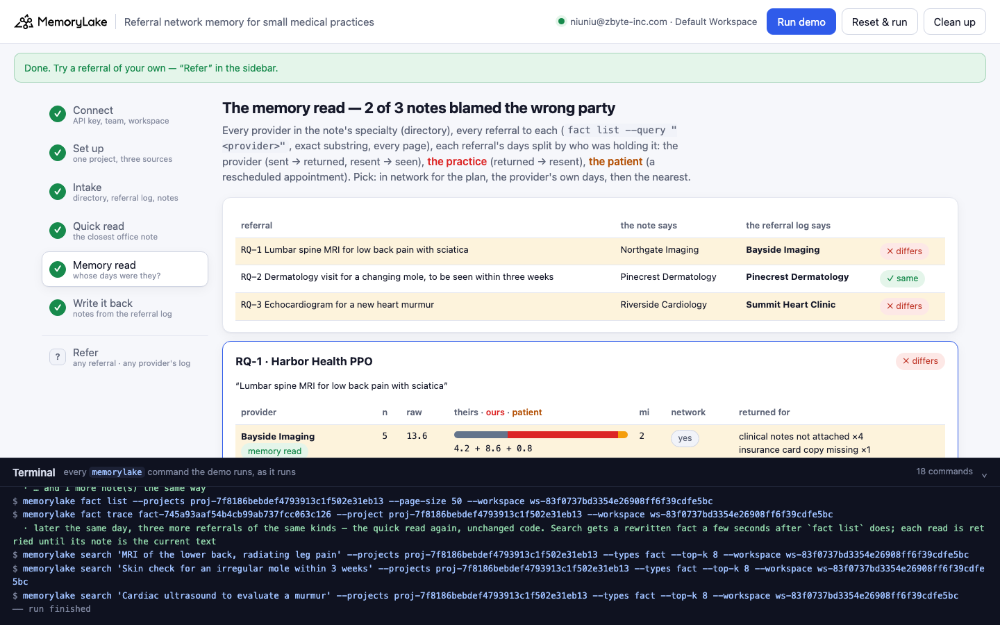
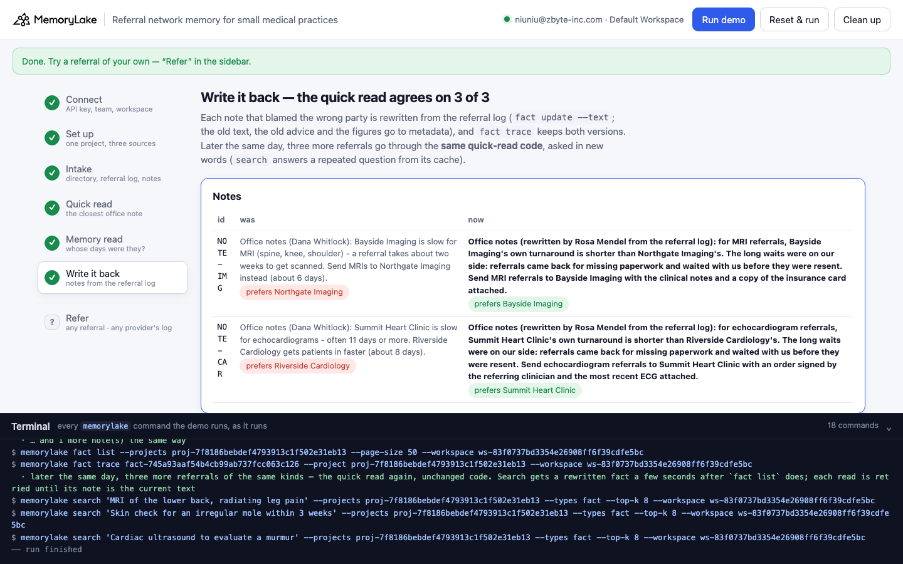

# Referral network memory for small medical practices

A runnable version of the MemoryLake use case
[*Give Small Medical Practices Referral Network Memory That Holds Every Provider*](https://www.memorylake.ai/en/usecase/referral-network-memory-for-medical-practices),
built entirely on the [`memorylake` CLI](https://github.com/memorylake-ai/memorylake-cli).

**Watch it run:** [CLI, 3:10](https://github.com/memorylake-ai/memorylake-usecases/releases/download/referral-network-memory-v1/referral-network-memory-cli-demo.mp4) · [Web, 5:25](https://github.com/memorylake-ai/memorylake-usecases/releases/download/referral-network-memory-v1/referral-network-memory-web-demo.mp4)
([release](https://github.com/memorylake-ai/memorylake-usecases/releases/tag/referral-network-memory-v1); GitHub serves them as downloads).

**The problem.** "The senior office manager knew which specialists return calls." When she leaves, what she knew
survives as notes: *this imaging center is slow, send people over there instead*. Those notes are reflection memory,
a judgment built from many referrals, and the number behind one can be exactly right while the judgment is wrong.
A referral that comes back for missing paperwork and then sits in the practice's fax queue for a week counts against
the provider in that average. Follow the note and you send patients further away to a provider that is actually slower,
while the incomplete paperwork that caused the wait keeps going out.

**What this demo shows.** Larkspur Family Medicine (fictional, four clinicians) keeps its referral network in one
MemoryLake project: the provider directory (6 providers), the EHR referral log (22 referrals, every event of each one,
word for word) and the 3 office notes Dana Whitlock left when she stepped down. Rosa Mendel starts on 2026-10-14 with
three referrals to place:

| Referral | Quick read: the closest note | Memory read: every referral, split by who held it | |
|---|---|---|---|
| RQ-1 lumbar spine MRI · Harbor Health PPO | "Bayside is slow (about two weeks), send MRIs to Northgate" → **Northgate**, 11 miles | Bayside 13.6 days = **4.2 its own** + 8.6 ours + 0.8 patient; Northgate 6.0 its own → **Bayside**, 2 miles, with the clinical notes and a copy of the insurance card | ✗ |
| RQ-2 dermatology, within 3 weeks · Cedar Mutual (control) | "Lakeview is slow (about a month), use Pinecrest" → **Pinecrest** | Lakeview 29.3 days, all its own → **Pinecrest** | ✓ |
| RQ-3 echocardiogram · Medicare | "Summit is slow (11+ days), Riverside is faster" → **Riverside**, 9 miles | Summit 10.8 = **4.0 its own** + 6.0 ours + 0.8 patient; Riverside 8.0 → **Summit**, 4 miles, with a signed order and the most recent ECG | ✗ |

Each of Dana's averages is right. What the averages leave out is whose days they were. The memory read reads every
referral to every provider in the specialty, with `fact list --query "Bayside Imaging"` (an exact substring match over
the whole project, every page), and splits each referral's elapsed days by who was holding it. Sent → returned and
resent → seen count for the provider, returned → resent counts for the practice, and a rescheduled appointment counts for
the patient. All five Bayside MRIs came back within two days (four without the clinical notes, one without the insurance
card copy) and then waited 7 to 10 days with the practice. Dermatology is the control: Lakeview's month really is
Lakeview's, and both reads agree.

Step 6 rewrites the two notes that blamed the wrong party where the next referral will read them (`fact update --text`,
with the old text, the old advice and the figures kept in metadata). `fact trace` keeps both versions. Later that day,
three more referrals go through the **same quick-read code** and agree with the referral log, 3 of 3.

```
setup ──────── proj create
intake ─────── fact add --project <p> '<record>' …   (31 records, one call)  + fact update --metadata {tool, kind, provider, specialty, prefer…}
quick read ─── search '<referral>' --projects <p> --types fact --top-k 8  → closest office note → the provider it prefers
memory read ── fact list --projects <p> --query 'Bayside Imaging' / 'Northgate Imaging' …   (exact substring, every page)
               → each referral: sent · returned · resent · rescheduled · seen → theirs / ours / patient days
               → in network for the plan, shortest own days, then nearest
write back ─── fact update <note> --text '<conclusion from the referral log>' --metadata {…, previous: '<old text>', basis: {…}}
               fact trace <note>  → ADD, UPDATE (old text kept) → quick read again (new wording)
```

No conversations and no extraction: every record is pinned word for word, and both reads are plain code over what the
CLI returns. No model decides anything.

## Prerequisites

- **Python 3.9+** (standard library only, nothing to `pip install`)
- **The `memorylake` CLI** on your `PATH`:
  ```bash
  curl -fsSL https://raw.githubusercontent.com/memorylake-ai/memorylake-cli/main/scripts/install.sh | sh
  ```
- **A MemoryLake API key.** Sign up at [app.memorylake.ai](https://app.memorylake.ai), open **API Keys**, create one. A free
  personal account is enough: nothing here needs an agent or a model call.

## Run it

```bash
git clone https://github.com/memorylake-ai/memorylake-usecases.git
cd memorylake-usecases/referral-network-memory
export MEMORYLAKE_API_KEY=sk-...           # China region: also export MEMORYLAKE_BASE_URL=https://app.memorylake.cn/openapi/memorylake
python3 demo.py
```

About a minute and a half the first time (one project, 31 facts, each with its metadata), about a minute on a re-run.
Every run replays Rosa's first morning: notes an earlier run rewrote are put back word for word from
`metadata.previous` first. With the key set, the demo logs into an isolated CLI profile under `./.memorylake-demo/` and
never touches your own `~/.memorylake`. Everything it creates has a `custom_id` starting with `mlu-rnm-`.

Then try a referral of your own, or open one provider's log:

```bash
python3 demo.py refer "Knee MRI after a sports injury" --plan "Cedar Mutual"
python3 demo.py refer "Echocardiogram before surgery, needed within 7 days" --plan "Harbor Health PPO" --within 7
python3 demo.py provider "Bayside Imaging"
python3 demo.py cleanup                    # deletes the project and every fact on it
```

`provider` prints every referral split by who held it:

```
  5 referral(s):
    id        sent       seen       days = theirs + ours + patient  returned for
    REF-2207  2026-06-03 2026-06-16   13 =      4 +    9 +       0  clinical notes not attached
    REF-2231  2026-06-18 2026-07-02   14 =      4 +   10 +       0  clinical notes not attached
    REF-2264  2026-07-08 2026-07-20   12 =      5 +    7 +       0  clinical notes not attached
    REF-2290  2026-07-27 2026-08-13   17 =      3 +   10 +       4  clinical notes not attached
    REF-2318  2026-08-19 2026-08-31   12 =      5 +    7 +       0  insurance card copy missing
    average                         13.6 =    4.2 +  8.6 +     0.8
```

## Or run it in the browser

```bash
python3 web/server.py                # opens http://127.0.0.1:8765
```

Paste the key, connect, run. The page drives the same functions as `demo.py` and streams every `memorylake` command into a
terminal drawer as it runs: the three sources, the quick read of each referral with its top 8, the memory read as one
split bar per provider (its own days, ours, the patient's), and the write-back with `fact trace`. **Refer** takes any
referral, plan and deadline, and opens any provider's referral log.





## What happens, step by step

### Steps 2–3: one project, three sources, one fact per record

```
$ memorylake proj create --name 'Larkspur referral network' --custom-id mlu-rnm-referrals --description '…'
$ memorylake fact add --project proj-… 'REF-2207 lumbar spine MRI referred to Bayside Imaging (Harbor Health PPO). Sent 2026-06-03. Returned 2026-06-05: clinical notes not attached. Resent 2026-06-14. Seen 2026-06-16.' …
$ memorylake fact update fact-… --project proj-… --metadata '{"key": "rnm:REF-2207", "record": "REF-2207", "tool": "ehr", "kind": "referral", "by": "Larkspur front desk", "on": "2026-06-03", "provider": "Bayside Imaging", "specialty": "imaging"}'
  · … and 30 more `fact update --metadata` the same way

    Directory       6
    EHR referrals  22
    Office notes    3

  Dana's notes, as she left them:
    NOTE-CAR  Office notes (Dana Whitlock): Summit Heart Clinic is slow for echocardiograms - often 11 days or more. Riverside Cardiology gets patients in faster (about 8 days).
    NOTE-DER  Office notes (Dana Whitlock): Lakeview Dermatology is slow - about a month from referral to visit. If the patient can't wait that long, use Pinecrest Dermatology (about 9 days).
    NOTE-IMG  Office notes (Dana Whitlock): Bayside Imaging is slow for MRI (spine, knee, shoulder) - a referral takes about two weeks to get scanned. Send MRIs to Northgate Imaging instead (about 6 days).
```

`fact add` takes many texts in one call and returns their ids in order; it takes no metadata, so each fact gets a
`fact update --metadata` right after. A note's metadata names the provider it is about and the one it prefers.

### Step 4: the quick read

```
$ memorylake search 'Lumbar spine MRI for low back pain with sciatica' --projects proj-… --types fact --top-k 8

  RQ-1 (Harbor Health PPO): “Lumbar spine MRI for low back pain with sciatica”
  search · top 8:
      #1   REF-2215  EHR referrals REF-2215 lumbar spine MRI referred to Northgate Imaging (Harbor Health PPO). …
      #2   REF-2318  EHR referrals REF-2318 lumbar spine MRI referred to Bayside Imaging (Harbor Health PPO). Se…
      #3   REF-2331  EHR referrals REF-2331 lumbar spine MRI referred to Northgate Imaging (Harbor Health PPO). …
      #4   NOTE-IMG  Office notes  Office notes (Dana Whitlock): Bayside Imaging is slow for MRI (spine, knee, s…   ← closest note
      …
  → quick read: send to Northgate Imaging
```

The note's text and advice are read from `fact list` by the hit's fact id, not from the hit itself: `search` can answer
a repeated question from a cache of older text.

### Step 5: the memory read

```
$ memorylake fact list --projects proj-… --query 'Bayside Imaging' --page-size 50

  RQ-1 Lumbar spine MRI for low back pain with sciatica · Harbor Health PPO
      provider                n   raw  = theirs +  ours + patient   mi  network  returned for
      Bayside Imaging         5  13.6  =    4.2 +   8.6 +     0.8    2  yes      clinical notes not attached ×4, insurance card co…  ← memory read
      Northgate Imaging       4   6.0  =    6.0 +   0.0 +     0.0   11  yes      —  ← the note
  · the note's “Bayside Imaging is slow” is the raw column (13.6 days); 8.6 of them were ours — 5 of 5 came back for paperwork and waited with us
  → quick read:  Northgate Imaging
  → memory read: Bayside Imaging: its own share is 4.2 days; send it complete (the clinical notes and a copy of the insurance card)

  RQ-2 Dermatology visit for a changing mole, to be seen within three weeks · Cedar Mutual · within 21 days
      Lakeview Dermatology    3  29.3  =   29.3 +   0.0 +     0.0    3  yes      referral form missing the date of birth ×1
      Pinecrest Dermatology   3   9.0  =    9.0 +   0.0 +     0.0    7  yes      —  ← memory read
  · the note's “Lakeview Dermatology is slow” holds: 29.3 of its 29.3 days are its own
  …
  referral  the note says            the referral log says
  ----------------------------------------------------------------------
  RQ-1      Northgate Imaging        Bayside Imaging          ✗ differs
  RQ-2      Pinecrest Dermatology    Pinecrest Dermatology    ✓ same
  RQ-3      Riverside Cardiology     Summit Heart Clinic      ✗ differs

  → 2 of 3 referrals the notes would send to the slower provider, further away — and the paperwork that caused the wait would keep going out incomplete
```

The rules are a few lines of code (`split_days()` and `memory_read()` in `demo.py`), reading only the referral record's
own text. A provider holds a referral from sent to returned and from resent to seen, the practice holds it from returned
to resent, and the patient holds it for however many days a rescheduled appointment moved. The pick is: in network for
the patient's plan, the provider's own days within the deadline if there is one, then the shortest own days, then the
nearest. The checklist comes from that provider's return reasons. Lakeview's one return was resent the same day (0 days
ours), so it stays the control.

### Step 6: write it back

```
    NOTE-IMG was “Office notes (Dana Whitlock): Bayside Imaging is slow for MRI (spine, knee, shoulder) - a referral takes about two weeks to get scanned. Se…”
             now “Office notes (rewritten by Rosa Mendel from the referral log): for MRI referrals, Bayside Imaging's own turnaround is shorter than Northgate Imaging's. The long waits were on our side: referrals came back for missing paperwork and waited with us before they were resent. Send MRI referrals to Bayside Imaging with the clinical notes and a copy of the insurance card attached.”
$ memorylake fact trace fact-… --project proj-…

  fact trace NOTE-IMG (newest first):
    UPDATE  MANUAL  2026-10-14T15:27:04  Office notes (rewritten by Rosa Mendel from the referral log): for MRI referrals, Bayside…
    ADD     MANUAL  2026-10-14T15:25:45  Office notes (Dana Whitlock): Bayside Imaging is slow for MRI (spine, knee, shoulder) - a…

  RQ-4 “MRI of the lower back, radiating leg pain” · Harbor Health PPO
    closest note NOTE-IMG (#4) · quick read: Bayside Imaging · memory read: Bayside Imaging  ✓ same
  RQ-5 “Skin check for an irregular mole within 3 weeks” · Harbor Health PPO
    closest note NOTE-DER (#1) · quick read: Pinecrest Dermatology · memory read: Pinecrest Dermatology  ✓ same
  RQ-6 “Cardiac ultrasound to evaluate a murmur” · Medicare
    closest note NOTE-CAR (#2) · quick read: Summit Heart Clinic · memory read: Summit Heart Clinic  ✓ same

  → the quick read now agrees with the referral log on 3 of 3: the note it follows is the one the referral log rewrote
```

The rewritten note states only the conclusion. The figures change with every new referral, so they go to
`metadata.basis` (per provider: n, raw, theirs, ours, patient), next to the old text and the old advice. The later
referrals are worded differently on purpose: `search` caches results by query text, so asking the morning's exact
question again could return the morning's answer.

## Measured

| What | Result |
|---|---|
| Closest note = the note for that specialty, in the top 8 | 3 / 3 referrals, every run (NOTE-IMG #4 after the wording names the MRI types; #7 in the first run, before it did) |
| Quick read vs memory read: RQ-1 ✗, RQ-2 ✓, RQ-3 ✗ | 6 / 6 runs (4 from scratch including both recordings, 1 re-run, 1 in the browser) |
| After write-back: quick read agrees with the referral log | 3 / 3, every run, first try |
| Time | 92–101 s from scratch, 63–65 s re-run (179 s with `--reset` deleting the previous run first) |

## Wiring it into your own referral network

- **Pin every referral's events, not just its outcome**: sent, returned (with the reason), resent, rescheduled, seen.
  Without the return and resend, the delay belongs to nobody, and an average gives it to the provider.
- **Keep reflections next to their evidence.** A note that says a provider is slow is a judgment built from records in
  the same project. Read the records before you follow the note, and write the conclusion back into the note so the next
  reader gets the corrected version.
- **Turn return reasons into a checklist** per provider (clinical notes, insurance card copy, signed order, last ECG).
  In this story that checklist saves more days than switching providers would.

## If something goes wrong

- **`the memorylake CLI is not on PATH`**: install it (above) or `export MEMORYLAKE_BIN=/path/to/memorylake`.
- **Search results differ on your run**: ranking moves between runs. Step 4 prints exactly what came back; the memory
  read uses search only to pick the note, and with it the specialty.
- **"no office note in the top 8"**: the referral's words matched referral records more closely than any note. Name the
  procedure the way the note does (for example "MRI", "echocardiogram", "dermatology").
- **"search answered from its cache"**: step 4 asks the same questions every run, and `search` can serve a repeated
  question from a cache made by an earlier run; the line names the hits whose fact ids are not in `fact list` now.
- **Something half-created after an interrupted run**: `python3 demo.py --reset`, or `python3 demo.py cleanup`.

## Files

```
referral-network-memory/
├── demo.py              # the CLI runner (every step is a plain `memorylake` command, echoed)
├── data/story.json      # 6 providers, 22 referrals, 3 office notes; 3 referrals + 3 later ones (fictional, plain ASCII)
├── web/server.py        # local web companion: same functions, Server-Sent Events
├── web/static/          # no-build front end
└── out/runs.jsonl       # one line per run (git-ignored)
```
