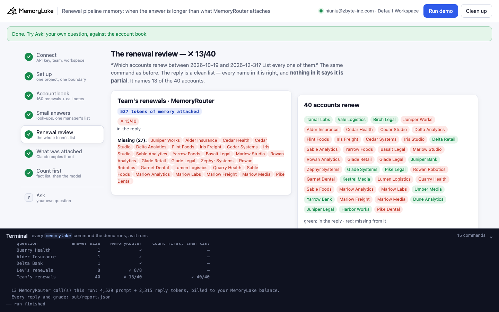
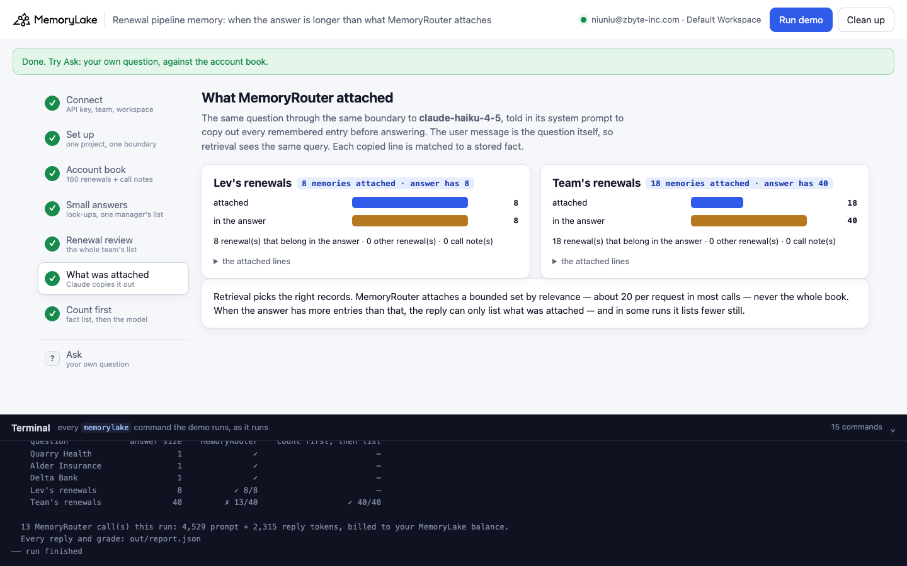
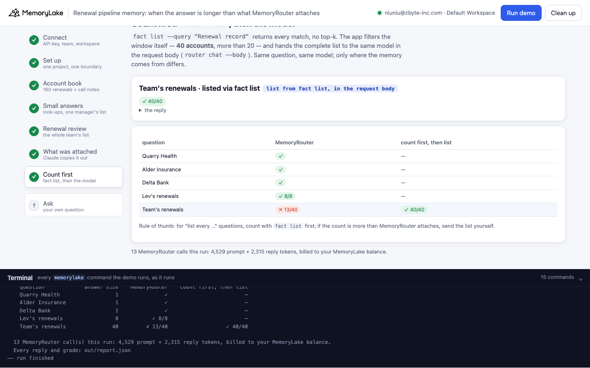

# Renewal pipeline memory: when the answer is longer than what MemoryRouter attaches

A runnable version of the MemoryLake use case
[*Give Sales Teams AI That Knows the Deal Before the Call Starts*](https://www.memorylake.ai/en/usecase/ai-memory-for-sales-teams),
built entirely on the [`memorylake` CLI](https://github.com/memorylake-ai/memorylake-cli) (v20261015 or later).

**Watch it run:** [CLI, 2:51](https://github.com/memorylake-ai/memorylake-usecases/releases/download/renewal-pipeline-memory-v1/renewal-pipeline-memory-cli-demo.mp4) · [Web, 3:10](https://github.com/memorylake-ai/memorylake-usecases/releases/download/renewal-pipeline-memory-v1/renewal-pipeline-memory-web-demo.mp4)
([release](https://github.com/memorylake-ai/memorylake-usecases/releases/tag/renewal-pipeline-memory-v1); GitHub serves them as downloads).

**The problem.** A customer-success team keeps every account's renewal record in shared memory, and its assistant
reads that memory through MemoryRouter: the app adds one `--boundary` to an ordinary model call, and MemoryRouter
attaches the memories that matter to the question. For "when does this account renew?" that is exactly right. For
"list every account renewing this quarter", the answer can have more entries than MemoryRouter attaches to one request,
and then the reply is a clean, correct-looking list with part of the answer missing.

**What this demo shows.** Tidewater Software (fictional) has four account managers and 160 accounts. Every renewal
record (owner, renewal date, ARR) and 60 recent call notes are stored as facts in one MemoryLake project, with one
**boundary** over it. On Monday 19 October the team prepares its renewal review: which accounts renew between
19 October and 31 December? **40 accounts.**

| Step | What you see |
|---|---|
| 3 Account book | 220 facts: 160 renewal records, 60 call notes. 40 renewals in the window: Priya 11, Tomas 9, Hana 12, Lev 8 |
| 4 Small answers | Three look-ups and Lev Brandt's 8 renewals, through MemoryRouter: all right |
| 5 Renewal review | The whole team's list, the same command: **about 20 of the 40**, every name in it right, and nothing in the reply says it is partial |
| 6 What was attached | Claude, asked the same question through the same boundary, copies out every memory it was given: each line is a renewal that belongs in the answer — retrieval picked the right records — but there are about 20 of them, not 40 |
| 7 Count first | `fact list --query "Renewal record"` returns every match (no top-k); the app filters the window itself (40 > 20) and hands the complete list to the same model in the request body (`router chat --body`): **40 / 40** |

Model replies vary from run to run, so every reply is graded and printed as it comes out, and [Measured](#measured)
below reports totals over all runs, not the best one.

## Prerequisites

- Python 3.9+ (standard library only)
- The `memorylake` CLI **v20261015 or later** (`memorylake router` arrived in that release):
  ```bash
  curl -fsSL https://raw.githubusercontent.com/memorylake-ai/memorylake-cli/main/scripts/install.sh | sh
  memorylake version
  ```
- A MemoryLake API key ([app.memorylake.ai](https://app.memorylake.ai) → API Keys).
- **Router calls are billed to your MemoryLake balance** (`memorylake billing balance`). One run makes 11 calls on
  `gpt-4o-mini` and 2 on `claude-haiku-4-5`, about 5,000 prompt + 3,000 reply tokens in all; the run prints the total.
  If the balance is empty, the router steps print the refusal and are skipped (step 7's `fact list` still runs).

## Run it

```bash
git clone https://github.com/memorylake-ai/memorylake-usecases.git
cd memorylake-usecases/renewal-pipeline-memory
export MEMORYLAKE_API_KEY=sk-...
python3 demo.py                                   # the whole story, about 2 minutes
python3 demo.py renewals                          # the review list, read with `fact list` (every record)
python3 demo.py renewals --manager "Lev Brandt"   # one manager's
python3 demo.py ask team                          # one question through MemoryRouter (quarry|alder|delta|lev|team)
python3 demo.py ask "Which accounts asked about a multi-year discount?"   # or your own
python3 demo.py cleanup                           # delete everything the demo created
```

The key is used to log into an isolated CLI profile under `.memorylake-demo/` (git-ignored); your own
`~/.memorylake` is never touched. For the China endpoint also set
`MEMORYLAKE_BASE_URL=https://app.memorylake.cn/openapi/memorylake`. Everything the demo creates has a `custom_id`
starting with `mlu-rpm-`. Every run starts over with a fresh project (the previous one is deleted first), so no answer
can come from an earlier run's retrieval.

## Or run it in the browser

```bash
python3 web/server.py           # opens http://127.0.0.1:8765
```

Same pipeline, one view per step: the small answers, the team's list with every missing account marked, what was
attached (with the lines), the count-first fix next to the scoreboard, an **Ask** page, and a terminal drawer with every
`memorylake` command as it runs.





## What happens, step by step

Excerpts below are from one real run (one of three parallel copies, run under the prefix `mlu-rpm2`; shown with
the default prefix and shortened ids); numbers vary between runs.

### Steps 2–3: one project, one boundary, the account book

```
$ memorylake proj create --name 'Tidewater account book' --custom-id mlu-rpm-book …
$ memorylake boundary create --name 'Tidewater CS assistant' --custom-id mlu-rpm-boundary --projects proj-…… --workspace ws-…
$ memorylake fact add --project proj-…… 'Renewal record: Fjord Works (account manager [...]' …  … 218 more
  · stored 220 facts in 5 `fact add` call(s): 160 renewal records, 60 call notes
   - Renewal record: Fjord Works (account manager Hana Okafor) - contract renews on 2027-09-29, ARR 141000 dollars.
   - Call note (2026-10-08, Hana Okafor): Juniper Studio asked how to export all their data.
  Renewals between 2026-10-19 and 2026-12-31: 40 accounts — Priya Nair 11, Tomas Reyes 9, Hana Okafor 12, Lev Brandt 8
```

The facts are stored verbatim with `fact add` (up to 50 per call); there are no conversations, so nothing is extracted
or rewritten. The book comes from `data/make_data.py` (fixed seed); every name is invented.

### Step 4: small answers are right

```
$ memorylake router chat 'When does Quarry Health'"'"'s contract renew, and who is its account manager?' --model gpt-4o-mini … --boundary bnd-……

    Quarry Health: ✓  (98 tokens of memory attached)
      │ Quarry Health's contract renews on December 10, 2026, and its account manager is Hana Okafor.
    Alder Insurance: ✓  (96 tokens of memory attached)
    Delta Bank: ✓  (97 tokens of memory attached)
    Lev's renewals: ✓ 8/8  (326 tokens of memory attached)
```

*Memory attached* is the provider's `prompt_tokens` minus the same question sent without the boundary.

### Step 5: the renewal review

```
$ memorylake router chat 'Which accounts have a contract renewing between 2026-10-19 and 2026-12-31? List every one of them, one per line: account - renewal date.' --model gpt-4o-mini … --boundary bnd-……
      │ Here are the accounts with contracts renewing between 2026-10-19 and 2026-12-31:
      │ Tamar Labs - 2026-10-24
      │ Vale Logistics - 2026-10-28
      │ Birch Legal - 2026-10-29
      │ …
      │ Harbor Works - 2026-12-30
      │ Pike Dental - 2026-12-31

    Team's renewals: ✗ 19/40  (692 tokens of memory attached)
    missing: Juniper Works, Alder Insurance, Cedar Studio, Delta Analytics, Flint Foods, Iris Freight, Iris Studio, Sable Analytics, …
  · 692 tokens of memory ≈ 19 renewal records (one record ≈ 32.7 tokens, measured on the look-ups and Lev's list above)
  · nothing in the reply says the list is partial, and nothing it names is wrong
```

The reply looks complete: a heading, one line per account, every date right. Twenty-one accounts are not in it. The estimate in the last-but-one line reads the attached memory's size: one look-up attaches one record,
Lev's list his eight, so a record costs about 33 tokens and 692 tokens is about 19 records.

### Step 6: what MemoryRouter attached

```
$ memorylake router messages 'Which accounts have a contract renewing between 2026-10-19 and 2026-12-31? …' --model claude-haiku-4-5 … --system 'Before answering, copy out verbatim, inside triple backticks, every remembered entry you were given (each line that starts with '"'"'- '"'"'). Then answer the question.' --boundary bnd-……

    Lev's renewals: 8 memories attached — 8 renewal(s) in the answer, 0 other renewal record(s), 0 call note(s); the answer has 8 account(s)
      - Renewal record: Birch Legal (account manager Lev Brandt) - contract renews on 2026-10-29, [...]
      - Renewal record: Juniper Bank (account manager Lev Brandt) - contract renews on 2026-11-27, [...]
      - Renewal record: Cedar Health (account manager Lev Brandt) - contract renews on 2026-11-06, [...]
      … 5 more

    Team's renewals: 19 memories attached — 19 renewal(s) in the answer, 0 other renewal record(s), 0 call note(s); the answer has 40 account(s)
      - Renewal record: Tamar Labs (account manager Tomas Reyes) - contract renews on 2026-10-24, [...]
      - Renewal record: Birch Legal (account manager Lev Brandt) - contract renews on 2026-10-29, [...]
      - Renewal record: Delta Retail (account manager Lev Brandt) - contract renews on 2026-11-15, [...]
      … 16 more
```

The user message is the question itself, so retrieval sees the same query; the copy-out instruction is in the system
prompt. Every copied line is matched to a stored fact. Retrieval is doing its job — no call note, no renewal outside the
window — it just attaches a bounded set. It is Claude quoting what it received, so treat it as a strong hint rather than
a log; MemoryRouter's response does not list the attached memories itself.

### Step 7: count first, then list

```
$ memorylake fact list --projects proj-…… --page-size 200 --query 'Renewal record' --workspace ws-…
  · `fact list --query` returns every match, no top-k: 160 renewal records; 40 renew between 2026-10-19 and 2026-12-31 (filtered by the app, not the model)
  · 40 > 20: more than MemoryRouter attaches to one request → list path
$ memorylake router chat 'Which accounts have a contract renewing between 2026-10-19 and 2026-12-31? List every one of them, one per line: account - renewal date.' --model gpt-4o-mini … --body out/renewals-team.json

    Team's renewals, listed via `fact list`: ✓ 40/40

    question             answer size    MemoryRouter    count first, then list
    Quarry Health                  1               ✓                         —
    Alder Insurance                1               ✓                         —
    Delta Bank                     1               ✓                         —
    Lev's renewals                 8           ✓ 8/8                         —
    Team's renewals               40         ✗ 19/40                   ✓ 40/40
```

Same question, same model; the only difference is where the memory comes from. `out/renewals-team.json` is a whole
provider request body whose system message holds the 40 records.

## Measured

Nine fresh runs of the final version on 2026-10-15: six from the terminal (three in parallel under separate prefixes,
then three in a row, one of them `--reset`), one browser check, and the two recorded runs (terminal and browser).
Temperature 0; replies still vary. Every run started from an empty project.

| Question (answer size) | MemoryRouter | Count first, then list |
|---|---|---|
| 3 look-ups (1 each) | 27 / 27 | — |
| Lev's renewals (8) | 9 / 9 complete | — |
| Team's renewals (40) | **0 / 9 complete**: 19, 18, 33, 19, 9, 19, 20, 18, 13 accounts named; 0 wrong names; 0 replies said the list might be incomplete | **9 / 9 complete** (40 / 40) |

What MemoryRouter attached for the team's question:

- To the `gpt-4o-mini` request (estimated from its size): about 14–20 records in 7 runs, about 33 in 2.
- To Claude's checker request in step 6: 18–19 records in 6 runs, 33–36 in 3. A probe before the demo (12 more checker
  calls on the same book) saw 18–20 in 11 and 32 in 1. **Never 40.** Every attached line, in every call, was a
  renewal in the window.
- For Lev's question the checker saw his 8 records in 7 runs and 7 in 2; the `gpt-4o-mini` replies listed all 8 in
  all 9.

What the numbers say, and don't:

- **MemoryRouter attaches a bounded set by relevance**, 14–20 renewals in most calls and about 35 in some, chosen
  well: no call note and no out-of-window renewal was ever attached to the window question. When the answer has more
  entries than that, the list cannot be complete.
- **The model can also list fewer than it was given.** In one run about 19 were attached and the reply named 9; in the
  browser run about 33 were attached and it named 20. A complete list in the prompt (step 7) was listed in full every
  time; the same model, asked to group the 40 by manager in one trial, dropped 3, so the demo asks the plain question.
- **Nothing in the reply flags the gap**, and nothing in it is wrong, which is what makes it easy to act on.
- One model (`gpt-4o-mini`) was measured for the answers; the attachment bound is MemoryRouter's, not the model's.
- The bound was measured on this book and this account; the demo routes on `ATTACH_BUDGET = 20` in `demo.py`.

## Use it in your own app

- Keep look-ups and short lists on MemoryRouter: add `--boundary <id>` (or `?boundary_id=` on the endpoint your
  OpenAI or Anthropic SDK points at) and let it attach what matters.
- For questions that must enumerate everything of a kind ("every renewal this quarter", "every open escalation"),
  **count first**: `fact list --query` (an exact substring match over the stored facts, paged, no top-k), filter in
  code, and if the count is more than MemoryRouter attaches, put the list into the request yourself (`--body`, or the
  messages your SDK sends).
- Store records in a fixed text format (as here: `Renewal record: <account> (account manager <name>) - contract renews
  on <date>, ARR <n> dollars.`) so the app can filter them without a model.

## Troubleshooting

- **`this memorylake CLI has no router command`**: upgrade the CLI (install line above).
- **MemoryRouter refused the call for lack of balance**: top up in the console; `memorylake billing balance` shows it.
- **A run was interrupted**: run again; it deletes the previous project and starts over.
- **`fact(s) are still in the project after deleting`**: deletes are retried and re-checked; run
  `python3 demo.py cleanup` again.

## Files

| File | What it is |
|---|---|
| `demo.py` | The demo: CLI wrapper, the grader, the pipeline, subcommands |
| `data/accounts.json` | The account book: 160 renewal records, 60 call notes, the window, the managers |
| `data/make_data.py` | Regenerates `accounts.json` (fixed seed) |
| `data/questions.json` | The five questions and what a right answer contains |
| `web/server.py`, `web/static/` | Browser companion (standard library server, no build step) |
