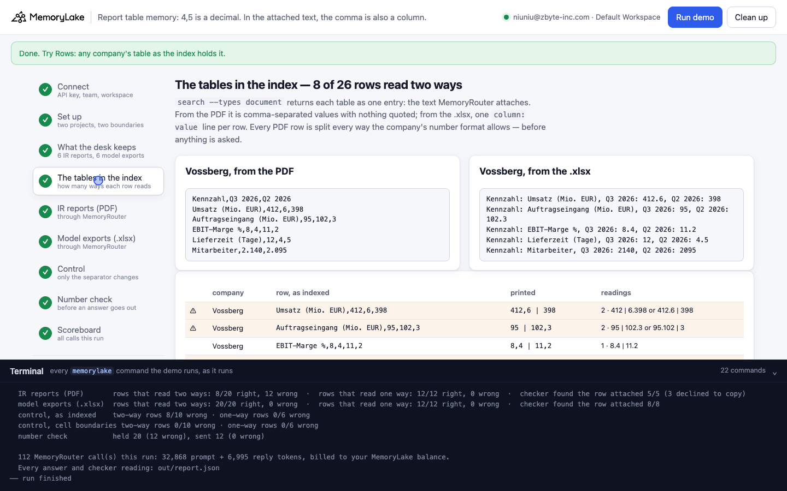
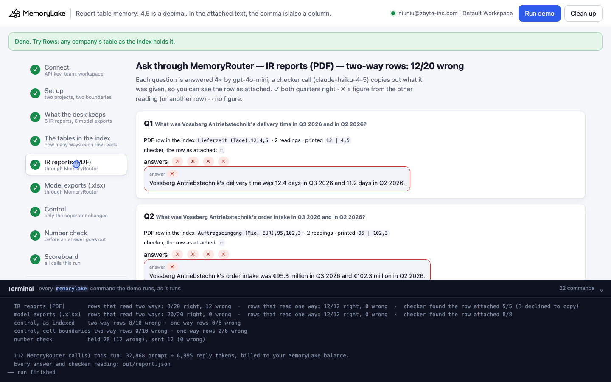
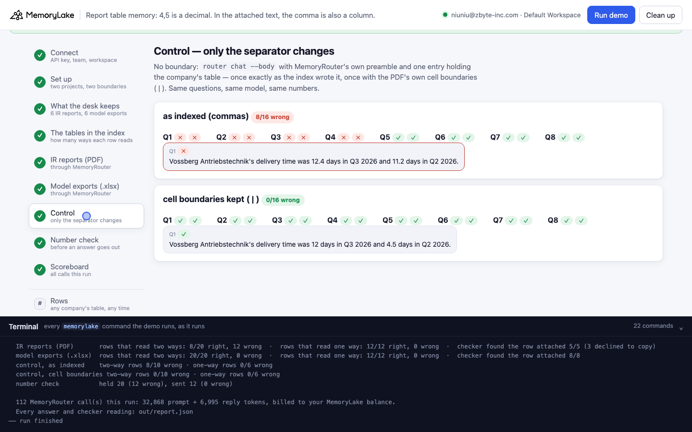
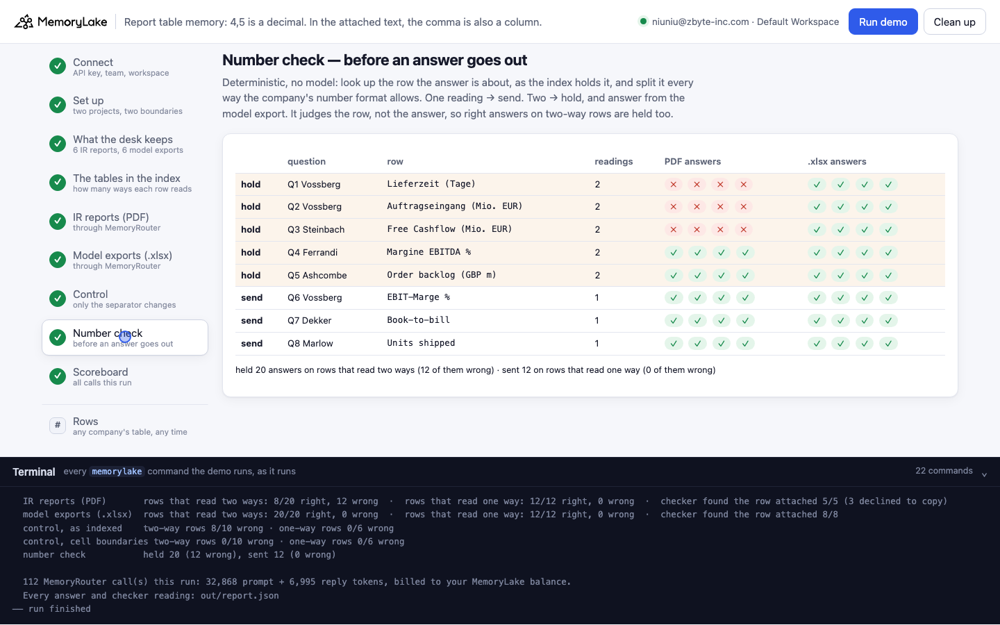

# Report table memory: 4,5 is a decimal — in the text MemoryRouter attaches, the comma is also a column

A runnable version of the MemoryLake use case
[*Give Hedge Funds Financial Research Memory That Compounds Across Funds*](https://www.memorylake.ai/en/usecase/financial-research-memory-for-hedge-funds),
built entirely on the [`memorylake` CLI](https://github.com/memorylake-ai/memorylake-cli) (v20261015 or later).

**Watch it run:** recording in progress.

**The problem.** A research desk keeps the quarterly IR reports of every company it covers. Half of them are
European: Vossberg's report prints *Lieferzeit (Tage) | 12 | 4,5* — twelve days, then four and a half. An assistant
that reads memory through MemoryRouter is not handed the PDF; it is handed the **text of the table as the index
holds it**, and MemoryRouter attaches a PDF table as comma-separated values with nothing quoted:

```
Kennzahl,Q3 2026,Q2 2026
Auftragseingang (Mio. EUR),95,102,3
Lieferzeit (Tage),12,4,5
```

`12,4,5` is *12 | 4.5* or *12.4 | 5*. Both splits are valid German numbers. The right page is attached and the
right row is in it — what is gone is where one cell ends and the next begins. Nothing in the reply says so.

**What this demo shows.** Kestrel Ridge Capital (a fictional fund) keeps six IR reports (four in European number
format, one UK, one US) in one MemoryLake project and the same KPI tables, keyed into its models, as `.xlsx` in
another. Eight PM questions go through MemoryRouter (`router chat --boundary`, `gpt-4o-mini`, temperature 0), each
asked 4 times per boundary. Before anything is asked, the demo splits every row of every PDF table, as the index
holds it, every way the company's number format allows.

Totals over **6 runs** (32 answers per boundary per run):

| | Rows that read two ways (Q1–Q5) | Rows that read one way (Q6–Q8) |
|---|---|---|
| Boundary over the **IR reports (PDF)** | **72 / 120 wrong** — Q1, Q2, Q3 wrong every time; Q4, Q5 right every time | 0 / 72 wrong |
| Boundary over the **model exports (.xlsx)** | 0 / 120 wrong | 0 / 72 wrong |
| Control, no boundary: the table **as the index wrote it** | 44 / 60 wrong | 0 / 36 wrong |
| Control: the same table, **cell boundaries kept** (` \| `) | **0 / 60 wrong** | 0 / 36 wrong |
| Number check (hold answers on rows that read two ways) | holds all 120, among them all 72 wrong | sends all 72, none wrong |

So: the failure is not "PDFs" or "German" — the one-way rows of the same German tables were right every time —
it is the rows whose attached text splits two ways. The same numbers as `.xlsx` were right every time, and in the
control putting the cell boundaries back was the only change needed. The reading counter knows which rows are at
risk before anything is asked; it cannot know which of them a given call will get wrong.

## Prerequisites

- Python 3.9+ (standard library only)
- The `memorylake` CLI **v20261015 or later** (`memorylake router` arrived in that release):
  ```bash
  curl -fsSL https://raw.githubusercontent.com/memorylake-ai/memorylake-cli/main/scripts/install.sh | sh
  memorylake version
  ```
- A MemoryLake API key ([app.memorylake.ai](https://app.memorylake.ai) → API Keys).
- **Router calls are billed to your MemoryLake balance** (`memorylake billing balance`). One run makes 112 calls
  (`gpt-4o-mini` answers, `claude-haiku-4-5` checker), about 33,000 prompt + 7,000 reply tokens; the run prints
  the total. If the balance is empty, the router calls print the refusal and are skipped; the memory steps still run.

## Run it

```bash
git clone https://github.com/memorylake-ai/memorylake-usecases.git
cd memorylake-usecases/report-table-memory
export MEMORYLAKE_API_KEY=sk-...
python3 demo.py                    # the whole story, about 7 minutes
python3 demo.py rows Vossberg      # one company's table as the index holds it, with every row's readings
python3 demo.py cleanup            # delete everything the demo created
```

The key is used to log into an isolated CLI profile under `.memorylake-demo/` (git-ignored); your own
`~/.memorylake` is never touched. For the China endpoint also set
`MEMORYLAKE_BASE_URL=https://app.memorylake.cn/openapi/memorylake`. Every run starts over, and everything it
creates is prefixed `mlu-rtm-` (projects, boundaries, Library files). The reports and model exports are generated
by `python3 data/make_reports.py` from `data/desk.json` and committed under `data/reports/` and `data/models/`.

## Or run it in the browser

```bash
python3 web/server.py                # opens http://127.0.0.1:8765
```

Paste the API key, press **Run the demo**, and follow the steps on the left while the terminal drawer shows every
`memorylake` command as it runs. **Rows** shows any company's table as the index holds it. **Clean up** removes
everything.

| Step 4: the tables in the index | Step 5: through MemoryRouter, the IR reports |
|---|---|
|  |  |
| **Step 7: control — only the separator changes** | **Step 8: the number check** |
|  |  |

## What happens, step by step

All output below is from one real run in this directory (long command lines shortened with `…`).

### Steps 2–3: two projects, two boundaries, six reports and six model exports

```
$ memorylake proj create --name 'Kestrel Ridge Capital — IR reports (PDF)' --custom-id mlu-rtm-pdf …
$ memorylake proj create --name 'Kestrel Ridge Capital — model exports (.xlsx)' --custom-id mlu-rtm-xlsx …
$ memorylake boundary create --name 'Research assistant: IR reports' --custom-id mlu-rtm-pdf --projects proj-2ff0… …
$ memorylake boundary create --name 'Research assistant: model exports' --custom-id mlu-rtm-xlsx --projects proj-0934… …

  DE  Vossberg Antriebstechnik AG    prints 412,6 · 2.140
  DE  Steinbach Hydraulik SE         prints 412,6 · 2.140
  IT  Ferrandi Componenti S.p.A.     prints 412,6 · 2.140
  NL  Dekker Maritiem N.V.           prints 412,6 · 2.140
  UK  Ashcombe Engineering plc       prints 154.2 · 2,310
  US  Marlow Controls Inc.           prints 154.2 · 2,310
$ memorylake lib upload data/reports/vossberg-q3-2026.pdf --name mlu-rtm-vossberg-q3-2026.pdf --on-conflict overwrite
$ memorylake proj doc import --project proj-2ff0… sc-…:inode-6cbd… … 5 more --wait …
  · 6 IR reports (PDF) uploaded and indexed in 51 s
$ memorylake lib upload data/models/vossberg-q3-2026-model.xlsx --name mlu-rtm-vossberg-q3-2026-model.xlsx --on-conflict overwrite
$ memorylake proj doc import --project proj-0934… sc-…:inode-d86b… … 5 more --wait …
  · 6 model exports (.xlsx) uploaded and indexed in 52 s
```

### Step 4: the tables in the index — and how many ways each row reads

```
$ memorylake search 'Vossberg Antriebstechnik AG Tabelle 1. Konzernkennzahlen je Quartal' --projects proj-2ff0… --types document --top-k 6 …
$ memorylake search 'Vossberg Antriebstechnik AG Tabelle 1. Konzernkennzahlen je Quartal' --projects proj-0934… --types document --top-k 6 …

  mlu-rtm-vossberg-q3-2026.pdf — the table as the index holds it (and as MemoryRouter attaches it):
    Kennzahl,Q3 2026,Q2 2026
    Umsatz (Mio. EUR),412,6,398
    Auftragseingang (Mio. EUR),95,102,3
    EBIT-Marge %,8,4,11,2
    Lieferzeit (Tage),12,4,5
    Mitarbeiter,2.140,2.095

  mlu-rtm-vossberg-q3-2026-model.xlsx — the same table from the .xlsx:
    Kennzahl: Umsatz (Mio. EUR), Q3 2026: 412.6, Q2 2026: 398
    Kennzahl: Auftragseingang (Mio. EUR), Q3 2026: 95, Q2 2026: 102.3
    Kennzahl: EBIT-Marge %, Q3 2026: 8.4, Q2 2026: 11.2
    Kennzahl: Lieferzeit (Tage), Q3 2026: 12, Q2 2026: 4.5
    Kennzahl: Mitarbeiter, Q3 2026: 2140, Q2 2026: 2095

    ⚠ Vossberg  Umsatz (Mio. EUR),412,6,398              2 readings: 412 | 6.398   or   412.6 | 398
    ⚠ Vossberg  Auftragseingang (Mio. EUR),95,102,3      2 readings: 95 | 102.3   or   95.102 | 3
      Vossberg  EBIT-Marge %,8,4,11,2                    1 reading: 8.4 | 11.2
    ⚠ Vossberg  Lieferzeit (Tage),12,4,5                 2 readings: 12 | 4.5   or   12.4 | 5
      Vossberg  Mitarbeiter,2.140,2.095                  1 reading: 2,140 | 2,095
      Steinbach Umsatz (Mio. EUR),186,4,179,9            1 reading: 186.4 | 179.9
      Steinbach Bruttomarge %,31,2,30,8                  1 reading: 31.2 | 30.8
    ⚠ Steinbach Free Cashflow (Mio. EUR),7,12,6          2 readings: 7 | 12.6   or   7.12 | 6
    ⚠ Steinbach Nettoverschuldung (Mio. EUR),64,5,71     2 readings: 64 | 5.71   or   64.5 | 71
      Steinbach Mitarbeiter,1.310,1.295                  1 reading: 1,310 | 1,295
      Ferrandi  Ricavi (mln EUR),248,1,233,7             1 reading: 248.1 | 233.7
    ⚠ Ferrandi  Margine EBITDA %,14,15,6                 2 readings: 14 | 15.6   or   14.15 | 6
    ⚠ Ferrandi  Ordini acquisiti (mln EUR),260,251,5     2 readings: 260 | 251.5   or   260.251 | 5
      Ferrandi  Dipendenti,1.870,1.850                   1 reading: 1,870 | 1,850
      Dekker    Omzet (mln EUR),92.7,88.1                1 reading: 92.7 | 88.1   (index wrote . for ,)
      Dekker    Orderportefeuille (mln EUR),410,386.2    1 reading: 410 | 386.2   (index wrote . for ,)
      Dekker    Book-to-bill,1.3,0.9                     1 reading: 1.3 | 0.9   (index wrote . for ,)
      Dekker    Medewerkers,640,628                      1 reading: 640 | 628
      Ashcombe  Revenue (GBP m),154.2,149.8              1 reading: 154.2 | 149.8
    ⚠ Ashcombe  Order backlog (GBP m),1,204,950          2 readings: 1 | 204,950   or   1,204 | 950
      Ashcombe  Operating margin %,9.1,8.7               1 reading: 9.1 | 8.7
      Ashcombe  Employees,2,310,2,280                    1 reading: 2,310 | 2,280
      Marlow    Revenue (USD thousands),5,525,4,980      1 reading: 5,525 | 4,980
      Marlow    Units shipped,18,2,450                   1 reading: 18 | 2,450
      Marlow    Paying customers,1,204,1,187             1 reading: 1,204 | 1,187
      Marlow    Cash burn (USD thousands),1,350,1,610    1 reading: 1,350 | 1,610
  · 8 of 26 rows read two ways in the index; the rest read one way. Nothing has been asked yet
  · the index wrote decimal points into Dekker's table this time (the PDF prints commas), which removes the clash for those rows; it did not for the others
```

The counter (`readings()` in `demo.py`) splits the row's tokens into as many numbers as the table has columns,
each a valid number in the company's format: for German, Italian and Dutch reports an integer part (with `.` for
thousands) and at most one decimal part after a comma; for UK and US reports 1–3 digits, then groups of exactly
three. `5,525,4,980` splits only one way; `1,204,950` splits two ways even in English. The index rewrote the Dutch
report's decimals as points in every run so far, and never the German or Italian ones.

### Step 5: ask through MemoryRouter — the IR reports

Each question 4× through `router chat --boundary`, plus a checker call: `router messages --model claude-haiku-4-5
--system "<copy out everything above my request, verbatim>" --boundary …`, which shows the row as it was attached.
It is its own call, so what it was given can differ from what an answer call was given.

```
  Q1  What was Vossberg Antriebstechnik's delivery time in Q3 2026 and in Q2 2026?
      in the PDF index: Lieferzeit (Tage),12,4,5   → 2 readings; printed 12 | 4,5
$ memorylake router chat 'What was Vossberg …' --model gpt-4o-mini --max-tokens 160 --temperature 0 --body out/body.json --boundary bnd-8542…
$ memorylake router messages 'What was Vossberg …' --model claude-haiku-4-5 --max-tokens 2500 --temperature 0 --system 'Before doing anything, copy out verbatim …' --boundary bnd-8542…
      checker, the row as attached: declined to copy (wrote NONE)
      answers ✗ ✗ ✗ ✗     e.g. “Vossberg Antriebstechnik's delivery time was 12.4 days in Q3 2026 and 11.2 days in Q2 2026.”

  Q2  What was Vossberg Antriebstechnik's order intake in Q3 2026 and in Q2 2026?
      in the PDF index: Auftragseingang (Mio. EUR),95,102,3   → 2 readings; printed 95 | 102,3
      checker, the row as attached: Auftragseingang (Mio. EUR),95,102,3
      answers ✗ ✗ ✗ ✗     e.g. “Vossberg Antriebstechnik's order intake was €95.3 million in Q3 2026 and €102.3 million in Q2 2026.”

  Q3  What was Steinbach Hydraulik's free cash flow in Q3 2026 and in Q2 2026?
      in the PDF index: Free Cashflow (Mio. EUR),7,12,6   → 2 readings; printed 7 | 12,6
      checker, the row as attached: Free Cashflow (Mio. EUR),7,12,6
      answers ✗ ✗ ✗ ✗     e.g. “Steinbach Hydraulik's free cash flow was €7.12 million in Q3 2026 and €6.12 million in Q2 2026.”

  Q4  What was Ferrandi Componenti's EBITDA margin in Q3 2026 and in Q2 2026?
      in the PDF index: Margine EBITDA %,14,15,6   → 2 readings; printed 14 | 15,6
      checker, the row as attached: Margine EBITDA %,14,15,6
      answers ✓ ✓ ✓ ✓     e.g. “Ferrandi Componenti's EBITDA margin was 14% in Q3 2026 and 15.6% in Q2 2026.”

  Q5  What was Ashcombe Engineering's order backlog at the end of Q3 2026 and of Q2 2026?
      in the PDF index: Order backlog (GBP m),1,204,950   → 2 readings; printed 1,204 | 950
      checker, the row as attached: Order backlog (GBP m),1,204,950
      answers ✓ ✓ ✓ ✓     e.g. “Ashcombe Engineering's order backlog at the end of Q3 2026 was GBP 1,204 million, and at the end of Q2 2026, it was GBP 950 million.”

  Q6  What was Vossberg Antriebstechnik's EBIT margin in Q3 2026 and in Q2 2026?
      in the PDF index: EBIT-Marge %,8,4,11,2   → 1 reading; printed 8,4 | 11,2
      checker, the row as attached: EBIT-Marge %,8,4,11,2
      answers ✓ ✓ ✓ ✓     e.g. “Vossberg Antriebstechnik's EBIT margin was 8.4% in Q3 2026 and 11.2% in Q2 2026.”
  …
    IR reports (PDF): rows that read two ways: 8/20 right, 12 wrong  ·  rows that read one way: 12/12 right, 0 wrong  ·  checker found the row attached 6/6 (2 declined to copy)
```

Three of the wrong answers are worth reading slowly. *95.3* is neither reading of `95,102,3` — the model made a
number up between them. *6.12* for Steinbach's Q2 is not in the table at all. *11.2 days* for Vossberg's Q2 is the
EBIT margin from the row above. None of them says it was unsure.

How an answer is graded (`grade()`): ✓ when both true figures are in it (English or German decimal, "1.204
billion" counts as 1,204 million); ✗ when it gives any other figure; · when it gives none.

### Step 6: the same questions, the boundary over the model exports

```
  Q1  What was Vossberg Antriebstechnik's delivery time in Q3 2026 and in Q2 2026?
      checker, the row as attached: Kennzahl: Lieferzeit (Tage), Q3 2026: 12, Q2 2026: 4.5
      answers ✓ ✓ ✓ ✓     e.g. “Vossberg Antriebstechnik's delivery time was 12 days in Q3 2026 and 4.5 days in Q2 2026.”
  …
    model exports (.xlsx): rows that read two ways: 20/20 right, 0 wrong  ·  rows that read one way: 12/12 right, 0 wrong  ·  checker found the row attached 8/8
```

### Step 7: control — only the separator changes

No boundary: `router chat --body` with MemoryRouter's own preamble and one entry, `- (<file>) <table>`, for the
company's table — once exactly as the index wrote it, once with the PDF's own cell boundaries (` | `).

```
    as indexed (commas)          Q1 ✗✗  Q2 ✗✗  Q3 ✗✗  Q4 ✗✗  Q5 ✓✓  Q6 ✓✓  Q7 ✓✓  Q8 ✓✓   → 8/16 wrong
    cell boundaries kept ( | )   Q1 ✓✓  Q2 ✓✓  Q3 ✓✓  Q4 ✓✓  Q5 ✓✓  Q6 ✓✓  Q7 ✓✓  Q8 ✓✓   → 0/16 wrong
```

Same numbers, same model, same preamble: putting the cell boundaries back fixes every two-way row. Which two-way
rows go wrong depends on what else is in the prompt — Ferrandi's margin (Q4) is right through MemoryRouter in
every run and wrong in every control answer (12 / 12); Vossberg's order intake (Q2) is wrong through MemoryRouter
every time and in 8 of 12 control answers; Ashcombe's backlog (Q5) is right in both. A row that reads two ways
is a coin; what is attached next to it changes how it lands.

### Step 8: the number check — before an answer goes out

```
    hold  Q1 Vossberg  Lieferzeit (Tage)            4/4 wrong  → model export: 4/4 right
    hold  Q2 Vossberg  Auftragseingang (Mio. EUR)   4/4 wrong  → model export: 4/4 right
    hold  Q3 Steinbach Free Cashflow (Mio. EUR)     4/4 wrong  → model export: 4/4 right
    hold  Q4 Ferrandi  Margine EBITDA %             0/4 wrong  → model export: 4/4 right
    hold  Q5 Ashcombe  Order backlog (GBP m)        0/4 wrong  → model export: 4/4 right
    send  Q6 Vossberg  EBIT-Marge %                 0/4 wrong
    send  Q7 Dekker    Book-to-bill                 0/4 wrong
    send  Q8 Marlow    Units shipped                0/4 wrong

    held 20 answers on rows that read two ways (12 of them wrong); sent 12 on rows that read one way (0 of them wrong)
  · the check judges the row, not the answer: it cannot tell which answers on a two-way row came out right, so it holds them all and asks the model export instead
```

### The read-only subcommand

```
$ python3 demo.py rows Vossberg
$ memorylake search 'Vossberg Antriebstechnik AG Tabelle 1. Konzernkennzahlen je Quartal' --projects proj-… --types document --top-k 6 …
$ memorylake search 'Vossberg Antriebstechnik AG Tabelle 1. Konzernkennzahlen je Quartal' --projects proj-… --types document --top-k 6 …

  Vossberg Antriebstechnik AG (DE, prints 412,6)
  ⚠ Umsatz (Mio. EUR),412,6,398              printed 412,6 | 398    reads: 412 | 6.398   or   412.6 | 398
  ⚠ Auftragseingang (Mio. EUR),95,102,3      printed 95 | 102,3     reads: 95 | 102.3   or   95.102 | 3
    EBIT-Marge %,8,4,11,2                    printed 8,4 | 11,2     reads: 8.4 | 11.2
  ⚠ Lieferzeit (Tage),12,4,5                 printed 12 | 4,5       reads: 12 | 4.5   or   12.4 | 5
    Mitarbeiter,2.140,2.095                  printed 2.140 | 2.095  reads: 2,140 | 2,095

  from the .xlsx:
    Kennzahl: Umsatz (Mio. EUR), Q3 2026: 412.6, Q2 2026: 398
    …
```

## Measured

6 runs (2 in this directory plus one through the web companion; 3 parallel copies with their own prefix), 32
answers per boundary per run. One more run crashed in step 5 on a bug in the demo (two answer calls read the
request-body file while a third was rewriting it); it is fixed and that run is left out.

- **IR reports (PDF)**, per question over 24 answers: Q1 delivery time 24 ✗ · Q2 order intake 24 ✗ · Q3 free cash
  flow 24 ✗ · Q4 EBITDA margin 24 ✓ · Q5 order backlog 24 ✓ · Q6, Q7, Q8 24 ✓ each. Every run: 12 of 32 wrong.
- **Model exports (.xlsx)**: 192 / 192 right.
- **Control** (2 answers per question per layout): as indexed — Q1 12 ✗ of 12, Q2 8 ✗, Q3 12 ✗, Q4 12 ✗, Q5 0 ✗;
  one-way rows 0 ✗. Cell boundaries kept: 0 ✗ of 96.
- **Checker** (5 runs with the final reader): through the IR-report boundary it copied out the asked-about row
  26 times in 40 calls and **declined 14 times** (it wrote `NONE`, and then answered the question from the table
  anyway — the attached-memory preamble says "never repeat an entry back"); through the .xlsx boundary 40 / 40.
  Every row it did copy out was the comma-separated row shown in step 4.
- **The index rewrote the Dutch report's decimals** as points (`92.7,88.1`) in all 6 runs, and none of the German or
  Italian ones. That removes the clash for those rows; it is not something to rely on.
- Each run: 112 MemoryRouter calls, about 33,000 prompt + 7,000 reply tokens, 7–9 minutes (indexing took 50–103 s for
  the 6 PDFs and 52–159 s for the 6 .xlsx; the slow ones were the parallel copies).

## Use it in your own app

- **Look at the text your retrieval layer hands the model, not at the file.** For a PDF table that is
  comma-separated values with nothing quoted. `search --types document` returns the same text, so you can
  inspect it before anything is asked.
- **Count readings, deterministically.** Split each row every way the source's number format allows. A row with
  one reading is safe to quote; a row with two is a coin the model flips — and it does not say it flipped one.
- **Keep numbers as numbers.** The same table as `.xlsx` is indexed as `column: value` lines and was read right
  every time here. Where you have the model export, put it in the boundary; where you only have the PDF, re-key or
  convert the tables before import.
- **Hold by row, not by answer.** The number check cannot tell which answers on a two-way row came out right, so it
  holds them all and answers from the export. That costs some right answers; it lets none of the wrong ones through.

## Troubleshooting

- **`this memorylake CLI has no router command`**: upgrade the CLI (install line above).
- **MemoryRouter refused the call for lack of balance**: top up in the console; `memorylake billing balance` shows it.
- **`missing … run python3 data/make_reports.py`**: regenerate the sources after editing `data/desk.json`.
- **`search did not return the Vossberg table`**: indexing finished but search has not caught up; run again in a minute.
- **A row shows `(row not returned)`**: the search in step 4 did not return that company's table this time; that
  question's row is counted with 0 readings. Run again.
- **A run was interrupted**: run again; it deletes what the previous run left and starts over.

## Files

| File | What it is |
|---|---|
| `demo.py` | The demo: CLI wrapper, setup, PDF and .xlsx import, the reading counter, MemoryRouter calls and the checker, the control, the number check, subcommands, cleanup |
| `data/desk.json` | The six companies' KPI tables as printed, the eight questions, the assistant's system prompt and the checker instruction |
| `data/make_reports.py`, `data/reports/`, `data/models/` | Writes the reports as plain-text PDFs and the same tables as .xlsx (no dependencies) |
| `web/server.py`, `web/static/` | Browser companion (standard library server, no build step) |
| `out/` | Request bodies and `report.json` with every answer, grade and checker reading (git-ignored) |
