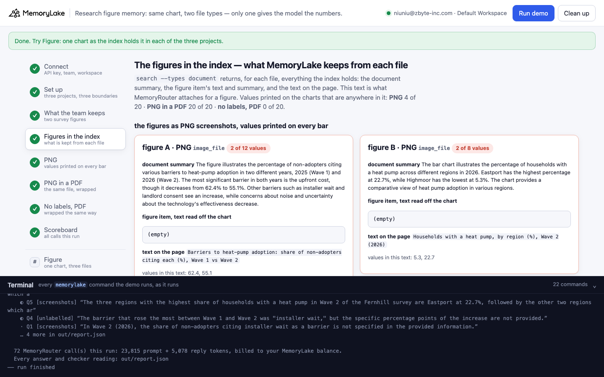
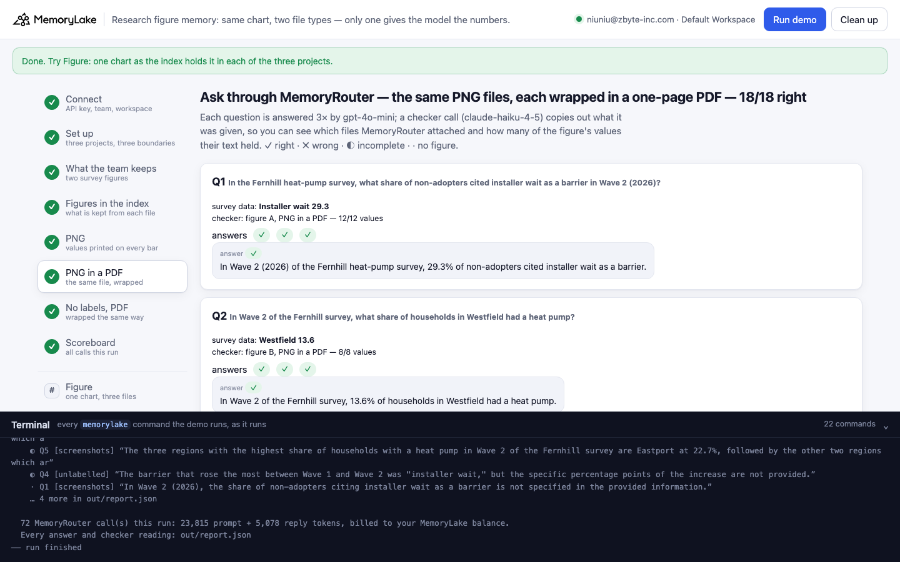
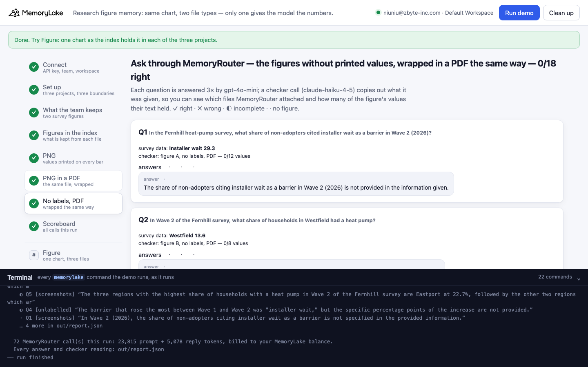
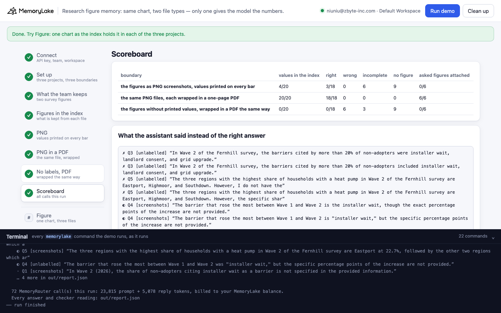

# Research figure memory: same chart, two file types — only one gives the model the numbers

A runnable version of the MemoryLake use case
[*Research Teams Need Shared Memory, Not Just Shared Documents*](https://www.memorylake.ai/en/usecase/ai-memory-for-research-teams),
built entirely on the [`memorylake` CLI](https://github.com/memorylake-ai/memorylake-cli) (v20261015 or later).

**Watch it run:** [CLI, 6:26](https://github.com/memorylake-ai/memorylake-usecases/releases/download/research-figure-memory-v1/research-figure-memory-cli-demo.mp4) · [Web, 6:35](https://github.com/memorylake-ai/memorylake-usecases/releases/download/research-figure-memory-v1/research-figure-memory-web-demo.mp4)
([release](https://github.com/memorylake-ai/memorylake-usecases/releases/tag/research-figure-memory-v1); GitHub serves them as downloads).

**The problem.** A research team keeps its results as bar charts with the value printed on every bar, and saves
them into shared memory so that everyone's assistant can answer from them. MemoryLake indexes a picture by looking
at it. Saved as a **PNG**, a chart becomes a vision summary plus its title, and that is what MemoryRouter attaches
when the assistant is asked about it. This is everything it attached for *"how many percentage points higher was
heat-pump ownership in Riverside than in Lakeland?"* (copied out by a checker call):

```
- (mlu-rfm-fig-b-regions.png) Households with a heat pump, by region (%), Wave 2 (2026)
- (mlu-rfm-fig-b-regions.png) mlu-rfm-fig-b-regions.png

The bar chart illustrates the percentage of households with a heat pump across different regions in 2026. Eastport
has the highest percentage at 22.7%, while Highmoor has the lowest at 5.3%. …
```

Eight values are printed on that chart; two reached the model. The answer: *"I do not have the specific figures for
heat-pump ownership in Riverside and Lakeland."*

Now take **the very same PNG file and wrap it in a one-page PDF** — no redraw, no data file, the image bytes go in
unchanged (`wrap_png_as_pdf()` in `demo.py`, under 50 lines of standard library). The PDF pipeline finds the chart as a
*figure* and reads the printed labels into the figure's text. MemoryRouter attached:

```
(mlu-rfm-fig-b-regions.pdf) The bar chart displays values for eight different locations: North Coast, Lakeland, …
North Coast: 18.4
Lakeland: 12.9
Midvale: 7.1
Riverside: 16.3
Highmoor: 5.3
Eastport: 22.7
Southdown: 6.8
Westfield: 13.6
(mlu-rfm-fig-b-regions.pdf) Households with a heat pump, by region (%), Wave 2 (2026)
```

and the answer was *"Riverside was 3.4 percentage points higher than Lakeland (16.3% − 12.9%)."* The grouped chart
(six barriers × two survey waves) comes out the same way, every value paired with its category and wave.

**What this demo shows.** The Fernhill Institute (a fictional policy research group) keeps two heat-pump survey
figures three ways, one project and one boundary each: **as PNG screenshots**, values printed on every bar;
**the same PNG files wrapped in a PDF**; and, as a control, **the charts without printed values, wrapped in a PDF
the same way**. Six questions the team asks — two look-ups, a threshold list, the biggest change between waves, a
top three, a gap between two regions — go through MemoryRouter (`router chat --boundary`, `gpt-4o-mini`,
temperature 0), each asked 3 times per boundary, and every answer is graded against the survey data. Every value
in the data is different, so a number in an answer names exactly one bar.

Totals over **10 runs** (18 answers per boundary per run):

| Boundary | Printed values in the index text | Right | Wrong | Incomplete | No figure | The asked figures were in what MemoryRouter attached |
|---|---|---|---|---|---|---|
| **PNG screenshots** | 4–6 of 20 (summary only) | **27 / 180** | 3 | 60 | 90 | 0 of 60 checker calls |
| **The same PNGs, wrapped in a PDF** | **20 of 20** | **175 / 180** | 4 | 1 | 0 | 60 of 60 |
| **No printed values, wrapped in a PDF** | 0 of 20 | **0 / 180** | **68** | 15 | 97 | 0 of 60 |

The figure item's own text — what the index reads off the chart — was **empty for every PNG** (20 of 20 imports)
and held **every printed value for every wrapped PDF** (20 of 20). The PNG's few values come from the summary: its
writer mentions the extremes (Eastport highest, Highmoor lowest; upfront cost 62.4 → 55.1). That is why the PNG
boundary answers the top-three question with *"Eastport at 22.7%, followed by the other two regions, which are not
specified"*. Its 27 right answers are all one question — which barriers were above 20% — and they are luck: the
model lists the barriers the summary says *increased*. When a summary named grid upgrade (14.7%) instead of
landlord consent, the same question went wrong three times out of three.

The unlabelled control shows what the PDF reads: the printed labels. Its figure text is usually the category
names and the legend, and the assistant fills the gap — *"the three regions with the highest share are Eastport,
Highmoor, and Southdown"* (Highmoor is the lowest of eight) 29 times of 30, *"upfront cost and uncertainty about
functionality"* for the barriers above 20% (uncertainty is 15.8). In 2 of the 10 imports of the grouped chart the
index went further and **estimated** the values from the bar heights, marked only by a tilde — `Unsure it works:
Wave 1 (2025) - ~60` (the survey says 31.6), `Landlord consent … ~35` (26.5). Those estimates reached the model:
*"approximately 30% of non-adopters cited installer wait"*. Step 4 counts them separately; none is a value printed
on the chart.

The four wrong answers with the PDF are worth seeing too: all 12 values were attached each time (the checker shows
it), and gpt-4o-mini still named grid upgrade (+6.3) as the biggest rise instead of installer wait (+10.6) three
times in one run, and once listed a 15.8% barrier as above 20%. Memory delivered the numbers; the model misread
them. The checker is what tells the two failures apart.

## Prerequisites

- Python 3.9+ (standard library only)
- The `memorylake` CLI **v20261015 or later** (`memorylake router` arrived in that release):
  ```bash
  curl -fsSL https://raw.githubusercontent.com/memorylake-ai/memorylake-cli/main/scripts/install.sh | sh
  memorylake version
  ```
- A MemoryLake API key ([app.memorylake.ai](https://app.memorylake.ai) → API Keys).
- **Router calls are billed to your MemoryLake balance** (`memorylake billing balance`). One run makes 72 calls
  (`gpt-4o-mini` answers, `claude-haiku-4-5` checker), about 24,000 prompt + 5,400 reply tokens; the run prints the
  total. If the balance is empty, the router calls print the refusal and are skipped; the memory steps still run.

## Run it

```bash
git clone https://github.com/memorylake-ai/memorylake-usecases.git
cd memorylake-usecases/research-figure-memory
export MEMORYLAKE_API_KEY=sk-...
python3 demo.py                      # the whole story, about 5 minutes
python3 demo.py figure A             # one figure as the index holds it in each of the three projects
python3 demo.py cleanup              # delete everything the demo created
```

The key is used to log into an isolated CLI profile under `.memorylake-demo/` (git-ignored); your own
`~/.memorylake` is never touched. For the China endpoint also set
`MEMORYLAKE_BASE_URL=https://app.memorylake.cn/openapi/memorylake`. Every run starts over, and everything it
creates is prefixed `mlu-rfm-` (projects, boundaries, Library files). The charts are generated by
`python3 data/make_figures.py` (needs Pillow) from `data/survey.json` and committed under `data/`; the PDFs are
written by the demo into `out/` on every run, so the demo itself needs nothing beyond the standard library.

## Or run it in the browser

```bash
python3 web/server.py                # opens http://127.0.0.1:8765
```

Paste the API key, press **Run the demo**, and follow the steps on the left while the terminal drawer shows every
`memorylake` command as it runs. **Figure** shows one chart as the index holds it in each project. **Clean up**
removes everything.

| Step 4: the figures in the index | Step 6: the same PNGs in a PDF |
|---|---|
|  |  |
| **Step 7: no printed values, in a PDF** | **Step 8: scoreboard** |
|  |  |

## What happens, step by step

All output below is from real runs in this directory (long command lines shortened with `…`).

### Steps 2–3: three projects, three boundaries, two figures

```
$ memorylake proj create --name 'Fernhill Institute — heat-pump survey figures (PNG)' --custom-id mlu-rfm-screenshots …
$ memorylake boundary create --name 'Research assistant: PNG' --custom-id mlu-rfm-screenshots --projects proj-… …
  … the same for mlu-rfm-pdf and mlu-rfm-unlabelled

  Fernhill household heat-pump survey — two result figures, every bar labelled with its value:
    fig-a-barriers.png       figure A: Barriers to heat-pump adoption: share of non-adopters citing each (%), Wave 1 vs Wave 2  (12 values)
    fig-b-regions.png        figure B: Households with a heat pump, by region (%), Wave 2 (2026)  (8 values)
  the team saves them as PNG screenshots. The same PNG files, wrapped in a PDF by wrap_png_as_pdf() (image bytes unchanged, no text layer):
    fig-a-barriers.png        30,257 bytes  →  fig-a-barriers.pdf        31,174 bytes
    fig-b-regions.png         24,640 bytes  →  fig-b-regions.pdf         25,529 bytes
    fig-a-barriers-plain.png  22,721 bytes  →  fig-a-barriers-plain.pdf  23,638 bytes
    fig-b-regions-plain.png   19,906 bytes  →  fig-b-regions-plain.pdf   20,795 bytes
  project “PNG”: fig-a-barriers.png, fig-b-regions.png
  project “PNG in a PDF”: fig-a-barriers.pdf, fig-b-regions.pdf
  project “no labels, PDF”: fig-a-barriers-plain.pdf, fig-b-regions-plain.pdf
$ memorylake lib upload data/fig-a-barriers.png --name mlu-rfm-fig-a-barriers.png --on-conflict overwrite
$ memorylake lib upload out/fig-a-barriers.pdf --name mlu-rfm-fig-a-barriers.pdf --on-conflict overwrite
$ memorylake proj doc import --project proj-… sc-…:inode-… sc-…:inode-… --wait --workspace ws-…
  · all documents indexed in 72 s (pictures are looked at by a vision model on import)
```

The wrapper adds under a kilobyte: the PNG's compressed image data becomes the PDF's image stream
(`/FlateDecode` with the PNG predictor), so nothing is re-encoded.

### Step 4: the figures in the index — what MemoryLake keeps from each file

`search --types document` returns, for each file, everything the index holds: the document summary and, for every
item, its text, its summary and its highlighted chunks. A chart is a `figure` item in both cases; what differs is
its `text`.

```
  mlu-rfm-fig-a-barriers.png  (image_file · PNG · figure A)
    document summary:  The figure illustrates the barriers to heat-pump adoption as cited by non-adopters in
                       two different years, 2025 (Wave 1) and 2026 (Wave 2). The most significant barrier in
                       both years is the upfront cost, though it decreases from 62.4% to 55.1%. …
    figure item, text read off the chart:  (empty)
    text on the page:  Barriers to heat-pump adoption: share of non-adopters citing each (%), Wave 1 vs Wave 2
    values printed on the chart that are anywhere in this text: 2 of 12  (62.4, 55.1)

  mlu-rfm-fig-a-barriers.pdf  (pdf_file · PNG in a PDF · figure A)
    document summary:  This content discusses the barriers to heat-pump adoption, focusing on the percentage of
                       non-adopters who cite each barrier in Wave 1 and Wave 2 of a survey.
    figure item, text read off the chart:  Upfront cost: Wave 1 (2025) - 62.4, Wave 2 (2026) - 55.1
                                           Installer wait: Wave 1 (2025) - 18.7, Wave 2 (2026) - 29.3
                                           Noise: Wave 1 (2025) - 11.2, Wave 2 (2026) - 9.8
                                           Landlord consent: Wave 1 (2025) - 23.9, Wave 2 (2026) - 26.5
                                           Grid upgrade: Wave 1 (2025) - 8.4, Wave 2 (2026) - 14.7
                                           Unsure it works: Wave 1 (2025) - 31.6, Wave 2 (2026) - 15.8
    figure item, summary:  The bar chart compares various concerns related to a project across two time
                           periods, Wave 1 (2025) and Wave 2 (2026). …
    values printed on the chart that are anywhere in this text: 12 of 12  (62.4, 55.1, 18.7, 29.3, …)

  mlu-rfm-fig-a-barriers-plain.pdf  (pdf_file · no labels, PDF · figure A)
    figure item, text read off the chart:  Upfront cost, Installer wait, Noise, Landlord consent, Grid upgrade, Unsure it works
                                           Wave 1 (2025), Wave 2 (2026)
    values printed on the chart that are anywhere in this text: 0 of 12
  …
  values printed on the charts that are anywhere in the index text:
    PNG               4 of 20
    PNG in a PDF     20 of 20
    no labels, PDF    0 of 20
```

The layout of the figure text varies between imports (`North Coast 18.4`, `North Coast: 18.4`, `Upfront cost (62.4,
55.1)`), the values in it did not. When the index estimates values for an unlabelled chart, step 4 adds a line:

```
    values estimated from the bar heights (written ~): 12, none of them printed on the chart; the furthest off: Unsure it works, Wave 1 (2025) ~60 (survey: 31.6)
```

### Step 5: ask through MemoryRouter — the PNG screenshots

```
  Q2  In Wave 2 of the Fernhill survey, what share of households in Westfield had a heat pump?
      survey data: Westfield 13.6
$ memorylake router chat 'In Wave 2 of the Fernhill survey, what share of households in Westfield had a heat pump?' --model gpt-4o-mini --max-tokens 200 --temperature 0 --body out/body.json --boundary bnd-…
$ memorylake router messages '…' --model claude-haiku-4-5 --max-tokens 2500 --temperature 0 --system 'You are a context inspector …' --boundary bnd-…
      checker: attached figure B, PNG (2/8 values)
      answers · · ·   e.g. “I do not have the specific share of households in Westfield with a heat pump from Wave 2 of the Fernhill survey.”
  …
  Q5  Name the three regions with the highest share of households with a heat pump in Wave 2 of the Fernhill survey, with their shares.
      survey data: Eastport 22.7, North Coast 18.4, Riverside 16.3
      checker: attached figure B, PNG (2/8 values)
      answers ◐ ◐ ◐   e.g. “The three regions with the highest share of households with a heat pump in Wave 2 of the Fernhill survey are Eastport at 22.7%, followed by the other ”

    PNG: 3/18 right · 0 wrong · 6 incomplete · 9 no figure  ·  checker: the asked figures were in what was attached 0/6
```

✓ right · ✗ wrong (invented, or another bar's value, or a name that does not belong) · ◐ incomplete · · no figure.

### Step 6: the same PNG files, wrapped in a PDF

```
  Q4  In the Fernhill survey, which barrier rose the most between Wave 1 and Wave 2, and by how many percentage points?
      survey data: Installer wait 18.7 → 29.3 (+10.6 points)
      checker: attached figure A, PNG in a PDF (12/12 values)
      answers ✓ ✓ ✓   e.g. “The barrier that rose the most between Wave 1 and Wave 2 is "installer wait," which increased by 10.6 percentage points (from 18.7 to 29.3).”

  Q5  Name the three regions with the highest share of households with a heat pump in Wave 2 of the Fernhill survey, with their shares.
      survey data: Eastport 22.7, North Coast 18.4, Riverside 16.3
      checker: attached figure B, PNG in a PDF (8/8 values)
      answers ✓ ✓ ✓   e.g. “The three regions with the highest share of households with a heat pump in Wave 2 of the Fernhill survey are Eastport at 22.7%, North Coast at 18.4%, ”

    PNG in a PDF: 17/18 right · 1 wrong · 0 incomplete · 0 no figure  ·  checker: the asked figures were in what was attached 6/6
```

### Step 7: the charts without printed values, wrapped in a PDF

```
  Q3  Which barriers were cited by more than 20% of non-adopters in Wave 2 of the Fernhill survey?
      survey data: Upfront cost 55.1, Installer wait 29.3, Landlord consent 26.5
      checker: attached figure A, no labels, PDF (0/12 values)
      answers ✗ ✗ ✗   e.g. “In Wave 2 of the Fernhill survey, the barriers cited by more than 20% of non-adopters were upfront cost and uncertainty about functionality.”

  Q5  Name the three regions with the highest share of households with a heat pump in Wave 2 of the Fernhill survey, with their shares.
      survey data: Eastport 22.7, North Coast 18.4, Riverside 16.3
      checker: attached figure B, no labels, PDF (0/8 values)
      answers ✗ ✗ ✗   e.g. “The three regions with the highest share of households with a heat pump in Wave 2 of the Fernhill survey are Eastport, Highmoor, and Southdown. Howeve”

    no labels, PDF: 0/18 right · 6 wrong · 3 incomplete · 9 no figure  ·  checker: the asked figures were in what was attached 0/6
```

### Step 8: scoreboard

```
  PNG              in the index:  4/20 values  ·  3/18 right · 0 wrong · 6 incomplete · 9 no figure  ·  checker: the asked figures were in what was attached 0/6
  PNG in a PDF     in the index: 20/20 values  ·  17/18 right · 1 wrong · 0 incomplete · 0 no figure  ·  checker: the asked figures were in what was attached 6/6
  no labels, PDF   in the index:  0/20 values  ·  0/18 right · 6 wrong · 3 incomplete · 9 no figure  ·  checker: the asked figures were in what was attached 0/6

  what the assistant said instead of the right answer (✗ wrong · ◐ incomplete · · no figure):
    ✗ Q3 [pdf] “… upfront cost (55.1%), installer wait (29.3%), landlord consent (26.5%), and un…”
    ✗ Q3 [unlabelled] “… upfront cost and uncertainty about functionality.”
    ✗ Q5 [unlabelled] “… Eastport, Highmoor, and Southdown. However, I do not have the…”
    ◐ Q4 [screenshots] “The barrier that rose the most between Wave 1 and Wave 2 was "installer wait," but the specific percentage points of the increase are not provided.”
    …

  72 MemoryRouter call(s) this run: 23,850 prompt + 5,460 reply tokens, billed to your MemoryLake balance.
```

### The read-only subcommand

`python3 demo.py figure A` prints the figure's survey data next to the same chart as the index holds it in each
of the three projects (the step 4 view, for one figure). It makes searches only, no model call.

## Measured

10 runs: 2 in this directory, 2 parallel copies with their own prefix, 4 through the browser companion, and the
two recording runs (CLI and web; the CLI video was recorded twice — the first take was fine, but the step 4 view
then gained the "estimated from the bar heights" line, and the video should match the code). 18 answers per
boundary per run; 60 checker calls per boundary, all readable.

- **Per question** (180 answers per boundary, 30 per question): **PNG** — Q3 27 ✓ 3 ✗; Q4 30 ◐ (installer wait
  named, no points); Q5 30 ◐ (Eastport only); Q1, Q2, Q6 30 · each. **PNG in a PDF** — Q1, Q2, Q5, Q6 30 ✓ each;
  Q3 28 ✓ 1 ✗ (a 15.8% barrier listed above 20%) 1 ◐ (upfront cost left out); Q4 27 ✓ 3 ✗ (grid upgrade +6.3, all
  in one run). **No printed values, PDF** — Q5 29 ✗ (Eastport, Highmoor, Southdown) 1 ·; Q3 27 ✗ 3 ·; Q4 15 ◐
  6 ✗ (*"10 percentage points (from ~20% to ~30%)"*, from the estimated figure text) 9 ·; Q1 24 · 6 ✗
  (*"approximately 30%"*, same two runs); Q2, Q6 30 · each.
- **The index text** (step 4, 10 imports of every file): figure item `text` empty for all 20 PNG imports, every
  printed value for all 20 wrapped-PDF imports; for the unlabelled PDFs, category names and legend only in 18 of
  20, and bar-height estimates (`~60`, `~35`) in 2 — both times the grouped chart, never the region chart. The PNG
  summaries held 4 or 6 of the 20 values (the extremes).
- **The checker** (`claude-haiku-4-5`, 180 calls, all readable): MemoryRouter attached the asked figure for every
  question in every boundary.
- Each run: 72 MemoryRouter calls, 23,000–25,000 prompt + 5,000–5,900 reply tokens, 5–6 minutes (the six
  documents indexed in 68–102 s; three copies importing at once were the slow ones).

## Use it in your own app

- **The file type decides what the index reads off a chart.** A chart inside a PDF is a figure whose printed labels
  are read into text, value by value; the same picture as a PNG is described, not read. Before you rely on a chart
  being "in memory", look at what `search --types document` holds for it.
- **Wrapping is enough.** No redraw and no export of the data: `wrap_png_as_pdf()` puts the PNG's own bytes in a
  one-page PDF. For screenshots you already have, that took this team from 27 to 175 of 180.
- **Print the values on the chart.** The PDF reads the labels. An unlabelled chart in a PDF usually gives the
  category names and nothing else (and the assistant then makes up rankings); sometimes it gives estimates off the
  bar heights, written `~60`, that can be off by half. Treat a `~` in figure text as a guess, not a value.
- **Grade list answers for what is missing and what is extra**, and tell "not attached" from "attached and still
  wrong": the checker shows every value was attached when the model still picked the wrong biggest rise.

## Troubleshooting

- **`this memorylake CLI has no router command`**: upgrade the CLI (install line above).
- **MemoryRouter refused the call for lack of balance**: top up in the console; `memorylake billing balance` shows it.
- **`missing … run python3 data/make_figures.py`**: regenerate the charts after editing `data/survey.json` (needs Pillow).
- **`wrap_png_as_pdf handles 8-bit greyscale or RGB, non-interlaced PNGs`**: re-export the chart that way (most
  charting tools do by default), or convert it with any image tool before wrapping.
- **`search did not return the figures yet`**: indexing finished but search has not caught up; run again in a minute.
- **`checker: declined to copy (wrote NONE)`**: the checker model sometimes refuses to reproduce attached memory;
  that question's attachment is reported as unknown, not as "nothing attached".
- **A run was interrupted**: run again; it deletes what the previous run left and starts over.

## Files

| File | What it is |
|---|---|
| `demo.py` | The demo: CLI wrapper, setup, the PNG → PDF wrapper, uploads and imports, the index view, MemoryRouter calls and the checker, grading against the survey data, subcommands, cleanup |
| `data/survey.json` | The two figures and their values, the three ways of keeping them, the six questions, the assistant's system prompt and the checker instruction |
| `data/make_figures.py`, `data/*.png` | Draws each figure with and without printed values (needs Pillow; the outputs are committed) |
| `web/server.py`, `web/static/` | Browser companion (standard library server, no build step) |
| `out/` | The wrapped PDFs, the request body and `report.json` with every answer, grade and checker reading (git-ignored) |
