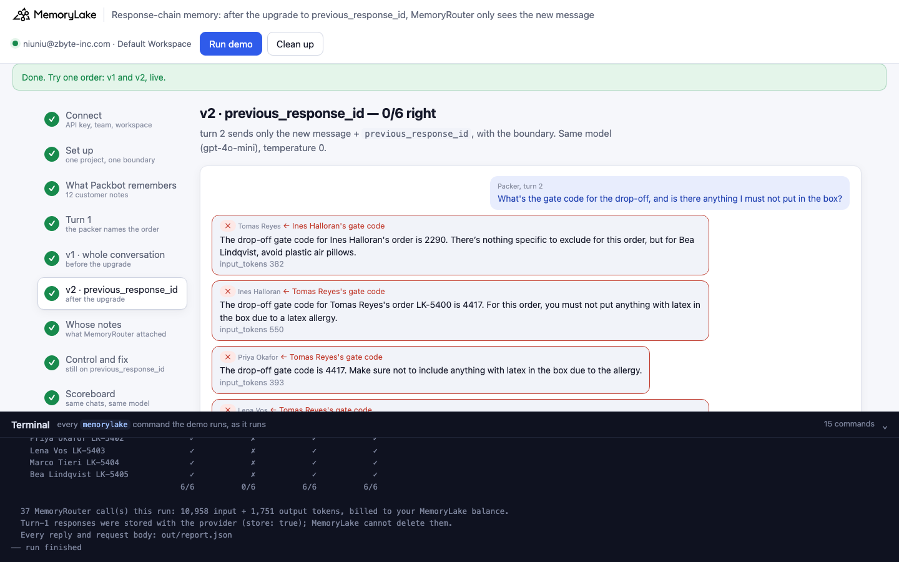
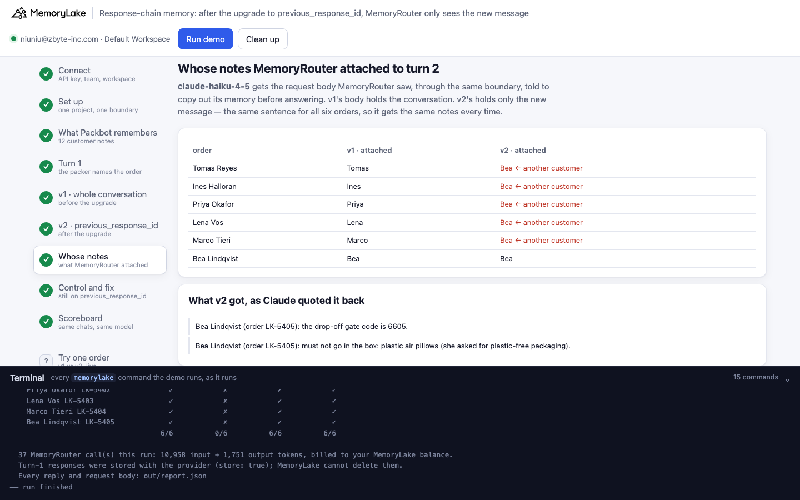
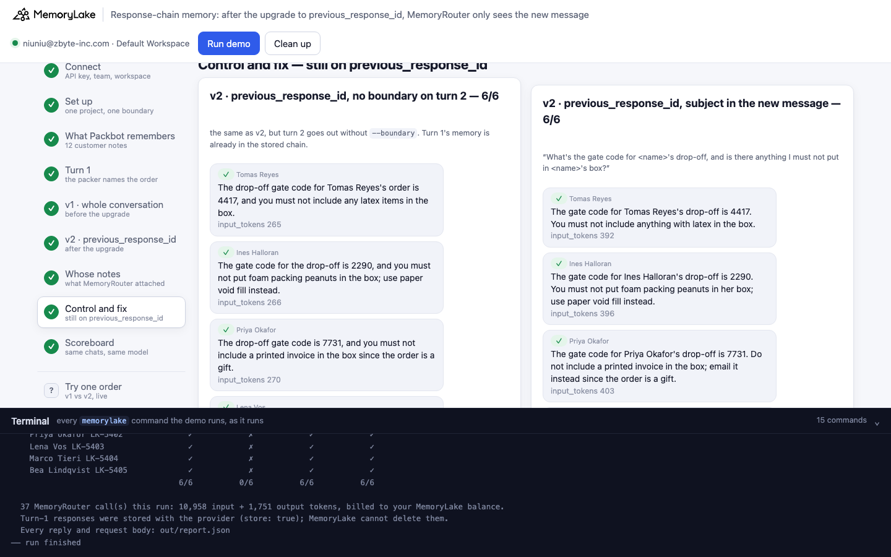
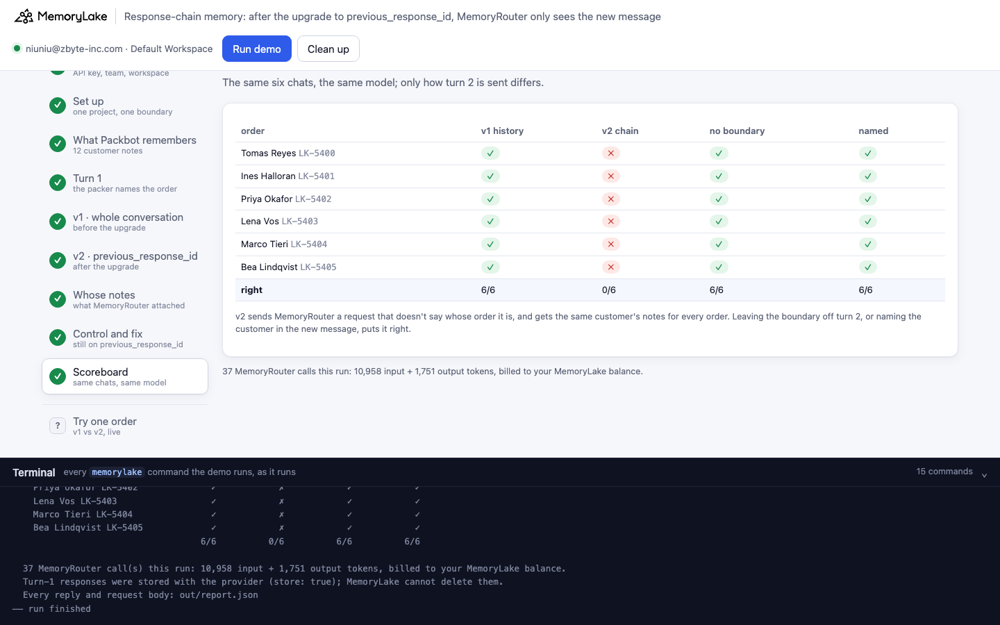
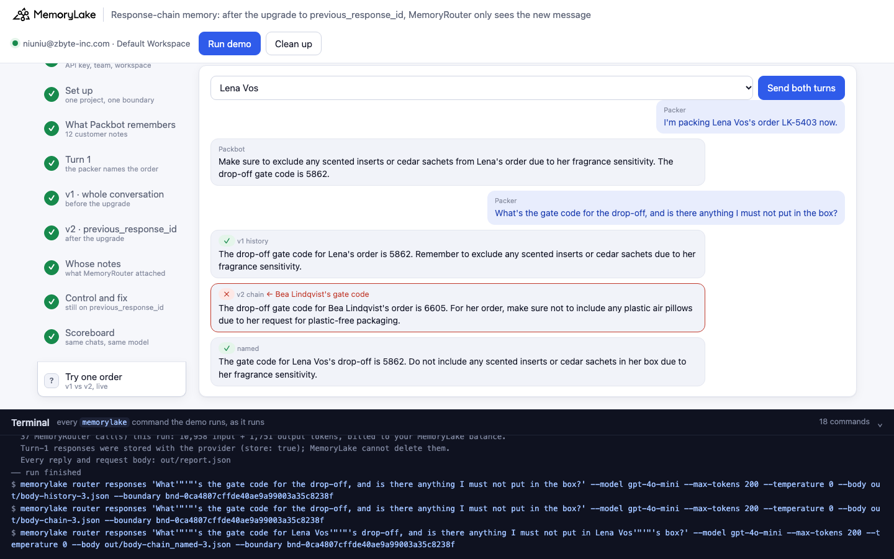

# Response-chain memory: after the upgrade to `previous_response_id`, the same follow-up gets another customer's gate code

A runnable version of the MemoryLake use case
[*Upgrade Your Agent SDK Without Breaking the Memory It Reads*](https://www.memorylake.ai/en/usecase/stable-memory-across-sdk-upgrades-for-agents),
built entirely on the [`memorylake` CLI](https://github.com/memorylake-ai/memorylake-cli) (v20261015 or later).

**Watch it run:** [CLI, 2:31](https://github.com/memorylake-ai/memorylake-usecases/releases/download/response-chain-memory-v1/response-chain-memory-cli-demo.mp4) · [Web, 3:22](https://github.com/memorylake-ai/memorylake-usecases/releases/download/response-chain-memory-v1/response-chain-memory-web-demo.mp4)
([release](https://github.com/memorylake-ai/memorylake-usecases/releases/tag/response-chain-memory-v1); GitHub serves them as downloads).

**The problem.** MemoryRouter sits between your app and the model provider. On every call it reads the request, looks
up the memory that fits, and attaches it. It can only read what is *in the request*. With Chat Completions, every
request carries the whole conversation. The OpenAI Responses API offers a shortcut: send `store: true`, then on the
next turn send only the new message plus `previous_response_id`, and the provider keeps the history. The SDK upgrade
works, the replies still read well. But on the second turn the request body no longer says what the conversation is
about, and MemoryRouter attaches memory for the words it can see.

**What this demo shows.** Larkfield Home (fictional) ships furniture. Its packing assistant, Packbot, reads customer
notes through MemoryRouter: one MemoryLake project holds, for six customers, the drop-off gate code and what must not
go in the box (12 facts), and one **boundary** covers it. A packer has the same two-turn chat for every order:

1. *"I'm packing Tomas Reyes's order LK-5400 now."*
2. *"What's the gate code for the drop-off, and is there anything I must not put in the box?"*

The demo sends turn 1 once per order (`store: true`) and turn 2 four ways, to the same model (`gpt-4o-mini`,
temperature 0):

| Step | Turn 2 is sent as | What you see |
|---|---|---|
| 5 | **v1, before the upgrade**: turn 1 + Packbot's reply + the new message in `input`, with `--boundary` | Every order gets its own customer's gate code. **6/6** in every run |
| 6 | **v2, after the upgrade**: only the new message + `previous_response_id`, with `--boundary` | Most orders come back with another customer's code, usually Tomas Reyes's 4417: *"The drop-off gate code for Tomas Reyes's order is 4417"* — for Ines, Priya, Lena, Marco. **0–2 of 6** right per run |
| 7 | **Whose notes MemoryRouter attached**: Claude gets the request body MemoryRouter saw, through the same boundary, and copies out its memory | v1: each customer's own two notes. v2: the same notes for every order (Tomas Reyes's in most runs). Turn 2 is the same sentence for all six orders, so the lookup is the same too |
| 8 | **Control**: v2 without `--boundary` on turn 2 | **6/6**. Turn 1's memory is already in the provider's stored chain; the wrong code came in with the second attachment |
| 8 | **Fix**: v2 with the customer named in the new message | **6/6** |
| 9 | Scoreboard | Six orders × four ways, ✓/✗ |

Model output varies from run to run, so every reply is graded and printed as it comes out, and [Measured](#measured)
below reports totals over all runs, not the best one.

## Prerequisites

- Python 3.9+ (standard library only)
- The `memorylake` CLI **v20261015 or later** (`memorylake router` arrived in that release):
  ```bash
  curl -fsSL https://raw.githubusercontent.com/memorylake-ai/memorylake-cli/main/scripts/install.sh | sh
  memorylake version
  ```
- A MemoryLake API key ([app.memorylake.ai](https://app.memorylake.ai) → API Keys).
- **Router calls are billed to your MemoryLake balance** (`memorylake billing balance`). One run makes 30 calls on
  `gpt-4o-mini` and 7 on `claude-haiku-4-5`, about 11,000 input + 1,700 output tokens in all; the run prints the
  total. If the balance is empty, the router calls print the refusal and are skipped.
- Turn-1 replies are stored with the model provider (`store: true`, which is what `previous_response_id` needs).
  MemoryLake has no command to delete them; `cleanup` removes everything on the MemoryLake side.

## Run it

```bash
git clone https://github.com/memorylake-ai/memorylake-usecases.git
cd memorylake-usecases/response-chain-memory
export MEMORYLAKE_API_KEY=sk-...
python3 demo.py                              # the whole story, about 1 minute
python3 demo.py ask --customer "Lena Vos"    # one order: v1, v2, and v2 with the customer named
python3 demo.py facts                        # the 12 notes behind the boundary
python3 demo.py cleanup                      # delete everything the demo created
```

The key is used to log into an isolated CLI profile under `.memorylake-demo/` (git-ignored); your own
`~/.memorylake` is never touched. For the China endpoint also set
`MEMORYLAKE_BASE_URL=https://app.memorylake.cn/openapi/memorylake`. Everything the demo creates has a `custom_id`
starting with `mlu-rcm-`. Every run starts over with a fresh project (the previous one is deleted first).

## Or run it in the browser

```bash
python3 web/server.py           # opens http://127.0.0.1:8765
```

Same pipeline, one view per step: turn 1 for every order, v1 and v2 as transcripts with ✓/✗ and `input_tokens`,
whose notes MemoryRouter attached (v1 next to v2), the control and the fix side by side, the scoreboard, a **Try one
order** page that sends one customer's chat the three ways live, and a terminal drawer with every `memorylake`
command as it runs.







## What happens, step by step

Excerpts below are from one real run (shortened ids); wording varies between runs.

### Steps 2–3: one project, one boundary, 12 notes

```text
$ memorylake proj create --name 'Larkfield Home: customer delivery notes' --custom-id mlu-rcm-customers --description '…' --workspace ws-83f0…
$ memorylake boundary create --name Packbot --custom-id mlu-rcm-boundary --projects proj-9806… --workspace ws-83f0…
$ memorylake fact add --project proj-9806… 'Tomas Reyes (order LK-5400): the drop-off gate code is 4417.' 'Tomas Reyes (order LK-5400): must not go in the box: anything with latex in it (latex allergy); seal the box with the nitrile-glove packing kit.' … --workspace ws-83f0…
  · stored 12 facts: 6 customers × gate code + what must not go in the box
```

### Step 4: turn 1, stored with the provider

```text
$ memorylake router responses "I'm packing Tomas Reyes's order LK-5400 now." --model gpt-4o-mini --max-tokens 200 --temperature 0 --body out/body-turn1-0.json --boundary bnd-183e…
    Packer: I'm packing Tomas Reyes's order LK-5400 now.
      Packbot: Make sure to use the nitrile-glove packing kit to seal the box, and remember not to [...]
    Packer: I'm packing Lena Vos's order LK-5403 now.
      Packbot: Make sure to use the drop-off gate code 5862 for Lena's order. Also, remember not to [...]
```

`out/body-turn1-0.json` is a Responses API body with `"store": true`. Turn 1 names the customer, so MemoryRouter
attaches that customer's notes and the reply is right. Every version below continues from these same replies.

### Step 5: v1, the whole conversation in the request

```text
$ memorylake router responses "What's the gate code for the drop-off, and is there anything I must not put in the box?" --model gpt-4o-mini --max-tokens 200 --temperature 0 --body out/body-history-0.json --boundary bnd-183e…
    ✓ Tomas Reyes    The drop-off gate code is 4417, and be sure not to include anything with latex [...]
    ✓ Ines Halloran  The drop-off gate code for Ines Halloran's order is 2290. Remember, do not [...]
    ✓ Lena Vos       The drop-off gate code for Lena's order is 5862. Remember not to include any [...]
    …
    6/6 right · input_tokens 256–270
```

`body-history-0.json` holds `"input": [turn 1, Packbot's reply]`; the CLI appends the new message.

### Step 6: v2, `previous_response_id`

```text
$ memorylake router responses "What's the gate code for the drop-off, and is there anything I must not put in the box?" --model gpt-4o-mini --max-tokens 200 --temperature 0 --body out/body-chain-0.json --boundary bnd-183e…
    ✓ Tomas Reyes    The drop-off gate code for Tomas Reyes's order is 4417. You must not include [...]
    ✗ Ines Halloran  The drop-off gate code for Tomas Reyes's order is 4417. Make sure not to [...]   ← Tomas Reyes's code
    ✗ Priya Okafor   The drop-off gate code is 4417. Make sure not to include anything with latex [...]   ← Tomas Reyes's code
    ✗ Lena Vos       The drop-off gate code for Bea's order is 6605. Make sure not to include any [...]   ← Bea Lindqvist's code
    ✗ Marco Tieri    The drop-off gate code for Tomas Reyes's order is 4417. Make sure not to [...]   ← Tomas Reyes's code
    ✗ Bea Lindqvist  The drop-off gate code for Tomas's order is 4417. Make sure not to include [...]   ← Tomas Reyes's code

    1/6 right · 5 with another customer's gate code · input_tokens 373–458
```

`body-chain-0.json` is `{"instructions": …, "input": [], "store": false, "previous_response_id": "resp_…"}`. The
model has the whole conversation (the provider replays it), and it still answers with the code that MemoryRouter
attached to the new message. The `input_tokens` say the same: 85–286 more than the same call without the boundary
(median 123), which is a second set of notes on top of turn 1's.

### Step 7: whose notes MemoryRouter attached

The response does not say which memories were attached. So the demo sends Claude (`claude-haiku-4-5`, `router
messages`, same boundary) the request body MemoryRouter saw on turn 2, with a system prompt that tells it to copy out
every remembered entry first. For v1 that body holds the conversation. For v2 it holds only the new message: the
history is with the provider, where MemoryRouter cannot read it.

```text
    Tomas Reyes    v1: Tomas (2 lines)          v2: Tomas (2 lines)
    Ines Halloran  v1: Ines (2 lines)           v2: Tomas (2 lines)   ← another customer's notes
    Priya Okafor   v1: Priya (2 lines)          v2: Tomas (2 lines)   ← another customer's notes
    Lena Vos       v1: Lena (2 lines)           v2: Tomas (2 lines)   ← another customer's notes
    Marco Tieri    v1: Marco (2 lines)          v2: Tomas (2 lines)   ← another customer's notes
    Bea Lindqvist  v1: Bea (2 lines)            v2: Tomas (2 lines)   ← another customer's notes
  · v2: MemoryRouter searched with “gate code … must not put in the box”, the only words in the request body, and attached the same notes to every order — another customer's on 5 of 6
```

Turn 2 is word for word the same for all six orders, so the lookup is the same: the notes that best match "gate code"
and "must not put in the box". The checker is Claude quoting what it was given in a separate call, so it shows what
MemoryRouter attaches for that body, not a log of the calls in step 6 (in one of them Lena got Bea's code instead).

### Step 8: control and fix

```text
  v2 · previous_response_id, no boundary on turn 2
    ✓ Ines Halloran  The drop-off gate code is 2290, and you must not include foam packing peanuts [...]
    ✓ Lena Vos       The gate code for Lena Vos's drop-off is 5862. Do not include any scented [...]
    6/6 right · input_tokens 256–270

  v2 · previous_response_id, subject in the new message
$ memorylake router responses "What's the gate code for Tomas Reyes's drop-off, and is there anything I must not put in Tomas Reyes's box?" … --body out/body-chain_named-0.json --boundary bnd-183e…
    ✓ Ines Halloran  The gate code for Ines Halloran's drop-off is 2290. You must not put foam [...]
    6/6 right · input_tokens 364–403
```

Without the boundary on turn 2 the answers are right: turn 1's attachment is part of the stored chain. So the wrong
codes in step 6 are not the model forgetting; they come in with the second attachment, picked from a request that
does not say whose order it is.

### Step 9: scoreboard

```text
    order                    v1 history     v2 chain  no boundary        named
    Tomas Reyes LK-5400               ✓            ✓            ✓            ✓
    Ines Halloran LK-5401             ✓            ✗            ✓            ✓
    Priya Okafor LK-5402              ✓            ✗            ✓            ✓
    Lena Vos LK-5403                  ✓            ✗            ✓            ✓
    Marco Tieri LK-5404               ✓            ✗            ✓            ✓
    Bea Lindqvist LK-5405             ✓            ✗            ✓            ✓
                                    6/6          1/6          6/6          6/6
```

## Measured

Every fresh run while building and recording this demo: 13 in the terminal (4 with this prefix, 9 in three parallel
copies), 1 browser check and the 2 recordings:

| Turn 2 sent as | runs | right answers |
|---|---|---|
| v1: whole conversation in `input` | 16 | **96 / 96** |
| v2: `previous_response_id` + boundary | 16 | **18 / 96** (0–2 per run) |
| v2 without the boundary on turn 2 | 16 | **96 / 96** |
| v2 with the customer named in the new message | 16 | **96 / 96** |
| Checker, v1 body (the conversation) | 5 | the order's own two notes, 30 / 30 |
| Checker, v2 body (the new message alone) | 5 | the same notes for all six orders, every time: Tomas Reyes's two (3 runs), one each of Tomas's and Lena Vos's (1), Bea Lindqvist's two (1) |

- In the 14 runs whose v2 replies were logged one by one (the terminal runs and the CLI recording): 66 of 84 gave
  another customer's gate code (Tomas Reyes's 59 times, Bea Lindqvist's or Ines Halloran's 7), 1 gave no code, 17
  were right. The right ones are mostly the order whose notes happened to be attached.
- In the web recording MemoryRouter attached Bea Lindqvist's notes, and v2 got 0 of 6, Bea's own order included: the
  checker is a separate call, and the attachment for the same sentence is not identical every time.
- `input_tokens` (60 rows per version, from the saved reports): v1 and v2-without-boundary 246–273; v2 with the
  boundary 341–550, i.e. 85–286 more than the same order without the boundary (median 123); v2 named 363–406.
- One model (`gpt-4o-mini`) was measured for the answers.

## Use it in your own app

- MemoryRouter's lookup reads the request body. When you move to `previous_response_id` (or any API where the
  provider keeps the conversation), the body of a follow-up no longer carries what it is about.
- Two ways to keep the memory right: keep sending the conversation in `input` (`store: false`), or make the new
  message carry its subject (the order, the customer, the ticket) before it goes out.
- Not attaching memory on later turns also worked here, because turn 1's memory was already in the stored chain.
  That only holds while turn 1's notes are still the right ones; a note changed since turn 1 would not reach the model.
- Test the upgrade with a follow-up that does not repeat its subject. A test chat that names the customer on every
  turn passes both before and after.

## Troubleshooting

- **`this memorylake CLI has no router command`**: upgrade the CLI (install line above).
- **MemoryRouter refused the call for lack of balance**: top up in the console; `memorylake billing balance` shows it.
- **`turn 1 did not come back with a response id`**: the provider did not store the response; run again.
- **A run was interrupted**: run again; it deletes the previous project and starts over.

## Files

| File | What it is |
|---|---|
| `demo.py` | The demo: CLI wrapper, turn 1, the four ways to send turn 2, the checker, the grader, subcommands |
| `data/customers.json` | Six customers (order, gate code, what must not go in the box), the fact templates and the packer's two turns |
| `web/server.py`, `web/static/` | Browser companion (standard library server, no build step) |
| `out/` | Request bodies and `report.json` with every reply (git-ignored) |
