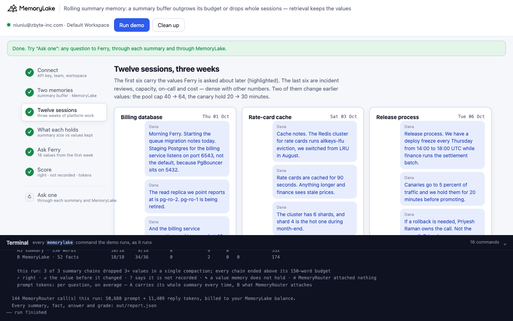
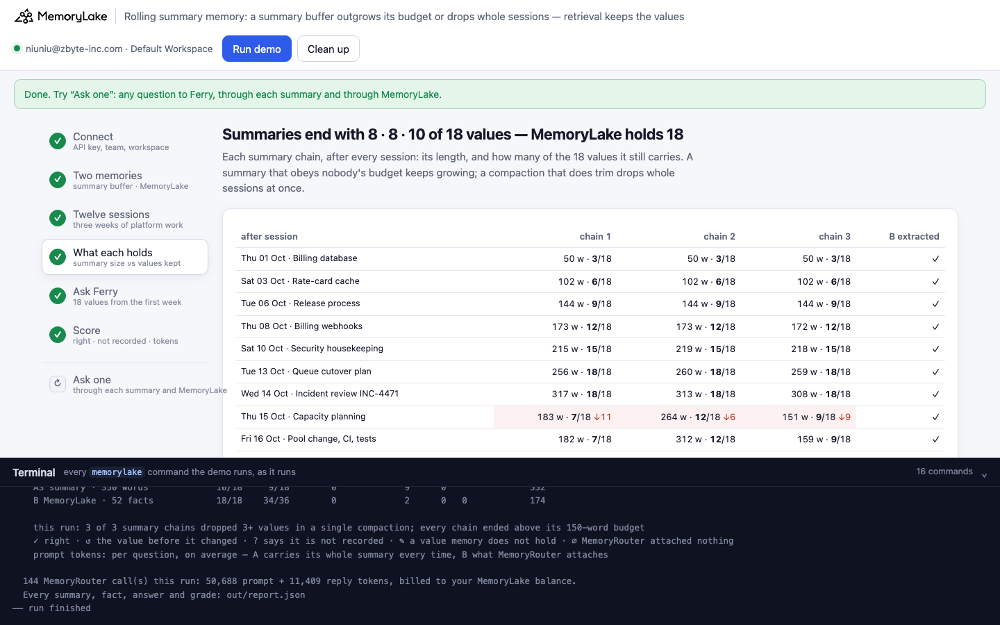
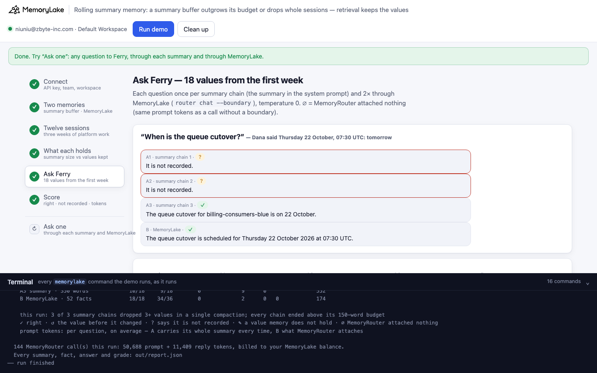
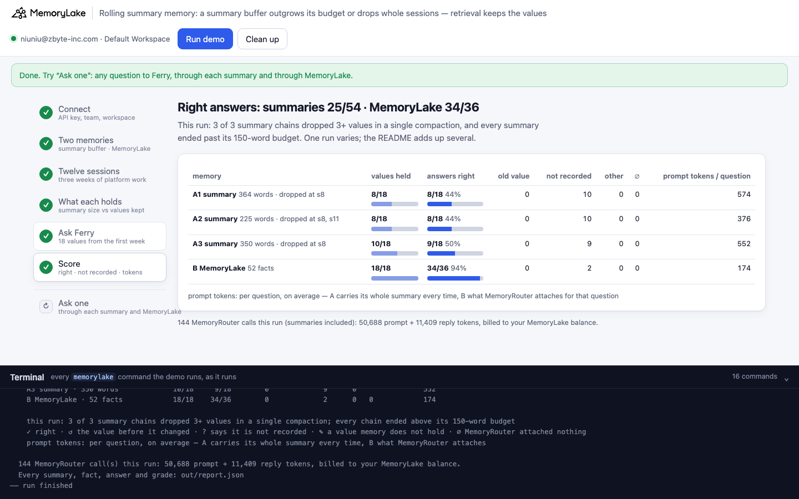

# Rolling summary memory: a summary buffer outgrows its budget, or drops whole sessions in one compaction

A runnable version of the MemoryLake use case
[*Stop Summarizing Agent History. Retrieve Structured Memory Instead.*](https://www.memorylake.ai/en/usecase/stop-summarizing-agent-history-retrieve-it-instead),
built entirely on the [`memorylake` CLI](https://github.com/memorylake-ai/memorylake-cli) (v20261015 or later).

**Watch it run:** [CLI, 10:08](https://github.com/memorylake-ai/memorylake-usecases/releases/download/rolling-summary-memory-v1/rolling-summary-memory-cli-demo.mp4) · [Web, 10:22](https://github.com/memorylake-ai/memorylake-usecases/releases/download/rolling-summary-memory-v1/rolling-summary-memory-web-demo.mp4)
([release](https://github.com/memorylake-ai/memorylake-usecases/releases/tag/rolling-summary-memory-v1); GitHub serves them as downloads). Each video is one run; the numbers below add up all of them.

**The problem.** Long agent history doesn't fit in the prompt, so many assistants keep a running summary: after each
session the model folds the new session into the summary, with a size budget. It looks cheap and tidy. Two things
happen to it, and you can't see either one unless you go and look:

- **The budget is ignored until it isn't.** Told "under 150 words", the summary grows session after session — 250,
  400, 500 words.
- **Then one compaction trims it, and drops a block of sessions.** Not the oldest ones, and not a word here and there:
  in one step the summary goes from ~500 words and all 18 values to ~160 words and 7. The assistant then answers,
  truthfully, "It is not recorded" — about a queue cutover scheduled for tomorrow.

Retrieval doesn't have that step. Each session goes into MemoryLake as a conversation, extraction turns it into
facts, and MemoryRouter attaches the ones a question needs — fewer tokens than the summary, and the values are still
there three weeks later.

**What this demo shows.** Dana Okafor (a fictional platform engineer at Kestrel Freight) works with Ferry, the team's
AI assistant, over twelve short sessions from 1 to 21 October. The first six carry 18 specific values: a Postgres
port, a read replica, cache TTL and eviction policy, the deploy freeze, the canary hold, the rollback owner, webhook
retries and backoff, the dead-letter queue, certificate and key dates, audit-log retention, the cutover plan. The last
six are incident reviews, capacity, CI, on-call and cost — dense with other numbers — and two of them change earlier
values (the pool cap 40 → 64, the canary hold 20 → 30 minutes). The same sessions go into two memories:

| | memory | how it is kept |
|---|---|---|
| **A** | summary buffer | after every session the app calls the model (`router chat`, no boundary) with the current summary and the new session: "Progressively summarize … Keep the summary under 150 words." **Three independent chains** per run — three instances of the same app. At question time the summary is in the system prompt. |
| **B** | MemoryLake | one project; each session a DIRECT conversation between Dana and Ferry, extracted before the next starts (so later sessions revise earlier facts); a boundary (the project plus Dana) read through `router chat --boundary`. |

Then, on Wednesday 21 October, Ferry is asked for the 18 values — once per summary chain, twice through MemoryLake —
on `gpt-4o-mini` at temperature 0, with a system prompt that says "If it is not in what you remember, say it is not
recorded." Nobody is tricked into guessing: the failure is honest forgetting.

Over 9 runs (27 summary chains), **23 of 27 chains lost 4–12 values in a single compaction** (most often 9–11 at once); none of the 27 stayed under its 150-word budget (final size 160–608 words). Ferry answered **247/486** right from the summaries — 238 times "It is not recorded" — and **315/324** through MemoryLake, where all 18 values were in the facts in every run. Per question, the summary cost 522 prompt tokens on average (279–930); MemoryRouter's attachment, 172 (149–278). Details in [Measured](#measured).

## Prerequisites

- **Python 3.9+** (standard library only).
- **The `memorylake` CLI, v20261015 or later** (`memorylake version`):
  ```bash
  curl -fsSL https://raw.githubusercontent.com/memorylake-ai/memorylake-cli/main/scripts/install.sh | sh
  ```
- **A MemoryLake API key**: sign up at [app.memorylake.ai](https://app.memorylake.ai), open **API Keys**, create one.
- **Balance for MemoryRouter**: about 145 calls on `gpt-4o-mini` per run — 36 summary compactions (3 chains × 12
  sessions), 18 baseline calls with `--max-tokens 1`, 54 answers from the summaries and 36 through MemoryLake.
  Everything else (projects, conversations, extraction, boundaries) is part of the free plan.

## Run it

```bash
git clone https://github.com/memorylake-ai/memorylake-usecases.git
cd memorylake-usecases/rolling-summary-memory
export MEMORYLAKE_API_KEY=sk-...        # logs into an isolated profile under .memorylake-demo/, never touches ~/.memorylake
python3 demo.py                         # about 8 minutes (the twelve sessions are extracted one after another)
python3 demo.py summaries               # the three summary chains, session by session, and each final summary
python3 demo.py memory                  # per value: the summaries vs the facts; every fact Ferry can read
python3 demo.py ask 'When is the queue cutover?'
python3 demo.py cleanup                 # deletes everything the demo created
```

China region: also `export MEMORYLAKE_BASE_URL=https://app.memorylake.cn/openapi/memorylake`. To use a specific
workspace: `export MEMORYLAKE_WORKSPACE=ws-…` (default: the team's default workspace). Without `MEMORYLAKE_API_KEY`
the demo uses your existing `memorylake auth login` session.

Every object the demo creates has a `custom_id` starting with `mlu-rsm-`. Each run starts over: it deletes what a
previous run left behind first. The summaries are the app's own state: `out/summaries.json`.

## Or run it in the browser

```bash
python3 web/server.py                   # opens http://127.0.0.1:8765
```

Paste the API key, press **Run demo**, and follow the steps: the two memories, the twelve sessions (with the summary
chains growing live while MemoryLake extracts), what each memory holds, Ferry's answers and the score. **Ask one**
sends any question through each summary and through MemoryLake. The terminal drawer at the bottom shows every
`memorylake` command as it runs. The server is standard library only and binds to localhost; the key stays in that
process and in `.memorylake-demo/`.

| | |
|---|---|
|  |  |
|  |  |

## What happens, step by step

Output excerpts below are from real runs (ids shortened).

### Step 2: two memories for Ferry

B is one project, two actors and a boundary. A needs nothing on the server: the app keeps the summary.

```
$ memorylake proj create --name 'Platform team notes' --custom-id mlu-rsm-notes
$ memorylake actor create --custom-id mlu-rsm-dana --display-name 'Dana Okafor' --description 'Platform engineer at Kestrel Freight. Demo data.' --tags demo
$ memorylake boundary create --name "Ferry's memory" --custom-id mlu-rsm-ferry --projects proj-a37e… --human-actor actor-7b66…
  · B: one project, Dana and Ferry as actors, and a boundary (project + Dana) — what Ferry reads through MemoryRouter

    A: no setup — the app keeps the summary itself. 3 chains, each told:
      “You keep the running memory of Ferry, an AI assistant for a platform engineering team. You are given
      the current summary and a new session. Progressively summarize: return a new summary that adds the new
      session to the current one. Return only the summary. Keep the summary under 150 words.”
```

### Step 3: twelve sessions, three weeks

Each session goes into MemoryLake as a DIRECT conversation, extracted before the next one is appended; at the same
time, each of the three summary chains folds it in with one model call:

```
$ memorylake conv create --project proj-a37e… --actors actor-7b66…,actor-69b8… --kind DIRECT --name 'Billing database (2026-10-01)' --custom-id mlu-rsm-conv-s1
$ memorylake conv msg append conv-19ed… --actor actor-7b66… --custom-id m00 --timestamp 2026-10-01T09:00:00Z --text 'Morning Ferry. Starting the queue migration notes today. Staging Postgres for the billing service listens on port 6543, not the default, because PgBouncer sits on 5432.'
$ memorylake conv cook-status conv-19ed…
$ memorylake router chat 'Current summary: […11 more lines]' --model gpt-4o-mini --max-tokens 900 --temperature 0 --system 'You keep the running memory of Ferry, …'
```

The summaries take under a minute; extraction takes about 30 seconds per session, one after the other.

### Step 4: what each memory holds

After every compaction the demo checks the summary for each of the 18 values (the value that was current at that
point: before session 9 the pool cap *is* 40). From the same run:

```
    A — the summary after each session (words · values kept of 18); budget 150 words
                                        chain 1           chain 2           chain 3
      01 Oct Billing database             51 w ·  3/18      50 w ·  3/18      50 w ·  3/18
      03 Oct Rate-card cache             100 w ·  6/18     102 w ·  6/18     102 w ·  6/18
      06 Oct Release process             142 w ·  9/18     144 w ·  9/18     144 w ·  9/18
      08 Oct Billing webhooks            178 w · 12/18     173 w · 12/18     173 w · 12/18
      10 Oct Security housekeeping       223 w · 15/18     215 w · 15/18     216 w · 15/18
      13 Oct Queue cutover plan          264 w · 18/18     255 w · 18/18     260 w · 18/18
      14 Oct Incident review INC-4471    318 w · 18/18     316 w · 18/18     313 w · 18/18
      15 Oct Capacity planning           385 w · 18/18     179 w ·  7/18 ↓11 183 w ·  7/18 ↓11
      16 Oct Pool change, CI, tests      437 w · 18/18     157 w ·  7/18     164 w ·  7/18
      19 Oct On-call handover            494 w · 18/18     222 w ·  7/18     220 w ·  7/18
      20 Oct Canary change, release tra  530 w · 18/18     193 w ·  8/18     280 w ·  8/18
      21 Oct Cost review                 592 w · 18/18     255 w ·  8/18     339 w ·  8/18
      ↓N one compaction dropped N values the summary held a moment before (counted from 3)
    chain 1: never dropped 3+ values at once — 592 words at the end, 3.9× its budget
    chain 2, folding in s8: 316 → 179 words, 18 → 7 values — lost: Canary hold, Rollback owner, Webhook retries,
    Max backoff, Dead-letter queue, TLS renewal, kf_live_ revocation, Audit-log retention, Consumer group,
    Cutover time, Prefetch
```

Two chains, the same model, the same prompt, the same input — and the same compaction, at the capacity-planning
session, cut both from ~315 words to ~180 and took sessions 3 to 6 with it. The third chain never trimmed and ended
at four times its budget. Then the facts (`fact list --projects`, plus Dana's actor):

```
    What Ferry has to go on, per value — the final summaries (A) and the facts (B, 47 facts):
                              A1   A2   A3   B
      01 Oct Postgres port    ✓    ✓    ✓    ✓
             Pool cap per pod ✓    ✓    ✓    ✓   changed later
      …
             Rollback owner   ✓    ✗    ✗    ✓
      08 Oct Webhook retries  ✓    ✗    ✗    ✓
      …
      13 Oct Consumer group   ✓    ✗    ✗    ✓
             Cutover time     ✓    ✗    ✗    ✓
             Prefetch         ✓    ✗    ✗    ✓
    B, the fact for the cutover: “The cutover is scheduled for Thursday 22 October at 07:30 UTC, before the
    European morning peak. (as of 2026-10-13)”
```

### Step 5: ask Ferry

Each question once per summary chain (the summary in the system prompt, no boundary) and twice through MemoryLake;
one more call per question without either is the ∅ baseline (a boundary call with the same prompt tokens had nothing
attached):

```
$ memorylake router chat 'What port does staging Postgres for the billing service listen on?' --model gpt-4o-mini --max-tokens 120 --temperature 0 --system 'Today is Wednesday 21 October 2026. You are Ferry, … If it is not in what you remember, say it is not recorded.' --boundary bnd-f902…

                          A1 A2 A3  B  B
      Postgres port       ✓ ✓ ✓     ✓ ✓    B: Staging Postgres for the billing service listens on port 6543.
      Pool cap per pod    ✓ ✓ ✓     ✓ ✓    B: The billing service connection pool is capped at 64 connections per pod.
      Canary hold         ✓ ✓ ✓     ✓ ✓    B: Canaries are held for 30 minutes before promotion.
      Rollback owner      ✓ ? ?     ✓ ✓    A2: It is not recorded.
      Webhook retries     ✓ ? ?     ✓ ✓    A2: It is not recorded.
      Dead-letter queue   ✓ ? ?     ✓ ?    A2: It is not recorded.
      Cutover time        ✓ ? ?     ✓ ✓    A2: It is not recorded.
      …

    “When is the queue cutover?”   (Dana said: Thursday 22 October at 07:30 UTC — tomorrow)
    A1 ✓ | The queue cutover is scheduled for Thursday, 22 October at 07:30 UTC.
    A2 ? | It is not recorded.
    A3 ? | It is not recorded.
    B  ✓ | The queue cutover is scheduled for Thursday 22 October 2026 at 07:30 UTC.
```

### Step 6: the score

```
                                        kept    right  old value  not recorded  other   ∅  prompt tokens
    A1 summary · 592 words             18/18    18/18        0             0      0                908
    A2 summary · 255 words              8/18     8/18        0            10      0                417
    A3 summary · 339 words              8/18     8/18        0            10      0                536
    B MemoryLake · 47 facts            18/18    35/36        0             1      0   0            173

    this run: 2 of 3 summary chains dropped 3+ values in a single compaction; every chain ended above its 150-word budget
```

The one summary that kept everything is the most expensive memory in the table: 908 prompt tokens per question,
because the whole summary rides along every time. MemoryRouter attached about 170.

## Measured

9 runs: three terminal runs, three parallel copies of the demo with their own `custom_id` prefix, the run recorded for the CLI video (from a fresh `git clone`), and two browser runs (the second is the web video). Every number below comes from the saved reports (`out/runs/`), re-graded with the final grader.

**Per run** — each summary chain's final size and values held, and every compaction that dropped 3 or more values the summary held a moment before (`−N at sK (words before → after)`); then answers right from the summaries (3 chains × 18), what the facts held, and answers right through MemoryLake (2 × 18):

| run | chain 1 | chain 2 | chain 3 | A right | B facts | B right |
|---|---|---|---|---|---|---|
| run1 | 225 w · 8/18 · −6 at s8 (312→304 w), −4 at s11 (416→163 w) | 354 w · 10/18 · −9 at s7 (254→182 w) | 217 w · 7/18 · −11 at s7 (258→166 w) | 24/54 | 46 facts · 18/18 | 36/36 |
| run2 | 344 w · 8/18 · −11 at s7 (252→161 w) | 590 w · 17/18 | 160 w · 6/18 · −12 at s10 (432→144 w) | 30/54 | 45 facts · 18/18 | 36/36 |
| run3 | 592 w · 18/18 | 255 w · 8/18 · −11 at s8 (316→179 w) | 339 w · 8/18 · −11 at s8 (313→183 w) | 34/54 | 47 facts · 18/18 | 35/36 |
| copy1 | 336 w · 6/18 · −4 at s5 (182→171 w), −9 at s9 (338→156 w) | 232 w · 7/18 · −11 at s11 (510→164 w) | 219 w · 7/18 · −11 at s11 (507→152 w) | 20/54 | 47 facts · 18/18 | 36/36 |
| copy2 | 599 w · 18/18 | 231 w · 7/18 · −11 at s11 (510→163 w) | 247 w · 8/18 · −10 at s11 (510→180 w) | 33/54 | 49 facts · 18/18 | 34/36 |
| copy3 | 345 w · 8/18 · −11 at s8 (317→165 w) | 423 w · 8/18 · −11 at s7 (259→161 w) | 228 w · 8/18 · −10 at s11 (486→161 w) | 24/54 | 50 facts · 18/18 | 34/36 |
| cli | 247 w · 8/18 · −11 at s7 (256→166 w) | 331 w · 8/18 · −11 at s7 (255→166 w) | 230 w · 8/18 · −10 at s11 (516→163 w) | 24/54 | 46 facts · 18/18 | 36/36 |
| web1 | 327 w · 8/18 · −11 at s8 (306→193 w) | 219 w · 7/18 · −11 at s11 (506→152 w) | 608 w · 18/18 | 33/54 | 44 facts · 18/18 | 34/36 |
| web2 | 364 w · 8/18 · −11 at s8 (317→183 w) | 225 w · 8/18 · −6 at s8 (313→264 w), −4 at s11 (377→159 w) | 350 w · 10/18 · −9 at s8 (308→151 w) | 25/54 | 52 facts · 18/18 | 34/36 |

**Per question** (right / asked; the first nine are from the first three sessions):

| value | A (summaries) | B (MemoryLake) |
|---|---|---|
| Postgres port | 27/27 | 18/18 |
| Report replica | 27/27 | 18/18 |
| Pool cap per pod | 27/27 | 18/18 |
| Redis eviction | 26/27 | 18/18 |
| Rate-card TTL | 25/27 | 18/18 |
| Redis shards | 26/27 | 18/18 |
| Deploy freeze | 21/27 | 18/18 |
| Canary hold | 25/27 | 18/18 |
| Rollback owner | 4/27 | 18/18 |
| Webhook retries | 4/27 | 18/18 |
| Max backoff | 4/27 | 18/18 |
| Dead-letter queue | 4/27 | 15/18 |
| TLS renewal | 4/27 | 18/18 |
| kf_live_ revocation | 4/27 | 18/18 |
| Audit-log retention | 4/27 | 18/18 |
| Consumer group | 4/27 | 18/18 |
| Cutover time | 7/27 | 18/18 |
| Prefetch | 4/27 | 12/18 |

- **The drop is a single step, and it takes the middle.** 23 of 27 chains lost a block of values in one compaction — usually at s7, s8 or s11 — and the block was sessions 3–6: the rollback owner, the webhook settings, the certificate and key dates, the cutover. Values from the first two sessions (Postgres, Redis) were answered right 158/162 from the summaries; values from sessions 4–6, 39/243. In 23 of those 26 compactions the summary also got much *shorter* (252–516 words → 144–193) — the only moment in a run it came near its budget; in the other 3, new sessions pushed old values out at about the same length.
- **The chains that never dropped kept growing.** 4 of 27 ended at 590, 592, 599, 608 words (about 4× the budget) with every value — and paid for it on every question (900+ prompt tokens).
- **The failure is honest.** With "say it is not recorded" in the system prompt, the summaries answered "It is not recorded" 238 times and gave a wrong value 1 time (a deploy freeze answered as "every Thursday", without the time). Without that sentence (an earlier probe, one chain that lost 10 values), 7 of the 10 holes were filled with a made-up value, 4 of them the very default the model gives with no memory at all: "retry three times", "webhook-dead-letter-queue", "renews every 90 days", "prefetches 10 messages".
- **The two changes came through in MemoryLake.** Each session was extracted before the next was appended, so "raised the pool cap to 64" and "canaries held for 30 minutes, not 20" revised the earlier facts; B answered both with the new value every time (18/18 and 18/18); the summaries never answered with an old value either (0 times) — what they lost, they lost outright.
- **MemoryLake's misses.** 9 of 324 answers said "not recorded" although the fact was in the project: the dead-letter queue (3) and the prefetch (6). In one run extraction had written the prefetch as "The ack latency alarm fires when a consumer prefetches above 25 messages", and the model would not read that as the prefetch count; for the others, what MemoryRouter attached was not inspected. ∅ (nothing attached): 0.

## Use it in your own assistant

- **If you keep a summary buffer, measure it per value, not per word.** Its length tells you nothing: the summaries
  here were over budget the whole time, and lost two thirds of their content in a step that made them *shorter* and
  look healthier. Keep a list of the things it must not lose and check each compaction against it — that is what
  `demo.py` does to draw the trace.
- **Retrieve instead of re-summarizing.** Write each session to MemoryLake (`conv msg append` on a conversation in
  your project) and let extraction keep the facts; at answer time `router chat --boundary <id>` attaches only what
  the question needs. Here that was ~170 prompt tokens per question against 280–930 for the summaries.
- **Order the writes when sessions revise each other.** Extract each session before appending the next: the pool cap
  and canary changes came out as the new value ("raised to 64 … previously 40") because the older fact was already
  there to revise.
- **Pin what must survive word for word.** Extraction is not a copy either: in one run it rewrote "each consumer
  prefetches 25 messages; above that the ack latency alarm fires" as "the alarm fires when a consumer prefetches
  above 25 messages", and the model would not read that as the prefetch count. A value your product depends on can be
  written as is with `fact add`.

## Troubleshooting

- **`unexpected argument '--boundary'` / no `router` command** — the CLI is older than v20261015; reinstall with the
  `install.sh` line above.
- **`MemoryRouter refused the call for lack of balance`** — the summary buffer needs the model too, so the run stops
  there; top up and run again.
- **Quotes in `ask`** — use single quotes around the question in the shell.
- **A session stays "extracting" past 420 s** — the demo counts MemoryLake as it stands and says so; run again.
- **Leftovers after an interrupted run** — `python3 demo.py cleanup` (it deletes each actor's facts before the
  actor: a deleted actor's facts could never be removed).

## Files

| file | what it is |
|---|---|
| `demo.py` | the whole demo: CLI wrapper, the summary chains, MemoryLake ingestion, the per-value census, MemoryRouter questions, grading, cleanup |
| `data/sessions.json` | Dana and Ferry, the twelve sessions, the summarizer prompt, Ferry's system prompt, the 18 questions with the value each one expects |
| `web/server.py`, `web/static/` | the browser companion (standard library server, no build step) |
| `out/summaries.json` | the three summary chains of the last run, step by step |
| `out/report.json` | every summary, fact, answer and grade of the last run (`cleanup` moves both to `out/runs/`) |
