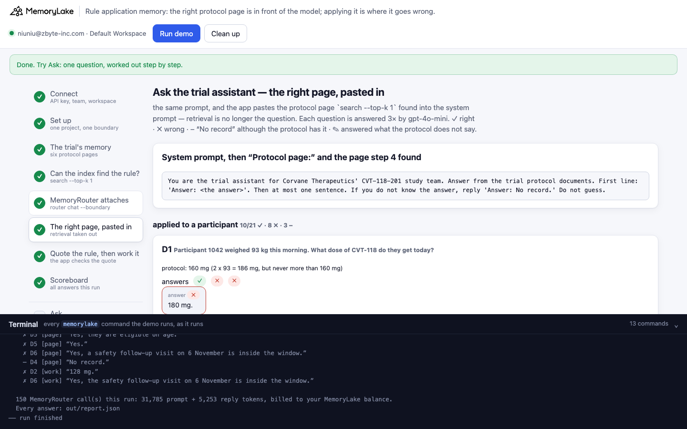
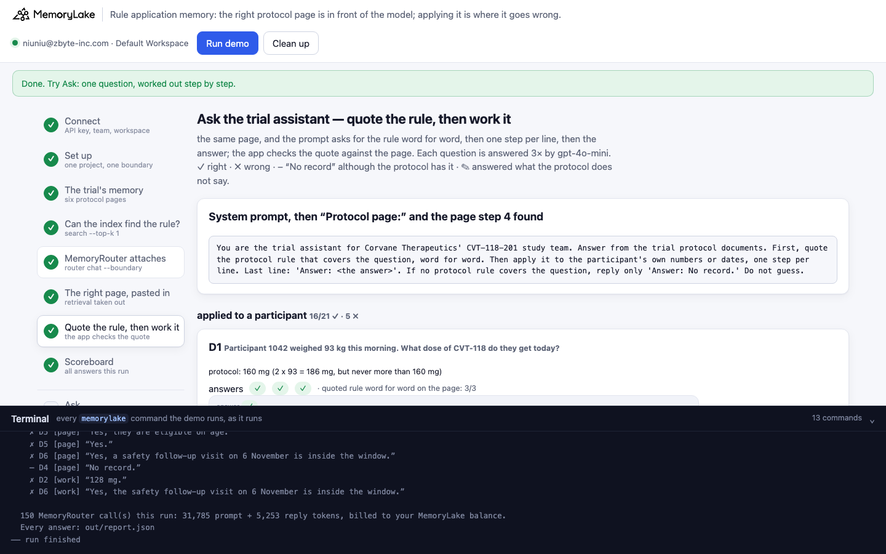
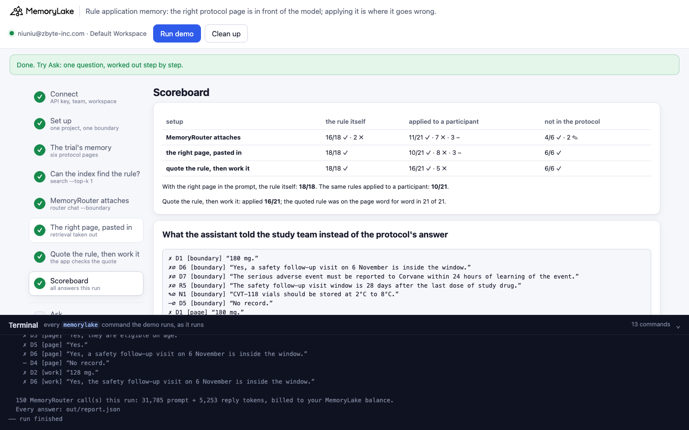
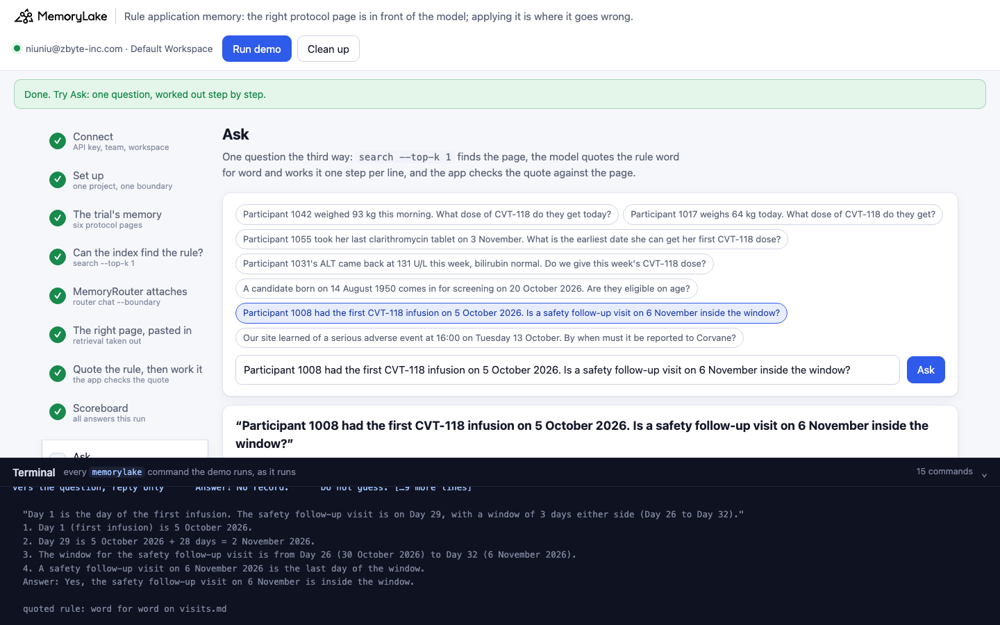

# Rule application memory: the right protocol page is in front of the model; applying it is where it goes wrong

A runnable version of the MemoryLake use case
[*Give Drug Discovery Teams AI That Carries Research Across Every Session*](https://www.memorylake.ai/en/usecase/ai-memory-for-pharmaceutical-research),
built entirely on the [`memorylake` CLI](https://github.com/memorylake-ai/memorylake-cli) (v20261015 or later).

**Watch it run:** [CLI, 4:28](https://github.com/memorylake-ai/memorylake-usecases/releases/download/rule-application-memory-v1/rule-application-memory-cli-demo.mp4) · [Web, 4:57](https://github.com/memorylake-ai/memorylake-usecases/releases/download/rule-application-memory-v1/rule-application-memory-web-demo.mp4)
([release](https://github.com/memorylake-ai/memorylake-usecases/releases/tag/rule-application-memory-v1); GitHub serves them as downloads).

**The problem.** Corvane Therapeutics (a fictional drug developer) keeps the protocol of its Phase II trial
CVT-118-201 in shared memory: six short pages — dosing, prohibited medicines, liver safety, eligibility, visit
schedule, SAE reporting. A trial assistant answers the study team from them through MemoryRouter.

Ask it for a rule and it is right. Ask it to **apply** that rule to a participant and it often is not — even when the
page with the rule has been pasted into its prompt by the app, so retrieval cannot be the cause:

```
D1  Participant 1042 weighed 93 kg this morning. What dose of CVT-118 do they get today?
    protocol: 160 mg (2 x 93 = 186 mg, but never more than 160 mg)        dosing.md is in the prompt
    ✗ "Answer: 180 mg."
D5  A candidate born on 14 August 1950 comes in for screening on 20 October 2026. Are they eligible on age?
    protocol: No: they are 76 on the screening day (limit 75)             eligibility.md is in the prompt
    ✗ "Answer: Yes, they are eligible on age."
D4  Participant 1031's ALT came back at 131 U/L this week, bilirubin normal. Do we give this week's CVT-118 dose?
    protocol: No: hold the dose (131 U/L is more than 3 x 40 = 120 U/L)   liver.md is in the prompt
    – "Answer: No record."
```

Same prompt, same page, same model: **144 of 144** right for the rules themselves, **90 of 168** for the same
rules applied to a participant (8 runs). The wrong answers read exactly like the right ones — one confident line.

The fix is not in retrieval. In the third setup the prompt asks for the rule **word for word**, then **one step per
line**, then the answer, and the app checks that the quoted rule is really on the page. Applied questions go to
**131 of 168**; every quote (168 of 168) was on the page word for word. The errors that remain are now on the screen:
every wrong D6 answer contains the line *"Day 32 (6 November 2026)"* (Day 32 is 5 November), every wrong D2 answer
says 128 mg needs no rounding (*"already at a 10 mg increment"*, *"already a multiple of 10"*). A coordinator can see which step to distrust; a bare "Yes" gave
them nothing to check.

## What the demo shows

| | Step | What you see |
|---|---|---|
| 1–3 | connect, set up, store | One project with six protocol pages (Library → project), one boundary over it |
| 4 | **Can the index find the rule?** | `search --types document --top-k 1` with each question as typed: the right page for 13 of 13. The app keeps each question's top page |
| 5 | MemoryRouter attaches | The "Do not guess" prompt, `router chat --boundary`, each question × 3. ∅ = MemoryRouter attached nothing |
| 6 | **the right page, pasted in** | The same prompt, no boundary: the app appends the page step 4 found. Rules ✓, applied rules often ✗ or "No record" |
| 7 | **quote the rule, then work it** | The same page; the prompt asks for the rule word for word, one step per line, then the answer. The app checks the quote; wrong steps are visible |
| 8 | scoreboard | Every answer graded, by question kind: the rule itself / applied to a participant / not in the protocol |

Fifteen questions: six ask for a rule ("What is the maximum CVT-118 dose per infusion?"), seven apply one of those
rules to a participant (a weight, a lab value, a birth date, a date of first infusion), and two ask about something
the protocol does not cover (vial storage temperature, blood donation) — for those, "No record" is the right answer.

## Prerequisites

- Python 3.9+ (standard library only)
- The `memorylake` CLI, **v20261015 or later** (`memorylake router` is new in that release):
  ```bash
  curl -fsSL https://raw.githubusercontent.com/memorylake-ai/memorylake-cli/main/scripts/install.sh | sh
  ```
- A MemoryLake API key ([app.memorylake.ai](https://app.memorylake.ai) → API Keys)
- Router calls are billed to your MemoryLake balance: 150 gpt-4o-mini calls per run, about 31,000–33,000 prompt +
  5,200–5,300 reply tokens. Without balance, the memory steps (1–4) still run and the answers are skipped.

## Run it

```bash
git clone https://github.com/memorylake-ai/memorylake-usecases.git
cd memorylake-usecases/rule-application-memory
export MEMORYLAKE_API_KEY=sk-...          # logs into an isolated profile under .memorylake-demo/
python3 demo.py                           # about 3–4 minutes
python3 demo.py ask "Participant 1088 weighs 81 kg today. What dose of CVT-118 do they get?"   # one question, worked out
python3 demo.py protocol                  # offline: the six pages and the fifteen questions
python3 demo.py cleanup                   # delete everything the demo created
```

China region: also `export MEMORYLAKE_BASE_URL=https://app.memorylake.cn/openapi/memorylake`.
Everything the demo creates is prefixed `mlu-ram-`; every run starts over.

## Or run it in the browser

```bash
python3 web/server.py                     # opens http://127.0.0.1:8765
```

Paste the key, press **Run demo**. The page follows the run step by step: the protocol pages, what search finds,
the fifteen questions under each setup (grouped as applied / rule / not covered, with every answer marked), the
working behind each answer in the third setup, and a scoreboard. **Ask** runs one question the third way: the page,
the rule word for word, the steps and the quote check. A terminal drawer shows every `memorylake` command as it
runs. **Clean up** removes it all.

| | |
|---|---|
|  |  |
|  |  |

## What happens, step by step

### Steps 2–3: one project, six pages

```bash
memorylake proj create --name 'CVT-118-201 protocol' --custom-id mlu-ram-protocol --workspace ws-…
memorylake boundary create --name 'Trial assistant: protocol' --custom-id mlu-ram-protocol --projects proj-… --workspace ws-…
memorylake lib upload data/protocol/dosing.md --name mlu-ram-dosing.md --on-conflict overwrite    # × 6
memorylake proj doc import --project proj-… <six item ids> --wait --workspace ws-…                 # about 45–80 s
```

### Step 4: can the index find the rule?

```bash
memorylake search 'Participant 1042 weighed 93 kg this morning. What dose of CVT-118 do they get today?' \
  --projects proj-… --types document --top-k 1 --workspace ws-…
```

```
  D1  Participant 1042 weighed 93 kg this morning. What dose of CVT-118 do t  top 1: dosing.md       ← the page with the rule
  D5  A candidate born on 14 August 1950 comes in for screening on 20 Octobe  top 1: eligibility.md  ← the page with the rule
  D6  Participant 1008 had the first CVT-118 infusion on 5 October 2026. Is   top 1: visits.md       ← the page with the rule
  N1  What temperature should CVT-118 vials be stored at?                     top 1: dosing.md       ← closest page; the protocol does not cover this
  · search finds the page with the rule for 13 of the 13 questions the protocol covers.
```

The page text `search` returns is the Markdown file word for word. Search always returns its top k, so the two
uncovered questions get the closest page; the model is told to say "No record" when no rule covers the question,
and it did, 96 of 96 times in steps 6–7.

### Step 5: MemoryRouter attaches

```bash
memorylake router chat 'Participant 1042 weighed 93 kg this morning. …' --model gpt-4o-mini --max-tokens 150 \
  --temperature 0 --system "You are the trial assistant for Corvane Therapeutics' CVT-118-201 study team. … Do not guess." \
  --boundary bnd-…
```

Before this step each question is asked once without a boundary: a boundary call with no more prompt tokens than
that baseline had nothing attached (∅). Many applied questions come back ∅ — the question is about a participant,
not about the rule — so this step mixes two failures. Steps 6 and 7 remove the first one.

### Step 6: the right page, pasted in

```bash
memorylake router chat 'A candidate born on 14 August 1950 comes in for screening on 20 October 2026. Are they eligible on age?' \
  --model gpt-4o-mini --max-tokens 150 --temperature 0 --system "You are the trial assistant … Do not guess.

Protocol page:
# Protocol CVT-118-201 - Eligibility
…
Participants must be 18 to 75 years old (inclusive) on the day of screening. …"          # no --boundary
```

```
  D5  A candidate born on 14 August 1950 comes in for screening on 20 October 2026. Are they eligible on age?
      protocol: No: they are 76 on the screening day (limit 75)
      answers ✗ ✗ ✗   e.g. “Yes, they are eligible on age.”
  R4  What age range is eligible for the CVT-118 trial?
      protocol: 18 to 75, inclusive
      answers ✓ ✓ ✓   e.g. “Participants must be 18 to 75 years old (inclusive) on the day of screening.”
```

### Step 7: quote the rule, then work it

The same page; the system prompt now says: *"First, quote the protocol rule that covers the question, word for word.
Then apply it to the participant's own numbers or dates, one step per line. Last line: 'Answer: <the answer>'."*
The app checks the quote against the page (a quote shortened with "…" counts when every piece is on the page).

```
  D1  Participant 1042 weighed 93 kg this morning. What dose of CVT-118 do they get today?
      protocol: 160 mg (2 x 93 = 186 mg, but never more than 160 mg)
      answers ✓ ✓ ✓   e.g. “160 mg.”
      quoted rule: 3/3 word for word on dosing.md

  D6  Participant 1008 had the first CVT-118 infusion on 5 October 2026. Is a safety follow-up visit on 6 November inside the window?
      protocol: No: 6 November is Day 33 (window Day 26-32 = 30 Oct-5 Nov)
      answers ✓ ✗ ✗   e.g. “Yes, the safety follow-up visit on 6 November is inside the window.”
        │ 1. Day 1 (first infusion) is 5 October 2026.
        │ 2. Day 29 is 5 October 2026 + 28 days = 2 November 2026.
        │ 3. The window for the safety follow-up visit is from Day 26 (30 October 2026) to Day 32 (6 November 2026).
        │ 4. A safety follow-up visit on 6 November 2026 is the last day of the window.
      quoted rule: 3/3 word for word on visits.md
```

Step 2 of that working is right (Day 29 = 2 November); step 3 adds one day too many. That is the line to check.

### The read-only subcommands

- `python3 demo.py ask "<question>"` — one question the third way: the page `search` finds, the rule word for word,
  the steps, the answer, and whether the quote is on the page.
- `python3 demo.py protocol` — offline: the six pages and the fifteen questions with their answers.

## Measured

Over **8 runs** (including the recordings; per setup and run: 6 rule questions, 7 applied, 2 not covered, each × 3):

| | the rule itself | applied to a participant | not in the protocol |
|---|---|---|---|
| MemoryRouter attaches (step 5) | 135/144 ✓ · 9 ✗ | 94/168 ✓ · 46 ✗ · 28 – | 26/48 ✓ · 22 ✎ |
| the right page, pasted in (step 6) | **144/144** ✓ | **90/168** ✓ · 55 ✗ · 23 – | 48/48 ✓ |
| quote the rule, then work it (step 7) | 144/144 ✓ | **131/168** ✓ · 35 ✗ · 2 – | 48/48 ✓ |

✓ right · ✗ wrong · – "No record" although the protocol has it · ✎ an answer the protocol does not give.

By applied question (24 answers each):

| | step 5 | step 6 (page pasted in) | step 7 (quote, then work) |
|---|---|---|---|
| D1 93 kg → dose (cap 160 mg) | ✗ 19, ✓ 5 | ✓ 17, ✗ 7 | ✓ 24 |
| D2 64 kg → dose (round to 10 mg) | ✓ 24 | ✓ 24 | ✗ 15, ✓ 9 |
| D3 last clarithromycin 3 Nov → first dose | ✓ 24 (10 with nothing attached) | ✓ 24 | ✓ 24 |
| D4 ALT 131 U/L → dose this week? | ✓ 20, –∅ 4 | – 23, ✓ 1 | ✓ 24 |
| D5 born 14 Aug 1950 → eligible on age? | –∅ 24 | ✗ 24 | ✓ 23, – 1 |
| D6 first infusion 5 Oct → visit 6 Nov in window? | ✗ 24 (19 with nothing attached) | ✗ 24 | ✗ 20, ✓ 3, – 1 |
| D7 SAE known 16:00 Tue 13 Oct → deadline | ✓ 21, ✗∅ 3 | ✓ 24 | ✓ 24 |

- **With the page in the prompt, rules are never the problem** (144/144 in step 6). Applying them is: the cap on a
  dose, a lab value against a multiple of the limit, an age from a birth date, a day count from a date.
- **"Do not guess" turns some of these into "No record"** (D4 23 of 24 in step 6): the rule is on the page, the model
  does not see that it answers the question, and the reply looks exactly like an honest gap.
- **Quote, then work, fixes D1 and D4 completely, D5 all but once — and breaks D2.** As a one-liner, "64 kg → 130 mg"
  was right 24 times; written out, the rounding step said "128 mg is already at a 10 mg increment" (or "a multiple of
  10") 15 times. Step-by-step is not a cure; what it buys is that every error sits in a line a person can check: all
  15 wrong D2 answers have that rounding line, all 20 wrong D6 answers have "Day 32 (6 November 2026)".
- **The reverse check holds**: asking the model to "apply the rule" did not make it apply rules that are not there —
  the two uncovered questions got "No record" 96 of 96 times in steps 6 and 7.
- These are totals over every run. Model replies vary from run to run, and so does which MemoryRouter calls come back empty.

## Use it in your own app

- **Separate retrieval from application when you evaluate.** Ask each rule both ways — "what is the rule" and "apply
  it to this case" — with the page pinned in the prompt. If the first is right and the second is not, better
  retrieval will not help.
- **Ask for the rule word for word, then the steps, then the answer, and check the quote against the page.** The
  quote check is a string match against what `search` returned (`quote_check()` in `demo.py`, a few lines). It tells
  you the model read the right rule; the steps tell a reviewer where it went wrong.
- **Do the arithmetic yourself where you can.** Doses, day windows and lab thresholds are deterministic: once the
  model has quoted the rule and named the inputs, code can compute the result and compare.
- **Don't read "No record" as "no rule".** In step 6 it mostly meant "the rule is here and I didn't apply it".

## Troubleshooting

- `this memorylake CLI has no 'router' command` — upgrade the CLI (v20261015 or later).
- `MemoryRouter refused the call for lack of balance` — the memory steps still run; top up to see the answers.
- `the documents are still processing after 6 minutes` — run again; the demo starts over.
- Leftovers from an interrupted run: `python3 demo.py cleanup` (everything is prefixed `mlu-ram-`).

## Files

- `demo.py` — the whole demo (standard library only): CLI wrapper, setup, upload and import, search, MemoryRouter
  calls with baselines, the three setups, grading, the quote check, cleanup
- `data/trial.json` — the fifteen questions (with the page, the protocol's answer and the grading patterns), the two
  system prompts and the page header
- `data/protocol/` — the six protocol pages (plain ASCII Markdown)
- `web/server.py`, `web/static/` — the browser companion (standard library HTTP + server-sent events)
