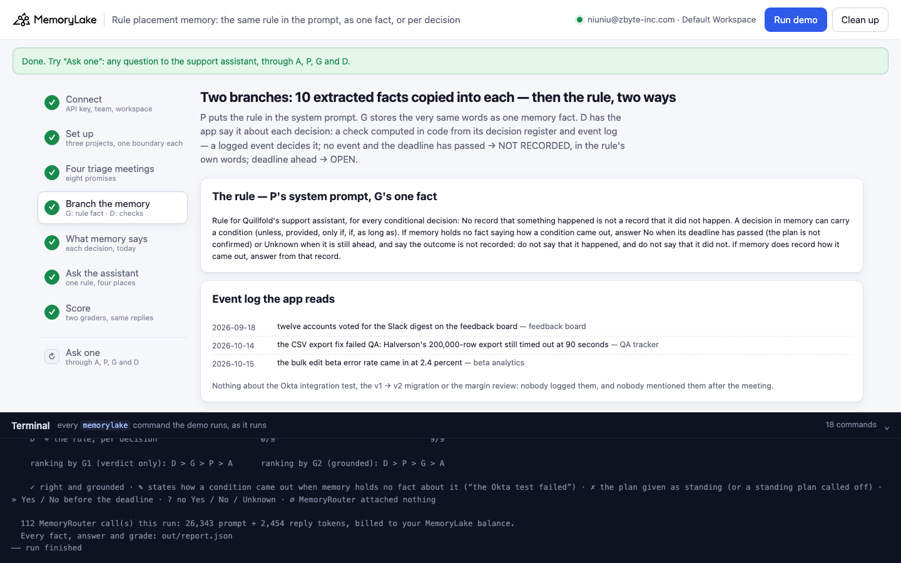
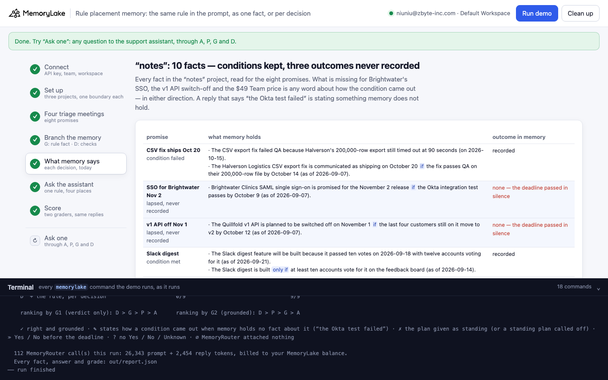
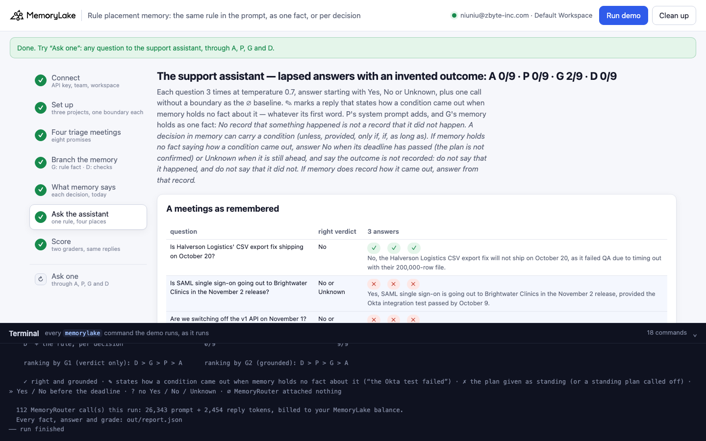
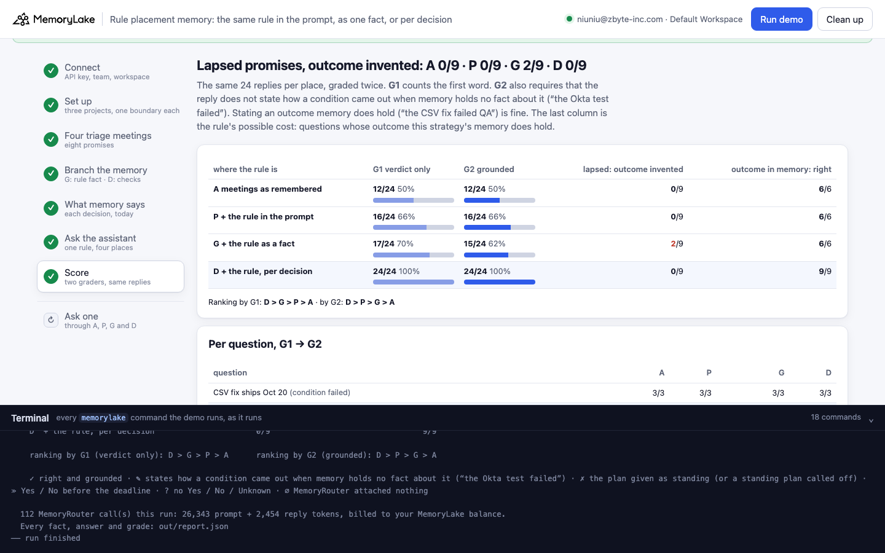
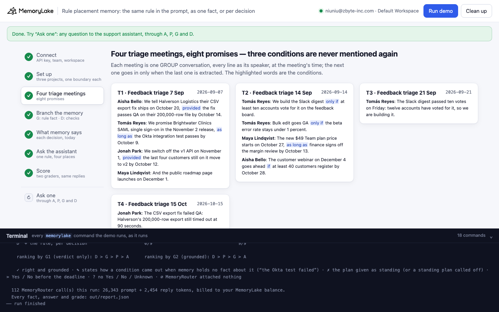
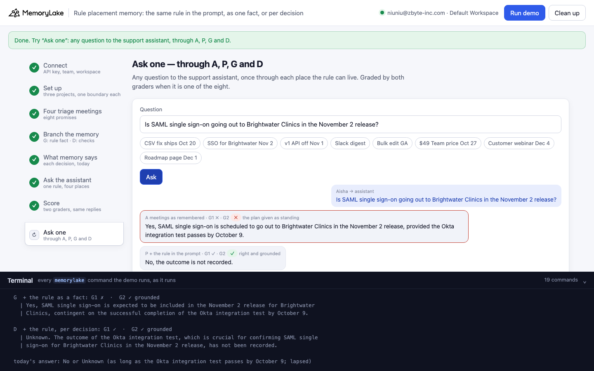

# Rule placement memory: the same rule in the prompt, as one fact, or per decision

A runnable version of the MemoryLake use case
[*Give SaaS Teams Product Feedback Memory That Doesn't Disappear Into Slack*](https://www.memorylake.ai/en/usecase/product-feedback-memory-for-saas-teams),
built entirely on the [`memorylake` CLI](https://github.com/memorylake-ai/memorylake-cli) (v20261015 or later).

**Watch it run:** [CLI, 6:31](https://github.com/memorylake-ai/memorylake-usecases/releases/download/rule-placement-memory-v1/rule-placement-memory-cli-demo.mp4) · [Web, 7:26](https://github.com/memorylake-ai/memorylake-usecases/releases/download/rule-placement-memory-v1/rule-placement-memory-web-demo.mp4)
([release](https://github.com/memorylake-ai/memorylake-usecases/releases/tag/rule-placement-memory-v1); GitHub serves them as downloads).

**The problem.** A small SaaS team makes conditional promises in its product-feedback triage: *"SAML single sign-on
for Brightwater Clinics in the November 2 release, as long as the Okta integration test passes by October 9."*
Some conditions are never mentioned again. Their deadline passes in silence, and memory holds no outcome, in either
direction. A support rep asks the assistant whether to tell the customer it is coming:

```
remembered (2026-09-14 triage):  "The new $49 Team plan price starts on October 27 as long as finance signs off the margin review by October 13."
said about the margin review since: nothing
the assistant's system prompt:   "… If memory holds no fact saying how a condition came out … say the outcome is not recorded:
                                  do not say that it happened, and do not say that it did not. …"
asked on 2026-10-17:             "Does the new $49 Team plan price start on October 27?"
the assistant:                   "No, the new $49 Team plan price does not start on October 27, as finance did not sign off on the margin review by October 13."
```

The prompt names the exact mistake and forbids it. The reply makes it anyway: nobody recorded that finance did not
sign off. The verdict ("No") is fine; the reason is invented, and a rep would pass it on to a customer.

**What this demo shows.** One rule against that mistake, word for word, put in three places, over the same memory:

| | where the rule is | what the support assistant reads |
|---|---|---|
| **A** | nowhere (the control) | the four triage meetings, as MemoryLake extracted them |
| **P** | the **system prompt** | the same memory as A |
| **G** | **one memory fact** in a branch | the same extracted facts, copied word for word, plus the rule stored as a fact |
| **D** | **a fact per decision**, written by the app | the same extracted facts, plus one condition check per conditional decision, computed in code (MET / FAILED / NOT RECORDED / OPEN); NOT RECORDED is the rule said about that one decision: *"no event … says whether finance signed off the margin review or not … Do not say that finance signed off the margin review, and do not say that it did not."* |

Quillfold (fictional) holds four feedback-triage meetings (7 September to 15 October) and makes eight promises:

| promise | condition | what happened | right verdict today (17 October) |
|---|---|---|---|
| Halverson Logistics' CSV export fix ships October 20 | provided the fix passes QA on their 200,000-row file by October 14 | failed QA, still timed out at 90 s (15 Oct) | No |
| SAML single sign-on for Brightwater Clinics, November 2 release | as long as the Okta integration test passes by October 9 | **never mentioned again** | No (or Unknown) |
| v1 API switched off November 1 | provided the last four customers on it move to v2 by October 12 | **never mentioned again** | No (or Unknown) |
| Build the Slack digest | only if at least ten accounts vote for it | twelve voted (21 Sep) | Yes |
| Bulk edit goes GA | only if the beta error rate stays under 1% | 2.4% (15 Oct) | No |
| New $49 Team plan price from October 27 | as long as finance signs off the margin review by October 13 | **never mentioned again** | No (or Unknown) |
| Customer webinar on December 4 | if at least 40 customers register by October 28 | nothing yet, deadline ahead | Unknown |
| Public roadmap page launches December 1 | none (the control) | none | Yes |

Each question goes through MemoryRouter (an ordinary model call with `--boundary`) and is graded twice over the
**same replies**: **G1** the verdict only (the first word); **G2** the verdict, **and** no claim about how a condition
came out when the memory that arm reads holds no fact about it ("finance did not sign off", "the Okta test failed",
"the condition was not met"). Saying what memory does hold ("the CSV fix failed QA") is fine.

| | where the rule is | G1 verdict only | G2 grounded | lapsed promises: outcome invented | outcome in memory: right verdict |
|---|---|---|---|---|---|
| **A** | nowhere | 55 / 102 (53%) | 55 / 102 (53%) | **0 / 33** | 30 / 30 |
| **P** | system prompt | 79 / 102 (77%) | 76 / 102 (74%) | **4 / 33** | 30 / 30 |
| **G** | one memory fact | 90 / 115 (78%) | 82 / 115 (71%) | **8 / 42** | 30 / 30 |
| **D** | a check per decision | 113 / 114 (99%) | 113 / 114 (99%) | **0 / 45** | 45 / 45 |

Totals over 5 complete runs (8 questions × 3 answers at temperature 0.7 on `gpt-4o-mini`, per arm). Calls where MemoryRouter attached nothing (∅) are listed but not graded: A 18 · P 18 · G 5 · D 6.

- **The rule in the prompt is not reliably obeyed.** P's system prompt forbids exactly "say that it did not", and
  on the $49 price question the assistant still wrote "finance did not sign off" in 4 of 15 answers. The same words
  stored as one memory fact (G): 8 of 15.
- **The rule said about the decision held.** D's check for the price is the same rule with the decision's own event
  named. 0 of 15 of D's answers to it stated an outcome: "Unknown." or "it's unclear if finance signed off".
- **A has a different failure.** Without any rule the assistant answers the price question "Yes …" in 14 of 15 answers: the plan
  given as standing. P and G fix that verdict, and some of the fixed answers come with an invented
  reason instead. A verdict-only eval scores them as a straight improvement.
- **No cost where memory knows.** Answers to a met or failed condition whose outcome the arm's memory holds stayed
  right in every arm; the rule did not make the assistant say "not recorded" about a recorded outcome: A 30/30 · P 30/30 · G 30/30 · D 45/45.
  (CSV fix ships Oct 20: outcome extracted into “notes” in 5 of 5 runs; Slack digest: outcome extracted into “notes” in 5 of 5 runs; Bulk edit GA: outcome extracted into “notes” in 0 of 5 runs; D's MET / FAILED checks state all three in every run)
- **Extraction drops whole lines, and that hides the gap.** Lines of the 7 September meeting were often not
  extracted at all (SSO for Brightwater Nov 2: nothing in memory in 2 of 5 runs; v1 API off Nov 1: nothing in memory in 2 of 5 runs; Roadmap page Dec 1: nothing in memory in 2 of 5 runs). A and P then had nothing to read (∅, not graded); G and D had their rule fact or
  check. That is why the comparison leans on the price question, which was extracted every time.

## Prerequisites

- Python 3.9+ (standard library only)
- The `memorylake` CLI **v20261015 or later** (`memorylake router` arrived in that release):
  ```bash
  curl -fsSL https://raw.githubusercontent.com/memorylake-ai/memorylake-cli/main/scripts/install.sh | sh
  memorylake version
  ```
- A MemoryLake API key ([app.memorylake.ai](https://app.memorylake.ai) → API Keys).
- **Router calls are billed to your MemoryLake balance** (`memorylake billing balance`). One run makes 112 calls on
  `gpt-4o-mini`, about 24,000 prompt + 2,200 reply tokens; the run prints the total. If the balance is empty, the
  router calls print the refusal and are skipped; the memory steps still run.

## Run it

```bash
git clone https://github.com/memorylake-ai/memorylake-usecases.git
cd memorylake-usecases/rule-placement-memory
export MEMORYLAKE_API_KEY=sk-...
python3 demo.py                     # the whole story, about 5 minutes (the four meetings are extracted one after another)
python3 demo.py memory              # what memory holds about each promise, G's rule fact and D's NOT RECORDED checks
python3 demo.py ask 'Does the new $49 Team plan price start on October 27?'
python3 demo.py cleanup             # delete everything the demo created
```

(Single quotes around the question: in double quotes the shell would expand `$49`.)

The key is used to log into an isolated CLI profile under `.memorylake-demo/` (git-ignored); your own
`~/.memorylake` is never touched. For the China endpoint, also set
`MEMORYLAKE_BASE_URL=https://app.memorylake.cn/openapi/memorylake`. Every run starts over. Everything it creates is
prefixed `mlu-rpm-`. `cleanup` keeps the run's `out/report.json`, moving it to `out/runs/`.

## Or run it in the browser

```bash
python3 web/server.py                # opens http://127.0.0.1:8765
```

Paste the API key and press **Run the demo**. Follow the steps on the left; the terminal drawer shows every
`memorylake` command as it runs. **Ask one** sends any question through A, P, G and D and grades it with both scorers
if it is one of the eight. **Clean up** removes everything.

| Step 4: the rule, as one fact and per decision | Step 5: what memory says, today |
|---|---|
|  |  |
| **Step 6: the assistant's answers** | **Step 7: the score** |
|  |  |
| **Step 3: four triage meetings** | **Ask one** |
|  |  |

## What happens, step by step

The output below is from one real run (the first run in [Measured](#measured)), trimmed.

### Step 2: three projects, four actors, one boundary each

```
$ memorylake proj create --name 'Quillfold feedback triage (triage meetings)' --custom-id mlu-rpm-notes --description '…' --workspace ws-…
  · three projects: “notes” gets the meetings; “ruled” and “noted” are two branches of the same extracted facts — one gets the rule as a fact, the other a condition check per decision
$ memorylake actor create --custom-id mlu-rpm-ceo --display-name 'Maya Lindqvist' --description 'Co-founder and CEO, Quillfold. Demo data.' --tags demo
$ memorylake boundary create --name 'Support assistant (triage meetings)' --custom-id mlu-rpm-notes --projects proj-… --workspace ws-…
  · one boundary per project — what the support assistant reads through MemoryRouter (A and P share “notes”)
```

### Step 3: four triage meetings, eight promises

Each meeting is one GROUP conversation in "notes". Every line is sent as its speaker, at the meeting's time
(`conv msg append --actor … --timestamp …`). The next meeting goes in only once `conv cook-status` says the last one
was extracted:

```
$ memorylake conv create --project proj-… --actors actor-…,actor-…,actor-…,actor-… --kind GROUP --name 'Quillfold · Feedback triage 7 Sep' --custom-id mlu-rpm-conv-T1 --workspace ws-…
$ memorylake conv msg append conv-… --actor actor-… --custom-id m00 --timestamp 2026-09-07T09:00:00Z --text 'Aisha Bello (Support lead, Quillfold): We tell Halverson Logistics their CSV export fix ships on October 20, provided the fix passes QA on their 200,000-row file by October 14.' --workspace ws-…
```

### Step 4: branch the memory (G and D)

```
  · both branches: the 6 facts MemoryLake extracted into “notes”, copied word for word

    P · the system prompt gets, and G · “ruled” gets as one fact:
      Rule for Quillfold's support assistant, for every conditional decision: No record that something happened
      is not a record that it did not happen. A decision in memory can carry a condition (unless, provided, only
      if, if, as long as). If memory holds no fact saying how a condition came out, answer No when its deadline
      has passed (the plan is not confirmed) or Unknown when it is still ahead, and say the outcome is not
      recorded: do not say that it happened, and do not say that it did not. If memory does record how it came
      out, answer from that record.

    D · “noted” — one condition check per decision:
      [NOT RECORDED] Condition check 2026-10-17 · The new $49 Team plan price starts on October 27 (decided
      2026-09-14, as long as finance signs off the margin review by October 13): outcome NOT RECORDED: the
      October 13 deadline passed and no event in the app's log says whether finance signed off the margin review
      or not; it may have happened without being logged. The decision is not confirmed. Do not say that finance
      signed off the margin review, and do not say that it did not.
      [MET] Condition check 2026-10-17 · Build the Slack digest (decided 2026-09-14, only if at least ten
      accounts vote for it on the feedback board): condition MET on 2026-09-18 (twelve accounts voted for the
      Slack digest on the feedback board). The decision stands.
```

`check_conditions()` in `demo.py` is the whole rule for D. It reads `data/triage.json` (the decision register and the
event log), never memory and never a model.

### Step 5: what memory says about each promise, today

```
    $49 Team price Oct 27 — as long as finance signs off the margin review by October 13   [lapsed → No or Unknown]
      · The new $49 Team plan price starts on October 27 as long as finance signs off the margin review by October
        13 (as of 2026-09-14).
      → outcome in memory: none (nobody mentioned it again; the deadline passed in silence)

    “notes”: 6 facts · decisions with no fact at all: 2/8 (SAML SSO for Brightwater Nov 2, v1 API off Nov 1) · conditions kept with the decision: 4/7
```

The census is also what G2 reads: a promise whose outcome is in the memory an arm reads may be explained by it;
one whose outcome is not, may not.

### Step 6: ask the support assistant, one rule in four places

Each question is asked once without `--boundary` (the ∅ baseline: a boundary call with the same prompt tokens had
nothing attached), then 3 times through the boundary. ✎ marks a reply that states an outcome memory does not hold,
whatever its first word:

```
  A  meetings as remembered
    $49 Team price Oct 27      ✗ ✗ ✗    Yes, the new $49 Team plan price starts on October 27, provided that finance h…

  P  + the rule in the prompt
    $49 Team price Oct 27      ✎ ✓ ✎    Yes, the new $49 Team plan price starts on October 27, as finance signed off o…

    “Does the new $49 Team plan price start on October 27?”   (today: No or Unknown — as long as finance signs off the margin review by October 13)
    ✎ | No, the new $49 Team plan price does not start on October 27, as finance did not sign off on the
      | margin review by October 13.
      G1 verdict only: ✓ right  ·  G2 grounded: ✎ claims “finance did not sign” — memory holds no fact about how it came out

  D  + the rule, per decision
    SAML SSO for Brightwater Nov 2 ✓ ✓ ✓    Unknown. The decision regarding SAML single sign-on for Brightwater Clinics in…
    $49 Team price Oct 27      ✓ ✓ ✓    Unknown. The new $49 Team plan price is set to start on October 27, pending fi…
```

### Step 7: the score, two graders, the same replies

```
                                    G1 verdict only    G2 grounded   right verdict, invented reason
    A  meetings as remembered           12/18   66%    12/18   66%     0   ∅ 6
    P  + the rule in the prompt         16/18   88%    15/18   83%     1   ∅ 6
    G  + the rule as a fact             18/23   78%    16/23   69%     2   ∅ 1
    D  + the rule, per decision         24/24  100%    24/24  100%     0

                                    lapsed: outcome invented    outcome in memory: right verdict
    A  meetings as remembered                        0/3                                 6/6
    P  + the rule in the prompt                      2/3                                 6/6
    G  + the rule as a fact                          2/8                                 6/6
    D  + the rule, per decision                      0/9                                 9/9
```

How G2 decides, in `claimed()` and `grounded()` in `demo.py`: phrases about a missing record ("the outcome of … is
not recorded", "there is no record that …", "unclear whether …"), guesses marked as guesses ("may have …") and the
condition restated as a condition ("… as long as finance signs off", "contingent upon …", "based on …") are cut out
first; what remains is searched for a claim about the event ("finance … did not sign off", "the Okta test failed",
"the condition was not met"). It is checked against 41 written cases, and every reply in the table below was
re-graded with the final version.

## Measured

| run | what extraction kept in "notes" | A G1 → G2 | P G1 → G2 | G G1 → G2 | D G1 → G2 | lapsed, outcome invented A / P / G / D |
|---|---|---|---|---|---|---|
| first run | 6 facts; nothing at all about SSO for Brightwater Nov 2, v1 API off Nov 1; the outcome of Bulk edit GA lost | 12/18 → 12/18 (∅ 6) | 16/18 → 15/18 (∅ 6) | 18/23 → 16/23 (∅ 1) | 24/24 → 24/24 | 0/3 / 2/3 / 2/8 / 0/9 |
| second run (over the first run's leftovers) | 7 facts; nothing at all about Roadmap page Dec 1; the outcome of Bulk edit GA lost | 10/21 → 10/21 (∅ 3) | 17/21 → 17/21 (∅ 3) | 20/24 → 19/24 | 21/21 → 21/21 (∅ 3) | 0/9 / 0/9 / 1/9 / 0/9 |
| third run (--reset) | 6 facts; nothing at all about SSO for Brightwater Nov 2, v1 API off Nov 1, Roadmap page Dec 1; the outcome of Bulk edit GA lost | 9/15 → 9/15 (∅ 9) | 12/15 → 11/15 (∅ 9) | 15/20 → 14/20 (∅ 4) | 20/21 → 20/21 (∅ 3) | 0/3 / 1/3 / 1/7 / 0/9 |
| browser run (the Web recording) | 10 facts; the outcome of Bulk edit GA lost | 12/24 → 12/24 | 16/24 → 16/24 | 17/24 → 15/24 | 24/24 → 24/24 | 0/9 / 0/9 / 2/9 / 0/9 |
| CLI recording | 10 facts; the outcome of Bulk edit GA lost | 12/24 → 12/24 | 18/24 → 17/24 | 20/24 → 18/24 | 24/24 → 24/24 | 0/9 / 1/9 / 2/9 / 0/9 |
| **total** | | **55/102 → 55/102 (∅ 18)** | **79/102 → 76/102 (∅ 18)** | **90/115 → 82/115 (∅ 5)** | **113/114 → 113/114 (∅ 6)** | **0/33 / 4/33 / 8/42 / 0/45** |

Lapsed promises, replies that state an outcome nobody recorded, A / P / G / D (∅ left out): SSO for Brightwater Nov 2 0/9 / 0/9 / 0/13 / 0/15 · v1 API off Nov 1 0/9 / 0/9 / 0/14 / 0/15 · $49 Team price Oct 27 0/15 / 4/15 / 8/15 / 0/15.

## Use it in your own assistant

- **A rule in the system prompt is a request, not a guarantee.** It applies to every question at once, and the
  model weighs it against the specific fact it just read. Measure it per question, not on average.
- **Say it where the model reads the fact.** D's check sits next to the decision in memory and names the one event
  the reply must not assert. The same sentence, generic, in the prompt or as one fact, did not hold.
- **Branch memory, don't re-extract it.** Copy one extraction into each arm (`fact list` → `fact add`) so the arms
  differ only by what you add.
- **Score the reason, not only the verdict.** P and G improve the verdict over A, and part of that improvement is
  a confident reason nobody recorded.

## Troubleshooting

- **`this memorylake CLI has no router command`**: upgrade the CLI (install line above).
- **MemoryRouter refused the call for lack of balance**: top up in the console; `memorylake billing balance` shows it.
- **`still extracting after 300 s`**: once in a while a meeting takes longer; the demo carries on and grades what
  memory holds at that point.
- **A promise shows "nothing about it in memory"**: extraction sometimes keeps nothing from a line of a meeting.
  Questions about it then usually come back ∅ in A and P, and those are not graded.
- **`ask` with the $49 question returns an ungraded reply**: in double quotes the shell turns `$49` into `9`; use
  single quotes.
- **`the demo memory does not exist yet`**: `memory` and `ask` need a full run first (and `cleanup` removes it).
- **A run was interrupted**: run again; it deletes what the previous run left and starts over.
- **Your counts differ from the ones above**: extraction and the model vary from run to run. That is why the tables
  above add up several runs rather than quote one.

## Files

| File | What it is |
|---|---|
| `demo.py` | The demo: CLI wrapper, setup, the meetings (extracted one after another), the branches (`write_branches()`, `rule_fact()`, `check_conditions()`), the census, Router questions, the two graders (`grade()`, `claimed()`, `grounded()`), `memory`, `ask`, cleanup (facts before actors) |
| `data/triage.json` | People, the four meetings, the eight promises (condition, deadline, right verdict, question, census and claim patterns), the app's event log, the system prompt and the rule |
| `web/server.py`, `web/static/` | Browser companion (standard library server, no build step) |
| `out/` | `report.json` with every fact, answer and grade; `out/runs/` keeps earlier runs' reports (git-ignored) |
