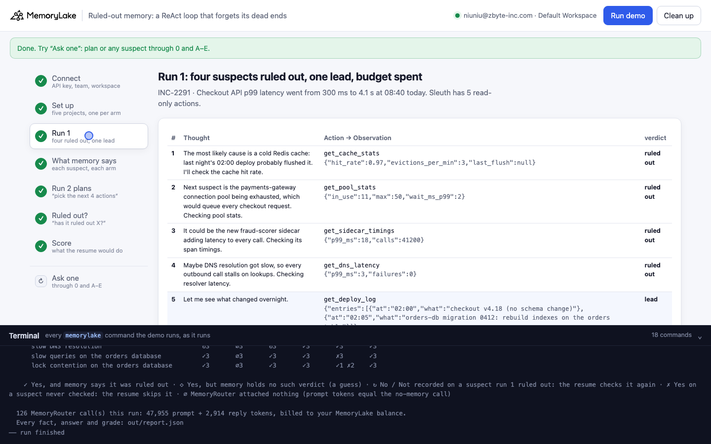
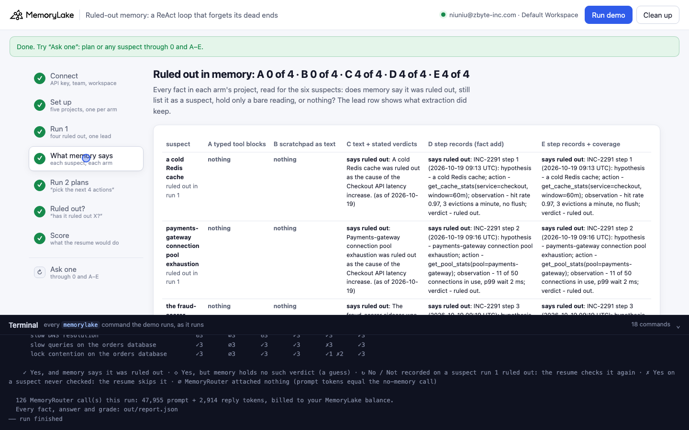
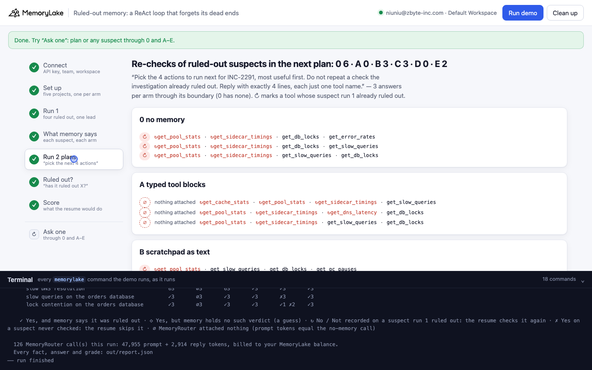
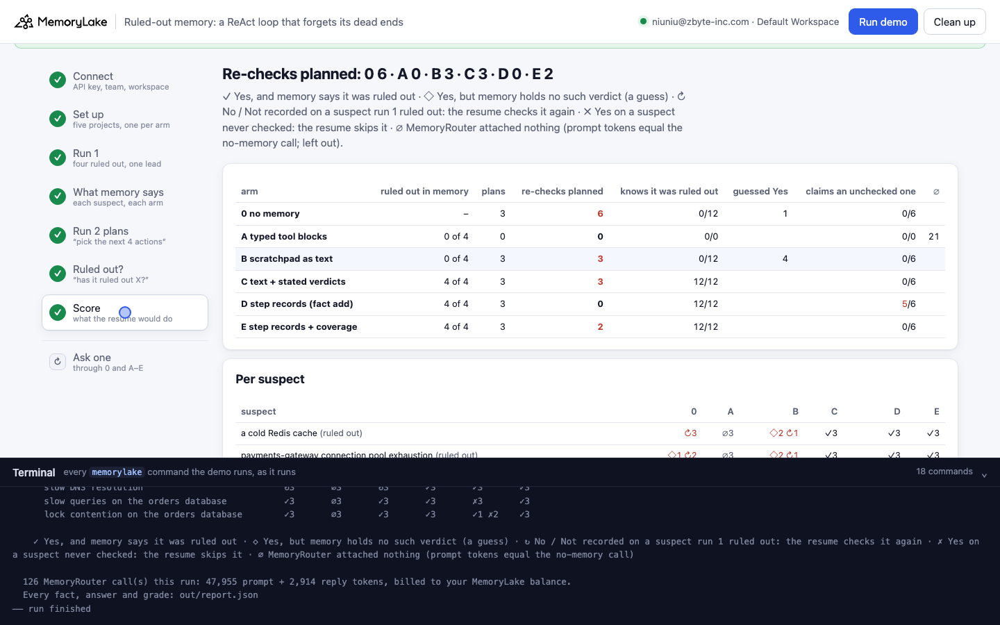

# Ruled-out memory: a ReAct loop that forgets its dead ends

A runnable version of the MemoryLake use case
[*Give ReAct Agent Loops Memory of Every Thought, Action, and Observation*](https://www.memorylake.ai/en/usecase/memory-for-react-style-agent-loops),
built entirely on the [`memorylake` CLI](https://github.com/memorylake-ai/memorylake-cli) (v20261015 or later).

**Watch it run:** recording in progress (videos will be linked here)

**The problem.** An investigation agent runs a ReAct loop: Thought, Action, Observation, repeat. In one run of five
actions it checks four suspects for a checkout latency incident, and each observation rules one out; the fifth action
finds a lead. The step budget is spent, the incident is still open, and the next run starts by asking memory what the
investigation already established. Hand the loop to MemoryLake as a conversation and extraction keeps **what was
found** but not **what was ruled out**:

```
run 1, iteration 1:  get_cache_stats → {"hit_rate": 0.97, "evictions_per_min": 3, "last_flush": null}   → cold cache: RULED OUT
in memory (B):       nothing about the cache                        (the lead from iteration 5 is there)
run 2 plans:         get_slow_queries, get_db_locks, ↻get_dns_latency, ↻get_pool_stats
```

Over 7 runs, the scratchpad stored as text (B) left **0 of 28** ruled-out suspects in memory and kept the lead
7 of 7 times. The resumed run then planned to check ruled-out suspects again **25** times in 84 picks.

Making the agent say its verdicts ("… so X is ruled out", C) mostly works here (24 of 28), but it is extraction's
call: one run kept none of them, and in the select probe for this demo (a shorter loop) the stated verdicts survived
2 of 9 times. Writing one typed record per iteration with `fact add` (D) keeps all of them (28 of 28) and the
plans never repeat a dead end (0 in 84 picks re-checks). But a memory full of "ruled out" records has a cost the plans
don't show: asked whether two suspects **nobody checked** were ruled out, D answered **"Yes"** 26 of 41 times,
including for slow queries on the orders database, the obvious next check. One more record saying what run 1 covered,
and that nothing else is ruled out (E), brings that to **0 of 42** and gives back some re-checks (10 in 84 picks).

## What it shows

- **Typed tool blocks (A) are stored but not extracted.** The framework-default log (`TOOL_USE` / `TOOL_RESULT`) left
  0 of 28 ruled-out suspects and the lead 0 of 7 times in memory. MemoryRouter attached nothing to 88 of 147 of A's
  answers.
- **When the observations are text (B), extraction is selective.** It kept the deploy log entry (the lead) every time
  and dropped the four rule-outs (4 bare readings such as "DNS resolver latency had p99_ms 3", never a
  verdict). None of the Thoughts with "most likely" became a fact either.
- **A Yes is not a memory.** B's memory holds no verdicts, yet its answers said "Yes, it was ruled out" 38
  times. The demo marks those ◇ (the right word with nothing behind it), not ✓.
- **Step records fix the plan and break the yes/no question (D).** Plans 21 of 21 clean; never-checked suspects
  claimed ruled out 26 of 41: "Yes … as the relevant migration involved rebuilding indexes".
- **Coverage fixes the question (E)** (0 of 42), and the plans re-pick `get_cache_stats` 10 in 84 picks times. E's Router
  calls carry fewer prompt tokens than D's (511 against 687 in the main run), so a smaller set of records was
  attached; which ones is not shown by the API.

## Prerequisites

- Python 3.9 or later (standard library only).
- The `memorylake` CLI, v20261015 or later:
  `curl -fsSL https://raw.githubusercontent.com/memorylake-ai/memorylake-cli/main/scripts/install.sh | sh`
- A MemoryLake API key from [app.memorylake.ai](https://app.memorylake.ai) (**API Keys**).
- Router calls are billed to your MemoryLake balance: about 130 calls on gpt-4o-mini per run.

## Run it

```bash
cd ruled-out-memory
export MEMORYLAKE_API_KEY=sk-...
python3 demo.py            # about 4 minutes
python3 demo.py memory     # what each arm remembers about each suspect
python3 demo.py ask queries   # "has it already ruled out slow queries?" through 0 and A–E
python3 demo.py cleanup    # deletes everything the demo created
```

The key is used to log in to an isolated CLI profile in `.memorylake-demo/`; your own `~/.memorylake` is not touched.
Everything the demo creates has a custom_id starting `mlu-rom-`. Every run starts over (an earlier run's objects are
deleted first), so `--reset` is accepted but changes nothing. `ask` takes `plan`, a suspect (`cache`, `pool`,
`sidecar`, `dns`, `queries`, `locks`) or any question in quotes.

## Or run it in the browser

```bash
python3 web/server.py      # opens http://127.0.0.1:8765
```

Paste the key, press **Run demo**: the same pipeline, step by step, with every `memorylake` command in the terminal
drawer. **Ask one** sends `plan` or a suspect question through 0 and A–E.

| Step 3: run 1 | Step 4: what memory says |
|---|---|
|  |  |
| **Step 5: run 2 plans** | **Step 7: the score** |
|  |  |

## What happens, step by step

### Step 2: five projects with the same name

Tarnwick (a fictional retailer) has an investigation agent, Sleuth, and an on-call engineer, Priya Raman; both are
actors. Each arm gets its own project, all named "Checkout service incidents" (the project name is context for
extraction, so it must not differ between arms); the arm is in the custom_id. One boundary per project is what the
resumed run reads.

### Step 3: run 1

```
iteration 1
  Thought The most likely cause is a cold Redis cache: last night's 02:00 deploy probably flushed it. I'll check
  the cache hit rate.
  Action get_cache_stats(service=checkout, window=60m)
  Observation {"hit_rate": 0.97, "evictions_per_min": 3, "last_flush": null}
  → a cold Redis cache: RULED OUT
...
iteration 5
  Thought Let me see what changed overnight.
  Action get_deploy_log(since=2026-10-19T00:00:00Z)
  Observation {"entries": [{"at": "02:00", "what": "checkout v4.18 (no schema change)"}, {"at": "02:05", "what":
  "orders-db migration 0412: rebuild indexes on the orders table"}]}
  → what changed overnight: LEAD

Step budget reached (5 of 5 actions). Stopping here; INC-2291 is still open.
```

The same loop is stored five ways:

| arm | how | command |
|---|---|---|
| A | Thought as TEXT; Action and Observation as `TOOL_USE` / `TOOL_RESULT` blocks | `conv msg append --content-json '[{"block_type":"TOOL_RESULT",…}]'` |
| B | one TEXT message per iteration: `Thought: … Action: … Observation: …` | `conv msg append --text …` |
| C | as B, and each next Thought first states the verdict ("… so a cold Redis cache is ruled out") | `conv msg append --text …` |
| D | no conversation; one record per iteration written by the app | `fact add` + `fact update --metadata` |
| E | as D, plus one coverage record | `fact add` + `fact update --metadata` |

D's records read like this (the step, hypothesis and verdict also go into metadata):

```
INC-2291 step 1 (2026-10-19 09:13 UTC): hypothesis - a cold Redis cache; action - get_cache_stats(service=checkout,
window=60m); observation - hit rate 0.97, 3 evictions a minute, no flush; verdict - ruled out.
```

E's coverage record:

```
INC-2291 run 1 coverage (2026-10-19 09:27 UTC): run 1 checked exactly five things - a cold Redis cache,
payments-gateway connection pool exhaustion, the fraud-scorer sidecar and slow DNS resolution (all four ruled out),
and the overnight deploy log (lead: migration 0412). Nothing else has been checked, and nothing else is ruled out.
```

A, B and C wait for extraction to settle: `cook-status` finished three polls in a row, the project's facts unchanged
over them, and at least 60 seconds since the last message.

### Step 4: what memory says about each suspect

Every fact in each project, read for the six suspects: does memory say it was ruled out, still list it as a suspect,
hold a bare reading, or nothing? From the main run:

```
a cold Redis cache — ruled out in run 1
  A  · nothing
  B  · nothing
  C  ✓ says ruled out: A cold Redis cache was ruled out as the cause of the Checkout API latency regression (as of
     2026-10-19).
  D  ✓ says ruled out: INC-2291 step 1 (2026-10-19 09:13 UTC): hypothesis - a cold Redis cache; ...

the lead (migration 0412 rebuilt the orders-table indexes):
  A  · nothing
  B  ✓ The deploy log since 2026-10-19T00:00:00Z includes “checkout v4.18 (no schema change)” at 02:00 and “orders-db
     migration 0412: rebuild indexes on the orders table” at 02:05 (on 2026-10-19).

A  typed tool blocks            1 facts · ruled out 0 of 4 · lead missing
B  scratchpad as text           3 facts · ruled out 0 of 4 · lead kept
C  text + stated verdicts       7 facts · ruled out 4 of 4 · lead kept
D  step records (fact add)      5 facts · ruled out 4 of 4 · lead kept
E  step records + coverage      6 facts · ruled out 4 of 4 · lead kept
```

### Step 5: run 2 plans

A new run of the same agent starts. Every arm gets the same system prompt (the agent, the incident, the nine tools)
and the same question, through `memorylake router chat --boundary <arm>`, three times at temperature 0.7; 0 asks without
a boundary, and its prompt tokens are the baseline for ∅ (a boundary call with exactly as many had nothing attached):

```
Pick the 4 actions to run next for INC-2291, most useful first. Do not repeat a check the investigation already
ruled out. Reply with exactly 4 lines, each just one tool name.
```

```
0  no memory
  ↻  ↻get_pool_stats, ↻get_sidecar_timings, ↻get_dns_latency, get_slow_queries   (3 re-checks)
B  scratchpad as text
  ↻  get_db_locks, get_slow_queries, ↻get_dns_latency, ↻get_pool_stats   (2 re-checks)
D  step records (fact add)
  ✓  get_slow_queries, get_db_locks, get_gc_pauses, get_error_rates   (0 re-checks)
```

### Step 6: "has the investigation already ruled out X?"

Six questions per arm, three answers each: the four suspects run 1 ruled out (the right answer is Yes, and it counts as
✓ only when that arm's memory says so) and two it never checked (Yes would skip a real lead). Only the first word
counts. `python3 demo.py ask queries`:

```
  D  step records (fact add): ✗ claims a check that never ran
    | Yes, the investigation has ruled out slow queries on the orders database, as the relevant
    | migration involved rebuilding indexes, which was noted in the deploy log.

  E  step records + coverage: ✓ right
    | No, slow queries on the orders database have not been ruled out.
```

### Step 7: the score

```
                                   plans  re-checks  knows ruled out  guessed Yes  claims an unchecked one
  0  no memory                         3          8          0/12           0                  0/6
  A  typed tool blocks                 3          7          0/3            1                  1/4      ∅ 11
  B  scratchpad as text                3          4          0/12           6                  2/6
  C  text + stated verdicts            3          2         12/12           0                  1/4      ∅ 2
  D  step records (fact add)           3          0         12/12           0                  3/6
  E  step records + coverage           3          0         12/12           0                  0/6
```

✓ Yes, and memory says it was ruled out · ◇ Yes, but memory holds no such verdict · ↻ No / Not recorded on a suspect
run 1 ruled out: the resume checks it again · ✗ Yes on a suspect never checked: the resume skips it · ∅ MemoryRouter
attached nothing (left out of the counts).

## Measured

Every run below is a full run on a free account; all numbers are recomputed from the saved reports with the demo's
final grading. Re-checks are counted over the plans' picks (4 per plan, ∅ plans left out).

| run | memory: ruled out kept (A · B · C · D · E) | re-checks planned (0 · A · B · C · D · E) | unchecked claimed ruled out (0 · A · B · C · D · E) |
|---|---|---|---|
| parallel copy 1 | 0/4 (no lead) · 0/4 · 0/4 · 4/4 · 4/4 | 4/12 · 0/0 · 3/12 · 3/12 · 0/12 · 2/12 | 0/6 · 0/0 · 0/5 · 1/6 · 5/6 · 0/6 |
| parallel copy 2 | 0/4 (no lead) · 0/4 · 4/4 · 4/4 · 4/4 | 5/12 · 5/12 · 3/12 · 1/12 · 0/12 · 2/12 | 0/6 · 0/2 · 2/6 · 2/6 · 4/6 · 0/6 |
| parallel copy 3 | 0/4 (no lead) · 0/4 · 4/4 · 4/4 · 4/4 | 6/12 · 5/12 · 6/12 · 2/12 · 0/12 · 2/12 | 0/6 · 2/6 · 1/6 · 1/6 · 4/5 · 0/6 |
| first run (this directory) | 0/4 (no lead) · 0/4 · 4/4 · 4/4 · 4/4 | 8/12 · 7/12 · 4/12 · 2/12 · 0/12 · 0/12 | 0/6 · 1/4 · 2/6 · 1/4 · 3/6 · 0/6 |
| `--reset` | 0/4 (no lead) · 0/4 · 4/4 · 4/4 · 4/4 | 7/12 · 0/0 · 3/12 · 0/12 · 0/12 · 1/12 | 0/6 · 0/0 · 3/6 · 3/6 · 3/6 · 0/6 |
| browser check (page errors in the UI, fixed; report kept) | 0/4 (no lead) · 0/4 · 4/4 · 4/4 · 4/4 | 8/12 · 7/12 · 3/12 · 1/12 · 0/12 · 1/12 | 0/6 · 2/6 · 2/6 · 0/5 · 2/6 · 0/6 |
| Web recording | 0/4 (no lead) · 0/4 · 4/4 · 4/4 · 4/4 | 6/12 · 0/0 · 3/12 · 3/12 · 0/12 · 2/12 | 0/6 · 0/0 · 0/6 · 0/6 · 5/6 · 0/6 |
| **total (7 runs)** | **0/28 · 0/28 · 24/28 · 28/28 · 28/28** | **44/84 · 24/48 · 25/84 · 12/84 · 0/84 · 10/84** | **0/42 · 5/18 · 10/41 · 8/39 · 26/41 · 0/42** |

Lead kept in memory: A 0/7 · B 7/7 · C 7/7 · D 7/7 · E 7/7. Answers left out as ∅ (MemoryRouter attached nothing): A 88/147 · B 16/147 · C 3/147 · D 1/147 · E 0/147. "Yes" on a ruled-out suspect with no verdict in memory (◇): no memory 5 · A 12 · B 38 · C 3 · D 0 · E 0.

## Use it in your own app

- Write one record per iteration from your loop's commit step: hypothesis, action, observation, verdict. Use
  `fact add` (it stores the text as given) and put the structured fields in `fact update --metadata`.
- Close each run with a coverage record: what was checked, and that nothing else is ruled out. Without it, a memory
  full of "ruled out" records reads as "everything is ruled out". Naming the tools in the coverage line (untested
  here) may help the plans that E still got wrong.
- Don't rely on extraction for negative results. In this demo it kept the lead every time it saw it as text and kept
  the rule-outs only when the agent said them in so many words, and not always then.
- Grade a "Yes" against what memory holds. A model answering a yes/no question with some memory attached says "Yes"
  readily; B said it 38 times with no verdict in memory.

## Troubleshooting

| Symptom | Cause / fix |
|---|---|
| `this memorylake CLI has no router command` | Upgrade the CLI (v20261015 or later). |
| `MemoryRouter refused the call for lack of balance` | Router calls are billed; the memory steps still ran. Top up in the console. |
| Step 3 takes 2 minutes or more | Extraction of the three conversations runs in the background; the demo waits until the facts stop changing. |
| A's answers are all ∅ | A's project often has no investigation facts at all, so the Router has nothing to attach. That is the point of A. |
| `an earlier run left the demo memory behind` | Normal: every run deletes the previous run's objects first. |

## Files

| File | What it is |
|---|---|
| `demo.py` | The demo: CLI wrapper, setup, the five ways of storing the loop (`messages()`, `write_records()`), extraction wait (`settle()`), the census (`classify()`), Router questions and grading (`grade()`), `memory`, `ask`, cleanup (facts before actors) |
| `data/incident.json` | The incident, the five iterations (thought, tool, arguments, result, verdict), the six suspects, the nine tools, the coverage record, prompts and questions |
| `web/server.py`, `web/static/` | Browser companion (standard library server, no build step) |
| `out/` | `report.json` with every fact, answer and grade; `out/runs/` keeps earlier reports (git-ignored) |
