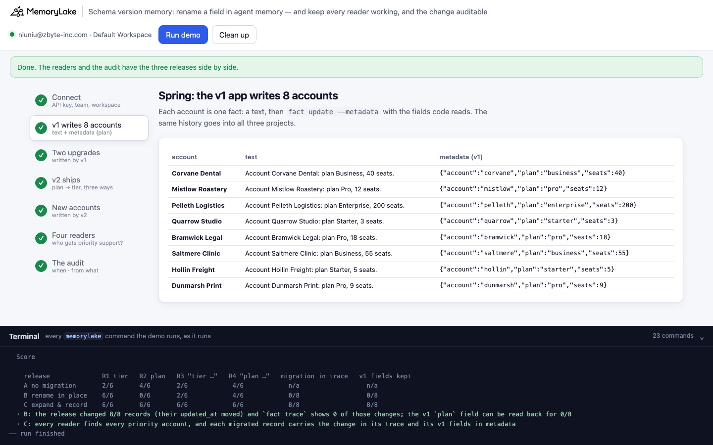
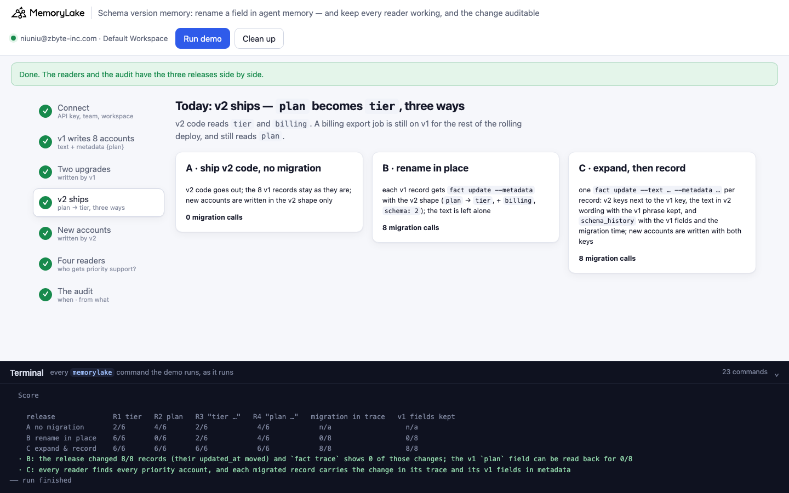
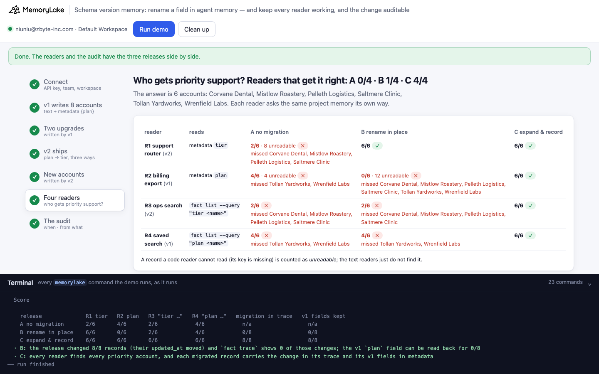
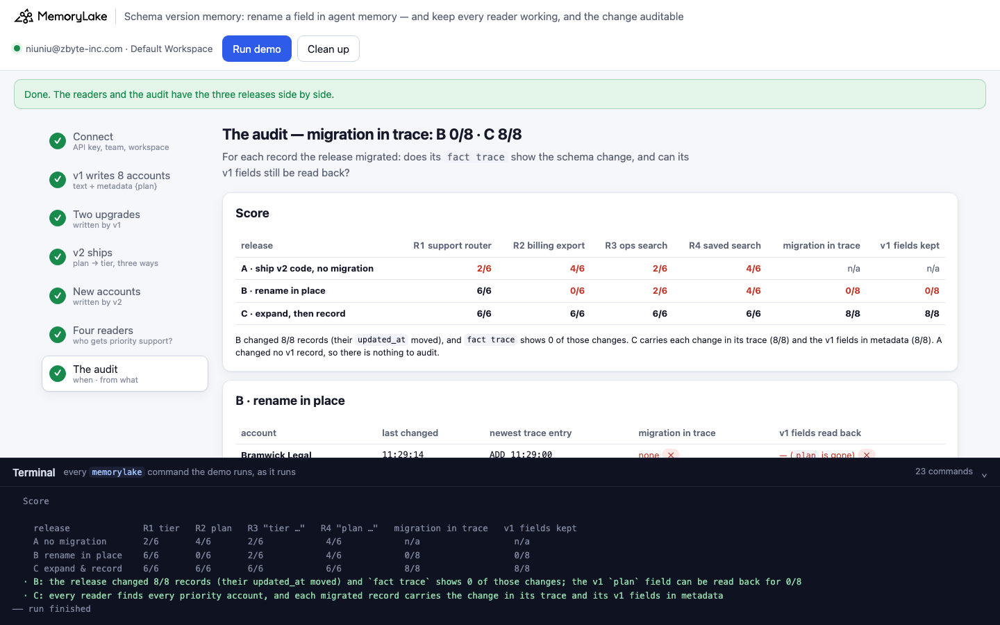

# Schema version memory: rename a field, and keep the readers and the audit

A runnable version of the MemoryLake use case
[*Evolve Agent Memory Schemas Without Breaking the Memory You Already Have*](https://www.memorylake.ai/en/usecase/schema-evolution-for-versioned-agent-memory),
built entirely on the [`memorylake` CLI](https://github.com/memorylake-ai/memorylake-cli) (v20261015 or later).

**Watch it run:** [CLI, 2:11](https://github.com/memorylake-ai/memorylake-usecases/releases/download/schema-version-memory-v1/schema-version-memory-cli-demo.mp4) · [Web, 2:20](https://github.com/memorylake-ai/memorylake-usecases/releases/download/schema-version-memory-v1/schema-version-memory-web-demo.mp4)
([release](https://github.com/memorylake-ai/memorylake-usecases/releases/tag/schema-version-memory-v1); GitHub serves them as downloads). Each video is one run; the numbers below add up all of them.

**The problem.** The use case page promises *forward-and-backward compatibility* ("new code reads old data; old code
reads what it can of new data") and an *audit trail per schema change*. A MemoryLake fact has two parts: the text,
which people, search and models read, and the metadata, which your code reads. A schema change usually touches the
metadata, and the way you ship it decides who can still read the records:

- **Ship v2 code and leave the old records alone.** v2 reads `tier`; the 8 records written by v1 only have `plan`.
  The v2 support router finds 2 of the 6 priority accounts. A billing job still running v1 during the rolling deploy
  finds the other 4 and misses the new accounts.
- **Rename the field in place** (`fact update --metadata` with the v2 shape). The v2 router is fixed (6/6). The v1
  job now reads nothing at all: 0/6, 12 records unreadable. The text still says "plan Business", so a search for
  "tier Business" still misses the old accounts. And the migration is invisible to the audit: **a `fact update` that
  changes only metadata does not appear in `fact trace`**. All 8 records moved (`updated_at` changed), the trace
  shows none of it, and the old `plan` value is gone from the record.

What works: expand, then record. In one `fact update --text … --metadata …` per record, write the v2 keys next to
the v1 key, the text in v2 wording with the v1 phrase kept, and a `schema_history` entry with the v1 fields and the
time. Because the text changed in the same call, the trace has an `UPDATE` for the migration. Write new records with
both keys too, until every reader is on v2. Then all four readers find all 6 accounts, and every migrated record
shows when it changed shape and what it was before.

**What this demo shows.** Tindlewood Analytics (fictional) runs an account assistant on project memory, one record
per customer account:

| time | what happens |
|---|---|
| spring | the v1 app writes 8 accounts: text `Account Corvane Dental: plan Business, 40 seats.` + metadata `{"account": "corvane", "plan": "business", "seats": 40}` |
| June → August | two upgrades, written by v1 (text and metadata in one `fact update`): Mistlow Roastery Pro → **Business**, Hollin Freight Starter → **Pro** |
| today | v2 ships: `plan` is renamed `tier`, `billing` is added |
| after the release | v2 signs 4 new accounts (Wrenfield Labs Enterprise, Tollan Yardworks Business, two smaller ones) |

The same v1 history goes into three projects, and v2 ships a different way in each:

| | the 8 v1 records | the 4 new records |
|---|---|---|
| **A** ship v2 code, no migration | left as they are | v2 shape only: `tier`, `billing`, `schema: 2` |
| **B** rename in place | `fact update --metadata` with the v2 shape; the text is left alone | v2 shape only |
| **C** expand, then record | one `fact update --text … --metadata …`: v2 keys **and** `plan`, text `tier Business (v1: plan Business)`, `schema_history` with the v1 fields | both keys, both phrases |

Then four readers answer the same question: **which accounts get priority support (Business or Enterprise)?** The
answer is 6 accounts: 4 written by v1, 2 by v2.

| reader | code | reads |
|---|---|---|
| R1 support router | v2 | metadata `tier` |
| R2 billing export | v1 (still running during the rolling deploy) | metadata `plan` |
| R3 ops search | v2 | `fact list --query "tier Business"`, `"tier Enterprise"` |
| R4 saved search | v1 | `fact list --query "plan Business"`, `"plan Enterprise"` |

And the audit asks of every record the release migrated (B and C): is the change in its `fact trace`, and can its
v1 fields still be read back? The months are labels: everything runs in about a minute, and every time shown is the
server's own clock. The audit's ground truth is a read of the v1 records taken just before the release
(`out/truth.json`). No model calls: nothing is billed.

## Prerequisites

- **Python 3.9+** (standard library only).
- **The `memorylake` CLI, v20261015 or later** (`memorylake version`):
  ```bash
  curl -fsSL https://raw.githubusercontent.com/memorylake-ai/memorylake-cli/main/scripts/install.sh | sh
  ```
- **A MemoryLake API key**: sign up at [app.memorylake.ai](https://app.memorylake.ai), open **API Keys**, create one.
  Everything the demo uses (projects, facts, metadata, `fact trace`, `fact list --query`) is part of the free plan.

## Run it

```bash
git clone https://github.com/memorylake-ai/memorylake-usecases.git
cd memorylake-usecases/schema-version-memory
export MEMORYLAKE_API_KEY=sk-...        # logs into an isolated profile under .memorylake-demo/, never touches ~/.memorylake
python3 demo.py                         # about 60 seconds
python3 demo.py record mistlow          # one account's text, metadata and trace in all three projects
python3 demo.py cleanup                 # deletes everything the demo created
```

China region: also `export MEMORYLAKE_BASE_URL=https://app.memorylake.cn/openapi/memorylake`. To use a specific
workspace: `export MEMORYLAKE_WORKSPACE=ws-…` (default: the team's default workspace). Without `MEMORYLAKE_API_KEY`
the demo uses your existing `memorylake auth login` session.

Every object the demo creates has a `custom_id` starting with `mlu-svm-`. Each run starts over: it deletes what a
previous run left behind first (`--reset` is accepted and does the same).

## Or run it in the browser

```bash
python3 web/server.py                   # opens http://127.0.0.1:8765
```

Paste the API key, press **Run demo**, and follow the steps: the v1 records, the two upgrades with their trace, the
three ways v2 ships, the new accounts, the four readers, and the audit with the score. The terminal drawer at the
bottom shows every `memorylake` command as it runs. The server is standard library only and binds to localhost; the
key stays in that process and in `.memorylake-demo/`.

| | |
|---|---|
|  |  |
|  |  |

## What happens, step by step

Output below is from one real run (the third terminal run; ids shortened where marked with …).

### Step 3: two upgrades, written by v1

v1 changes the text and the metadata in one `fact update`. The trace keeps the text versions:

```
$ memorylake fact update fact-45940947… --text 'Account Mistlow Roastery: plan Business, 30 seats.' --metadata '{"account": "mistlow", "plan": "business", "seats": 30}' --project proj-21514a… --workspace ws-…

  fact trace on Mistlow Roastery — the v1 app's text changes, on the server's clock:
    11:24:44  ADD     Account Mistlow Roastery: plan Pro, 12 seats.
    11:24:53  UPDATE  Account Mistlow Roastery: plan Business, 30 seats.
  · the trace keeps every text version; it has no entry for the metadata writes (they were metadata-only)
```

(Every record was written as `fact add` + `fact update --metadata`: that second call is not in the trace either.)

### Step 4: v2 ships, three ways

B's migration call, then C's (one per record; C's is shown in full):

```
$ memorylake fact update fact-9ea030… --metadata '{"schema": 2, "account": "corvane", "tier": "business", "seats": 40, "billing": "annual"}' --project proj-3d8564… --workspace ws-…
    B  8 × fact update --metadata (v2 shape; text untouched)
$ memorylake fact update fact-b4eb51… --text 'Account Corvane Dental: tier Business (v1: plan Business), 40 seats, billing annual.' --metadata '{"schema": 2, "account": "corvane", "tier": "business", "plan": "business", "seats": 40, "billing": "annual", "schema_history": [{"schema": 1, "fields": {"plan": "business", "seats": 40}, "until": "2026-10-18T11:24:59.554213+00:00", "by": "v2 release migration"}]}' --project proj-fb6234… --workspace ws-…
    C  8 × fact update --text --metadata (v2 + v1 keys, v1 phrase kept, schema_history)
```

### Step 6: four readers, one question

```
  Which accounts get priority support (Business or Enterprise)? The answer is 6 accounts: Corvane Dental, Mistlow Roastery, Pelleth Logistics, Saltmere Clinic, Tollan Yardworks, Wrenfield Labs.

    reader                             A no migration        B rename in place     C expand & record
    R1 support router (v2)             2/6, 8 unreadable ✗   6/6 ✓                 6/6 ✓
    R2 billing export (v1)             4/6, 4 unreadable ✗   0/6, 12 unreadable ✗  6/6 ✓
    R3 ops search (v2)                 2/6 ✗                 2/6 ✗                 6/6 ✓
    R4 saved search (v1)               4/6 ✗                 4/6 ✗                 6/6 ✓
      A R1 missed: Corvane Dental, Mistlow Roastery, Pelleth Logistics, Saltmere Clinic
      A R2 missed: Tollan Yardworks, Wrenfield Labs
      A R3 missed: Corvane Dental, Mistlow Roastery, Pelleth Logistics, Saltmere Clinic
      A R4 missed: Tollan Yardworks, Wrenfield Labs
      B R2 missed: Corvane Dental, Mistlow Roastery, Pelleth Logistics, Saltmere Clinic, Tollan Yardworks, Wrenfield Labs
      B R3 missed: Corvane Dental, Mistlow Roastery, Pelleth Logistics, Saltmere Clinic
      B R4 missed: Tollan Yardworks, Wrenfield Labs
```

"Unreadable" means the key the reader looks for is not in the record's metadata. A real service would crash, fall
back to a default, or treat the account as a free one; the demo counts it.

### Step 7: the audit

For each migrated record: when it last changed (`updated_at`), the newest entry in its `fact trace`, whether the trace
has the migration (an `UPDATE` from the v1 text, at the record's last change), and whether the v1 fields can be read
back from the record:

```
  B · rename in place
    account               last changed   newest trace entry      migration in trace   v1 fields read back
    Bramwick Legal        11:25:01       ADD 11:24:47            none ✗               — (`plan` is gone) ✗
    Corvane Dental        11:25:00       ADD 11:24:46            none ✗               — (`plan` is gone) ✗
    Mistlow Roastery      11:25:01       UPDATE 11:24:53         none ✗               — (`plan` is gone) ✗
    …

  C · expand, then record
    account               last changed   newest trace entry      migration in trace   v1 fields read back
    Bramwick Legal        11:25:03       UPDATE 11:25:03         11:25:03 ✓           plan pro, 18 seats ✓
    Corvane Dental        11:25:03       UPDATE 11:25:03         11:25:03 ✓           plan business, 40 seats ✓
    Mistlow Roastery      11:25:03       UPDATE 11:25:03         11:25:03 ✓           plan business, 30 seats ✓
    …

  Score

    release              R1 tier   R2 plan   R3 "tier …"   R4 "plan …"   migration in trace   v1 fields kept
    A no migration       2/6       4/6       2/6            4/6            n/a                  n/a
    B rename in place    6/6       0/6       2/6            4/6            0/8                  0/8
    C expand & record    6/6       6/6       6/6            6/6            8/8                  8/8
  · B: the release changed 8/8 records (their updated_at moved) and `fact trace` shows 0 of those changes; the v1 `plan` field can be read back for 0/8
  · C: every reader finds every priority account, and each migrated record carries the change in its trace and its v1 fields in metadata
```

In B the only sign that anything happened is `updated_at`: 11:25:01 on Bramwick Legal, 14 seconds after its newest
trace entry, with nothing that says what changed.

`python3 demo.py record mistlow` puts one account side by side (from the second terminal run):

```
  A · ship v2 code, no migration
    text:        Account Mistlow Roastery: plan Business, 30 seats.
    metadata:    {"account": "mistlow", "plan": "business", "seats": 30}
    created_at:  11:23:10   updated_at: 11:23:18
    fact trace:
      11:23:10  ADD     Account Mistlow Roastery: plan Pro, 12 seats.
      11:23:18  UPDATE  Account Mistlow Roastery: plan Business, 30 seats.

  B · rename in place
    text:        Account Mistlow Roastery: plan Business, 30 seats.
    metadata:    {"account": "mistlow", "billing": "monthly", "schema": 2, "seats": 30, "tier": "business"}
    created_at:  11:23:12   updated_at: 11:23:26
    fact trace:
      11:23:12  ADD     Account Mistlow Roastery: plan Pro, 12 seats.
      11:23:19  UPDATE  Account Mistlow Roastery: plan Business, 30 seats.

  C · expand, then record
    text:        Account Mistlow Roastery: tier Business (v1: plan Business), 30 seats, billing monthly.
    metadata:    {"account": "mistlow", "billing": "monthly", "plan": "business", "schema": 2, "schema_history": [{"by": "v2 release migration", "fields": {"plan": "business", "seats": 30}, "schema": 1, "until": "2026-10-18T11:23:24.395536+00:00"}], "seats": 30, "tier": "business"}
    created_at:  11:23:15   updated_at: 11:23:28
    fact trace:
      11:23:15  ADD     Account Mistlow Roastery: plan Pro, 12 seats.
      11:23:19  UPDATE  Account Mistlow Roastery: plan Business, 30 seats.
      11:23:28  UPDATE  Account Mistlow Roastery: tier Business (v1: plan Business), 30 seats, billing monthly.
```

## Measured

5 runs: three terminal runs (the second over the first's leftovers, the third with `--reset`), the browser run recorded for the Web video, and the run recorded for the CLI video (from a fresh `git clone`). Every number comes from the saved reports (`out/runs/`); every run gave the same result for every reader and every record.

Priority accounts each reader found (6 per run), and migrated records the audit could read (8 per run), summed:

| | A ship v2, no migration | B rename in place | C expand, then record |
|---|---|---|---|
| R1 support router (v2, `tier`) | 10 of 30 | 30 of 30 | 30 of 30 |
| R2 billing export (v1, `plan`) | 20 of 30 | 0 of 30 | 30 of 30 |
| R3 ops search (v2, "tier …") | 10 of 30 | 10 of 30 | 30 of 30 |
| R4 saved search (v1, "plan …") | 20 of 30 | 20 of 30 | 30 of 30 |
| migration in `fact trace` | n/a | 0 of 40 | 40 of 40 |
| v1 fields read back | n/a | 0 of 40 | 40 of 40 |

The first terminal run took 60 s. All writes go through the API with fixed texts and metadata (no extraction from
conversations, no search ranking), so nothing in the outcome depends on a model.

## Use it in your own agents

- **Metadata is your schema; the text is everyone else's.** Code reads metadata keys, `fact list --query` matches the
  text as written (a case-insensitive substring), and search and models read the text. Renaming a key fixes none of
  the text readers; rewording the text breaks every saved query on the old words.
- **A metadata-only `fact update` leaves no trace entry.** `fact trace` records text versions; `fact update
  --metadata` replaces the whole metadata object and only moves `updated_at`. If a migration must be auditable,
  change the text in the same call, or keep the old fields and the time in the metadata itself (`schema_history`).
- **Expand before you contract.** While any v1 reader can still run (a rolling deploy, a nightly job, a saved query),
  write both keys and both phrases, on migrated and new records alike. Drop `plan` and the "(v1: …)" phrase in a later
  release, once nothing reads them.
- **`fact update --metadata` is a whole replacement.** A migration that writes only the new keys deletes the old ones.
  Read the record, add to it, write it back.
- **Count what your readers cannot read.** A record without the key you expect is not "not priority": report it.

## Troubleshooting

- **`no fact trace with full history`** — the CLI is older than v20261015; reinstall with the `install.sh` line above.
- **Different numbers on your account** — every number comes from fixed writes; please open an issue with
  `out/report.json` attached.
- **Leftovers after an interrupted run** — `python3 demo.py cleanup`.

## Files

| file | what it is |
|---|---|
| `demo.py` | the whole demo: CLI wrapper, the v1 writes, the three releases, the four readers, the audit, cleanup |
| `data/story.json` | the accounts, the v1 upgrades, the v2 accounts, the three releases and the four readers |
| `web/server.py`, `web/static/` | the browser companion (standard library server, no build step) |
| `out/world.json`, `out/truth.json`, `out/report.json` | the project and record ids, the v1 records read just before the release, and the score (`cleanup` moves them to `out/runs/`) |
