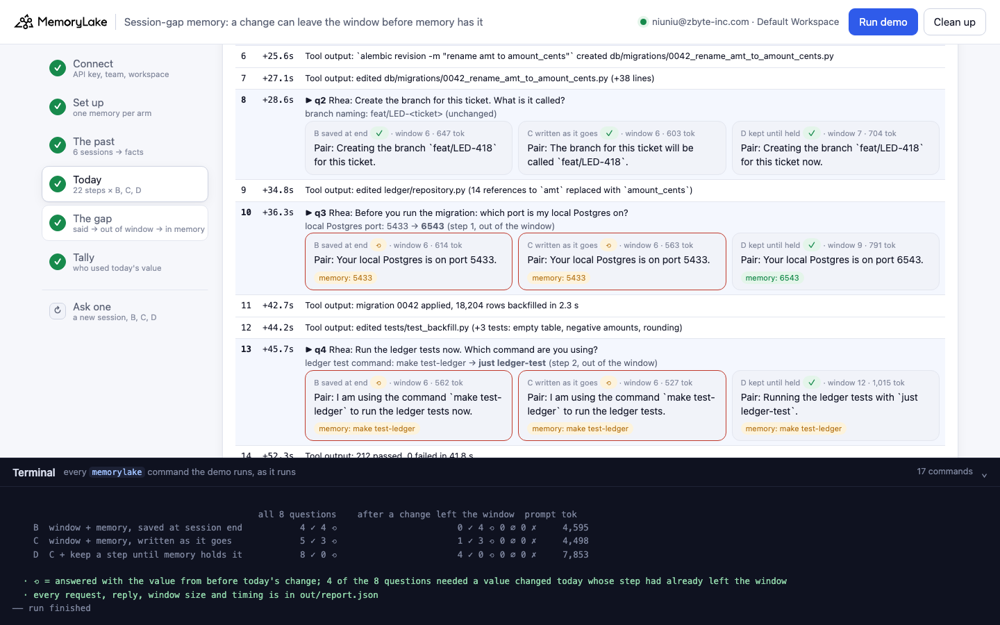
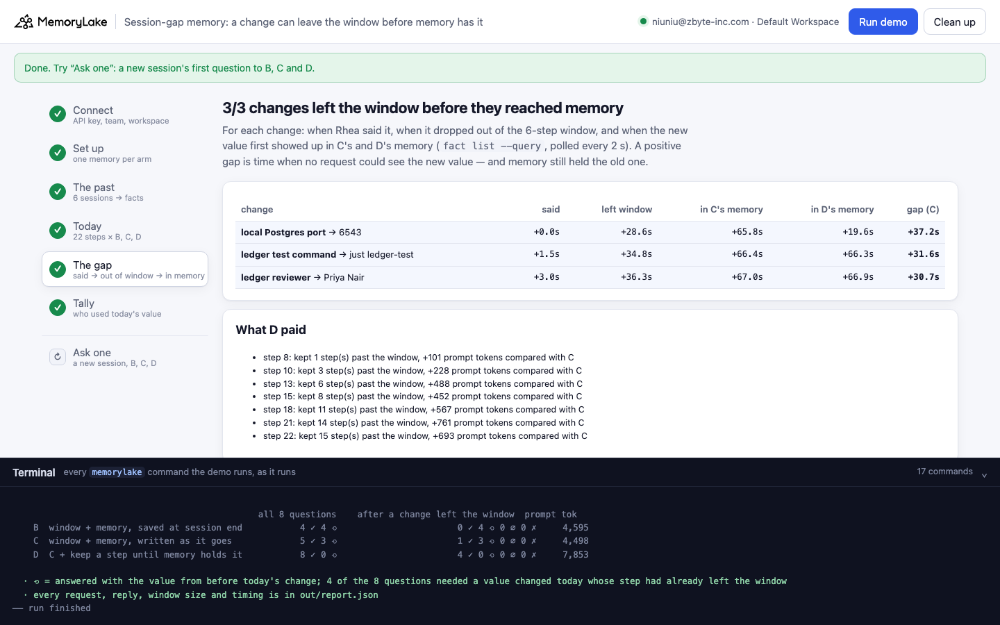
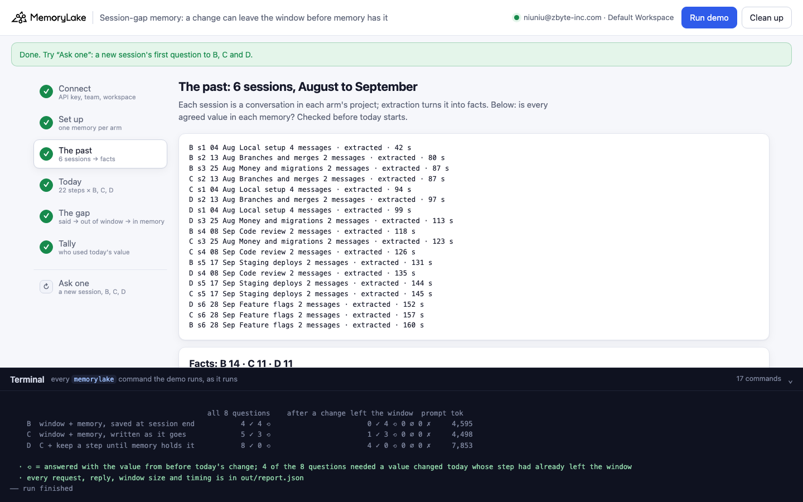
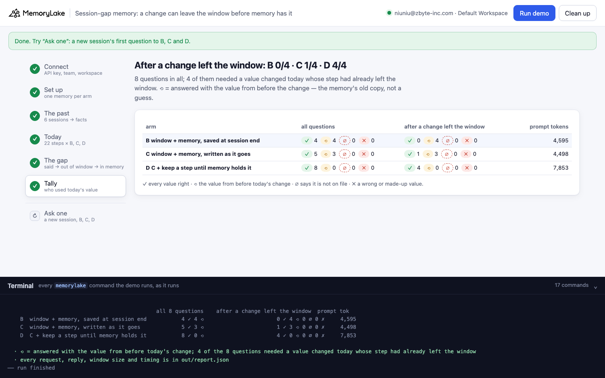

# Session-gap memory: a change can leave the context window before memory has it

A runnable version of the MemoryLake use case
[*Session Memory vs Persistent Memory: An Architectural Guide*](https://www.memorylake.ai/en/usecase/session-memory-vs-persistent-memory-for-ai),
built entirely on the [`memorylake` CLI](https://github.com/memorylake-ai/memorylake-cli) (v20261015 or later).

**Watch it run:** [CLI, 6:39](https://github.com/memorylake-ai/memorylake-usecases/releases/download/session-gap-memory-v1/session-gap-memory-cli-demo.mp4) · [Web, 7:14](https://github.com/memorylake-ai/memorylake-usecases/releases/download/session-gap-memory-v1/session-gap-memory-web-demo.mp4)
([release](https://github.com/memorylake-ai/memorylake-usecases/releases/tag/session-gap-memory-v1); GitHub serves them as downloads). Both are real, unedited runs from a clean account and are counted in the Measured table below: in the CLI one extraction beat the window and C was right every time, in the Web one it did not.

**The problem.** A common design keeps a short window of the current session in the prompt (session memory) and lets
retrieval bring back everything older (persistent memory). It works for things agreed weeks ago. It breaks for things
changed *today*: extraction takes tens of seconds, an agent's steps take one or two, so a change made at the start of
a session can slide out of the window before MemoryLake has written it. In that gap the window no longer has the new
value, and memory still has the old one, so the agent answers with the old value, confidently:

```
  step 10  + 37.4s  ▶ q3  Rhea: Before you run the migration: which port is my local Postgres on?
           local Postgres port: 5433 → 6543, changed at step 1 (+0.0s); that step has left the 6-step window
    ⟲ B  saved at end        window  6 steps ·   569 tok  memory: port old
        | Pair: Your local Postgres is on port 5433.
    ⟲ C  written as it goes  window  6 steps ·   564 tok  memory: port old
        | Pair: Your local Postgres is on port 5433.
    ✓ D  kept until held     window  9 steps ·   719 tok  memory: port NEW
        | Pair: Your local Postgres is on port 6543.
```

Rhea Tanaka (backend engineer at Brindlewood Payments, a fictional company) works with Pair, the team's coding agent,
on the ledger service. Six past sessions (August to September) settled seven conventions: the test command, the local
database port, branch names, money columns, the reviewer, the staging window and the flag prefix. On 19 October she
changes three of them in her first three messages (port 5433 → 6543, `make test-ledger` → `just ledger-test`,
reviewer Tomasz Ilic → Priya Nair), then Pair works through a 22-step migration task, about 1.5 seconds per step,
and has to use those values at eight checkpoints. Every request carries the last 6 steps plus what MemoryRouter
attaches from that arm's memory (`router chat --boundary`). The arms differ only in when today's session is written:

- **B — saved at session end.** Today's session goes into MemoryLake when the session closes (the common "save on
  close"), so during the session memory only has the past.
- **C — written as it goes.** Each step is appended to a MemoryLake conversation as it happens (`conv msg append`,
  off the hot path; nothing waits for extraction).
- **D — kept until held.** Written like C, and a step leaves the window only once `conv cook-status` reports the
  conversation finished, that is, once memory holds everything sent so far. Until then the step stays in the prompt.

Each arm has its own project and boundary, so what C writes never reaches B or D. At every checkpoint the demo also
asks each arm's memory directly (`fact list --query`) which value it holds at that moment, and a watcher records when
each new value first shows up.

<!-- measured-summary -->
Over the 7 runs counted below, B answered all 28 questions about a change that had already left the window
with the value from before the change. C got 20 of 28 right and 8 with the old value, depending on whether extraction
beat the window that time (in the runs measured with the final reading rule, it reached C's memory between
11 s before and 37 s after the step left the window).
D got all 28, carrying up to 15 extra steps and 1.47–1.75× C's prompt tokens.
<!-- /measured-summary -->

## What it shows

- **Retrieval makes the gap worse than forgetting.** A window that loses a value usually gets "not on file". Here the
  window loses today's value while memory still holds the old one, so MemoryRouter attaches the old value and the
  agent uses it without hesitation: `5433`, `make test-ledger`, Tomasz Ilic.
- **Saving at session end is wrong inside the session, every time.** B answered every question about a change that
  had left the window with the pre-change value. Its memory is right only for the next session.
- **Writing as you go is a race.** In the Web recording each change reached C's memory 31–37 seconds after it left
  the window, and C answered three of four such questions with the old value; in the CLI recording extraction was
  faster than the window and C was right every time. The demo prints, for each change, when it was said, when it left
  the window and when it reached memory.
- **The fix is to drop from the window only what memory holds.** D was right on every question. The price is prompt
  size: `cook-status` is one flag for the whole conversation, and while an agent keeps appending it rarely reports
  finished, so D carried up to 15 extra steps (1.47–1.75× C's prompt tokens over the session).
- **Extraction revises facts the way they were written, not the way you think of them.** In one run D's memory
  held "the test command is `make test-ledger`, and it expects a local Postgres on port 5433" as one fact. Today's
  session revised it to port 6543 and left `make test-ledger` in it; the new command reached memory only through
  another fact, more than two minutes after Rhea said it.

## Prerequisites

- Python 3.9 or later (standard library only).
- The `memorylake` CLI, v20261015 or later:
  `curl -fsSL https://raw.githubusercontent.com/memorylake-ai/memorylake-cli/main/scripts/install.sh | sh`
- A MemoryLake API key from [app.memorylake.ai](https://app.memorylake.ai) (**API Keys**).
- Router calls are billed to your MemoryLake balance: 24 calls on gpt-4o-mini per run, under 0.01 USD.

## Run it

```bash
cd session-gap-memory
export MEMORYLAKE_API_KEY=sk-...
python3 demo.py            # about 6 minutes: past sessions extracted, a 22-step session, then the gap is measured
python3 demo.py facts      # what each arm's memory says now about the three conventions changed today
python3 demo.py ask "Which port is my local Postgres on?"   # a new session's first question to B, C and D
python3 demo.py cleanup    # deletes everything the demo created
```

The key is used to log in to an isolated CLI profile in `.memorylake-demo/`; your own `~/.memorylake` is not touched.
Everything the demo creates has a custom_id starting `mlu-sgp-`. A second run reuses B's memory (nothing of today was
ever written into it) and rebuilds C's and D's, because the run before wrote today's session into them; `--reset`
rebuilds all three.

## Or run it in the browser

```bash
python3 web/server.py      # opens http://127.0.0.1:8765
```

Paste the key, press **Run demo**: the same pipeline, step by step, with every `memorylake` command in the terminal
drawer. **Today** shows every step with its time and, at each checkpoint, the three answers and what each arm's memory
held at that moment. **The gap** shows when each change was said, left the window and reached memory. **Ask one** asks
B, C and D the first question of a new session.

| Step 4: today | Step 5: the gap |
|---|---|
|  |  |
| **Step 3: the past** | **Step 6: tally** |
|  |  |

## What happens, step by step

### Step 2: one memory per arm

```
$ memorylake actor create --custom-id mlu-sgp-rhea --display-name 'Rhea Tanaka' --description '…' --tags demo
$ memorylake proj create --name 'Ledger service — Pair'"'"'s memory (B)' --custom-id mlu-sgp-proj-b
$ memorylake boundary create --name 'Pair'"'"'s memory (B)' --custom-id mlu-sgp-bnd-b --projects proj-…
  · three projects with a boundary each — one memory per arm, so what C writes today never reaches B or D
```

The boundaries cover only their project. Rhea and Pair are shared actors; conversation facts also land on the actors,
but no boundary includes them, so they never reach a request.

### Step 3: the past

Each of the six past sessions becomes a DIRECT conversation in each arm's project, with the session's real
timestamps; the demo waits for extraction (`conv cook-status`) and checks every agreed value in every memory:

```
$ memorylake conv create --project proj-… --actors actor-…,actor-… --kind DIRECT --name 'Local setup (2026-08-04)' --custom-id mlu-sgp-b-s1
$ memorylake conv msg append conv-… --actor actor-… --custom-id m00 --timestamp 2026-08-04T09:00:00Z --text 'Rhea Tanaka (backend engineer, Brindlewood): Welcome aboard, Pair. …'
$ memorylake conv cook-status conv-…
    B  s1  04 Aug  Local setup            4 messages · extracted · 36 s
    …
    Facts extracted from the six past sessions: B 13 · C 12 · D 11
        agreed value                                   B   C   D
        local Postgres port: 5433                      ✓   ✓   ✓
        ledger test command: make test-ledger          ✓   ✓   ✓
        …
  · 7/7 agreed values are in all three memories — what each arm knows before today is the same
```

### Step 4: today

Twenty-two steps. Plain steps (Rhea's instructions, tool output) go to every arm's thread and, for C and D, into
their MemoryLake conversation through a background writer. At each of the eight checkpoints the same request goes to
B, C and D at the same moment: `memorylake router chat --body out/body-<arm>.json --model gpt-4o-mini --max-tokens 140
--temperature 0 --boundary <arm's boundary> "<step>"`, with the system prompt and the arm's window in the body.

```
  step  1  +  0.0s  Rhea: Morning, Pair. Heads-up before we start: I moved my local Postgres to port 6543 this m…
$ memorylake conv msg append conv-… --actor actor-… --custom-id t000 --timestamp 2026-10-18T23:34:26Z --text 'Rhea: Morning, Pair. …'
  step  2  +  1.5s  Rhea: Also, we dropped the Makefile on Friday. The ledger tests run with `just ledger-test` …
  step  3  +  3.0s  Rhea: And Tomasz is on leave until November. Send ledger reviews to Priya Nair instead.
  …
  step 13  + 46.5s  ▶ q4  Rhea: Run the ledger tests now. Which command are you using?
           ledger test command: make test-ledger → just ledger-test, changed at step 2 (+1.5s); that step has left the 6-step window
    ⟲ B  saved at end        window  6 steps ·   531 tok  memory: command old
        | Pair: I am using the command `make test-ledger` to run the ledger tests.
    ⟲ C  written as it goes  window  6 steps ·   578 tok  memory: command old
        | Pair: I am using the command `make test-ledger` to run the ledger tests.
    ✓ D  kept until held     window 12 steps ·   977 tok  memory: command NEW
        | Pair: I am using the command `just ledger-test` to run the ledger tests now.
  …
  step 18  + 64.1s  ▶ q6  Rhea: Open the pull request. Who do you request the review from?
           ledger reviewer: Tomasz Ilic → Priya Nair, changed at step 3 (+3.0s); that step has left the 6-step window
    ⟲ B  saved at end        window  6 steps ·   583 tok  memory: reviewer old
        | Pair: I will request the review from Tomasz Ilic. Opening the pull request now.
    ✓ C  written as it goes  window  6 steps ·   756 tok  memory: reviewer NEW
        | Pair: I will request the review from Priya Nair. Opening the pull request now.
    ✓ D  kept until held     window 17 steps · 1,201 tok  memory: reviewer NEW
        | Pair: I will request the review from Priya Nair for the pull request.
```

✓ every value right · ⟲ the value from before today's change · ∅ says it is not on file · ✗ a wrong or made-up value.
The grading rules are checked against known replies before any call is made. "memory: … old/NEW" is what
`fact list --query` found in that arm's project at that moment, read in parallel with the calls. Questions about the
four unchanged conventions (branch, money columns, staging window, flag prefix) are there as a control: all three arms
answer them from memory.

### Step 5: the gap

From the first run (its gap times are upper bounds, see ¹ under Measured):

```
    Each change: when Rhea said it, when it left the 6-step window, when it reached memory.
        change                                      said  left window  in C memory  in D memory   gap (C)
        local Postgres port → 6543                 +0.0s       +29.9s       +55.1s       +35.4s    +25.2s
        ledger test command → just ledger-test     +1.5s       +35.9s       +55.7s       +35.9s    +19.8s
        ledger reviewer → Priya Nair               +3.0s       +37.4s       +52.4s       +36.5s    +15.0s
  · 3/3 changes left the window before they reached memory — for up to 25 s the only copy of the new value was nowhere a request could see it, and memory still answered with the old one

    D kept steps past the window while `cook-status` had not reported its conversation finished (…):
      step 10: 3 step(s) past the window, +155 prompt tokens compared with C
      …
      step 22: 15 step(s) past the window, +592 prompt tokens compared with C
```

Then what C's memory says after the session, fact by fact, with the value each fact states first (a revised fact
carries the old value along in "previously …").

### Step 6: tally

```
                                               all 8 questions    after a change left the window  prompt tok
    B  window + memory, saved at session end           4 ✓ 4 ⟲                       0 ✓ 4 ⟲ 0 ∅ 0 ✗     4,542
    C  window + memory, written as it goes             6 ✓ 2 ⟲                       2 ✓ 2 ⟲ 0 ∅ 0 ✗     4,905
    D  C + keep a step until memory holds it           8 ✓ 0 ⟲                       4 ✓ 0 ⟲ 0 ∅ 0 ✗     7,605
```

### `ask`: a new session's first question

`python3 demo.py ask "<question>"` asks B, C and D with no window at all, only what each memory holds now. After a
run, C and D have today's session in memory and answer with the new values; B still answers with the old ones,
because its copy of today would be written when the session closes, and the demo never closes it.

## Measured

<!-- measured-table -->
Full runs of the final version on a free account. The three "after the window" columns count the four questions per run
that needed a value changed today whose step had already left the 6-step window (q3, q4, q6, q8). "Gap" is when the new value
reached C's memory minus when its step left the window, in seconds, for port · test command · reviewer (positive: the window
lost it first). "Past values" is how many of the seven agreed values step 3 found, written in English, in all three memories.

| run | past values | B after the window | C after the window | D after the window | gap in C (s) | D's most extra steps | prompt tokens B · C · D |
|---|---|---|---|---|---|---|---|
| first run (built) | 7/7 | 0 ✓ · 4 ⟲ | 2 ✓ · 2 ⟲ | 4 ✓ · 0 ⟲ | +25.2 · +19.8 · +15.0¹ | 15 | 4,542 · 4,905 · 7,605 |
| second run (B reused, C and D rebuilt) | 7/7 | 0 ✓ · 4 ⟲ | 2 ✓ · 2 ⟲ | 4 ✓ · 0 ⟲ | +35.2 · +29.7 · +24.9¹ | 15 | 4,511 · 4,872 · 7,549 |
| `--reset` | 6/7 | 0 ✓ · 4 ⟲ | 4 ✓ · 0 ⟲ | 4 ✓ · 0 ⟲ | +6.7 · +0.4 · -0.4¹ | 15 | 4,446 · 4,731 · 7,512 |
| browser check (built) | 7/7 | 0 ✓ · 4 ⟲ | 3 ✓ · 1 ⟲ | 4 ✓ · 0 ⟲ | -2.5 · -9.8 · +12.8¹ | 15 | 4,415 · 4,508 · 7,837 |
| CLI recording, first take (not published) | 7/7 | 0 ✓ · 4 ⟲ | 4 ✓ · 0 ⟲ | 4 ✓ · 0 ⟲ | +4.5 · -0.7 · +92.7¹ | 15 | 4,460 · 4,799 · 7,675 |
| CLI recording | 7/7 | 0 ✓ · 4 ⟲ | 4 ✓ · 0 ⟲ | 4 ✓ · 0 ⟲ | -5.7 · -10.7 · +4.0 | 15 | 4,516 · 4,973 · 7,321 |
| Web recording | 6/7 | 0 ✓ · 4 ⟲ | 1 ✓ · 3 ⟲ | 4 ✓ · 0 ⟲ | +37.2 · +31.6 · +30.7 | 15 | 4,595 · 4,498 · 7,853 |
| **total (7 runs)** | | **0 ✓ · 28 ⟲** | **20 ✓ · 8 ⟲** | **28 ✓ · 0 ⟲** | -11 to +37 (runs without ¹) | 15 | D = 1.47–1.75× C |

¹ These runs read each fact by the first value it names, so a fact such as "Tomasz is on leave, so reviews go to
Priya Nair" counted as the old reviewer. That rule can only see a new value late, never early: their gap times are
upper bounds, and their "memory: old" labels may hide a fact that already had the new value. From the CLI recording on,
a fact is read up to "previously" and counts as new if it names the new value at all. The grades do not depend on it.

On the other questions (the change still in the window, or a convention that did not change) all three arms were right in every run: all eight questions, B 28/56 · C 48/56 · D 56/56.
<!-- /measured-table -->

## Use it in your own app

- Don't let the window and memory hand off with a gap. Drop a turn from the prompt only once memory holds it:
  append each turn as it happens (`conv msg append`) and check `conv cook-status` before you trim.
- `conv consumed-messages --message <id>` says a message has been *read* by extraction, not that its facts are
  written: in a probe the change was read 14 s after it was sent and became a fact 27 s after. Trim on
  `cook-status`, not on consumed.
- Expect `cook-status` to stay unfinished while an agent keeps appending. Budget for a window that grows during busy
  stretches, or slow the agent down at the moments a just-made change matters.
- Saving the session when it closes is fine for the next session, never for this one.
- After the session, check the facts you care about (`fact list --query`): a fact that bundled two values may be
  revised for one and keep the other.

## Troubleshooting

| Symptom | Cause / fix |
|---|---|
| `this memorylake CLI has no router command` | Upgrade the CLI (v20261015 or later). |
| `MemoryRouter refused the call for lack of balance` | Router calls are billed; the memory steps still ran. Top up in the console. |
| `still extracting after 420 s` | Extraction is slow right now; the run continues and the value check says what is missing. |
| An agreed value shows `·` in step 3 | Extraction left it out, or wrote it in another language (it happens); the check reads English only. That arm may still answer it. |
| C gets everything right | Extraction beat the window this time (it did in 3 of 7 runs). Run again: the race goes both ways (see Measured). |
| A change shows `—` in "in C memory" | It had not reached memory within 180 s after the last step. |

## Files

| File | What it is |
|---|---|
| `demo.py` | The demo: CLI wrapper, per-arm setup and rebuild (`setup()`), ingestion and the value check (`show_memory()`), the background writer and memory watcher (`Writer`, `Watcher`), D's window rule (`d_window()`), the session (`run_session()`), grading (`grade()`, `check_grader()`), the gap (`show_gap()`), `ask`, `facts`, cleanup |
| `data/session.json` | The playbook, the six past sessions, the seven conventions (old and new values), today's 22 steps and the eight questions |
| `web/server.py`, `web/static/` | Browser companion (standard library server, no build step) |
| `out/` | `report.json` with every call, window size, token count, reply and timing; `out/runs/` keeps earlier reports (git-ignored) |
