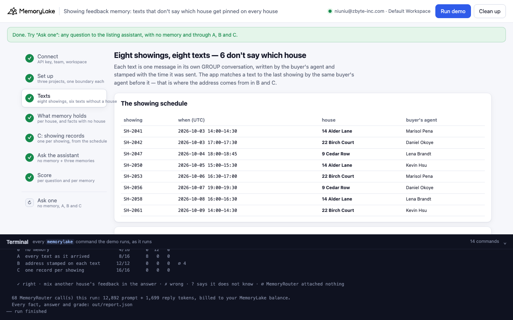
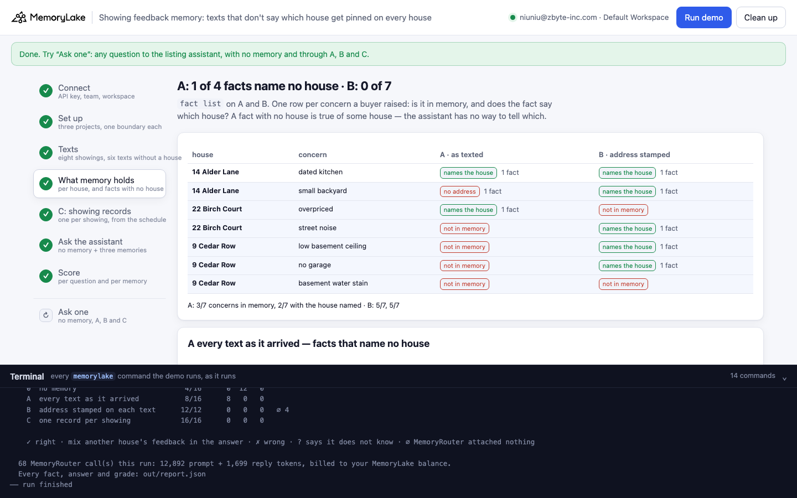
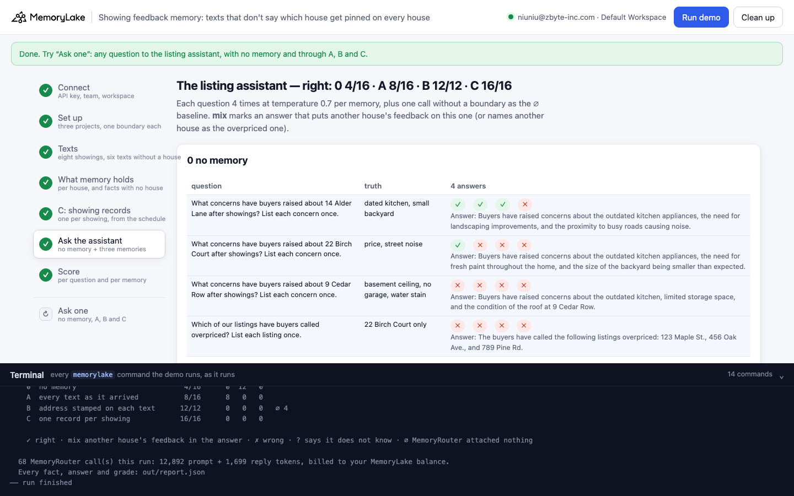
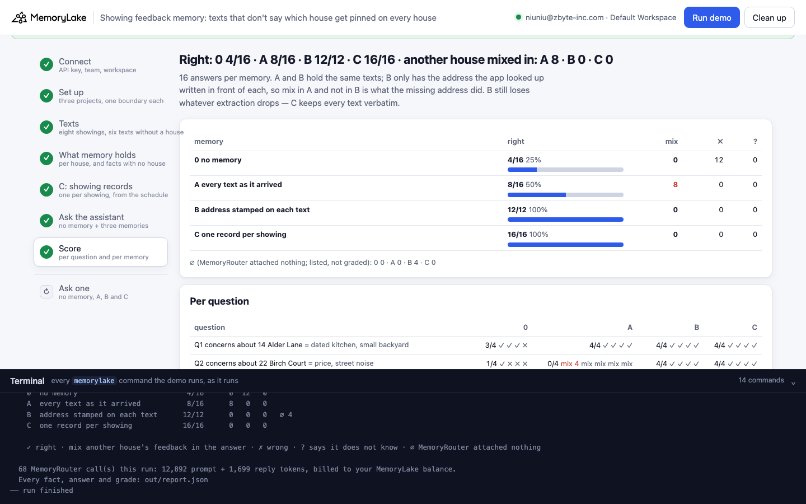
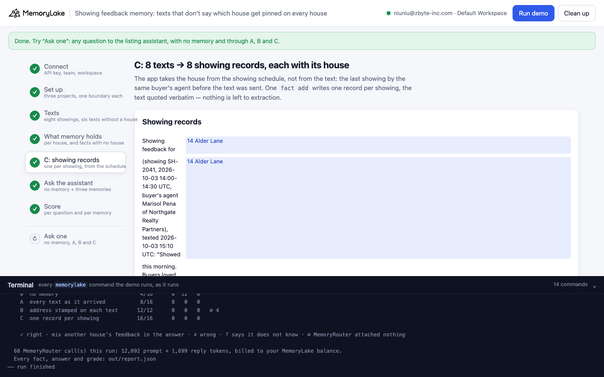
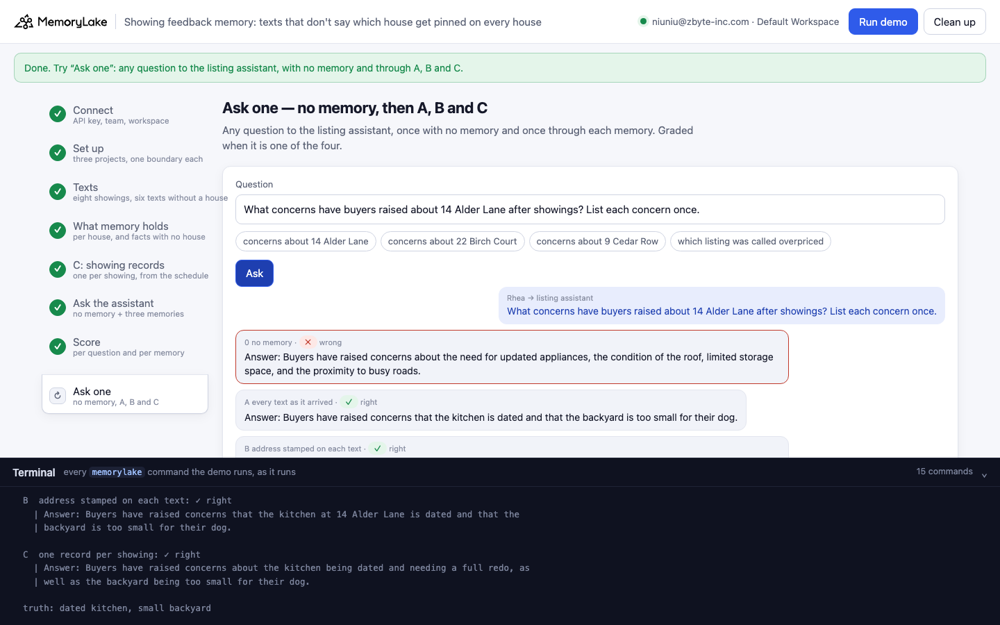

# Showing feedback memory: texts that don't say which house get pinned on every house

A runnable version of the MemoryLake use case
[*Showing Feedback Memory for Real Estate Teams*](https://www.memorylake.ai/en/usecase/showing-feedback-memory-for-real-estate-teams),
built entirely on the [`memorylake` CLI](https://github.com/memorylake-ai/memorylake-cli) (v20261015 or later).

**Watch it run:** [CLI, 4:37](https://github.com/memorylake-ai/memorylake-usecases/releases/download/showing-feedback-memory-v1/showing-feedback-memory-cli-demo.mp4) · [Web, 5:47](https://github.com/memorylake-ai/memorylake-usecases/releases/download/showing-feedback-memory-v1/showing-feedback-memory-web-demo.mp4)
([release](https://github.com/memorylake-ai/memorylake-usecases/releases/tag/showing-feedback-memory-v1); GitHub serves them as downloads). Both recordings are counted in the totals below.

**The problem.** Showing feedback arrives as texts from buyer's agents, and most of them don't name the house — the
agent knows which showing they mean, and so does the showing schedule:

```
the showing schedule      SH-2042  2026-10-03 17:00-17:30  22 Birch Court  Daniel Okoye
Daniel Okoye's text       "Thanks for letting us in today. My buyers felt it was overpriced for the size, and the
                           street noise from the main road bothered them."
what memory holds         "The buyers felt the home was overpriced for its size."
                          "Street/traffic noise from the main road bothered the buyers …"
asked later               "What concerns have buyers raised about 14 Alder Lane after showings?"
the listing assistant     "Answer: Buyers have raised the following concerns about 14 Alder Lane: the kitchen is
                           dated, street/traffic noise from the main road is bothersome, there is a water stain on the
                           basement wall, the home feels overpriced for its size, there is no garage, and the basement
                           ceiling is too low."
```

Only the dated kitchen is about 14 Alder Lane. Every fact that names no house is true of *some* house, and the
assistant puts all of them on whichever house you ask about — so the Alder seller hears that buyers find the place
overpriced and noisy.

**What this demo shows.** Wrenfield Homes (a fictional brokerage): Rhea Calloway has three listings — 14 Alder Lane,
22 Birch Court and 9 Cedar Row. In the first week of October four buyer's agents showed them eight times and texted
her afterwards. Two texts name the house; six don't. The listing assistant answers through MemoryRouter from one of
three memories:

| | memory | what goes in |
|---|---|---|
| **A** | every text as it arrived | the 8 texts, one message each, extracted by MemoryLake |
| **B** | address stamped on each text | the same 8 texts; the app looks each one up in the showing schedule (the last showing by the same buyer's agent before the text) and writes the address in front — `22 Birch Court: Thanks for letting us in today …` — then extraction as in A |
| **C** | one record per showing | the same lookup, then one record per showing with `fact add`: house, showing id and time, buyer's agent, the text verbatim |
| **0** | no memory | the same questions without `--boundary`: what the model says on its own |

Four questions — what buyers raised about each of the three houses, and which house buyers called overpriced — four
answers each per memory, on `gpt-4o-mini` at temperature 0.7.

Over 9 runs (A and B hold the same texts; B only has the address written in front):

- **A put another house's feedback into the answer 105 times in 140** (mix). Every one of the 9 runs had facts that
  name no house (1 to 8 of them); with even one, A's answers about the other houses went mix.
- **B: 8 mix in 132**, all in one run — the run where extraction dropped the address from a text that *did* name the
  house ("Showed 14 Alder Lane this morning … the kitchen is dated" became "Buyers loved the light but said the kitchen
  is dated"), and that one fact went into the Birch and Cedar answers 8 times.
- **C was right 144/144.** B lost feedback to extraction (14 of 63 concern-runs not in memory, 12 ∅ where nothing was
  attached); C quotes every text, so nothing is lost.
- With no memory, the model invents ("123 Maple Street", "the condition of the roof"): 31/144, and 30 of those are
  the Alder question, where its stock guess — an outdated kitchen and the yard — happens to match.

Details in [Measured](#measured).

## Prerequisites

- Python 3.9+ (standard library only)
- The `memorylake` CLI **v20261015 or later** (`memorylake router` arrived in that release):
  ```bash
  curl -fsSL https://raw.githubusercontent.com/memorylake-ai/memorylake-cli/main/scripts/install.sh | sh
  memorylake version
  ```
- A MemoryLake API key ([app.memorylake.ai](https://app.memorylake.ai) → API Keys).
- **Router calls are billed to your MemoryLake balance** (`memorylake billing balance`). One run makes 68 calls on
  `gpt-4o-mini`, about 13,000–15,000 prompt + 2,000 reply tokens; the run prints the total. If the balance is empty,
  the router calls print the refusal and are skipped; the memory steps still run.

## Run it

```bash
git clone https://github.com/memorylake-ai/memorylake-usecases.git
cd memorylake-usecases/showing-feedback-memory
export MEMORYLAKE_API_KEY=sk-...
python3 demo.py                     # the whole story, about 3 minutes
python3 demo.py memory              # re-read which concerns A's and B's facts hold, and whether they name the house
python3 demo.py ask 'What concerns have buyers raised about 14 Alder Lane after showings? List each concern once.'
python3 demo.py cleanup             # delete everything the demo created
python3 demo.py selftest            # the grader's and the join's offline cases (no account needed)
```

The key is used to log into an isolated CLI profile under `.memorylake-demo/` (git-ignored); your own
`~/.memorylake` is never touched. For the China endpoint, also set
`MEMORYLAKE_BASE_URL=https://app.memorylake.cn/openapi/memorylake`. Every run starts over. Everything it creates is
prefixed `mlu-sfm-`. `cleanup` keeps the run's `out/report.json`, moving it to `out/runs/`.

## Or run it in the browser

```bash
python3 web/server.py                # opens http://127.0.0.1:8765
```

Paste the API key and press **Run the demo**. Follow the steps on the left; the terminal drawer shows every
`memorylake` command as it runs. **Ask one** sends any question with no memory and through A, B and C, and grades it
if it is one of the four. **Clean up** removes everything.

| Step 3: the schedule and the texts | Step 4: what memory holds |
|---|---|
|  |  |
| **Step 6: the assistant's answers** | **Step 7: the score** |
|  |  |
| **Step 5: C, one record per showing** | **Ask one** |
|  |  |

## What happens, step by step

The output below is from one real run (the second in [Measured](#measured)), trimmed.

### Step 2: three projects, four buyer's agents, one boundary each

```
$ memorylake proj create --name 'Wrenfield Homes listings' --custom-id mlu-sfm-texted --description 'Showing feedback on Wrenfield Homes listings. Demo data.' --workspace ws-…
  · three projects with the same name: A gets the texts as sent, B the texts with the address stamped in front, C the app's showing records
$ memorylake actor create --custom-id mlu-sfm-pena --display-name 'Marisol Pena' --description 'Buyer'"'"'s agent at Northgate Realty Partners. Demo data.' --tags demo
  · 4 buyer's agents who text feedback: Marisol Pena (Northgate Realty Partners), Daniel Okoye (Brightline Home Group), Lena Brandt (Coastway Property Co.), Kevin Hsu (Fieldstone Agents)
$ memorylake boundary create --name 'Listing assistant (every text as it arrived)' --custom-id mlu-sfm-texted --projects proj-… --workspace ws-…
  · one boundary per project — what the listing assistant reads through MemoryRouter
```

The three projects share one plain name: a project's name is context for extraction, so it must not differ between
the memories. The arm is in the `custom_id` and the boundary name.

### Step 3: eight showings, eight texts

```
    The showing schedule (what the showing tool knows):
      SH-2041  2026-10-03 14:00-14:30  14 Alder Lane     Marisol Pena
      SH-2042  2026-10-03 17:00-17:30  22 Birch Court    Daniel Okoye
      SH-2047  2026-10-04 18:00-18:45  9 Cedar Row       Lena Brandt
      …
    The texts (what Rhea's phone got):
      sent             from           names the house?  text
      2026-10-03 15:10  Marisol Pena   yes               Showed 14 Alder Lane this morning. Buyers loved the light but …
      2026-10-03 19:40  Daniel Okoye   no                Thanks for letting us in today. My buyers felt it was overpric…
      2026-10-04 20:05  Lena Brandt    no                Feedback from this afternoon: they liked the layout, but the b…
      …
    6 of 8 texts don't say which house. The app can tell from the schedule: the last showing by the same buyer's agent before the text.
      Daniel Okoye   text 2026-10-03 19:40  →  SH-2042 (2026-10-03 17:00-17:30)  22 Birch Court
      …
      Daniel Okoye   text 2026-10-07 21:15  →  SH-2056 (2026-10-07 19:00-19:30)  9 Cedar Row
$ memorylake conv create --project proj-… --actors actor-… --kind GROUP --name 'Text from Marisol Pena' --custom-id mlu-sfm-conv-texted-t1 --workspace ws-…
$ memorylake conv msg append conv-… --actor actor-… --custom-id mlu-sfm-msg-texted-t1 --timestamp 2026-10-03T15:10:00Z --text 'Marisol Pena (buyer'"'"'s agent, Northgate Realty Partners): Showed 14 Alder Lane this morning. Buyers loved the light but said the kitchen is dated.' --workspace ws-…
$ memorylake conv consumed-messages conv-… --message conv-entry-… --workspace ws-…
  · 16 conversations, 16 messages, all read in 63 s
```

Each text is one message in its own GROUP conversation, written by the buyer's agent and stamped with the time it was
sent. Two buyer's agents texted after showing two different houses (Okoye: Birch on the 3rd, Cedar on the 7th), so
the lookup goes by time, not by agent. A message is "read" when it appears in its extraction batch
(`conv consumed-messages --message`) and `conv cook-status` reports `cook_finished`.

### Step 4: what memory holds

```
$ memorylake fact list --projects proj-… --page-size 200 --workspace ws-…
    house           concern                           A  as texted                    B  address stamped
    14 Alder Lane   dated kitchen                     1 fact(s), 1 name the house     2 fact(s), 2 name the house
    14 Alder Lane   small backyard                    NOT IN MEMORY                   1 fact(s), 1 name the house
    22 Birch Court  overpriced                        2 fact(s), 1 name the house     2 fact(s), 2 name the house
    22 Birch Court  street noise                      1 fact(s), no address           2 fact(s), 2 name the house
    9 Cedar Row     low basement ceiling              1 fact(s), no address           1 fact(s), 1 name the house
    9 Cedar Row     no garage                         1 fact(s), no address           1 fact(s), 1 name the house
    9 Cedar Row     basement water stain              1 fact(s), no address           1 fact(s), 1 name the house

    A: 8 facts; 6 of them name no house:
      · Street/traffic noise from the main road bothered the buyers; they could not get past the traffic noise despite
        the listing having nice finishes (as of 2026-10-09).
      · Prospective buyers need a garage. (as of 2026-10-05)
      · The basement ceiling is too low for the prospective buyers. (as of 2026-10-05)
      · Prospective buyers liked the layout. (as of 2026-10-05)
      · The buyers felt the home was overpriced for its size. (as of 2026-10-04)
      · The clients noticed a water stain on the basement wall and became nervous about it. (as of 2026-10-08)

    B: 11 facts; 0 of them name no house
```

The census reads the facts, not the answers: a concern is "in memory" when a fact carries it, and "names the house"
when that fact has the address or the street name in it.

### Step 5: C — one record per showing

```
$ memorylake fact add 'Showing feedback for 14 Alder Lane (showing SH-2041, 2026-10-03 14:00-14:30 UTC, buyer'"'"'s agent Marisol Pena of Northgate Realty Partners), texted 2026-10-03 15:10 UTC: "Showed 14 Alder Lane this morning. …"' … --project proj-… --workspace ws-…
  · C: 8 texts → 8 showing records, each with the house from the schedule and the text verbatim (`fact add`)
      · Showing feedback for 22 Birch Court (showing SH-2042, 2026-10-03 17:00-17:30 UTC, buyer's agent Daniel Okoye
        of Brightline Home Group), texted 2026-10-03 19:40 UTC: "Thanks for letting us in today. My buyers felt it was
        overpriced for the size, and the street noise from the main road bothered them."
```

### Step 6: ask the listing assistant

```
  A  every text as it arrived
    concerns about 14 Alder Lane         mix mix mix mix  Buyers have raised the following concerns about 14 Alder Lane: the…
    concerns about 22 Birch Court        mix mix mix mix  Buyers have raised the following concerns about 22 Birch Court: st…
    concerns about 9 Cedar Row           mix mix mix mix  Buyers have raised concerns about street/traffic noise from the ma…
    which listing was called overpriced  ✓ ✓ ✓ ✓          The listings that buyers have called overpriced are the home menti…
  B  address stamped on each text
    concerns about 14 Alder Lane         ✓ ✓ ✓ ✓          Buyers have raised concerns that the kitchen is dated, needs a ful…
    concerns about 9 Cedar Row           ✓ ✓ ✓ ✓          Buyers have raised concerns about the lack of a garage, the low ba…
  C  one record per showing
    concerns about 9 Cedar Row           ✓ ✓ ✓ ✓          Buyers have raised concerns about the low ceiling in the basement,…
    which listing was called overpriced  ✓ ✓ ✓ ✓          22 Birch Court.

    B  address stamped on each text · “What concerns have buyers raised about 14 Alder Lane after showings? …”
      ✓ | Answer: Buyers have raised concerns that the kitchen is dated, needs a full redo to be
      ✓ | livable, and that the backyard is too small for their dog.
```

`router chat --boundary <memory>`, system prompt "Answer from the team's showing feedback memory. Reply in one or two
sentences, starting with 'Answer:'". Each question also runs once without a boundary: a boundary call with exactly as
many prompt tokens had nothing attached (∅, not graded).

### Step 7: the score

```
                                                    0              A              B              C
      Q1 concerns about 14 Alder Lane               4/4            0/4 mix 4      4/4            4/4
      Q2 concerns about 22 Birch Court              0/4            0/4 mix 4      4/4            4/4
      Q3 concerns about 9 Cedar Row                 0/4            0/4 mix 4      4/4            4/4
      Q4 which listing was called overpriced        0/4            4/4            4/4            4/4

                                          right   mix   ✗   ?
    0  no memory                          4/16      0  12   0
    A  every text as it arrived           4/16     12   0   0
    B  address stamped on each text      16/16      0   0   0
    C  one record per showing            16/16      0   0   0
```

**mix** = the answer about one house carries a concern that only another house had (the garage on Alder, the noise on
Cedar), or names another house as the overpriced one. A piece of the answer that names the other house ("the noise was
at Birch") or says a concern did not come up is not counted. With no memory, another house's concern is invented, so it
is ✗. The grader's rules and 26 offline cases, and 8 offline cases for the schedule lookup, are in `demo.py`
(`grade()`, `CASES`, `resolve()`; `python3 demo.py selftest`).

## Measured

Per run, graded from the saved `out/report.json` with the final grader; columns 2–3 are read from the saved facts.

| run | A: facts that name no house / facts | concerns in memory, A · B (with the house named) | 0 no memory | A every text as it arrived | B address stamped | C one record per showing |
|---|---|---|---|---|---|---|
| first run | 6/8 | 6/7 (2) · 4/7 (4) | 3/16 (✗ 13) | 4/16 (mix 12) | 12/12 (∅ 4) | 16/16 |
| second run | 6/8 | 6/7 (2) · 7/7 (7) | 4/16 (✗ 12) | 4/16 (mix 12) | 16/16 | 16/16 |
| third run (`--reset`) | 3/5 | 4/7 (2) · 7/7 (7) | 3/16 (✗ 13) | 4/16 (mix 12) | 16/16 | 16/16 |
| run 4 | 8/10 | 6/7 (2) · 5/7 (5) | 3/16 (✗ 13) | 4/16 (mix 12) | 16/16 | 16/16 |
| run 5 | 6/7 | 4/7 (1) · 5/7 (5) | 4/16 (✗ 12) | 4/16 (mix 12) | 12/12 (∅ 4) | 16/16 |
| run 6 | 2/4 | 2/7 (1) · 5/7 (5) | 3/16 (✗ 13) | 0/12 (mix 12 · ∅ 4) | 16/16 | 16/16 |
| run 7 | 5/8 | 5/7 (2) · 4/7 (3) | 4/16 (✗ 12) | 3/16 (mix 13) | 8/16 (mix 8) | 16/16 |
| browser run (Web recording) | 1/4 | 3/7 (2) · 5/7 (5) | 4/16 (✗ 12) | 8/16 (mix 8) | 12/12 (∅ 4) | 16/16 |
| CLI recording | 3/3 | 3/7 (0) · 7/7 (7) | 3/16 (✗ 13) | 0/16 (mix 12 · ✗ 1 · ? 3) | 16/16 | 16/16 |
| **total (9 runs)** | **40/57** | 39/63 (14) · 49/63 (48) | **31/144 (✗ 113)** | **31/140 (mix 105 · ✗ 1 · ? 3 · ∅ 4)** | **124/132 (mix 8 · ∅ 12)** | **144/144** |

Per question, all runs:

| question (truth) | 0 no memory | A every text as it arrived | B address stamped | C one record per showing |
|---|---|---|---|---|
| Q1 What concerns have buyers raised about 14 Alder Lane after showings? List each concern once. (dated kitchen, small backyard) | 30/36 (✗ 6) | 4/36 (mix 32) | 32/32 (∅ 4) | 36/36 |
| Q2 … about 22 Birch Court … (price, street noise) | 1/36 (✗ 35) | 0/36 (mix 36) | 32/36 (mix 4) | 36/36 |
| Q3 … about 9 Cedar Row … (basement ceiling, no garage, water stain) | 0/36 (✗ 36) | 0/36 (mix 36) | 32/36 (mix 4) | 36/36 |
| Q4 Which of our listings have buyers called overpriced? List each listing once. (22 Birch Court only) | 0/36 (✗ 36) | 27/32 (mix 1 · ✗ 1 · ? 3 · ∅ 4) | 28/28 (∅ 8) | 36/36 |

- **Q4 is the reverse check**: one text names Birch and calls it pricey ("22 Birch Court: buyers said the price is
  high …"). An unowned "overpriced for its size" fact did not make the assistant name another house as overpriced (1 in
  32); it made it put the concern on whichever house you ask about. A missed Q4 only in the CLI recording, where no A
  fact named a house and the assistant answered "[insert relevant listings here]".
- **The 4 A answers right on Q1 are the browser run**, where only one fact named no house (the water stain) and the
  assistant left it out of the Alder answer. In the other eight runs every Q1–Q3 answer through A was mix.
- **Extraction loses whole texts, in B as in A.** B had 7/7 concerns in memory in 3 of 9 runs; a Birch or Cedar text
  sometimes produced no fact at all: in one run nothing about Alder was left, so the Alder question attached nothing
  (∅ 4), and in two runs both "overpriced" texts were gone (Q4 ∅ 8). A record written with `fact add` (C) does not go through extraction.

## What else we measured

The select probe (`probe-sfm1`, the same eight texts, 2026-10-18), before the demo: A 9/9 answers about the three
houses mixed (every answer listed six or seven concerns); B 9/9 kept to the house but extraction had dropped three
texts (both "overpriced" texts and the water stain), so "which house was called overpriced" attached nothing through
B, and the model invented "123 Maple St".

## Use it in your own agent

- **Join feedback to the showing on the way in.** The house is in the showing tool, not in the text. Match each text to
  the last showing by the same buyer's agent before it was sent, and write the house into what you store.
- **Prefer a record you write over extraction for anything you will filter on.** Stamping the address in front (B)
  fixed the attribution in 8 of 9 runs; in the ninth, extraction rewrote a text that *named* the house into a fact
  that does not, and that fact went into two other houses' answers. One `fact add` per showing (C), with the text
  quoted, was right 144/144.
- **Keep the showing id and time in the record.** "Audit feedback origin" on the use case page is the showing
  (`SH-2042`, 17:00–17:30) and the text's own timestamp — enough to trace any line of seller advice back to a text.

## Troubleshooting

- **`this memorylake CLI has no router command`**: upgrade the CLI (install line above).
- **MemoryRouter refused the call for lack of balance**: top up in the console; `memorylake billing balance` shows it.
  Steps 2–5 do not need the Router.
- **`still extracting after 420 s`**: once in a while a message takes longer to read; the demo carries on with what
  memory holds. Run `python3 demo.py memory` a few minutes later to re-read the facts.
- **A looks right this time**: if extraction keeps few unowned facts (the browser run kept one), there is little to mix
  in. Step 4 shows how many of A's facts name no house.
- **`∅` on a B question**: extraction dropped every text about that house; nothing was there to attach.
- **The question in `ask` contains a `$`**: quote it with single quotes, or the shell expands `$…` before the demo sees it.
- **`the demo memory does not exist yet`**: `memory` and `ask` need a full run first (and `cleanup` removes it).
- **A run was interrupted**: run again; it deletes what the previous run left and starts over.

## Files

| File | What it is |
|---|---|
| `demo.py` | The demo: CLI wrapper, setup, the texts (`ingest_one()`, `wait_read()`), the schedule lookup (`resolve()`, `stamped_text()`, `record_text()`), the census (`census_copy()`), Router questions, the grader (`grade()`, `CASES`, `selftest`), `memory`, `ask`, cleanup (facts before the actors) |
| `data/showings.json` | The three listings and their concerns, the four buyer's agents, the showing schedule, the eight texts, the questions, the system prompt |
| `web/server.py`, `web/static/` | Browser companion (standard library server, no build step) |
| `out/` | `report.json` with every fact, the lookup, every answer and grade; `out/runs/` keeps earlier runs' reports (git-ignored) |
