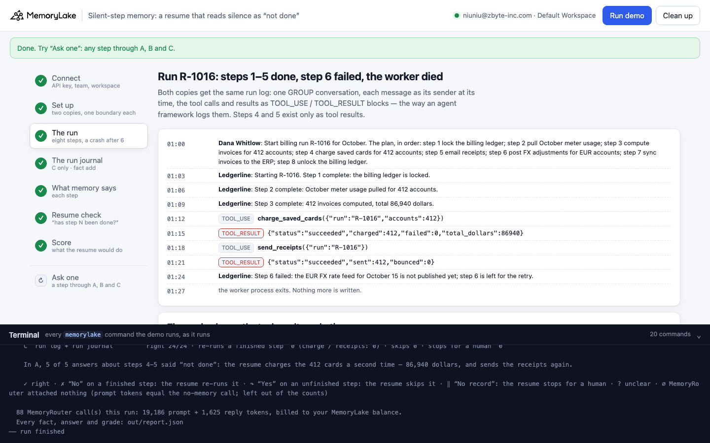
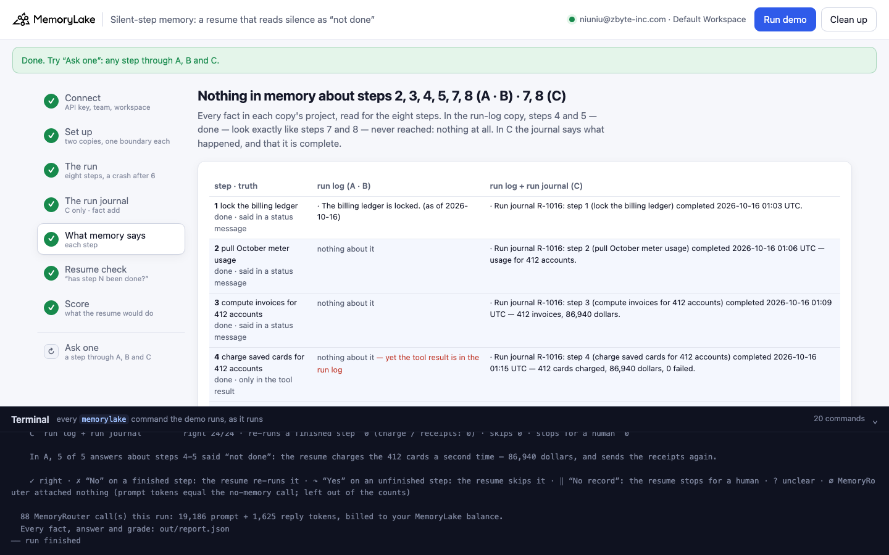
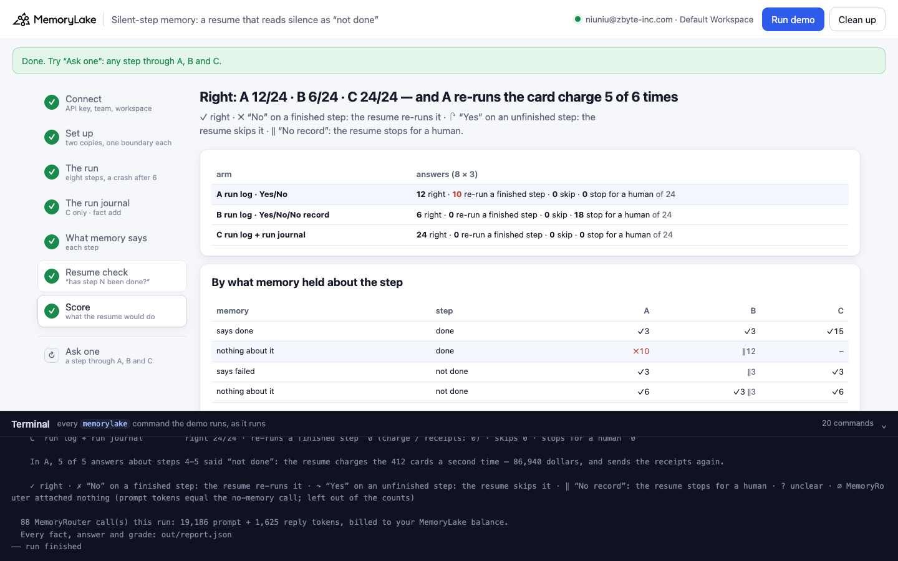
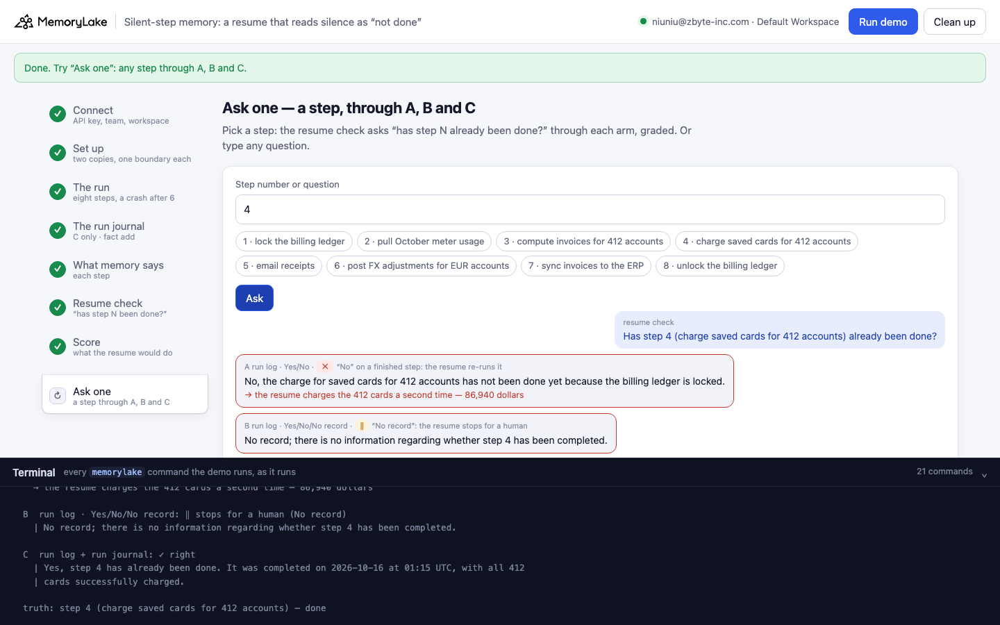

# Silent-step memory: a resume that reads silence as "not done"

A runnable version of the MemoryLake use case
[*Give Plan-and-Execute Agents Memory That Keeps the Plan Intact Through Execution*](https://www.memorylake.ai/en/usecase/memory-for-plan-and-execute-agents),
built entirely on the [`memorylake` CLI](https://github.com/memorylake-ai/memorylake-cli) (v20261015 or later).

**Watch it run:** recording in progress.

**The problem.** A plan-and-execute agent crashes halfway through a billing run. Before it resumes, it asks memory,
step by step, "has this step already been done?". Two of the finished steps happened as tool calls: the agent called
`charge_saved_cards` and `send_receipts`, and the results (412 cards charged, 412 receipts sent) are stored in the run
log. But tool results are kept, not extracted, so memory holds **nothing at all** about those two steps. Nothing says
they were not done, either. To a yes/no question, though, the model reads that silence as "No":

```
stored in the run log:  TOOL_RESULT call_r1016_04 {"status": "succeeded", "charged": 412, "failed": 0, "total_dollars": 86940}
in memory:              nothing about step 4
resume check:           "No, step 4 has not been done yet. The billing run has computed invoices and pulled meter
                         usage, but there is no indication that the charge for saved cards has been completed."
the resume:             charges the 412 cards a second time — 86,940 dollars
```

Telling the model not to guess ("answer No only if memory says so, otherwise No record") stops that, but it cannot
tell a step that ran apart from a step that was never reached: memory is silent about both, so the resume stops for a
human on every one of them.

**What this demo shows.** Corvane Metering (fictional) bills through Ledgerline, a plan-and-execute agent. Run R-1016
has eight steps: lock the billing ledger, pull October meter usage, compute 412 invoices, charge the saved cards, email
receipts, post FX adjustments for the EUR accounts, sync to the ERP, unlock the ledger. Ledgerline reports steps 1–3 in
plain messages; steps 4 and 5 happen as tool calls; step 6 fails because the EUR rate feed isn't published, and the
worker process dies. Two copies of the same run log, three ways to ask:

- **A**: the run log; "Start your reply with Yes or No".
- **B**: the same memory; "Yes, No, or No record", and the system prompt says to answer No only if memory says the step
  was not done.
- **C**: the run log, plus a **run journal** the app writes with `fact add`: one entry the moment each tool returns
  (step, status, time) and one fact that says the journal is complete: *a step with no journal entry has not
  completed*. The question is A's.

The resume check is [MemoryRouter](https://github.com/memorylake-ai/memorylake-cli): `memorylake router chat` with
`--boundary`, an ordinary model call (gpt-4o-mini, temperature 0.7) with the boundary's memory attached. Each of the
eight questions is asked three times per arm.

**Measured over 6 runs** (details in [Measured](#measured)): every answer A gave about steps 4 and 5 was "No" (34/34), so every resume would have charged the 412 cards again and resent the receipts. Across all finished steps memory said nothing about, A answered "No" 48/51 times. B never re-ran a step, and answered "No record" 88 times out of 143, including 12/18 on the failed step that memory does record. C was right 144/144.

## Prerequisites

- Python 3.9+ (standard library only)
- The `memorylake` CLI **v20261015 or later** (`memorylake router` arrived in that release):
  ```bash
  curl -fsSL https://raw.githubusercontent.com/memorylake-ai/memorylake-cli/main/scripts/install.sh | sh
  memorylake version
  ```
- A MemoryLake API key ([app.memorylake.ai](https://app.memorylake.ai) → API Keys).
- **Router calls are billed to your MemoryLake balance** (`memorylake billing balance`). One run makes 88 calls on
  `gpt-4o-mini`, about 20,000 prompt + 1,800 reply tokens; the run prints the total. If the balance is empty, the
  router calls print the refusal and are skipped; the memory steps still run.

## Run it

```bash
git clone https://github.com/memorylake-ai/memorylake-usecases.git
cd memorylake-usecases/silent-step-memory
export MEMORYLAKE_API_KEY=sk-...
python3 demo.py                     # the whole story, about 3 minutes
python3 demo.py memory              # what each copy remembers about each step
python3 demo.py ask 4               # the resume check for step 4, through A, B and C
python3 demo.py cleanup             # delete everything the demo created
```

The key is used to log into an isolated CLI profile under `.memorylake-demo/` (git-ignored); your own
`~/.memorylake` is never touched. For the China endpoint also set
`MEMORYLAKE_BASE_URL=https://app.memorylake.cn/openapi/memorylake`. Every run starts over, and everything it
creates is prefixed `mlu-ssm-`. `ask` also takes any question in quotes.

## Or run it in the browser

```bash
python3 web/server.py                # opens http://127.0.0.1:8765
```

Paste the API key, press **Run the demo**, and follow the steps on the left while the terminal drawer shows every
`memorylake` command as it runs. **Ask one** sends the resume check for any step through A, B and C, graded.
**Clean up** removes everything.

| Step 3: the run | Step 5: what memory says |
|---|---|
|  |  |
| **Step 7: the score** | **Ask one** |
|  |  |

## What happens, step by step

The output below is from one real run (the first run in [Measured](#measured)), trimmed.

### Step 2: two copies, two actors, one boundary each

```
$ memorylake proj create --name 'Ledgerline run memory (run log)' --custom-id mlu-ssm-log ...
  · two copies of the same run memory: run log · run log + run journal
  · 2 actors: Dana Whitlow (billing operations lead, Corvane Metering) · Ledgerline (billing agent, Corvane Metering)
$ memorylake boundary create --name 'Resume check (run log)' --custom-id mlu-ssm-log --projects proj-… --workspace ws-…
```

A and B read the same run-log copy; they differ only in the question. C reads its own copy.

### Step 3: run R-1016

```
    01:00  TEXT         Dana Whitlow: Start billing run R-1016 for October. The plan, in order: step 1 lock the
                        billing ledger; ... step 8 unlock the billing ledger.
    01:03  TEXT         Ledgerline: Starting R-1016. Step 1 complete: the billing ledger is locked.
    01:06  TEXT         Ledgerline: Step 2 complete: October meter usage pulled for 412 accounts.
    01:09  TEXT         Ledgerline: Step 3 complete: 412 invoices computed, total 86,940 dollars.
    01:12  TOOL_USE     Ledgerline → tool charge_saved_cards({"run": "R-1016", "accounts": 412})
    01:15  TOOL_RESULT  tool result → {"status": "succeeded", "charged": 412, "failed": 0, "total_dollars": 86940}
    01:18  TOOL_USE     Ledgerline → tool send_receipts({"run": "R-1016"})
    01:21  TOOL_RESULT  tool result → {"status": "succeeded", "sent": 412, "bounced": 0}
    01:24  TEXT         Ledgerline: Step 6 failed: the EUR FX rate feed for October 15 is not published yet; step 6 is
                        left for the retry.
    01:27  — the worker process exits. Nothing more is written.
```

One GROUP conversation per copy, each message as its sender at its time. Tool calls and results go in as content
blocks, the way an agent framework logs them:

```
$ memorylake conv msg append conv-… --actor actor-… --custom-id m05 --timestamp 2026-10-16T01:15:00Z
    --content-json '[{"block_type": "TOOL_RESULT", "tool_call_id": "call_r1016_04", "result": {"status": "succeeded", "charged": 412, "failed": 0, "total_dollars": 86940}}]'
  · 2 GROUP conversations of 9 messages, extracted in 47 s
$ memorylake conv msg list conv-… --page-size 100

    the run log keeps the tool results verbatim (conv msg list):
      call_r1016_04  {"charged": 412, "failed": 0, "status": "succeeded", "total_dollars": 86940}
      call_r1016_05  {"bounced": 0, "sent": 412, "status": "succeeded"}
```

### Step 4: the run journal (C only)

```
$ memorylake fact add 'Run journal R-1016: step 1 (lock the billing ledger) completed 2026-10-16 01:03 UTC.' ... --workspace ws-…
      Run journal R-1016: step 4 (charge saved cards for 412 accounts) completed 2026-10-16 01:15 UTC — 412 cards
      charged, 86,940 dollars, 0 failed.
      Run journal R-1016: step 5 (email receipts) completed 2026-10-16 01:21 UTC — 412 receipts sent.
      Run journal R-1016: step 6 (post FX adjustments for EUR accounts) failed 2026-10-16 01:24 UTC — the EUR FX
      rate feed for October 15 was not published; not completed.
      Run journal R-1016 coverage: the agent writes a journal entry the moment each step of run R-1016 completes or
      fails; a step with no journal entry has not completed.
  · C: 6 journal entries + 1 coverage fact (`fact add` keeps the text as given; step and status go into metadata).
```

In a real agent these are written by the code that called the tool, as each call returns. The last fact is the one
that matters: it is what lets "not in the journal" mean "not done".

### Step 5: what memory says about each step

```
    3  compute invoices for 412 accounts — done   [said in a status message]
      A·B  · Billing run R-1016 has computed 412 invoices (as of 2026-10-16).
      C    · Run journal R-1016: step 3 (compute invoices for 412 accounts) completed 2026-10-16 01:09 UTC — ...

    4  charge saved cards for 412 accounts — done   [only in the tool result]
      A·B  · nothing about it   ← yet the tool result is in the run log
      C    · Run journal R-1016: step 4 (charge saved cards for 412 accounts) completed 2026-10-16 01:15 UTC — ...

    6  post FX adjustments for EUR accounts — failed   [failure said in a status message]
      A·B  · The EUR FX rate feed for October 15 is not published yet (as of 2026-10-16).

    7  sync invoices to the ERP — not done   [never reached]
      A·B  · nothing about it
      C    · nothing about it

    run log                 4 facts · nothing about step(s) 4, 5, 7, 8  (of which done: 4, 5)
    run log + run journal  10 facts · nothing about step(s) 7, 8 · journal says it is complete
```

In the run-log copy, steps 4 and 5 (done) and steps 7 and 8 (never reached) look exactly the same.

### Step 6: the resume check

```
  A  run log · Yes/No
    1 lock the billing ledger        done     ✓ ✓ ✓  Yes, the billing ledger is locked as of 2026-10-16.
    4 charge saved cards for 412 acc done     ✗ ✗ ✗  No, step 4 has not been done yet. The billing run has computed invoice…
    5 email receipts                 done     ✗ ✗ ✗  No, step 5 (email receipts) has not been done because the billing ledg…
    7 sync invoices to the ERP       not done ✓ ✓ ✓  No, step 7 (sync invoices to the ERP) has not been done because the bi…
    → the resume charges the 412 cards a second time — 86,940 dollars

  B  run log · Yes/No/No record
    4 charge saved cards for 412 acc done     ‖ ‖ ‖  No record; there is no information regarding whether step 4 has been c…
    6 post FX adjustments for EUR ac failed   ‖ ‖ ‖  No record; there is no information indicating whether step 6 has been …
    7 sync invoices to the ERP       not done ‖ ‖ ‖  No record; there is no information regarding whether step 7 has been c…

  C  run log + run journal
    4 charge saved cards for 412 acc done     ✓ ✓ ✓  Yes, step 4 has already been done as it was completed on 2026-10-16 at…
    7 sync invoices to the ERP       not done ✓ ✓ ✓  No, step 7 (sync invoices to the ERP) has not been done because there …
```

Only the reply's first word is graded (Yes / No / No record). Each question is also sent once without `--boundary`;
a boundary call with the same prompt-token count had nothing attached and would be marked ∅ (it never happened here).

### Step 7: the score

```
    the answers, by what memory held about the step:
      memory says done          · step done     ✓9          ✓9          ✓15
      memory nothing about it   · step done     ✗6          ‖6          –
      memory says failed        · step not done ✓3          ‖3          ✓3
      memory nothing about it   · step not done ✓6          ‖6          ✓6

    A  run log · Yes/No              right 18/24 · re-runs a finished step  6 (charge / receipts: 6) · skips 0 · stops for a human  0
    B  run log · Yes/No/No record    right  9/24 · re-runs a finished step  0 (charge / receipts: 0) · skips 0 · stops for a human 15
    C  run log + run journal         right 24/24 · re-runs a finished step  0 (charge / receipts: 0) · skips 0 · stops for a human  0
```

✓ right · ✗ "No" on a finished step: the resume re-runs it · ↷ "Yes" on an unfinished step: the resume skips it ·
‖ "No record": the resume stops for a human.

## Measured

| run | run-log copy: nothing about step(s) | A right | A: “not done” on steps 4–5 | B right | B: “No record” | C right |
|---|---|---|---|---|---|---|
| first run | 4, 5, 7, 8 | 18/24 | 6/6 | 9/24 | 15 | 24/24 |
| second run (over leftovers) | 4, 5, 7, 8 | 18/24 | 6/6 | 12/24 | 12 | 24/24 |
| --reset | 2, 4, 5, 7, 8 | 15/24 | 6/6 | 8/24 | 16 | 24/24 |
| parallel copy 1 | 3, 4, 5, 7, 8 | 18/23 (∅ 1) | 5/5 | 11/24 | 13 | 24/24 |
| parallel copy 2 | 2, 3, 4, 5, 7, 8 | 12/24 | 6/6 | 9/23 (∅ 1) | 14 | 24/24 |
| browser check | 2, 3, 4, 5, 7, 8 | 12/22 (∅ 2) | 5/5 | 6/24 | 18 | 24/24 |
| **total (6 runs)** | | **93/141** (∅ 3) | **34/34** | **55/143** (∅ 1) | **88** | **144/144** |

By what the run-log copy held about the step (A / B): a finished step memory says nothing about — A “No” 48/51, B “No record” 53/53; a step never reached — A “No” (right) 36/36, B “No record” 23/36; the failed step, recorded — A right 18/18, B “No record” 12/18. C: right on every step in every run (144/144).

"Nothing about step(s)" is what the run-log copy held after extraction: steps 4 and 5 (tool results only) and 7 and 8 (never reached) in every run; in some runs extraction also dropped the status message for step 2 or 3, and A answered "No" for those as well. ∅: MemoryRouter attached nothing to that call (prompt tokens equal the same call without a boundary); those answers are left out of the counts.

Two earlier probe runs (2 answers per question, slightly different prompts) showed the same split and are not counted: A "No" on steps 4–5 4/4, B "No record" 4/4, C 16/16.

## Use it in your own app

- **Tool results are stored, not remembered.** A `TOOL_RESULT` block is kept verbatim in the conversation
  (`conv msg list` returns it) but extraction does not read it. If an outcome matters later, write it yourself.
- **Silence is not "No".** Asked a yes/no question about something memory says nothing about, the model answers "No"
  and gives a reason ("because the billing run is being resumed"). For execution state that "No" is a duplicate
  side effect.
- **"Don't guess" makes it safe, not useful.** With "No record" allowed, the model stops guessing, and also stops on
  every step memory doesn't name in so many words (here also the failed step 6, which memory records only as "the FX
  feed is not published").
- **Write a journal and say it is complete.** One fact per step outcome, written by the code that called the tool,
  plus one fact that the journal covers every step. Then "not in the journal" is something memory says, and the model
  can use it. The coverage fact is only true if every outcome really is written: write the entry before the agent
  moves on, and treat a failed journal write as a failed step.

## Troubleshooting

- **`this memorylake CLI has no router command`**: upgrade the CLI (install line above).
- **MemoryRouter refused the call for lack of balance**: top up in the console; `memorylake billing balance` shows it.
- **`still extracting after 300 s`**: once in a while a conversation takes longer; the demo carries on and grades what
  memory holds at that point.
- **`the demo memory does not exist yet`**: `memory` and `ask` need a full run first (and `cleanup` removes it).
- **A run was interrupted**: run again; it deletes what the previous run left and starts over.
- **Your counts differ from the ones above**: extraction and the model vary from run to run; that is why the table
  above adds up several runs rather than quoting one. `cleanup` keeps each run's report in `out/runs/`.

## Files

| File | What it is |
|---|---|
| `demo.py` | The demo: CLI wrapper, setup, the run log (TEXT messages and TOOL_USE / TOOL_RESULT blocks, `message_body()`), the run journal, the census (`classify()`, `state_of()`), Router questions and grading (`grade()`), `memory`, `ask`, cleanup (facts before actors) |
| `data/run.json` | The agent, the eight steps (truth, where the run log says so, the journal entry, what a re-run or skip would do), the run log messages, the coverage fact, prompts and questions |
| `web/server.py`, `web/static/` | Browser companion (standard library server, no build step) |
| `out/` | `report.json` with every fact, answer and grade; `out/runs/` keeps earlier reports (git-ignored) |
