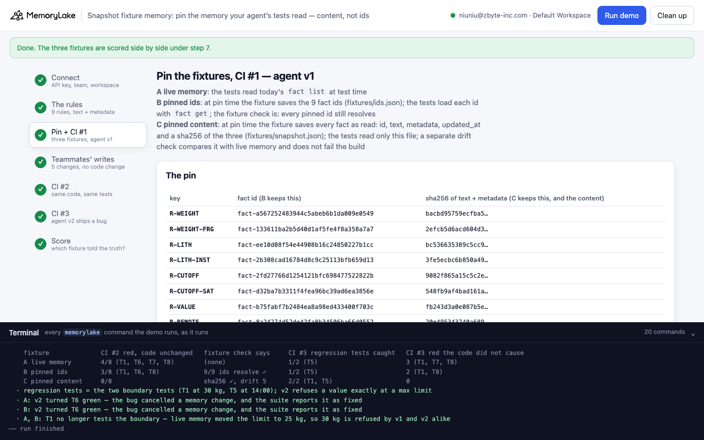
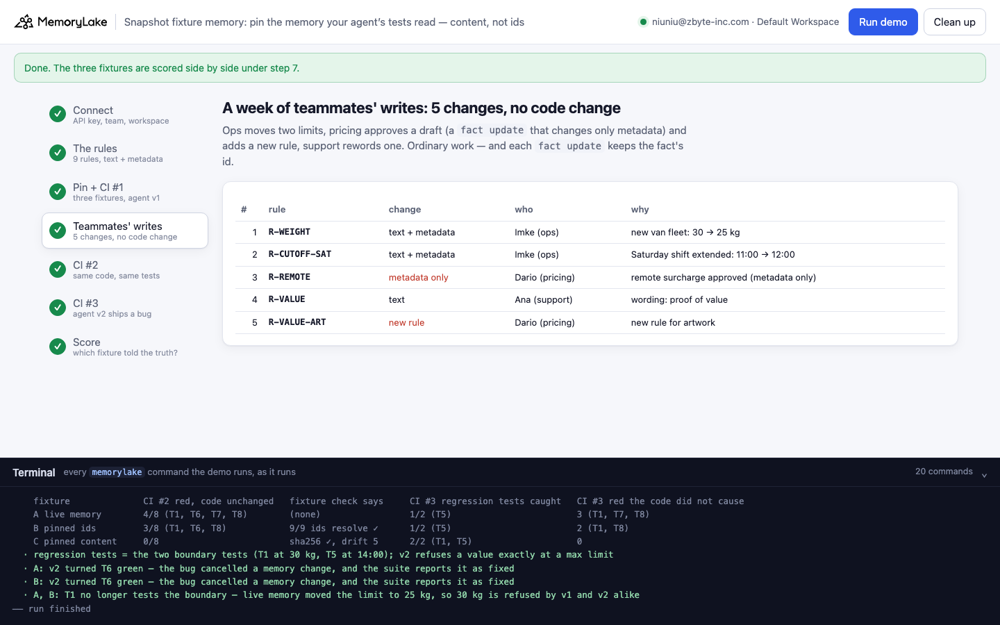
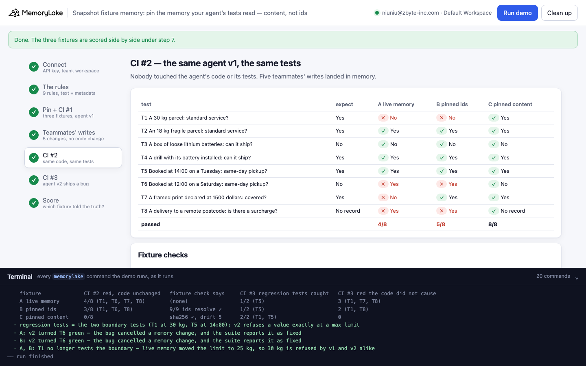
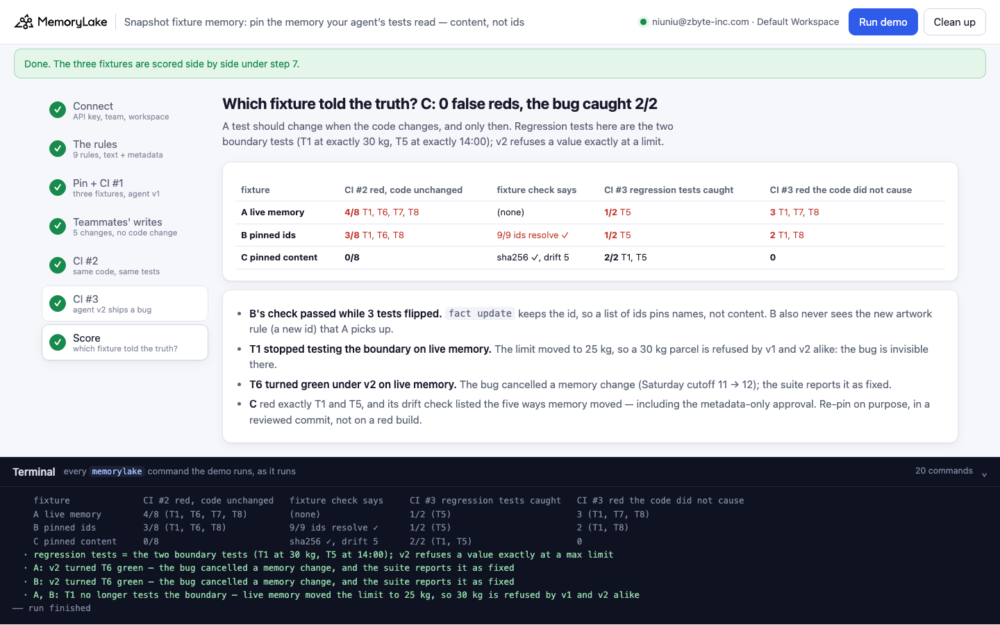

# Snapshot fixture memory: pin the memory your agent's tests read — content, not ids

A runnable version of the MemoryLake use case
[*Test Agents Reliably With Memory Snapshots You Can Pin and Replay*](https://www.memorylake.ai/en/usecase/memory-snapshotting-for-agent-testing),
built entirely on the [`memorylake` CLI](https://github.com/memorylake-ai/memorylake-cli) (v20261015 or later).

**Watch it run:** videos are being recorded.

**The problem.** An agent that reads memory has tests that read memory. Point them at live memory and they turn red
whenever a teammate edits a rule — no code changed, the build is "flaky". The usual fix is a fixture: pin the facts
the tests use. How you pin decides whether the fixture pins anything:

- **Pin the fact ids.** The fixture keeps a list of ids; the tests load each with `fact get`; the fixture check is
  "every pinned id still resolves". But **`fact update` keeps the id**. After a week of ordinary edits the check
  says `9/9 pinned ids resolve ✓` — and 3 of 8 tests flipped, because the same ids now hold other content.
- **Read live memory.** 4 of 8 tests flip (it also picks up a new rule nobody pinned). Worse, when a real bug ships
  later, one of the two tests that should catch it no longer can: the limit it was written against moved, so the old
  and the new code give the same wrong-looking answer. Another test turns green because the bug cancels a memory
  change.
- **Pin the content.** The fixture keeps every fact as read: id, text, metadata, `updated_at` and a sha256. Tests
  read only that file. A separate drift check compares it with live memory and lists what moved, without failing the
  build. 0 of 8 tests flip on memory changes; the bug reds exactly its two tests.

**What this demo shows.** Tollquay Freight (fictional) runs a quote agent on project memory, one fact per shipping
rule: a text people read, and metadata the agent's code reads (`topic`, `kind`, `status`, `applies_to`, `op`,
`value`). The agent is plain code: it reads the active rules on the question's topic, prefers the one for the
question's category over the general one, and answers from the rule's limit. Eight tests guard it, two of them at a
boundary (a parcel of exactly 30 kg, a booking at exactly 14:00).

| step | what happens |
|---|---|
| 2 | 9 rules → project memory (`fact add`, then `fact update --metadata`); one is a draft |
| 3 | pin three fixtures (A none, B `fixtures/ids.json`, C `fixtures/snapshot.json`) — CI #1 with agent v1: 8/8 everywhere |
| 4 | teammates' writes: two limits move (text + metadata), a draft is approved (metadata only), a rule is reworded, a new rule is added. No code change |
| 5 | CI #2, same agent v1: A 4/8, B 5/8 with its fixture check green, C 8/8 with a drift report of 5 changes |
| 6 | CI #3, agent v2 (a refactor that refuses a value exactly at a `max` limit); triage by running v1 on the same inputs |
| 7 | score |

No model calls: nothing is billed to your MemoryLake balance.

## Prerequisites

- **Python 3.9+** (standard library only).
- **The `memorylake` CLI, v20261015 or later** (`memorylake version`):
  ```bash
  curl -fsSL https://raw.githubusercontent.com/memorylake-ai/memorylake-cli/main/scripts/install.sh | sh
  ```
- **A MemoryLake API key**: sign up at [app.memorylake.ai](https://app.memorylake.ai), open **API Keys**, create one.
  Everything the demo uses (projects, facts, metadata) is part of the free plan.

## Run it

```bash
git clone https://github.com/memorylake-ai/memorylake-usecases.git
cd memorylake-usecases/snapshot-fixture-memory
export MEMORYLAKE_API_KEY=sk-...        # logs into an isolated profile under .memorylake-demo/, never touches ~/.memorylake
python3 demo.py                         # about 25 seconds
python3 demo.py drift                   # the pinned fixture against live memory, fact by fact
python3 demo.py cleanup                 # deletes everything the demo created
```

China region: also `export MEMORYLAKE_BASE_URL=https://app.memorylake.cn/openapi/memorylake`. To use a specific
workspace: `export MEMORYLAKE_WORKSPACE=ws-…` (default: the team's default workspace). Without `MEMORYLAKE_API_KEY`
the demo uses your existing `memorylake auth login` session.

Every object the demo creates has a `custom_id` starting with `mlu-snp-`. Each run starts over: it deletes what a
previous run left behind first (`--reset` is accepted and does the same).

## Or run it in the browser

```bash
python3 web/server.py                   # opens http://127.0.0.1:8765
```

Paste the API key, press **Run demo**, and follow the steps: the rules, the pin and CI #1, the teammates' writes,
CI #2, CI #3 with its triage, and the score. The terminal drawer at the bottom shows every `memorylake` command as it
runs. The server is standard library only and binds to localhost; the key stays in that process and in
`.memorylake-demo/`.

| | |
|---|---|
|  |  |
|  |  |

## What happens, step by step

Output below is from one real run (the third terminal run; ids shortened where marked with …).

### Steps 2 and 3: the rules and the pin

Each rule is a text plus the metadata the code reads:

```
$ memorylake fact add 'Weight: parcels up to 30 kg ship on the standard service.' --project proj-0ac9… --workspace ws-83f0…
$ memorylake fact update fact-0867… --metadata '{"key": "R-WEIGHT", "topic": "weight", "kind": "rule", "applies_to": "all", "op": "max", "value": 30, "unit": "kg", "status": "active"}' --project proj-0ac9… --workspace ws-83f0…
```

Then one `fact list` is pinned two ways: B keeps the 9 ids, C keeps the 9 facts as read with a sha256 of text +
metadata. CI #1 (agent v1) passes 8/8 under all three fixtures.

### Step 4: a week of teammates' writes

```
    1. R-WEIGHT       text + metadata  Imke (ops)       new van fleet: 30 → 25 kg
    2. R-CUTOFF-SAT   text + metadata  Imke (ops)       Saturday shift extended: 11:00 → 12:00
    3. R-REMOTE       metadata only    Dario (pricing)  remote surcharge approved (metadata only)
    4. R-VALUE        text             Ana (support)    wording: proof of value
    5. R-VALUE-ART    new rule         Dario (pricing)  new rule for artwork
```

Each update is `fact update <id> --text … --metadata …`: the fact keeps its id.

### Step 5: CI #2 — same code, same tests

```
    agent v1   expect      A live       B pinned ids   C pinned content test
    T1         Yes         ✗ No         ✗ No           ✓ Yes            A 30 kg parcel: standard service?
    T2         Yes         ✓ Yes        ✓ Yes          ✓ Yes            An 18 kg fragile parcel: standard service?
    T3         No          ✓ No         ✓ No           ✓ No             A box of loose lithium batteries: can it ship?
    T4         Yes         ✓ Yes        ✓ Yes          ✓ Yes            A drill with its battery installed: can it ship?
    T5         Yes         ✓ Yes        ✓ Yes          ✓ Yes            Booked at 14:00 on a Tuesday: same-day pickup?
    T6         No          ✗ Yes        ✗ Yes          ✓ No             Booked at 12:00 on a Saturday: same-day pickup?
    T7         Yes         ✗ No         ✓ Yes          ✓ Yes            A framed print declared at 1500 dollars: covered?
    T8         No record   ✗ Yes        ✗ Yes          ✓ No record      A delivery to a remote postcode: is there a surcharge?
    A live memory: 4/8 pass   B pinned ids: 5/8 pass   C pinned content: 8/8 pass

    B fixture check: 9/9 pinned ids resolve ✓  (9 come back with the same id)
    C fixture check: 9/9 records match their sha256 ✓
    C drift check (does not fail the build): live memory has moved 5 way(s) since the pin
      R-WEIGHT       text; metadata value: 30 → 25
      R-CUTOFF-SAT   text; metadata value: 11 → 12
      R-VALUE        text
      R-REMOTE       metadata status: draft → active
      R-VALUE-ART    new, not in the pin

    T1 under B read R-WEIGHT by its pinned id fact-0867a6bd181a4d679f275b07232976aa
      at the pin: Weight: parcels up to 30 kg ship on the standard service.
      today:      Weight: parcels up to 25 kg ship on the standard service; heavier parcels go as freight.
```

B differs from A only on T7: the new artwork rule has a new id, so a list of ids never sees it. C's drift check
names all five changes, including the metadata-only approval (R-REMOTE) that turned T8 from "No record" into "Yes".

### Step 6: CI #3 — agent v2 ships a bug

v2 is a refactor ("share one compare() for max and min") that compares a `max` rule with `<` instead of `<=`: a value
exactly at the limit is refused. Triage runs v1 on the same inputs at the same moment; a test whose result differs is
the code change.

```
    triage: run v1 on the same inputs, same moment — a test whose result differs is the code change
    A live memory      red 4: T1, T5, T7, T8   code broke T5        code turned green T6     red without the code T1, T7, T8
    B pinned ids       red 3: T1, T5, T8       code broke T5        code turned green T6     red without the code T1, T8
    C pinned content   red 2: T1, T5           code broke T1, T5    code turned green —      red without the code —
```

- On live memory the 30 kg limit is now 25 kg, so T1 is refused by v1 and v2 alike: **the boundary test no longer
  tests the boundary**, and the bug is invisible there.
- On live memory the Saturday cutoff moved from 11:00 to 12:00, so a 12:00 booking flipped to Yes; v2's `<` turns
  it back to No. **The bug cancels a memory change and T6 goes green** — the suite reports it as fixed.

### Step 7: score

```
    fixture              CI #2 red, code unchanged   fixture check says     CI #3 regression tests caught   CI #3 red the code did not cause
    A live memory        4/8 (T1, T6, T7, T8)        (none)                 1/2 (T5)                        3 (T1, T7, T8)
    B pinned ids         3/8 (T1, T6, T8)            9/9 ids resolve ✓      1/2 (T5)                        2 (T1, T8)
    C pinned content     0/8                         sha256 ✓, drift 5      2/2 (T1, T5)                    0
```

### `python3 demo.py drift`

Prints each difference between the pin and live memory with both versions side by side (text and metadata), e.g.

```
  R-REMOTE  fact-c108…  — metadata status: draft → active
    pinned: Remote zones: deliveries to remote postcodes carry a 12 dollar surcharge.
            metadata {"applies_to": "all", "key": "R-REMOTE", "kind": "rule", "op": "always", "status": "draft", "topic": "remote_zone"}
    live:   Remote zones: deliveries to remote postcodes carry a 12 dollar surcharge.
            metadata {"applies_to": "all", "key": "R-REMOTE", "kind": "rule", "op": "always", "status": "active", "topic": "remote_zone"}   updated_at 13:18:20
```

## Measured

Runs so far: three terminal runs (the second over the first's leftovers, the third with `--reset`) and one browser
run. Every run gave the same table above; the first terminal run took 22 s. All writes go through the API with fixed
texts and metadata (no extraction from conversations, no search ranking), so nothing depends on a model.

## Use it in your own agents

- **Pin content, not ids.** `fact update` keeps the id; an id list pins names. Save each fact the tests read as read:
  text, metadata and `updated_at`, with a hash of the content, and make the tests read only that file.
- **Hash what the code reads.** Here that is text + metadata: the approval that changed T8 was metadata only, with
  the text unchanged. A hash of the text alone would have missed it.
- **Check drift, don't fail on it.** A drift report against live memory tells you the fixture is behind; re-pin on
  purpose, in a reviewed commit, and look at which tests change when you do.
- **Live memory can take a test's coverage away.** A boundary test is written against a limit; when someone moves the
  limit, the test still runs and still means something else. Pinned content keeps the input the test was written
  for.
- **Triage by running the old code on the same inputs.** Reds that do not change between old and new code are not
  the code change.

## Troubleshooting

- **`this memorylake CLI has no fact trace with full history`** — the CLI is older than v20261015; reinstall with the
  `install.sh` line above.
- **`the runs disagree with the story's own expectations`** — a test result differs from what the story data says it
  should be; please open an issue with the files in `out/`.
- **Leftovers after an interrupted run** — `python3 demo.py cleanup`.

## Files

| file | what it is |
|---|---|
| `demo.py` | the whole demo: CLI wrapper, the agent (v1 and v2), the three fixtures, the CI runs, triage, score, cleanup |
| `data/story.json` | the rules, the eight tests, the teammates' writes, the regression and the three fixtures |
| `web/server.py`, `web/static/` | the browser companion (standard library server, no build step) |
| `out/fixtures/ids.json`, `out/fixtures/snapshot.json` | fixture B (pinned ids) and fixture C (pinned content with sha256) |
| `out/world.json`, `out/ci1.json` … `out/ci3.json`, `out/report.json` | the ids, each CI run's results, checks, drift and triage, and the score (`cleanup` moves them to `out/runs/`) |
