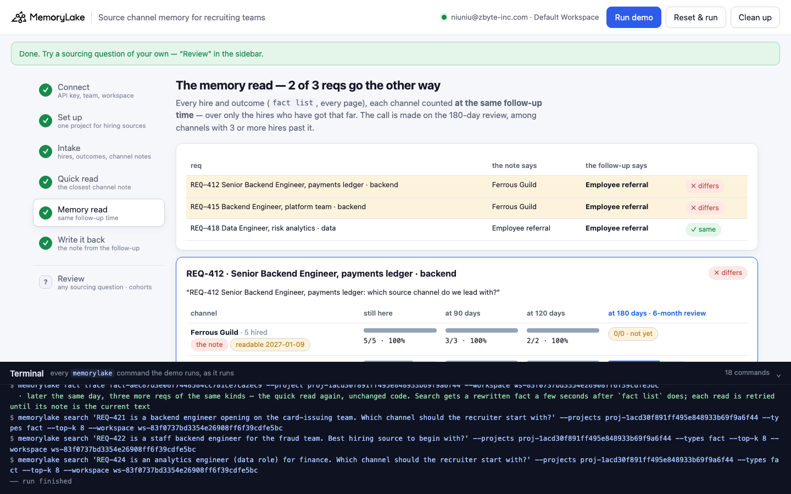
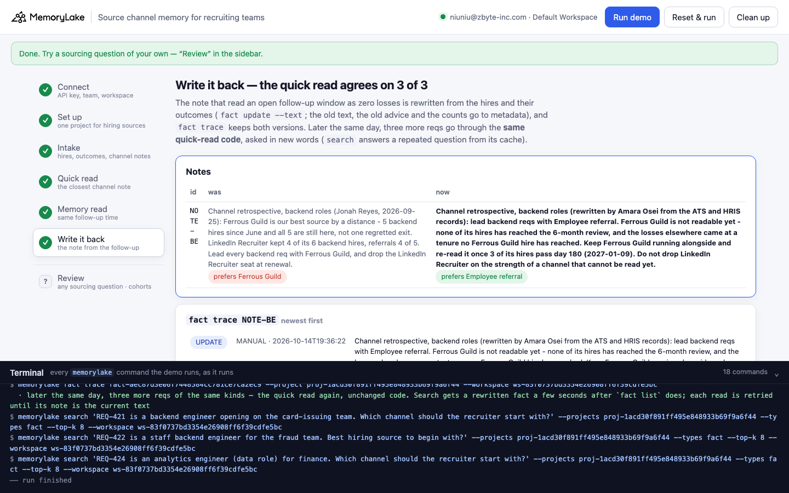

# Source channel memory for recruiting teams

A runnable version of the MemoryLake use case
[*Give Recruiting Teams Source Channel Memory That Reveals What Actually Works*](https://www.memorylake.ai/en/usecase/source-channel-memory-for-recruiting-teams),
built entirely on the [`memorylake` CLI](https://github.com/memorylake-ai/memorylake-cli).

**Watch it run:** [CLI, 2:37](https://github.com/memorylake-ai/memorylake-usecases/releases/download/source-channel-memory-v1/source-channel-memory-cli-demo.mp4) · [Web, 3:53](https://github.com/memorylake-ai/memorylake-usecases/releases/download/source-channel-memory-v1/source-channel-memory-web-demo.mp4)
([release](https://github.com/memorylake-ai/memorylake-usecases/releases/tag/source-channel-memory-v1); GitHub serves them as downloads).

**The problem.** "Which channel produced the hire? Which produced quality conversations?" Once somebody answers that,
the answer lives on as reflection memory: *this channel is our best source, every hire from it is still here*. A note
like that can be true word for word and still be the wrong call. A channel you started using in June can't have lost
anyone at month five yet. "Still here" then compares hires who have been around for two years with hires who have been
around for two months, and the newest channel always looks perfect.

**What this demo shows.** Corvid Pay (fictional) hires backend and data engineers through a LinkedIn Recruiter seat,
employee referrals and, since June, Ferrous Guild (a community job board). Its hiring memory lives in one MemoryLake
project: 22 hires from the ATS (channel, role, start date, word for word), 18 outcomes from the HRIS (6-month review
results and exit days), and the 2 channel notes Jonah Reyes left when he handed recruiting to Amara Osei. On
2026-10-15 three reqs land on Amara's desk:

| Req | Quick read: the closest channel note | Memory read: every channel at the same follow-up time | |
|---|---|---|---|
| REQ-412 Senior Backend Engineer · backend | "Ferrous Guild is our best source by a distance: 5 backend hires since June, all 5 still here. LinkedIn kept 4 of 6." → **Ferrous Guild** | On the 6-month review: referral **5/5**, LinkedIn 4/6, Ferrous Guild **0/0**, not readable until 2027-01-09 → **Employee referral** | ✗ |
| REQ-415 Backend Engineer · backend | → **Ferrous Guild** | → **Employee referral** | ✗ |
| REQ-418 Data Engineer · data (control) | "all 3 referral hires still here, LinkedIn lost 1 of 3" → **Employee referral** | Every data hire is past the review: referral 3/3, LinkedIn 2/3 → **Employee referral** | ✓ |

Jonah's backend note is accurate: all 5 Ferrous Guild hires are still here, and LinkedIn kept 4 of 6. But the Guild
hires started between June and September, so they have been here 37 to 136 days. Both LinkedIn losses came later than
that, on days 143 and 158. **At 120 days, the furthest any Guild hire has got, LinkedIn had also kept 6 of 6.** "Zero
exits" here only means the follow-up window hasn't closed yet. On the measure the team actually uses, the 6-month review,
Ferrous Guild has no data at all: its first hire reaches day 180 on 2026-11-28 and its third on 2027-01-09. The data-roles note is
the control. Every hire in it is past the review, so "still here" and the review count the same people, and both reads
agree.

Step 6 rewrites the note that read an open follow-up window as zero losses, in the place the next req will read it
(`fact update --text`, with the old text, the old advice and the counts kept in metadata). `fact trace` keeps both
versions. Later that day, three more reqs go through the **same quick-read code** and agree with the follow-up, 3 of 3.

```
setup ──────── proj create
intake ─────── fact add --project <p> '<record>' …   (42 records, one call)  + fact update --metadata {channel, family, start; day; result…}
quick read ─── search '<req>' --projects <p> --types fact --top-k 8  → closest channel note for the req's role family → the channel it prefers
memory read ── fact list --projects <p>   (every hire and outcome, every page)
               → per channel, at 90 / 120 / 180 days: passed / reached, counting only the hires who have reached that day
               → the call: best 6-month-review pass rate among channels with 3+ hires past it; the rest "not readable until <date>"
write back ─── fact update <note> --text '<conclusion from the follow-up>' --metadata {…, prefer, previous: '<old text>', basis: {…}, readable_on}
               fact trace <note>  → ADD, UPDATE (old text kept) → quick read again (new wording)
```

There are no conversations and no extraction. Every record is pinned word for word, and both reads are plain code over
what the CLI returns. No model decides anything.

## Prerequisites

- **Python 3.9+** (standard library only, nothing to `pip install`)
- **The `memorylake` CLI** on your `PATH`:
  ```bash
  curl -fsSL https://raw.githubusercontent.com/memorylake-ai/memorylake-cli/main/scripts/install.sh | sh
  ```
- **A MemoryLake API key.** Sign up at [app.memorylake.ai](https://app.memorylake.ai), open **API Keys**, create one. A free
  personal account is enough: nothing here needs an agent or a model call.

## Run it

```bash
git clone https://github.com/memorylake-ai/memorylake-usecases.git
cd memorylake-usecases/source-channel-memory
export MEMORYLAKE_API_KEY=sk-...           # China region: also export MEMORYLAKE_BASE_URL=https://app.memorylake.cn/openapi/memorylake
python3 demo.py
```

The first run takes about a minute and a half (one project, 42 facts, each with its metadata). A re-run takes about a
minute. Every run replays Amara's first channel review: if an earlier run rewrote a note, that note is first put back
word for word from `metadata.previous`. "Today" is fixed at 2026-10-15 in `data/story.json`, so the tenures and the
dates don't drift. With the key set, the demo logs into an isolated CLI profile under `./.memorylake-demo/` and never
touches your own `~/.memorylake`. Everything it creates has a `custom_id` starting with `mlu-scr-`.

Then ask a sourcing question of your own, or list a role family's cohort:

```bash
python3 demo.py cohort backend             # every backend hire, what happened to them, each channel at 90 / 120 / 180 days
python3 demo.py review "Is Ferrous Guild worth a paid sponsorship for backend hiring?" --family backend
python3 demo.py review "Where do our best data engineers come from?" --family data
python3 demo.py cleanup                    # deletes the project and every fact on it
```

`cohort backend` lists the 16 backend hires and ends with the table:

```
    H-117  2026-03-02 LinkedIn Recruiter   Senior Backend Engineer   6-month review passed
    H-116  2026-04-06 Employee referral    Backend Engineer          6-month review passed
    H-119  2026-06-01 Ferrous Guild        Backend Engineer          day 136, before the 6-month review
    H-120  2026-06-15 Ferrous Guild        Senior Backend Engineer   day 122, before the 6-month review
    H-121  2026-07-13 Ferrous Guild        Backend Engineer          day 94, before the 6-month review
    H-122  2026-08-03 Ferrous Guild        Backend Engineer          day 73, before the 6-month review
    H-123  2026-09-08 Ferrous Guild        Backend Engineer          day 37, before the 6-month review

      channel              hired   still here    at 90 days   at 120 days   at 180 days   (passed / reached)
      Ferrous Guild            5     5/5 100%      3/3 100%      2/2 100%     0/0   —
      LinkedIn Recruiter       6     4/6  67%      6/6 100%      6/6 100%      4/6  67%
      Employee referral        5     4/5  80%      5/5 100%      5/5 100%      5/5 100%  ← memory read
  · Ferrous Guild: 0 of 5 hires past day 180; readable on 2027-01-09
  → Employee referral (5/5 passed the 6-month review vs LinkedIn Recruiter 4/6); Ferrous Guild not readable until 2027-01-09
```

After a run, the backend note has already been rewritten, so the quick read of a `review` agrees with the memory read.
`review` therefore also reads the note's original text from `metadata.previous` and checks it the same way, so the
comparison stays visible:

```
  NOTE-BE before an earlier run rewrote it: “Channel retrospective, backend roles (Jonah Reyes, 2026-09-25): Ferrous Guild is our best source by a distance - …”
  → that text's quick read: Ferrous Guild  ✗ differs from the memory read
```

## Or run it in the browser

```bash
python3 web/server.py                # opens http://127.0.0.1:8765
```

Paste the key, connect and run. The page drives the same functions as `demo.py` and streams every `memorylake` command
into a terminal drawer as it runs. You see the hires with their outcomes, the quick read of each req with its top 8, the
memory read as a table of follow-up times (a `0/0 · not yet` cell where a channel can't be read), and the write-back
with `fact trace`. **Review** takes any sourcing question and role family, and lists either family's cohort.





## What happens, step by step

### Steps 2–3: one project, three sources, one fact per record

```
$ memorylake proj create --name 'Corvid Pay - hiring sources' --custom-id mlu-scr-sources --description '…'
$ memorylake fact add --project proj-… 'ATS hire H-100: Priya Natarajan, Data Engineer, started 2025-02-03. Source: LinkedIn Recruiter (paid seat). Recruiter: Jonah Reyes.' 'HRIS H-100 Priya Natarajan: 6-month review on 2025-08-02, passed (meets or exceeds expectations).' …
$ memorylake fact update fact-… --project proj-… --metadata '{"key": "scr:H-100", "record": "H-100", "tool": "ats", "kind": "hire", "by": "Jonah Reyes", "on": "2025-02-03", "hire": "H-100", "name": "Priya Natarajan", "family": "data", "role": "Data Engineer", "channel": "LinkedIn Recruiter", "start": "2025-02-03"}'
  · … and 41 more `fact update --metadata` the same way

    ATS            22   backend 16 · data 6
    HRIS           18   6-month reviews 14 · exits 4
    channel notes   2

  Jonah's notes, as he left them:
    NOTE-BE   Channel retrospective, backend roles (Jonah Reyes, 2026-09-25): Ferrous Guild is our best source by a distance - 5 backend hires since June and all 5 are still here, not one regretted exit. LinkedIn Recruiter kept 4 of its 6 backend hires, referrals 4 of 5. Lead every backend req with Ferrous Guild, and drop the LinkedIn Recruiter seat at renewal.
    NOTE-DATA Channel retrospective, data roles (Jonah Reyes, 2026-09-25): referrals beat LinkedIn for data hires - all 3 referral hires are still here, LinkedIn Recruiter lost 1 of 3. Lead data reqs with an employee-referral push.
```

`fact add` takes many texts in one call and returns their ids in order. It takes no metadata, so each fact gets a
`fact update --metadata` right after. An outcome's metadata points at its hire (`hire: H-104`) with the exit day or
the review result. A note's metadata names its role family and the channel it prefers.

### Step 4: the quick read

```
$ memorylake search 'REQ-412 Senior Backend Engineer, payments ledger: which source channel do we lead with?' --projects proj-… --types fact --top-k 8

  REQ-412 (backend): “REQ-412 Senior Backend Engineer, payments ledger: which source channel do we lead with?”
  search · top 8:
      #1   NOTE-BE   channel notes Channel retrospective, backend roles (Jonah Reyes, 2026-09-25): Ferrous Guild i…   ← closest note
      #2   H-120     ATS           ATS hire H-120: Mateo Alvarez, Senior Backend Engineer, started 2026-06-15. Sou…
      #3   H-119     ATS           ATS hire H-119: Dara Byrne, Backend Engineer, started 2026-06-01. Source: Ferro…
      …
  → quick read: lead with Ferrous Guild
```

The top 8 is mostly Ferrous Guild hires: the note named the channel, and the hires carry its name. The quick read takes the
closest note **for the req's role family** and reads its text and advice from `fact list` by fact id, because `search`
can answer a repeated question from a cache of older text.

### Step 5: the memory read

```
$ memorylake fact list --projects proj-… --page-size 50

  REQ-412 Senior Backend Engineer, payments ledger · backend
      channel              hired   still here    at 90 days   at 120 days   at 180 days   (passed / reached)
      Ferrous Guild            5     5/5 100%      3/3 100%      2/2 100%     0/0   —    ← the note
      LinkedIn Recruiter       6     4/6  67%      6/6 100%      6/6 100%      4/6  67%
      Employee referral        5     4/5  80%      5/5 100%      5/5 100%      5/5 100%  ← memory read
  · the note counts who is still here. Ferrous Guild's hires have been here 37 to 136 days; the losses elsewhere came on days 143 and 158
  · at 120 days — the furthest any Ferrous Guild hire has got — LinkedIn Recruiter kept 6/6, Employee referral kept 5/5: the same 100% Ferrous Guild has now
  · Ferrous Guild: 0 of 5 hires past day 180; the first gets there on 2026-11-28, the third on 2027-01-09
  → quick read:  Ferrous Guild
  → memory read: Employee referral (5/5 passed the 6-month review vs LinkedIn Recruiter 4/6); Ferrous Guild not readable until 2027-01-09
  …
  req      role                                       the note says       the follow-up says
  ------------------------------------------------------------------------------------------------
  REQ-412  Senior Backend Engineer, payments ledger   Ferrous Guild       Employee referral   ✗ differs
  REQ-415  Backend Engineer, platform team            Ferrous Guild       Employee referral   ✗ differs
  REQ-418  Data Engineer, risk analytics              Employee referral   Employee referral   ✓ same

  → 2 of 3 reqs: the note leads with a channel whose “zero exits” is a follow-up window that has not closed
```

The rules are a few lines of code (`follow()`, `cohort_table()` and `decide()` in `demo.py`), reading only the records'
metadata. Each hire's outcome at day *N* is *passed* (still here at day *N*, or at day 180 a passed review), *failed*
(left before day *N*), or *not yet* (hasn't reached day *N* and hasn't left). A cell is passed over reached, so the
*not yet* hires count in neither number. They are not a success, and the cell says `0/0` rather than 100% when nobody
has got there. The call is made on the 6-month review, among channels with at least 3 hires past it. A channel with
fewer gets the date its third hire reaches day 180 instead of a rate.

### Step 6: write it back

```
    NOTE-BE was “Channel retrospective, backend roles (Jonah Reyes, 2026-09-25): Ferrous Guild is our best source by a distance - 5 backend hires since June and all 5 are still here, not…”
            now “Channel retrospective, backend roles (rewritten by Amara Osei from the ATS and HRIS records): lead backend reqs with Employee referral. Ferrous Guild is not readable yet - none of its hires has reached the 6-month review, and the losses elsewhere came at a tenure no Ferrous Guild hire has reached. Keep Ferrous Guild running alongside and re-read it once 3 of its hires pass day 180 (2027-01-09). Do not drop LinkedIn Recruiter on the strength of a channel that cannot be read yet.”
$ memorylake fact trace fact-… --project proj-…

  fact trace NOTE-BE (newest first):
    UPDATE  MANUAL  2026-10-14T19:24:49  Channel retrospective, backend roles (rewritten by Amara Osei from the ATS and HRIS recor…
    ADD     MANUAL  2026-10-14T19:23:55  Channel retrospective, backend roles (Jonah Reyes, 2026-09-25): Ferrous Guild is our best…

  REQ-421 Backend Engineer, card issuing · backend: “REQ-421 is a backend engineer opening on the card-issuing team. Which channel should the recruiter start with?”
    closest note NOTE-BE (#1) · quick read: Employee referral · memory read: Employee referral  ✓ same
  REQ-422 Staff Backend Engineer, fraud · backend: “REQ-422 is a staff backend engineer for the fraud team. Best hiring source to begin with?”
    closest note NOTE-BE (#1) · quick read: Employee referral · memory read: Employee referral  ✓ same
  REQ-424 Analytics Engineer, finance · data: “REQ-424 is an analytics engineer (data role) for finance. Which channel should the recruiter start with?”
    closest note NOTE-DATA (#1) · quick read: Employee referral · memory read: Employee referral  ✓ same

  → the quick read now agrees with the follow-up on 3 of 3: the note it follows is the one the hire records rewrote
```

The rewritten note states only the conclusion and the date it can be revisited. The counts change with every hire and
every review, so they go to `metadata.basis` (per channel: hired, still here, passed / reached at each horizon), next
to the old text, the old advice and `metadata.readable_on`. Text and metadata change in one `fact update` call, so
`fact trace` records the rewrite together with its basis. The later reqs are worded differently on purpose: `search`
caches results by query text, so asking the morning's exact question again could return the morning's answer.

## Measured

| What | Result |
|---|---|
| Closest note = that role family's note, ranked #1 in the top 8 | every req, every run |
| Quick read vs memory read: REQ-412 ✗, REQ-415 ✗, REQ-418 ✓ | 7 / 7 runs (4 from scratch including both recordings, 2 re-runs, 1 in the browser) |
| After write-back: quick read agrees with the follow-up | 3 / 3, every run, first try |
| Time | 82 s from scratch, 50 s re-run (115 s with `--reset` deleting the previous run first) |

## Wiring it into your own channel reviews

- **Pin the start date with every hire and the date with every outcome.** "Still here" is a rate only once you know
  how long each person has had to leave. Without the dates, a channel's newest hires look like its best hires.
- **Count at the same follow-up time, and only over the people who have got there.** Someone at day 40 is neither a
  success nor a failure at day 180. Leave them out of both numbers, and print `0/0` instead of 100%.
- **Write down when a channel becomes readable.** "Not yet" is an answer with a date attached: the day the third hire
  passes the review. Put that date in the note, so the next person revisits the channel instead of trusting it or
  dropping it.

## If something goes wrong

- **`the memorylake CLI is not on PATH`**: install it (above) or `export MEMORYLAKE_BIN=/path/to/memorylake`.
- **Search results differ on your run**: ranking moves between runs. Step 4 prints exactly what came back. The memory
  read uses search only to pick the note.
- **"no backend channel note in the top 8"**: the question's words matched hires more closely than any note. Say
  "channel", "source" or "lead with" the way the notes do.
- **"search answered from its cache"**: step 4 asks the same questions every run, and `search` can serve a repeated
  question from a cache made by an earlier run. The line names the hits whose fact ids are not in `fact list` now.
- **Something half-created after an interrupted run**: `python3 demo.py --reset`, or `python3 demo.py cleanup`.

## Files

```
source-channel-memory/
├── demo.py              # the CLI runner (every step is a plain `memorylake` command, echoed)
├── data/story.json      # 22 hires, 18 outcomes, 2 channel notes; 3 reqs + 3 later ones (fictional, plain ASCII)
├── web/server.py        # local web companion: same functions, Server-Sent Events
├── web/static/          # no-build front end
└── out/runs.jsonl       # one line per run (git-ignored)
```
