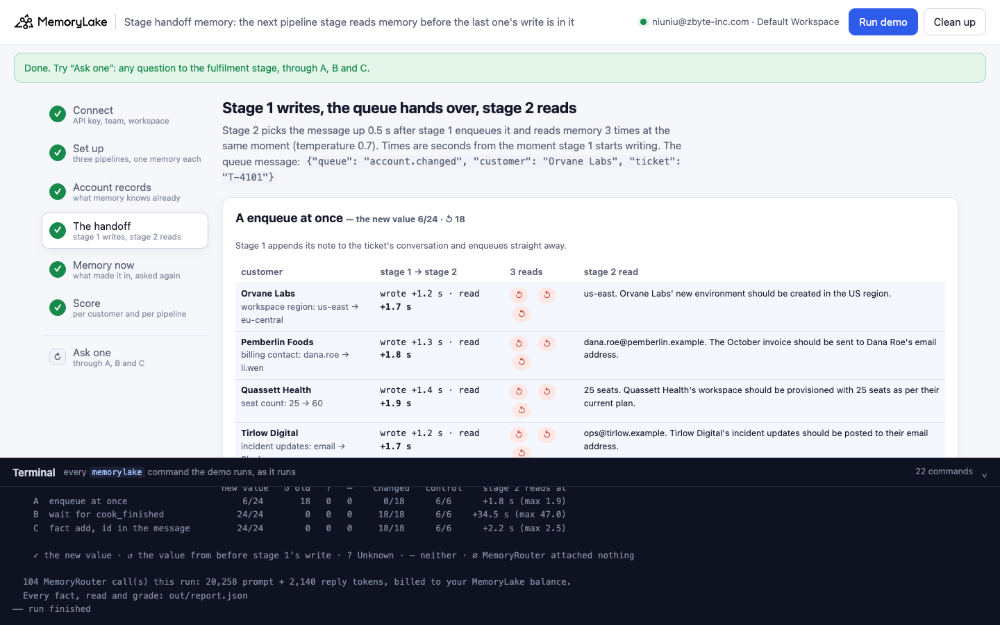
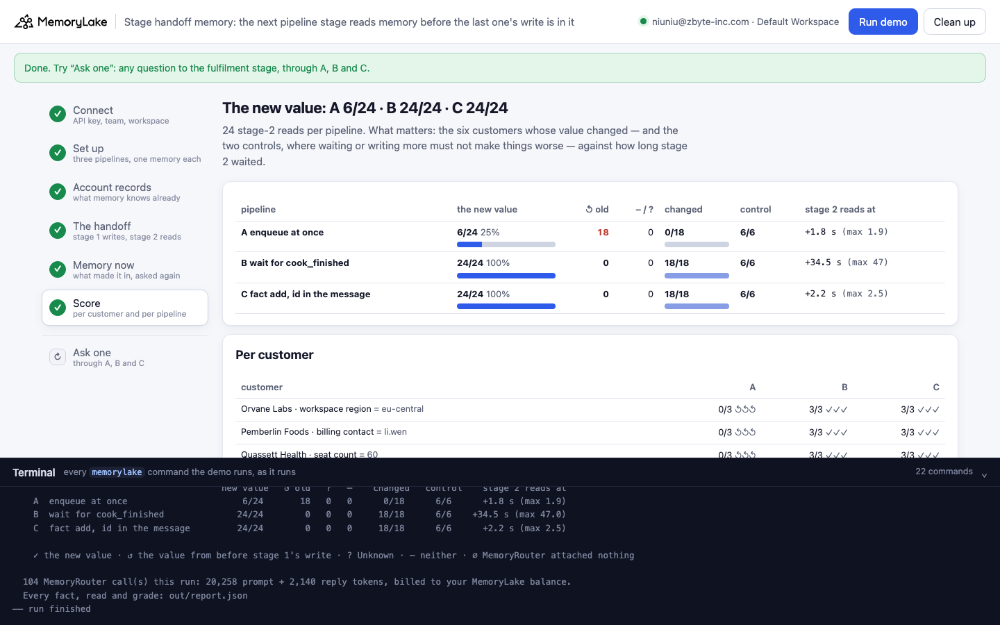
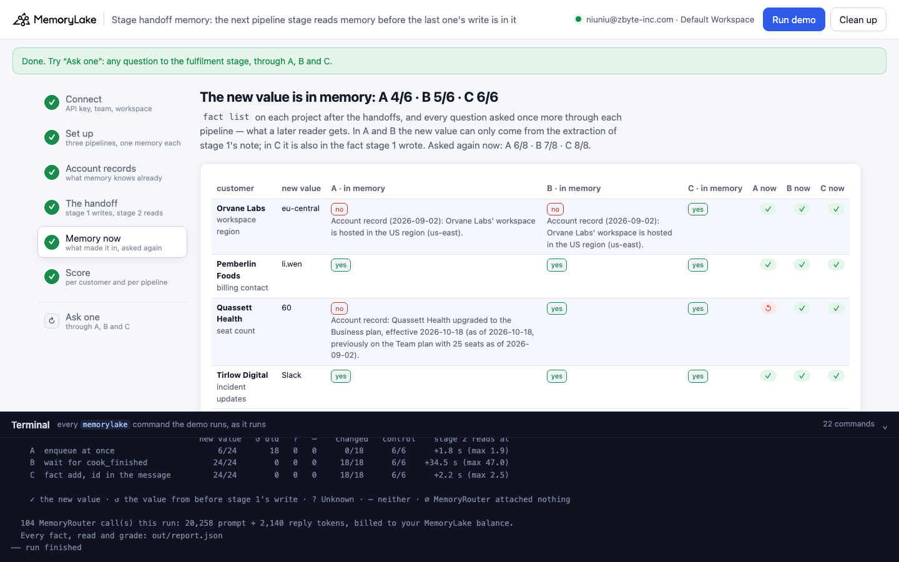
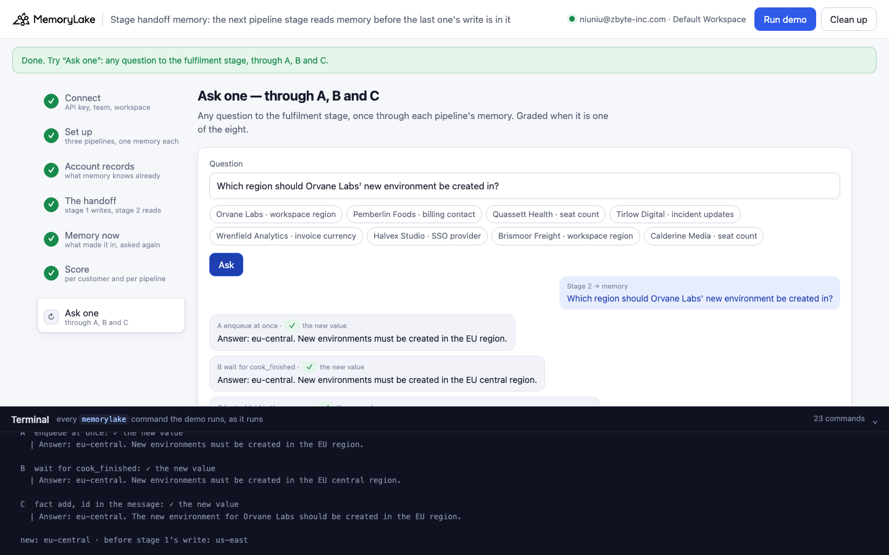

# Stage handoff memory: the next pipeline stage reads memory before the last one's write is in it

A runnable version of the MemoryLake use case
[*Memory for Queue-Driven Agent Pipelines*](https://www.memorylake.ai/en/usecase/memory-for-queue-driven-agent-pipelines),
built entirely on the [`memorylake` CLI](https://github.com/memorylake-ai/memorylake-cli) (v20261015 or later).

**Watch it run:** videos are being recorded.

**The problem.** In a queue-driven pipeline the messages stay light: stage 1 writes what it learned into shared
memory and enqueues an id; stage 2 picks the message up and reads the context from memory. The queue hands a message
over in about a second. MemoryLake reads a conversation message in the background — extraction took **10 to 77
seconds** per message in our runs. So the next stage reads the memory from *before* the last stage's write, and acts
on it as confidently as when it is right:

```
stage 1 writes  (t = 0)       "Intake note, ticket T-4101: Orvane Labs asked to move their workspace to the EU region
                               (eu-central) for data residency. New environments must be created in eu-central."
stage 1 enqueues              {"queue": "account.changed", "customer": "Orvane Labs", "ticket": "T-4101"}
stage 2 reads   (t = +1.9 s)  "Which region should Orvane Labs' new environment be created in?"
memory answers                "Answer: us-east. Orvane Labs' new environment should be created in the US region."
extraction finishes later     somewhere between +10 s and +77 s
```

Nothing about the reply says it is stale. The old value is a real fact in memory, and until extraction finishes it
is the only one.

**What this demo shows.** Ferrowind (a fictional SaaS company) runs an account-change pipeline. Stage 1 (intake)
reads what a customer asked for and writes it into memory; stage 2 (fulfilment) asks memory through MemoryRouter
before it acts — creates the environment in a region, sends the invoice to a contact, provisions seats, configures
SSO. Eight customers: six are changing one value, two (the controls) send a request about something else. The same
handoff runs through three pipelines, each with its own memory:

| | stage 1 | when stage 2 reads |
|---|---|---|
| **A** | appends its note to the ticket's conversation, enqueues at once | about 2 s after the write |
| **B** | appends its note, waits until `conv consumed-messages --message` lists it and `conv cook-status` reports `cook_finished`, then enqueues | after extraction: 11 to 77 s |
| **C** | appends its note **and** writes its result with `fact add` — dated, naming the value it replaces — then puts the fact id in the queue message and enqueues at once | about 2.5 s after the write |

Over five runs (each read three times at temperature 0.7 — 72 reads per run):

| pipeline | the new value | ↺ the old value | changed customers | controls | stage 2 reads at (median) |
|---|---|---|---|---|---|
| A enqueue at once | 30/120 | **90** | **0/90** | 30/30 | +1.8 s |
| B wait for `cook_finished` | 114/120 | 0 | 90/90 | **24/30** | **+38.8 s** (max 77.1) |
| C `fact add` + id in the message | **120/120** | 0 | **90/90** | 30/30 | +2.4 s |

- **A** read the old value every time a value had changed: 90 of 90 reads, in every run. The controls were right
  because nothing about them had changed.
- **B** is right about the changed customers, but stage 2 waits a median 39 s for each message, and waiting made a
  control wrong: in three runs out of five, extraction wrote Orvane's note as a fact with **no customer in it** —
  *"New environments must be created in eu-central"* — and MemoryRouter attaches that fact to Brismoor's region
  question too. In two of those runs the fact was already there when Brismoor's stage 2 read, and all three reads
  answered *eu-central* for a customer who never asked to move.
- **C** is right at the speed of A. `fact add` is synchronous: the fact exists when the call returns, and the next
  read can retrieve it. The queue message carries its id, so stage 2 (or an auditor) can `fact get` exactly what
  stage 1 meant.

## Prerequisites

1. **Python 3.9+** (standard library only).
2. **The `memorylake` CLI, v20261015 or later** — `memorylake router` is new in that release:
   ```bash
   curl -fsSL https://raw.githubusercontent.com/memorylake-ai/memorylake-cli/main/scripts/install.sh | sh
   memorylake version
   ```
3. **A MemoryLake API key** — sign up at [app.memorylake.ai](https://app.memorylake.ai), open **API Keys**, create one.
   For the China region use `https://app.memorylake.cn` and also set
   `MEMORYLAKE_BASE_URL=https://app.memorylake.cn/openapi/memorylake`.
4. **MemoryRouter calls are billed** to your MemoryLake balance: about 110 calls on gpt-4o-mini per run
   (roughly 20,000 prompt tokens). Without balance the memory steps still run and the replies are skipped.

## Run it

```bash
git clone https://github.com/memorylake-ai/memorylake-usecases.git
cd memorylake-usecases/stage-handoff-memory
export MEMORYLAKE_API_KEY=sk-...
python3 demo.py
```

About 2.5 minutes. With a key set, the demo logs into an isolated CLI profile under `.memorylake-demo/` and never
touches your `~/.memorylake`. Without one it uses your existing `memorylake auth login` session. Everything it
creates is prefixed `mlu-qdp-`; every run starts over.

Then:

```bash
python3 demo.py memory
```

```bash
python3 demo.py ask "Which region should Orvane Labs' new environment be created in?"
```

```bash
python3 demo.py cleanup
```

`memory` re-reads the three projects and asks every question once more; `ask` sends one question through A, B and C;
`cleanup` deletes the boundaries, conversations, the stage-1 actor (its facts first) and the three projects. The full
report of a run is in `out/report.json`; `cleanup` moves it to `out/runs/`.

## Or run it in the browser

```bash
python3 web/server.py
```

Opens `http://127.0.0.1:8765`. Paste the API key, press **Run demo**. The page runs the same pipeline (it imports
`demo.py`) and shows each step: the account records, the three handoffs with their timings, what made it into memory,
and the score. **Ask one** sends any question through all three memories. The terminal drawer at the bottom shows
every `memorylake` command as it runs.

| | |
|---|---|
|  |  |
|  |  |

## What happens, step by step

The commands below are from a real run (ids shortened).

### Step 2: three projects, one actor, one boundary each

```bash
memorylake proj create --name 'Ferrowind customer accounts' --custom-id mlu-qdp-now --description 'Ferrowind customer accounts. Demo data.' --workspace ws-…
memorylake actor create --custom-id mlu-qdp-intake --display-name intake-stage --description 'Pipeline stage 1: reads customer requests and writes what changed into memory. Demo data.' --tags demo
memorylake boundary create --name 'Fulfilment stage (enqueue at once)' --custom-id mlu-qdp-now --projects proj-… --workspace ws-…
```

Three projects with the same plain name (a project's name is context for extraction, so no pipeline letter in it),
one boundary each. Each pipeline writes into and reads from its own project only.

### Step 3: what memory knows already

```bash
memorylake fact add 'Account record (2026-09-02): Orvane Labs'"'"' workspace is hosted in the US region (us-east).' 'Account record (2026-09-02): Pemberlin Foods'"'"' billing contact is dana.roe@pemberlin.example.' … --project proj-… --workspace ws-…
```

Eight account records from September, the same in all three projects: us-east, dana.roe@…, 25 seats, email, USD,
Okta, and the two controls (us-west, 10 seats).

### Step 4: stage 1 writes, the queue hands over, stage 2 reads

Stage 1, every pipeline:

```bash
memorylake conv create --project proj-… --actors actor-… --kind GROUP --name 'Intake T-4101' --custom-id mlu-qdp-conv-now-orvane --workspace ws-…
memorylake conv msg append conv-… --actor actor-… --custom-id T-4101-note --timestamp 2026-10-18T09:00:00Z --text 'Intake note, ticket T-4101: Orvane Labs asked to move their workspace to the EU region (eu-central) for data residency. New environments must be created in eu-central.' --workspace ws-…
```

B then polls until the message is read:

```bash
memorylake conv consumed-messages conv-… --message conv-entry-… --workspace ws-…
memorylake conv cook-status conv-… --workspace ws-…
```

C also writes its result as a fact and puts the id in the queue message:

```bash
memorylake fact add 'Intake result (2026-10-18, ticket T-4101): Orvane Labs'"'"' workspace region is now eu-central (EU), for data residency. This replaces us-east; create new environments in eu-central.' --project proj-… --workspace ws-…
```

```
queue message: {"queue": "account.changed", "customer": "Orvane Labs", "ticket": "T-4101", "fact_id": "fact-b27fbbf7…"}
```

Stage 2, every pipeline, half a second after the enqueue — three reads at the same moment, plus one call without
`--boundary` per question as the baseline (a read with exactly that many prompt tokens had nothing attached, ∅):

```bash
memorylake router chat 'Which region should Orvane Labs'"'"' new environment be created in?' --model gpt-4o-mini --max-tokens 80 --temperature 0.7 --system 'You are the fulfilment stage of Ferrowind'"'"'s account-change pipeline …' --boundary bnd-…
```

From a real run:

```
  A  enqueue at once — stage 1 appends its note and enqueues
    Orvane Labs          wrote + 1.4s · read + 1.9s         ↺ ↺ ↺   us-east. Orvane Labs' new environment should be created in
    Pemberlin Foods      wrote + 1.2s · read + 1.7s         ↺ ↺ ↺   dana.roe@pemberlin.example. Pemberlin Foods' October invoi
    Quassett Health      wrote + 1.4s · read + 1.9s         ↺ ↺ ↺   25 seats. Quassett Health's workspace should be provisione
    Tirlow Digital       wrote + 1.3s · read + 1.8s         ↺ ↺ ↺   ops@tirlow.example. Tirlow Digital's incident updates shou
    Wrenfield Analytics  wrote + 1.3s · read + 1.8s         ↺ ↺ ↺   USD. Wrenfield Analytics' next invoice should be issued in
    Halvex Studio        wrote + 1.3s · read + 1.8s         ↺ ↺ ↺   Okta. Halvex Studio should configure their SSO with Okta.
    Brismoor Freight     wrote + 1.0s · read + 1.5s         ✓ ✓ ✓   us-west. Brismoor Freight's new environment should be crea
    Calderine Media      wrote + 1.3s · read + 1.8s         ✓ ✓ ✓   10 seats. Calderine Media's workspace should be provisione
    → 6/24 the new value · ↺ 18 the old one   (10 s for all eight)

  B  wait for cook_finished — stage 1 waits until the conversation reports cook_finished (up to 300 s), then enqueues
    Orvane Labs          cook_finished + 60.6s              ✓ ✓ ✓   eu-central. Orvane Labs' new environment should be created
    Pemberlin Foods      cook_finished + 32.7s              ✓ ✓ ✓   li.wen@pemberlin.example. The October invoice should be se
    …
    Calderine Media      cook_finished + 10.4s              ✓ ✓ ✓   10 seats. Calderine Media's workspace should be provisione
    → 24/24 the new value · ↺ 0 the old one   (70 s for all eight)

  C  fact add, id in the message — stage 1 also writes its result with `fact add`, puts the fact id in the message, enqueues
    Orvane Labs          fact add + 1.8s · read + 2.4s      ✓ ✓ ✓   eu-central. Orvane Labs' new environment should be created
    …
    → 24/24 the new value · ↺ 0 the old one   (10 s for all eight)
```

### Step 5: what memory holds now

```bash
memorylake fact list --projects proj-… --page-size 200 --workspace ws-…
```

After the handoffs (and 20 s more), the demo lists each project's facts and asks every question once more. Two
things show up here that the handoff itself does not:

- **Extraction does not always keep the new value, or the customer.** Over five runs a fact naming the customer and
  stating the new value was in A's memory for 26 of 30 changes and in B's for 29 of 30. In two runs A lost
  Quassett's 60 seats: once merged into the September record as *"Quassett Health is on the Business plan with 25
  seats (previously … Team plan with 25 seats)"*, once as *"upgraded to the Business plan, effective 2026-10-18"*
  with no seat count — asked again, memory said 25 both times. The region change became *"New environments must be
  created in eu-central"*, a fact with no customer in it, in A's memory in 2 runs and in B's in 3.
- **A fact with no customer in it answers every customer's question.** The demo prints these facts. Asked again,
  that fact made Orvane's answer right — and Brismoor's wrong (*"eu-central. New environments for Brismoor Freight
  must be created in the eu-central region"*: A in 2 runs, B in 2). C's own facts always name the customer; its
  notes are extracted too, but in these runs a subjectless fact never appeared in C's project.

### Step 6: the score

```
                                        new value   ↺ old   ?   –    changed   control    stage 2 reads at
    A  enqueue at once                      6/24       18   0   0      0/18      6/6      +1.8 s (max 1.9)
    B  wait for cook_finished              24/24        0   0   0     18/18      6/6    +51.4 s (max 64.0)
    C  fact add, id in the message         24/24        0   0   0     18/18      6/6      +2.4 s (max 2.6)
```

## Measured

Five runs: three `python3 demo.py` runs on the CLI, one in the browser, one more CLI run. Every stored reply was
re-graded with the final grader (0 grades changed).

| run | A new value (controls) | B new value (controls) | B median wait | C new value (controls) |
|---|---|---|---|---|
| 1 | 6/24 (6/6) | 21/24 (**3/6**) | 42.6 s | 24/24 (6/6) |
| 2 | 6/24 (6/6) | 24/24 (6/6) | 37.0 s | 24/24 (6/6) |
| 3 | 6/24 (6/6) | 21/24 (**3/6**) | 54.9 s | 24/24 (6/6) |
| browser | 6/24 (6/6) | 24/24 (6/6) | 34.5 s | 24/24 (6/6) |
| 4 | 6/24 (6/6) | 24/24 (6/6) | 51.4 s | 24/24 (6/6) |

In B's two bad runs the three wrong reads were Brismoor's: *eu-central*, from the subjectless fact above. Asked
again after the handoffs, A was right 35 of 40 times, B 30 of 32 (run 1 asked only A again; B and C
were added from run 2 on), C 32 of 32.
No read was ∅ in any run.

## What else we measured

These came from a probe before the demo was built (6 customers, one run each), not from the demo itself:

- **`cook_finished` is not a commit.** One change (Orvane's region) was read — `consumed-messages` listed it,
  `cook_finished` was true at +21 s — and no fact about it was ever written. 80 s later memory still said us-east.
  Waiting for extraction tells you extraction ran, not that it kept what you wrote. It did not happen in the five demo
  runs; B was 90/90 on the changed customers.
- **A fact you write can still lose to an older one.** In the probe, C's first fact for Halvex was undated
  (*"Halvex Studio upgraded to the Business plan with 60 seats."*) next to the record *"… Team plan with 25 seats
  (as of 2026-09-02)"*. Reads at +0.7 s and +80 s gave the new plan; reads at +10, +20 and +40 s gave the old one.
  The demo's C facts carry the date and name the value they replace, and were right in 120 of 120 reads.
- **At-least-once delivery did not double anything.** We first tested whether a redelivered event ("bought a
  500-credit pack", delivered twice as two messages) would be counted twice. It was not: 0 of 6 duplicates became a
  second fact, and 0 of 36 answers doubled the total. Appending with `--custom-id <event id>` makes the redelivery a
  no-op anyway — the CLI returns the message created the first time.

## Use it in your own pipeline

- **Don't hand off on the strength of an append.** A `conv msg append` returns when the message is stored, not when
  its facts are. If the next stage reads memory, either write what it needs with `fact add` (synchronous) or wait.
- **Put the fact id in the message.** Messages stay light, and the receiving stage can `fact get <id>` to see exactly
  what it is acting on — or check it is still current before an irreversible step.
- **Write the result as a sentence that stands on its own:** the customer's name, the date, the new value and the
  value it replaces. Extraction may drop the subject of a sentence in a note; a fact you write keeps it.
- **If you wait for extraction instead, budget for it:** 10 to 77 s per message here, per stage. And check for the
  fact afterwards (`fact list --query <value>`), because a finished extraction can still have written nothing.
- **Keep the conversation for the audit trail.** C still appends the note: `conv msg list` shows what stage 1 saw,
  the fact shows what it decided.

## Troubleshooting

- **`this memorylake CLI has no router command`** — upgrade the CLI (v20261015+).
- **Replies are skipped / "MemoryRouter refused the call for lack of balance"** — top up your MemoryLake balance;
  the memory steps still run.
- **B waits up to 300 s for a message** — extraction is slow at that moment; the demo enqueues after 300 s anyway and
  says so.
- **`ask` doesn't grade my question** — only the eight questions shown in the demo are graded; quote them exactly.
  In a shell, quote the whole question.
- **Port 8765 in use** — `web/server.py` tries the next port and prints which one it took; or pass `--port N`.
- **A run stopped half-way** — run `python3 demo.py cleanup`, then `python3 demo.py` again.

## Files

| file | what it is |
|---|---|
| `demo.py` | the demo: CLI wrapper, the three handoffs, census, grading, `memory` / `ask` / `cleanup` |
| `data/accounts.json` | the eight customers: record, stage-1 note, stage-1 result fact, stage-2 question, values |
| `web/server.py` | the browser companion (standard library HTTP + Server-Sent Events, imports `demo.py`) |
| `web/static/` | the page (no build step) |
| `web/screenshot-*.png` | screenshots from a real browser run |
