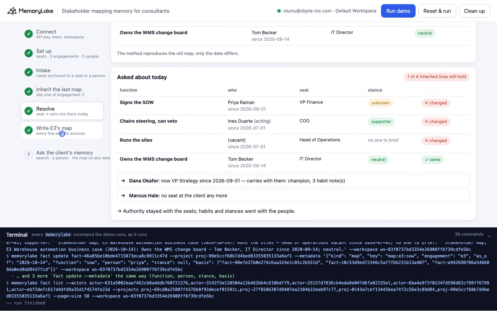
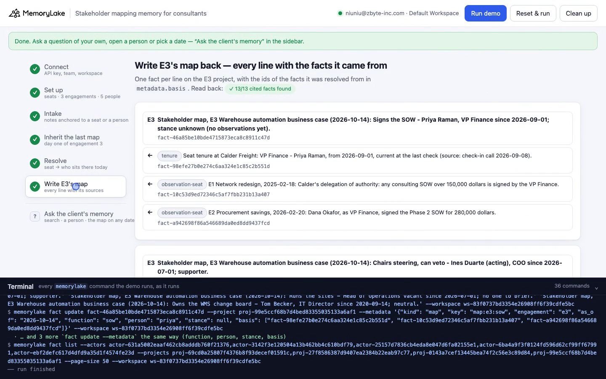

# Stakeholder mapping memory for consultants

A runnable version of the MemoryLake use case
[*Give Consultants Stakeholder Mapping Memory That Holds Across Every Engagement*](https://www.memorylake.ai/en/usecase/stakeholder-mapping-memory-for-consultants),
built entirely on the [`memorylake` CLI](https://github.com/memorylake-ai/memorylake-cli).

**Watch it run:** [CLI, 3:18](https://github.com/memorylake-ai/memorylake-usecases/releases/download/stakeholder-map-memory-v1/stakeholder-map-memory-cli-demo.mp4) · [Web, 4:30](https://github.com/memorylake-ai/memorylake-usecases/releases/download/stakeholder-map-memory-v1/stakeholder-map-memory-web-demo.mp4)
([release](https://github.com/memorylake-ai/memorylake-usecases/releases/tag/stakeholder-map-memory-v1); GitHub serves them as downloads).

**The problem.** A firm works with the same client three times in two years. Each engagement re-maps the stakeholders —
who signs, who can veto, who influences — and the map dies with the slides. The page's fix is that *"subsequent engagements
inherit prior maps"*. But a map inherited as-is is exactly how a team walks into the third engagement and briefs the wrong
person: people change seats between engagements, and a map line mixes two kinds of fact that move in opposite directions.
**Authority belongs to the seat** ("the VP Finance signs any SOW over 150,000 dollars"). **Habits and stances belong to the
person** ("Dana wants the downside case first"). When Dana changes seats, the first stays and the second goes with her.

**What this demo shows.** Ashgrove Partners (fictional) is starting its third engagement with Calder Freight (fictional).
The first two left notes in MemoryLake, each one fact, pinned word for word, tagged in `metadata` with what it is anchored
to — a seat or a person — plus engagement 2's stakeholder map. Calder reorganised in between: the COO left, the Head of
Operations became acting COO, a new VP Finance joined and the old one moved to a new VP Strategy seat.

| Map line | Inherited from engagement 2 | Resolved for today | |
|---|---|---|---|
| Signs the SOW (VP Finance) | Dana Okafor — champion | **Priya Raman**, since 2026-09-01 — no observations yet | ✗ |
| Chairs steering, can veto (COO) | Marcus Hale — skeptic | **Ines Duarte** (acting), since 2026-07-01 — supporter | ✗ |
| Runs the sites (Head of Operations) | Ines Duarte — supporter | **vacant** since 2026-07-01 | ✗ |
| Owns the WMS change board (IT Director) | Tom Becker — neutral | Tom Becker — neutral | ✓ |

One line of four still holds. Every fact behind the inherited map is still true — Dana did sign the Phase 2 SOW — and
`search` for "Who signs the SOW at Calder Freight?" puts that old map line first. Nothing was superseded; the map was
attached to the wrong anchor. And the seat that holds the veto is now held by the person who backed automation last time.

The same resolver, asked about 2026-02-20, rebuilds engagement 2's map line for line (4/4), so the difference is the date,
not the method. The new map is written back for engagement 3, each line carrying the ids of the facts it came from.

```
setup ────────── proj create "seats" + "E1" + "E2" + "E3" · actor create × 5 (one per person) + actor bind
intake ───────── fact add --project <seats> '<Seat tenure …>' × 8 + '<Check-in …>' × 2   + fact update --metadata {kind, seat, person, start, end}
                 fact add --project <E1|E2> '<seat-anchored note>' × 5 + '<E2 map line>' × 4  + fact update --metadata {anchor: seat, seat, function, …}
                 fact add --actor <person> '<person-anchored note>' × 10                    + fact update --metadata {anchor: person, trait, stance, …}
inherit ─────── fact list --projects <E2>  (kind = map)   ·   search 'Who signs the SOW at Calder Freight?' --top-k 3
resolve ─────── fact list --projects <seats>,<E1>,<E2>,<E3> --actors <5 people>   (both scopes in one call, every page)
                 → per map line: seat → tenure on the day → that person's own stance and habits
                 resolve(2026-02-20) == E2's saved map?   resolve(today) vs inherited
write ──────── fact add --project <E3> '<Stakeholder map, E3 …>' × 4 + fact update --metadata {…, basis: [fact ids]}
```

The resolver is plain code over the pinned facts' metadata, not a model: the same memory gives the same map every time. No
conversations and no extraction.

## Prerequisites

- **Python 3.9+** (standard library only, nothing to `pip install`)
- **The `memorylake` CLI** on your `PATH`:
  ```bash
  curl -fsSL https://raw.githubusercontent.com/memorylake-ai/memorylake-cli/main/scripts/install.sh | sh
  ```
- **A MemoryLake API key.** Sign up at [app.memorylake.ai](https://app.memorylake.ai), open **API Keys**, create one. A free
  personal account is enough: nothing here needs an agent or a model call.

## Run it

```bash
git clone https://github.com/memorylake-ai/memorylake-usecases.git
cd memorylake-usecases/stakeholder-map-memory
export MEMORYLAKE_API_KEY=sk-...           # China region: also export MEMORYLAKE_BASE_URL=https://app.memorylake.cn/openapi/memorylake
python3 demo.py
```

About 1½ minutes the first time, about 25 s on a re-run, which reads back what is already there. With the key set, the demo
logs into an isolated CLI profile under `./.memorylake-demo/` and never touches your own `~/.memorylake`. Everything it creates
has a `custom_id` starting with `mlu-smm-`.

```bash
python3 demo.py map 2026-07-15                                  # the map resolved for any date (here: between the two reorganisations)
python3 demo.py person dana                                     # seats Dana held, and every observation on her actor
python3 demo.py ask "Who can veto the automation project?"     # search's top 8 over the seats, E1, E2 and the five people
python3 demo.py --reset                                         # delete everything the demo created, then replay
python3 demo.py cleanup                                         # delete everything the demo created
```

## Or run it in the browser

```bash
python3 web/server.py                # opens http://127.0.0.1:8765
```

Paste the key, connect, run. The page drives the same functions as `demo.py` and streams every `memorylake` command into a
terminal drawer as it runs: the timeline and seat tenures as they are pinned, the inherited map and what `search` says, the
resolver's check against February and today's map line by line, and engagement 3's map with every cited fact. **Ask the
client's memory** takes any question, opens one person, or resolves the map for a date.





## What happens, step by step

Output below is from real runs (ids shortened).

### Steps 2–3 — seats, three engagements, five people; every note one fact

Seat tenures and two check-in notes go on a *seats* project; notes about what a seat can do go on the engagement project they
came from; notes about what a person is like go on that person's actor. Each gets `metadata` with `anchor: seat | person`.

```
$ memorylake fact add --project proj-a21b… 'Seat tenure at Calder Freight: VP Finance - Dana Okafor, from 2023-04-03 to 2026-08-31 (source: check-in call 2026-09-08).' 'Seat tenure at Calder Freight: VP Finance - Priya Raman, from 2026-09-01, current at the last check (source: check-in call 2026-09-08).' …
$ memorylake fact update fact-… --project proj-a21b… --metadata '{"kind": "tenure", "key": "tenure:vp-finance:2023-04-03", "seat": "vp-finance", "person": "dana", "acting": false, "start": "2023-04-03", "end": "2026-08-31", …}'
$ memorylake fact add --actor actor-0746… 'E1 Network redesign, 2025-03-11: Dana Okafor asked for the downside case before she would look at the upside.' …

  8 seat tenures · 2 check-in notes · 5 seat-anchored and 10 person-anchored observations · 4 map lines

    2025-02-10  E1 Network redesign starts
    2025-06-27  E1 Network redesign ends
    2026-01-12  E2 Procurement savings starts
    2026-02-20  E2 stakeholder map saved (4 lines)
    2026-04-24  E2 Procurement savings ends
    2026-07-02  Check-in call with Calder Freight (Ines Duarte): Marcus Hale left Calder on 30 June. Ines Duarte is acting COO from 1 J…
    2026-09-08  Check-in call with Calder Freight (Dana Okafor): Priya Raman joined as VP Finance on 1 September. Dana Okafor moved to …
    2026-10-14  E3 Warehouse automation business case starts

    on each person: Dana 4 · Marcus 2 · Ines 2 · Tom 2 · Priya 0
```

### Step 4 — day one of engagement 3: inherit the last map

```
$ memorylake fact list --projects proj-3b12… --workspace ws-… --page-size 50

    inherited from E2 (2026-02-20), as saved:
    function                    who                      seat                 stance
    Signs the SOW               Dana Okafor              VP Finance           champion
    Chairs steering, can veto   Marcus Hale              COO                  skeptic
    Runs the sites              Ines Duarte              Head of Operations   supporter
    Owns the WMS change board   Tom Becker               IT Director          neutral

$ memorylake search 'Who signs the SOW at Calder Freight?' --projects <seats>,<E1>,<E2> --actors <5 people> --types fact --top-k 3

    “Who signs the SOW at Calder Freight?” — search top 3:
       1  Stakeholder map, E2 Procurement savings (2026-02-20): Signs the SOW - Dana Okafor, VP Finance; champion.
       2  E1 Network redesign, 2025-02-18: Calder's delegation of authority: any consulting SOW over 150,000 dollars is signed by…
       3  E2 Procurement savings, 2026-02-20: Dana Okafor, as VP Finance, signed the Phase 2 SOW for 280,000 dollars.

  → the inherited map sends the SOW to Dana Okafor; the first person search names is Dana Okafor — every fact behind both is true
```

The answer is in the hits — hit 2 says the *VP Finance* signs — but the first name memory offers is the old one.

### Step 5 — resolve each line through the seat, then the person in it

One `fact list --projects … --actors …` reads every fact from both scopes. For each map line: its seat → the tenure fact
covering the day → that person's stance and habits (facts on their actor, dated up to the day). First the check, then today:

```
    the resolver asked about 2026-02-20 (the day E2's map was saved):
    Signs the SOW               Dana Okafor              VP Finance           champion
    Chairs steering, can veto   Marcus Hale              COO                  skeptic
    Runs the sites              Ines Duarte              Head of Operations   supporter
    Owns the WMS change board   Tom Becker               IT Director          neutral

    ✓ 4/4 lines match the map E2 saved that day — the method reproduces the old map; only the date differs

    line by line against the inherited map:
      ✗ Signs the SOW               Dana Okafor    → Priya Raman    Priya Raman holds the seat since 2026-09-01; no observations of them yet
      ✗ Chairs steering, can veto   Marcus Hale    → Ines Duarte    Ines Duarte holds the seat since 2026-07-01; their own stance is supporter, not skeptic
      ✗ Runs the sites              Ines Duarte    → (vacant)       Ines Duarte left the seat; vacant since 2026-07-01
      ✓ Owns the WMS change board   Tom Becker     → Tom Becker     same person, same stance
      → Dana Okafor: now VP Strategy since 2026-09-01; carries with them: champion, 3 habit note(s)
      → Marcus Hale: now no seat at the client

  → 1 of 4 inherited lines still hold. Authority stayed with the seats; habits and stances went with the people.
```

Two opposite mistakes are avoided at once: the SOW does not go to Dana (authority stayed with the seat), and Priya is not
briefed with Dana's "downside case first" (that habit went with Dana).

### Step 6 — write engagement 3's map back, with its sources

```
$ memorylake fact add --project proj-76c9… 'Stakeholder map, E3 Warehouse automation business case (2026-10-14): Signs the SOW - Priya Raman, VP Finance since 2026-09-01; stance unknown (no observations yet).' …
$ memorylake fact update fact-… --project proj-76c9… --metadata '{"kind": "map", "key": "map:e3:sow", …, "basis": ["fact-7012…", "fact-6e24…", "fact-efcd…"]}'

    Stakeholder map, E3 Warehouse automation business case (2026-10-14): Chairs steering, can veto - Ines Duarte (acting), COO since 2026-07-01; supporter.
      ← fact-1d65…  tenure             Seat tenure at Calder Freight: COO - Ines Duarte (acting), from 2026-07-01, current at the last…
      ← fact-cf67…  observation·seat   E1 Network redesign, 2025-03-04: The COO chairs Calder's network steering committee and can vet…
      ← fact-d2f7…  observation·person E1 Network redesign, 2025-06-20: Ines Duarte backed the automated sorter recommendation at the …
      ← fact-d2a4…  observation·person E1 Network redesign, 2025-03-19: Ines Duarte wants site-level throughput data before she will d…
    …
    ✓ 13/13 cited facts read back from memory

  gaps to close before the steering committee:
    · Signs the SOW: Priya Raman — no observations; meet before the SOW, don't brief with someone else's habits
    · Runs the sites: Head of Operations is vacant — ask who covers site data requests
```

The next engagement inherits *this* map — and can still see why each line says what it says.

## Measured

Seven runs on a free account on 2026-10-14 — four from scratch (two of them the recordings, one from the web page), one with `--reset`, two re-runs (one from the web page):

| What | Result |
|---|---|
| Inherited E2 map: Dana · Marcus · Ines · Tom | 7 / 7 (plain `fact list --projects <E2>`) |
| `search "Who signs the SOW at Calder Freight?"` hit 1 = the old E2 map line naming Dana | 7 / 7 |
| Resolver asked about 2026-02-20 reproduces E2's saved map | 4 / 4 lines, 7 / 7 runs |
| Resolver for today: SOW → Priya, veto seat → Ines (acting, supporter), sites → vacant, WMS → Tom; 1 of 4 lines still hold | 7 / 7 |
| E3 map written with `metadata.basis`; every cited fact read back | 13 / 13 cited facts, 7 / 7 runs |
| Cleanup: four projects gone, five actors gone, `fact list --actors <deleted id>` → 0 for every deleted person | every deleted actor checked (10 ids) |
| Time | 68–79 s from scratch, 23–29 s re-run (`--reset` adds about a minute of cleanup) |

Only the `search` line depends on ranking; it is printed as returned, and the map does not depend on it.

## Wiring it into your own firm

- **Seats**: one fact per tenure (`Seat tenure: <seat> - <person>, from … to …`) on a per-client project, with seat, person,
  start and end in `metadata`. Every check-in that mentions a move adds a tenure; nothing is overwritten, so any date can be
  resolved.
- **Tag every note with its anchor** when you write it: authority, budget, sign-off, reporting lines → `anchor: seat`; stance,
  style, relationships, history with you → `anchor: person`. Seat notes go on the engagement project; person notes go on the
  person's actor, so they follow the person to a new seat — or out of the client.
- **At kick-off**, don't copy the last map: resolve each line for today (`fact list --projects … --actors …`, then the join),
  and list what changed. A person with zero observations in a deciding seat is the first meeting to book.
- **Write the new map back** with `metadata.basis` pointing at the facts it came from; that is the "audit stakeholder
  rationale" the page asks for.
- `search` is fine for "what do we know about …?", but for "who decides?" it returns the most similar line — often the old
  map — so resolve, don't rank.

## If something goes wrong

- **`the memorylake CLI is not on PATH`**: install it (above) or `export MEMORYLAKE_BIN=/path/to/memorylake`.
- **Something half-created after an interrupted run**: `python3 demo.py --reset`, or `python3 demo.py cleanup`. Cleanup
  deletes each person's facts before the actor itself (an actor deleted first leaves its facts readable and undeletable).
- **`the demo data does not exist yet`** from `map` / `person` / `ask`: run `python3 demo.py` first.

## Files

```
stakeholder-map-memory/
├── demo.py              # the CLI runner (every step is a plain `memorylake` command, echoed)
├── data/story.json      # 5 people, 5 seats, 8 tenures, 2 check-ins, 15 observations, E2's 4-line map (fictional, plain ASCII)
├── web/server.py        # local web companion: same functions, Server-Sent Events
├── web/static/          # no-build front end
└── out/runs.jsonl       # one line per run (git-ignored)
```
