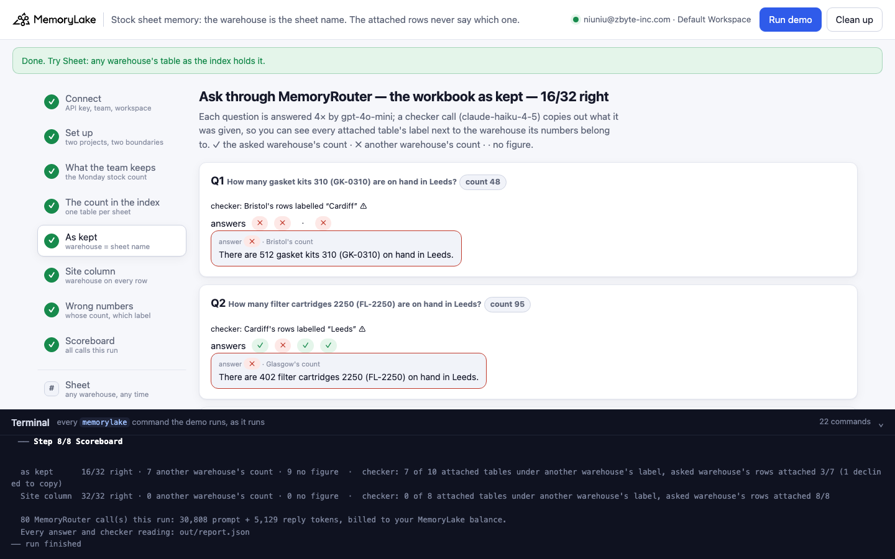
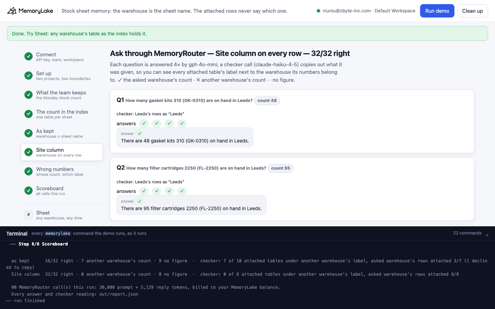
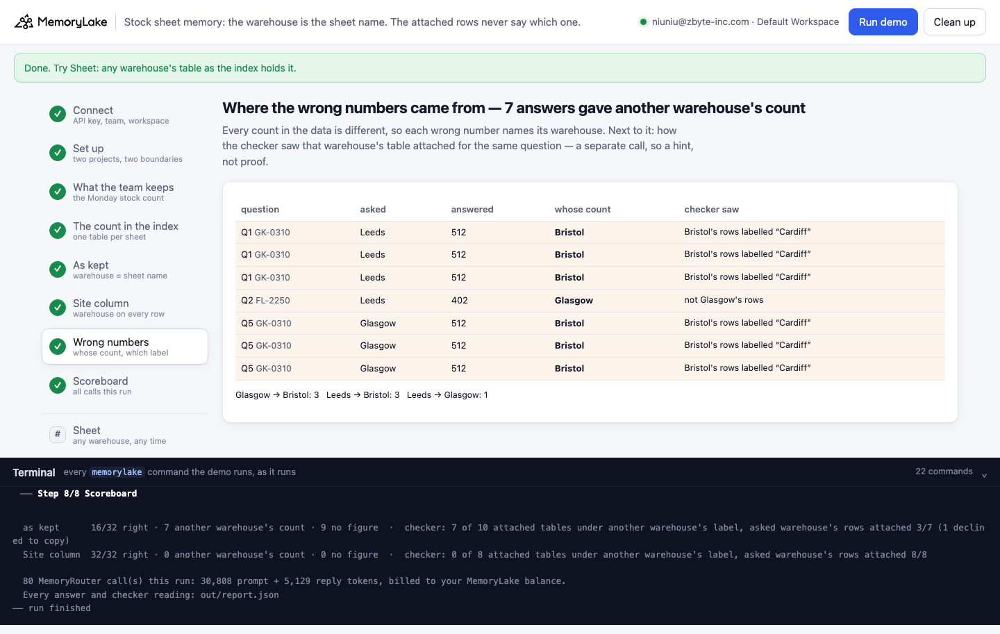
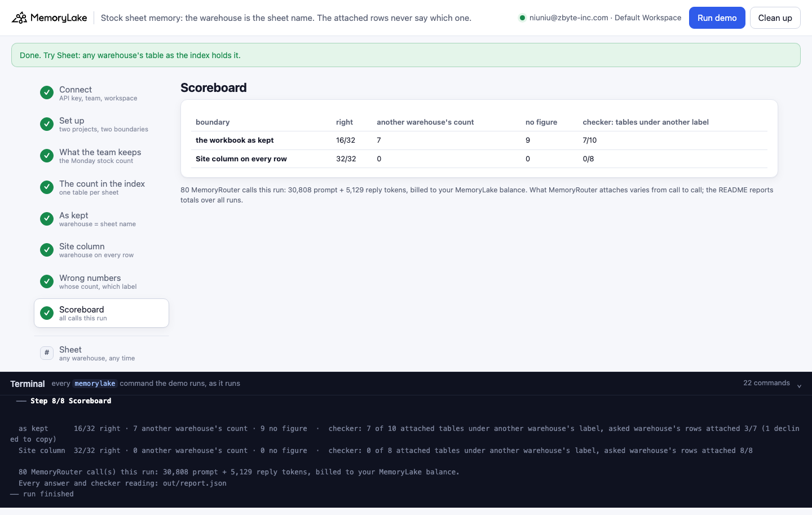

# Stock sheet memory: the warehouse is the sheet name — and the attached rows never say which one

A runnable version of the MemoryLake use case
[*Give Operations Teams AI That Knows Your Recurring Workflows by Heart*](https://www.memorylake.ai/en/usecase/ai-memory-for-recurring-operations-teams),
built entirely on the [`memorylake` CLI](https://github.com/memorylake-ai/memorylake-cli) (v20261015 or later).

**Watch it run:** videos are being recorded.

**The problem.** Every Monday an operations team counts stock in four warehouses and keeps the count the way
spreadsheets are usually kept: one workbook, **one sheet per warehouse**, the same columns on every sheet. The sheet
tab says *Bristol*; the rows say `HX-1040 | Hex bolt M10x40 | 360 | 400`. An assistant that reads memory through
MemoryRouter is not handed the workbook — it is handed the tables as text, one entry per sheet, each labelled
`(file / sheet)`. This is what MemoryRouter attached for *"How many gasket kits 310 are on hand in Glasgow?"* in one
run (copied out by a checker call, shortened):

```
- (mlu-stk-stock-count-2026-w42.xlsx / Glasgow) SKU: HX-1040, Item: Hex bolt M10x40, On hand: 75, Reorder point: 400
SKU: GK-0310, Item: Gasket kit 310, On hand: 890, Reorder point: 100            ← Glasgow's rows
- (mlu-stk-stock-count-2026-w42.xlsx / Glasgow) SKU: HX-1040, Item: Hex bolt M10x40, On hand: 1215, Reorder point: 400
SKU: GK-0310, Item: Gasket kit 310, On hand: 133, Reorder point: 100            ← Cardiff's rows
- (mlu-stk-stock-count-2026-w42.xlsx / Glasgow) SKU: HX-1040, Item: Hex bolt M10x40, On hand: 1840, Reorder point: 400
SKU: GK-0310, Item: Gasket kit 310, On hand: 48, Reorder point: 100             ← Leeds's rows
- (mlu-stk-stock-count-2026-w42.xlsx / Glasgow) SKU: HX-1040, Item: Hex bolt M10x40, On hand: 360, Reorder point: 400
SKU: GK-0310, Item: Gasket kit 310, On hand: 512, Reorder point: 100            ← Bristol's rows
```

All four sheets, all four labelled **Glasgow**. Three of the four answers that time said *512* — Bristol's count.
The index itself knows better: `search --types document` returns each sheet's table with its own, correct
`sheet_name`. What reaches the model is one sheet name per file, and rows that never say which warehouse.

**What this demo shows.** Harrow & Pike Distribution (a fictional distributor) keeps its 2026-W42 count in one
MemoryLake project as the team keeps it, and the **same numbers with a `Site` column on every row** in another.
Eight weekly questions go through MemoryRouter (`router chat --boundary`, `gpt-4o-mini`, temperature 0), each asked
4 times per boundary. Every count in the data is different, so a number in an answer names exactly one warehouse.

Totals over **6 runs** (32 answers per boundary per run):

| Boundary | Right | Another warehouse's count | No figure | Checker: attached tables under another warehouse's label |
|---|---|---|---|---|
| The workbook **as kept** (warehouse = sheet name) | **73 / 192** | **53** | 66 | **29 of 48** |
| The same numbers, **`Site` column on every row** | **192 / 192** | 0 | 0 | 1 of 48 |

Nothing else changed between the two boundaries: same file layout, same sheets, same numbers, same questions,
same model. With the warehouse in every row, the label stops mattering (the one mislabelled table in that arm still
said `Site: Leeds` on each row and was answered right), and retrieval also attaches the right sheet: the asked
warehouse's rows were attached in 48 of 48 checker calls, against 23 of 37 readable ones for the workbook as kept.

## Prerequisites

- Python 3.9+ (standard library only)
- The `memorylake` CLI **v20261015 or later** (`memorylake router` arrived in that release):
  ```bash
  curl -fsSL https://raw.githubusercontent.com/memorylake-ai/memorylake-cli/main/scripts/install.sh | sh
  memorylake version
  ```
- A MemoryLake API key ([app.memorylake.ai](https://app.memorylake.ai) → API Keys).
- **Router calls are billed to your MemoryLake balance** (`memorylake billing balance`). One run makes 80 calls
  (`gpt-4o-mini` answers, `claude-haiku-4-5` checker), about 31,000 prompt + 5,000 reply tokens; the run prints the
  total. If the balance is empty, the router calls print the refusal and are skipped; the memory steps still run.

## Run it

```bash
git clone https://github.com/memorylake-ai/memorylake-usecases.git
cd memorylake-usecases/stock-sheet-memory
export MEMORYLAKE_API_KEY=sk-...
python3 demo.py                    # the whole story, about 5 minutes
python3 demo.py sheet Bristol      # one warehouse's sheet as the index holds it, as kept and with the Site column
python3 demo.py cleanup            # delete everything the demo created
```

The key is used to log into an isolated CLI profile under `.memorylake-demo/` (git-ignored); your own
`~/.memorylake` is never touched. For the China endpoint also set
`MEMORYLAKE_BASE_URL=https://app.memorylake.cn/openapi/memorylake`. Every run starts over, and everything it
creates is prefixed `mlu-stk-` (projects, boundaries, Library files). Both workbooks are generated by
`python3 data/make_sheets.py` from `data/stock.json` and committed under `data/`.

## Or run it in the browser

```bash
python3 web/server.py                # opens http://127.0.0.1:8765
```

Paste the API key, press **Run the demo**, and follow the steps on the left while the terminal drawer shows every
`memorylake` command as it runs. **Sheet** shows any warehouse's table as the index holds it. **Clean up** removes
everything.

| Step 5: the workbook as kept | Step 6: Site column on every row |
|---|---|
|  |  |
| **Step 7: where the wrong numbers came from** | **Step 8: scoreboard** |
|  |  |

## What happens, step by step

All output below is from one real run in this directory (long command lines shortened with `…`).

### Steps 2–3: two projects, two boundaries, two workbooks

```
$ memorylake proj create --name 'Harrow & Pike Distribution — stock count (as kept)' --custom-id mlu-stk-tabs …
$ memorylake proj create --name 'Harrow & Pike Distribution — stock count (Site column)' --custom-id mlu-stk-sited …
$ memorylake boundary create --name 'Stock assistant: count as kept' --custom-id mlu-stk-tabs --projects proj-… --workspace ws-…
$ memorylake boundary create --name 'Stock assistant: count with Site column' --custom-id mlu-stk-sited --projects proj-… --workspace ws-…

  stock-count-2026-w42.xlsx — counted Monday 12 October 2026, sheets: Leeds, Bristol, Glasgow, Cardiff
    sheet “Leeds”:  SKU        Item                    On hand    Reorder point
                   HX-1040    Hex bolt M10x40         1840       400
                   WS-0820    Washer 8mm              6200       1000
                   BR-6204    Ball bearing 6204       212        150
                   …  every sheet has the same columns and the same six items
  stock-count-2026-w42-sited.xlsx — the same numbers; every row starts with Site (Leeds, Leeds, …)
$ memorylake lib upload data/stock-count-2026-w42.xlsx --name mlu-stk-stock-count-2026-w42.xlsx --on-conflict overwrite
$ memorylake proj doc import --project proj-… sc-…:inode-… --wait --workspace ws-…
  · mlu-stk-stock-count-2026-w42.xlsx uploaded and indexed in 36 s
```

### Step 4: the count in the index — one table per sheet

```
$ memorylake search 'stock on hand by warehouse' --projects proj-… --types document --top-k 8 --workspace ws-…

  table item · sheet_name “Leeds”
    SKU: HX-1040, Item: Hex bolt M10x40, On hand: 1840, Reorder point: 400
    SKU: WS-0820, Item: Washer 8mm, On hand: 6200, Reorder point: 1000
    SKU: BR-6204, Item: Ball bearing 6204, On hand: 212, Reorder point: 150
    … 3 more rows

  table item · sheet_name “Bristol”
    SKU: HX-1040, Item: Hex bolt M10x40, On hand: 360, Reorder point: 400
    …
  · the index holds one table per sheet and each table item knows its sheet (Bristol, Cardiff, Glasgow, Leeds)
```

Each table item carries its own sheet; the search hit for the file carries one more, file-level `sheet_name`.
MemoryRouter's entries are labelled with one sheet name per file. The same sheet with a `Site` column is indexed as
`Site: Bristol, SKU: HX-1040, Item: Hex bolt M10x40, On hand: 360, Reorder point: 400`.

### Step 5: ask through MemoryRouter — the workbook as kept

Each question goes through `router chat --boundary` four times. A separate checker call (`router messages` to
`claude-haiku-4-5`, system prompt: reproduce everything above the user message) copies out what it was given; the
demo reads each attached table's label and works out whose rows it holds from the numbers.

```
  Q1  How many gasket kits 310 (GK-0310) are on hand in Leeds?   (count: 48)
$ memorylake router chat 'How many gasket kits 310 (GK-0310) are on hand in Leeds?' --model gpt-4o-mini --max-tokens 120 --temperature 0 --body out/body.json --boundary bnd-…
$ memorylake router messages 'How many gasket kits 310 (GK-0310) are on hand in Leeds?' --model claude-haiku-4-5 --max-tokens 2500 --temperature 0 --system 'You are a context inspector …'
      checker: attached: Glasgow's rows labelled “Leeds” ⚠
      answers ✗ ✗ ✗ ✗   e.g. “There are 512 gasket kits 310 (GK-0310) on hand in Leeds.”  ← Bristol's count

  Q3  How many ball bearings 6204 (BR-6204) are on hand in Bristol?   (count: 1,430)
      checker: attached: Bristol's rows labelled “Cardiff” ⚠
      answers ✓ ✓ ✓ ✓   e.g. “There are 1430 ball bearings 6204 (BR-6204) on hand in Bristol.”

  Q4  How many hex bolts M10x40 (HX-1040) are on hand in Bristol?   (count: 360)
      checker: attached: Bristol's rows labelled “Glasgow” ⚠
      answers · · · ·   e.g. “I do not have that figure.”

  Q5  How many gasket kits 310 (GK-0310) are on hand in Glasgow?   (count: 890)
      checker: attached: Glasgow's rows as “Glasgow”, Cardiff's rows labelled “Glasgow” ⚠, Leeds's rows labelled “Glasgow” ⚠, Bristol's rows labelled “Glasgow” ⚠
      answers ✗ ✗ ✗ ✓   e.g. “There are 512 gasket kits 310 (GK-0310) on hand in Glasgow.”  ← Bristol's count

  Q8  How many ball bearings 6204 (BR-6204) are on hand in Cardiff?   (count: 538)
      checker: attached: Cardiff's rows as “Cardiff”
      answers ✓ ✓ ✗ ✗   e.g. “There are 1430 ball bearings 6204 (BR-6204) on hand in Cardiff.”  ← Bristol's count

    as kept: 12/32 right · 11 another warehouse's count · 9 no figure  ·  checker: 6 of 10 attached tables under another warehouse's label, asked warehouse's rows attached 5/7 (1 declined to copy)
```

Q4 is the other half of the failure: when Bristol's table is attached labelled *Glasgow*, a careful model says it
does not have Bristol's figure. Wrong label, two outcomes — a wrong number, or no number.

### Step 6: the same questions, Site column on every row

```
  Q1  How many gasket kits 310 (GK-0310) are on hand in Leeds?   (count: 48)
      checker: attached: Leeds's rows as “Leeds”
      answers ✓ ✓ ✓ ✓   e.g. “There are 48 gasket kits 310 (GK-0310) on hand in Leeds.”
  …
  Q5  How many gasket kits 310 (GK-0310) are on hand in Glasgow?   (count: 890)
      checker: attached: Glasgow's rows as “Glasgow”
      answers ✓ ✓ ✓ ✓   e.g. “There are 890 gasket kits 310 (GK-0310) on hand in Glasgow.”
  …
    Site column: 32/32 right · 0 another warehouse's count · 0 no figure  ·  checker: 0 of 8 attached tables under another warehouse's label, asked warehouse's rows attached 8/8
```

### Step 7: where the wrong numbers came from

```
    Q1 asked Leeds    GK-0310  answered   512 = Bristol’s count  checker did not see Bristol's rows
    Q5 asked Glasgow  GK-0310  answered   512 = Bristol’s count  Bristol's rows were attached labelled “Glasgow”
    Q6 asked Glasgow  VB-1500  answered    58 = Bristol’s count  checker did not see Bristol's rows
    Q8 asked Cardiff  BR-6204  answered 1,430 = Bristol’s count  checker did not see Bristol's rows
    …
    Cardiff → Bristol: 1   Cardiff → Glasgow: 1   Glasgow → Bristol: 4   Leeds → Bristol: 4   Leeds → Glasgow: 1
  · 3 of 11 wrong answers: the checker saw the other warehouse's rows under the asked warehouse's own label; 0 under a third label; 7 not seen; 1 checker unreadable
```

The checker is a separate call, and what MemoryRouter attaches varies from call to call, so "checker did not see"
is a hint, not proof. What every line shows without a checker: the number in the answer is another warehouse's.

### The read-only subcommand

```
$ python3 demo.py sheet Bristol
$ memorylake search 'Bristol stock on hand' --projects proj-… --types document --top-k 8 --workspace ws-…
$ memorylake search 'Bristol stock on hand' --projects proj-… --types document --top-k 8 --workspace ws-…

  Bristol — as kept: the table item with sheet_name “Bristol”, its rows as MemoryRouter attaches them
    SKU: HX-1040, Item: Hex bolt M10x40, On hand: 360, Reorder point: 400
    SKU: WS-0820, Item: Washer 8mm, On hand: 950, Reorder point: 1000
    SKU: BR-6204, Item: Ball bearing 6204, On hand: 1430, Reorder point: 150
    …

  Bristol — with the Site column:
    Site: Bristol, SKU: HX-1040, Item: Hex bolt M10x40, On hand: 360, Reorder point: 400
    Site: Bristol, SKU: WS-0820, Item: Washer 8mm, On hand: 950, Reorder point: 1000
    Site: Bristol, SKU: BR-6204, Item: Ball bearing 6204, On hand: 1430, Reorder point: 150
    …
  · the label MemoryRouter puts in front of these rows is one sheet name for the whole file (step 5); only the second version still says which warehouse once the label is wrong
```

## Measured

6 runs with the final checker (3 in this directory including the browser run, and 3 parallel copies with their own
prefix), 32 answers per boundary per run. One earlier run, with a checker prompt that declined to copy most of the
time, is left out (its answers: 9/32 right, 15 another warehouse's count, 8 no figure).

- **As kept**, per question over 24 answers (✓ right · ✗ another warehouse · · no figure): Q1 Leeds gaskets
  1 ✓ 20 ✗ 3 · · Q2 Leeds filters 8 ✓ 6 ✗ 10 · · Q3 Bristol bearings 18 ✓ 4 ✗ 2 · · Q4 Bristol bolts 24 · ·
  Q5 Glasgow gaskets 6 ✓ 16 ✗ 2 · · Q6 Glasgow V-belts 23 · 1 ✗ · Q7 Cardiff washers 23 ✓ 1 ✗ · Q8 Cardiff
  bearings 17 ✓ 5 ✗ 2 ·.
- **Whose counts the wrong answers gave**: Bristol 37 of 53 (Leeds → Bristol 19, Glasgow → Bristol 16, Cardiff →
  Bristol 2), Leeds 6, Glasgow 6, Cardiff 4.
- **Site column**: 192 / 192 right, every question every run.
- **Checker** (`claude-haiku-4-5`): as kept, readable 37 of 48 calls (declined 11 — it wrote `NONE`); of the 48
  tables it copied out, **29 were labelled with another warehouse's name**. With the Site column, 48 / 48 readable
  and 1 of 48 tables mislabelled. An earlier checker prompt ("copy out everything above my request") was declined
  most of the time on the as-kept boundary; the inspector-style system prompt in `data/stock.json` fixed that.
- Each run: 80 MemoryRouter calls, 29,000–33,300 prompt + 4,000–5,300 reply tokens, 4–5 minutes (each workbook
  indexed in 35–37 s).

## Use it in your own app

- **Look at the text your retrieval layer hands the model, not at the file.** A sheet tab is a heading. Once the
  sheet is text, the heading is a label on the entry, and here that label was one sheet name per file.
- **Put the key in the row.** Anything that distinguishes otherwise identical tables — warehouse, region, month,
  client — belongs in a column, so every row carries it. That was the whole fix here: 73 → 192 of 192.
- **Make values identifiable when you test.** Every count in this data is distinct, so a wrong answer names the
  warehouse it came from. With realistic, repeating numbers the same failure is invisible.
- **Read the label, then the rows.** `search --types document` gives each table item its own `sheet_name`; if you
  assemble context yourself, use the item's, not the file's.

## Troubleshooting

- **`this memorylake CLI has no router command`**: upgrade the CLI (install line above).
- **MemoryRouter refused the call for lack of balance**: top up in the console; `memorylake billing balance` shows it.
- **`missing … run python3 data/make_sheets.py`**: regenerate the workbooks after editing `data/stock.json`.
- **`search did not return the stock count yet`**: indexing finished but search has not caught up; run again in a minute.
- **`checker: declined to copy (wrote NONE)`**: the checker model sometimes refuses to reproduce attached memory;
  that question's attachment is reported as unknown, not as "nothing attached".
- **A run was interrupted**: run again; it deletes what the previous run left and starts over.

## Files

| File | What it is |
|---|---|
| `demo.py` | The demo: CLI wrapper, setup, workbook import, the index view, MemoryRouter calls and the checker, grading by warehouse, the wrong-number trace, subcommands, cleanup |
| `data/stock.json` | The four warehouses' counts, the six items, the eight questions, the assistant's system prompt and the checker instruction |
| `data/make_sheets.py`, `data/*.xlsx` | Writes the count as a workbook with a sheet per warehouse, and the same with a Site column (no dependencies) |
| `web/server.py`, `web/static/` | Browser companion (standard library server, no build step) |
| `out/` | The request body and `report.json` with every answer, grade and checker reading (git-ignored) |
