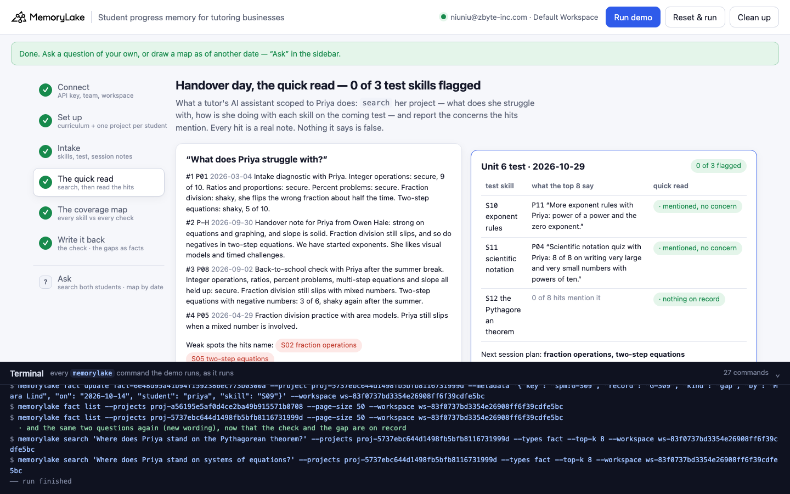
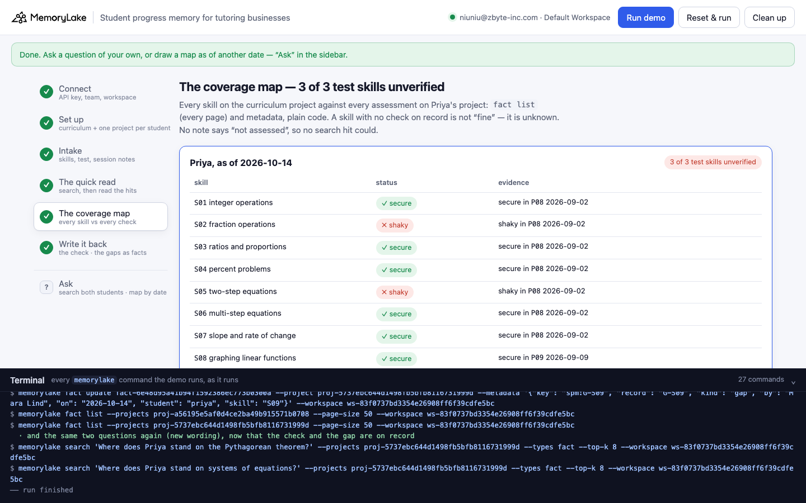

# Student progress memory for tutoring businesses

A runnable version of the MemoryLake use case
[*Give Tutoring Businesses Student Progress Memory That Holds Across Tutors and Sessions*](https://www.memorylake.ai/en/usecase/student-progress-memory-for-tutoring-businesses),
built entirely on the [`memorylake` CLI](https://github.com/memorylake-ai/memorylake-cli).

**Watch it run:** [CLI, 3:05](https://github.com/memorylake-ai/memorylake-usecases/releases/download/student-progress-memory-v1/student-progress-memory-cli-demo.mp4) · [Web, 4:20](https://github.com/memorylake-ai/memorylake-usecases/releases/download/student-progress-memory-v1/student-progress-memory-web-demo.mp4)
([release](https://github.com/memorylake-ai/memorylake-usecases/releases/tag/student-progress-memory-v1); GitHub serves them as downloads).

**The problem.** When a tutor leaves, the new tutor (or their AI assistant) reads what the old one wrote down. Session
notes record what *happened*: what was practiced, what was checked, what went wrong. They never record what *didn't*
happen. So a search over them can only ever surface concerns someone noted. A skill that was practiced but never checked,
checked once before the summer, or never touched at all produces no hit, and "no hit" reads as "no concern". Every answer
is true. The handover is still blind.

**What this demo shows.** Larkspur Learning (fictional) tutors grade 8 math. Priya Raman has had a weekly session with
Owen Hale since March. Owen left on September 30; Mara Lind takes Priya over today, October 14. Priya's school has a
**Unit 6 test on October 29**: exponent rules, scientific notation, the Pythagorean theorem.

Every session note, Owen's handover note, the grade 8 skill list and the test syllabus are MemoryLake facts, word for word,
with metadata: who wrote it, when, which skills a session **assessed** (`S10=secure`, `S02=shaky`) and which it only
**practiced**. The same memory, read two ways:

| Read | Test skills flagged | What it says |
|---|---|---|
| **The quick read** — `search` Priya's project ("what does she struggle with?", "how is she doing with \<skill\>?") and report what the hits say | **0 of 3** | Weak spots: fraction division, two-step equations with negatives (both real). Exponents "mentioned, no concern", scientific notation "8 of 8, secure", Pythagorean theorem "0 of 8 hits mention it" |
| **The coverage map** — every skill on the curriculum project against every assessment on record (`fact list` + metadata, plain code) | **3 of 3 unverified** | Exponent rules **practiced, never checked**; scientific notation **last checked 176 days ago**, before the summer; Pythagorean theorem **never assessed** |

And the control: **Leo**, the same tutor and the same test, whose notes *do* cover it. Both readings agree on Leo (the
Pythagorean theorem is shaky, nothing else) — the map is not crying wolf; it disagrees only where the records are silent.

Then it is written back: Mara's 15-minute check is pinned like every other note — the secure result too — and every skill
still never assessed becomes a fact that says so. The map now shows 0 of 3 unverified (1 secure, 2 shaky), and asking about
systems of equations finds the gap instead of other skills' notes.

```
setup ──────── proj create  curriculum · priya · leo
intake ─────── fact add --project <p> '<note>' …   + fact update --metadata {by, on, assessed: [S10=secure …], practiced: [S10 …]}
quick read ─── search 'What does Priya struggle with?' / 'How is Priya doing with <skill>?' --projects <priya>  → read the hits
coverage map ─ fact list --projects <curriculum>, <priya>  → every skill × every assessment: secure · shaky · checked long ago · practiced, never checked · never assessed
control ────── the same two readings of Leo
write back ─── fact add '<the 15-minute check>' (assessed metadata) · fact add '<skill>, <student>: not assessed yet' (kind: gap)
```

No conversations and no extraction: every record is pinned word for word, and the coverage map is plain code over
`fact list` and metadata — the same memory gives the same map every time.

## Prerequisites

- **Python 3.9+** (standard library only, nothing to `pip install`)
- **The `memorylake` CLI** on your `PATH`:
  ```bash
  curl -fsSL https://raw.githubusercontent.com/memorylake-ai/memorylake-cli/main/scripts/install.sh | sh
  ```
- **A MemoryLake API key.** Sign up at [app.memorylake.ai](https://app.memorylake.ai), open **API Keys**, create one. A free
  personal account is enough: nothing here needs an agent or a model call.

## Run it

```bash
git clone https://github.com/memorylake-ai/memorylake-usecases.git
cd memorylake-usecases/student-progress-memory
export MEMORYLAKE_API_KEY=sk-...           # China region: also export MEMORYLAKE_BASE_URL=https://app.memorylake.cn/openapi/memorylake
python3 demo.py
```

About a minute and a half the first time (three projects, 33 facts, each with its metadata), about a minute on a re-run,
which reads back what is already there. With the key set, the demo logs into an isolated CLI profile under
`./.memorylake-demo/` and never touches your own `~/.memorylake`. Everything it creates has a `custom_id` starting with
`mlu-spm-`.

```bash
python3 demo.py map leo                                              # the coverage map of the control student
python3 demo.py map priya 2026-06-12                                 # Priya's map as of any date
python3 demo.py ask "How is Priya doing with systems of equations?"  # search's top 8 across both students
python3 demo.py --reset                                              # delete everything the demo created, then replay
python3 demo.py cleanup                                              # delete everything the demo created
```

## Or run it in the browser

```bash
python3 web/server.py                # opens http://127.0.0.1:8765
```

Paste the key, connect, run. The page drives the same functions as `demo.py` and streams every `memorylake` command into a
terminal drawer as it runs: the projects, every note with its metadata, the quick read, the coverage map with Leo's control
next to it, and the write-back. **Ask** takes any question across both students, or draws either student's coverage map as
of a date.





## What happens, step by step

Output below is from a real run (ids shortened).

### Steps 2–3 — a curriculum project, one project per student; every record, one fact each

The curriculum project holds the 12 grade 8 skills (`S01`–`S12`) and the Unit 6 test syllabus. Each student's project
holds their session notes and the handover note. One `fact add` per project (it takes many texts at once), then
`fact update --metadata` on each fact (`fact add` takes no metadata):

```
$ memorylake fact add --project proj-…d459d549 'Intake diagnostic with Priya. Integer operations: secure, 9 of 10. …' …
$ memorylake fact update fact-…92dbfeb0 --project proj-…d459d549 --metadata '{"key": "spm:P01", "record": "P01", "kind": "session", "by": "Owen Hale", "on": "2026-03-04", "student": "priya", "assessed": ["S01=secure", "S03=secure", "S04=secure", "S02=shaky", "S05=shaky"]}'
```

Owen's handover note (P-H, 2026-09-30), word for word:

> Handover note for Priya from Owen Hale: strong on equations and graphing, and slope is solid. Fraction division still
> slips, and so do negatives in two-step equations. We have started exponents. She likes visual models and timed challenges.

### Step 4 — handover day, the quick read

What a tutor's AI assistant scoped to Priya does: search her project, then report what the hits say. A sentence that names
a skill next to a weakness word ("slips", "shaky", "cannot" …) is a concern; a mention without one is "no concern"; no
mention at all is "nothing on record".

```
  “What does Priya struggle with?” · top 8:
      #1  P01  2026-03-04  Intake diagnostic with Priya. Integer operations: secure, 9 of 10. Ratios and proportions: …
      #2  P-H  2026-09-30  Handover note for Priya from Owen Hale: strong on equations and graphing, and slope is soli…
      #3  P08  2026-09-02  Back-to-school check with Priya after the summer break. Integer operations, ratios, percent…
      #4  P05  2026-04-29  Fraction division practice with area models. Priya still slips when a mixed number is invol…
  → weak spots the hits name: S02 fraction operations (P01); S05 two-step equations (P01)

  the Unit 6 test (2026-10-29), one search per skill:
    S10 exponent rules                 · mentioned, no concern    P11 “More exponent rules with Priya: power of a power and the ze…”
    S11 scientific notation            · mentioned, no concern    P04 “Scientific notation quiz with Priya: 8 of 8 on writing very…”
    S12 the Pythagorean theorem        · nothing on record        0 of 8 hits mention it

  → the quick read: 0 of 3 test skills flagged; next session plan: fraction operations, two-step equations
```

`search` always returns its top 8, relevant or not: the Pythagorean question gets eight notes about other skills.

### Step 5 — the coverage map

Every skill on the curriculum project against every assessment on Priya's project — `fact list` (every page) and the
`assessed` / `practiced` metadata. A skill whose last check is shaky is **shaky**; secure but more than 90 days old is
**checked long ago**; practiced with no check is **practiced, never checked**; nothing at all is **never assessed**.

```
    skill                              status                             evidence
    S01 integer operations             ✓ secure                           secure in P08 2026-09-02
    S02 fraction operations            ✗ shaky                            shaky in P08 2026-09-02
    …
    S09 systems of equations           ? never assessed                   no assessment on record
    S10 exponent rules                 ? practiced, never checked         practiced in P10 2026-09-16, P11 2026-09-23; no check on record  ← on the test
    S11 scientific notation            ? checked long ago                 secure in P04 2026-04-21 — 176 days ago, before the summer  ← on the test
    S12 the Pythagorean theorem        ? never assessed                   no assessment on record  ← on the test

  → Priya, as of 2026-10-14: 6 secure · 2 shaky · 1 checked long ago · 1 practiced, never checked · 2 never assessed
  → coverage: 3 of 3 Unit 6 test skills unverified (S10 practiced, never checked; S11 checked long ago; S12 never assessed)
  → the quick read flagged 0 of 3; 3 unverified test skill(s) it could not see:
      S10 exponent rules             quick read: · mentioned, no concern    map: practiced, never checked
      S11 scientific notation        quick read: · mentioned, no concern    map: checked long ago
      S12 the Pythagorean theorem    quick read: · nothing on record        map: never assessed

    Leo — the quick read:   S10 · mentioned, no concern; S11 · mentioned, no concern; S12 ✗ concern noted
    Leo — the coverage map: S10 ✓ secure; S11 ✓ secure; S12 ✗ shaky
  → Leo: the two readings agree — 1 flagged by the quick read, 1 shaky and 0 unverified on the map
```

### Step 6 — write it back

Mara's 15-minute check is pinned like any other note, with `assessed` metadata — the secure result too, so "secure" is
something on record, not an absence. Every skill still never assessed (here: systems of equations, not on this test) gets a
fact that says so:

```
$ memorylake fact add --project proj-…d459d549 'Systems of equations (S09), Priya Raman: not assessed yet. No check on record since tutoring began on 2026-03-04. Not on the coming test; check before unit 5.'
$ memorylake fact update fact-…1926d8f4 --project proj-…d459d549 --metadata '{"key": "spm:G-S09", "record": "G-S09", "kind": "gap", "by": "Mara Lind", "on": "2026-10-14", "student": "priya", "skill": "S09"}'

  the coverage map again, test skills:
    S10 exponent rules                 ✓ secure                           secure in P13 2026-10-14
    S11 scientific notation            ✗ shaky                            shaky in P13 2026-10-14
    S12 the Pythagorean theorem        ✗ shaky                            shaky in P13 2026-10-14

  → coverage: 0 of 3 Unit 6 test skills unverified; 2 shaky (S11, S12)
  → next session plan: S11 scientific notation, S12 the Pythagorean theorem, S02 fraction operations, S05 two-step equations

  “Where does Priya stand on systems of equations?” · top 3 of 8:
      #1  G-S09 2026-10-14  Systems of equations (S09), Priya Raman: not assessed yet. No check on record since tutorin…
      #2  P-H   2026-09-30  Handover note for Priya from Owen Hale: strong on equations and graphing, and slope is soli…
      #3  P06   2026-05-13  Multi-step equations with variables on both sides: Priya scored 7 of 8. Secure.
  → G-S09 is hit #1
```

Two things about `search` that step 6 handles, both measured while building this demo:

- **A new fact is in `fact list` at once but reaches `search` a few seconds later.** Step 6 asks again (every 4 s, up to 8
  times) until the fact it just wrote comes back, and prints how many tries it took.
- **Asking the exact same question again can return the answer from before the write.** The same query text over the same
  project returned the pre-write top 8 for at least 17 minutes after the gap fact existed, while the same question with one
  letter lower-cased returned the gap first. So step 6 words its questions differently from step 4 ("Where does Priya stand
  on …" rather than "How is Priya doing with …"). If your assistant re-asks a question after writing, change the wording or
  read with `fact list`.

## Measured

| What | Result |
|---|---|
| Quick read 0 / 3 test skills flagged; coverage map 3 / 3 unverified (practiced / checked long ago / never); Leo's two readings agree | 7 / 7 runs (6 from scratch, including both recordings, and 1 re-run) |
| After the write-back: 0 / 3 unverified, 2 shaky | 7 / 7 |
| Search rank of the check note (P13) for the Pythagorean question | #1 in 7 / 7 |
| Search rank of the gap fact for the systems question | #1 in all 4 runs with the final gap wording; with earlier wordings: not in the top 8 once (asked before the index caught up), #1 once, #7 once |
| Time | 84–122 s from scratch, 52 s re-run |

The coverage map never depends on search. The search lines are what `search` returned; the demo prints whatever comes back.

## Wiring it into your own tutoring notes

- **Intake**: one fact per session note, verbatim (`fact add --project <student>`), with `assessed` (skill = result) and
  `practiced` (skill ids) in metadata. Ask tutors for those two fields at the end of every session; it takes ten seconds.
- **The denominator**: keep the skill list (and each test's syllabus) on its own project. Coverage is only measurable
  against a list of what *should* be known.
- **Handover**: draw the map (`coverage` in `demo.py`) before reading any notes. Treat "practiced, never checked", "checked
  long ago" and "never assessed" as unknowns to check in the first session, not as fine.
- **Write-back**: record checks with secure results too, and record gaps as facts, so that search — and anyone who only
  searches — finds them.

## If something goes wrong

- **`the memorylake CLI is not on PATH`**: install it (above) or `export MEMORYLAKE_BIN=/path/to/memorylake`.
- **Search results differ on your run**: ranking can move between runs. Steps 4 and 6 print exactly what came back; the
  coverage map does not depend on search.
- **Step 6 says a fact is "still not in the search results"**: the search index was slower than 30 s; run `python3 demo.py`
  again (it re-reads and does not write twice).
- **Something half-created after an interrupted run**: `python3 demo.py --reset`, or `python3 demo.py cleanup`.

## Files

```
student-progress-memory/
├── demo.py              # the CLI runner (every step is a plain `memorylake` command, echoed)
├── data/story.json      # 12 skills, the Unit 6 test, 2 students, 21 notes (fictional, plain ASCII)
├── web/server.py        # local web companion: same functions, Server-Sent Events
├── web/static/          # no-build front end
└── out/runs.jsonl       # one line per run (git-ignored)
```
