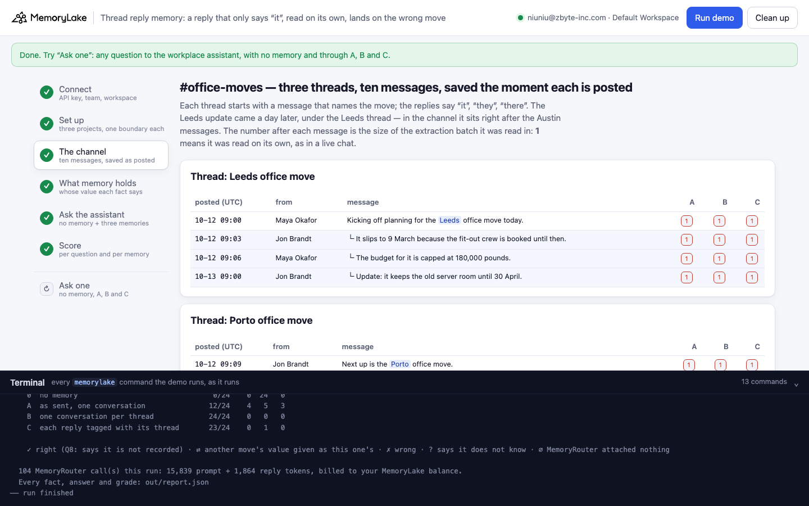
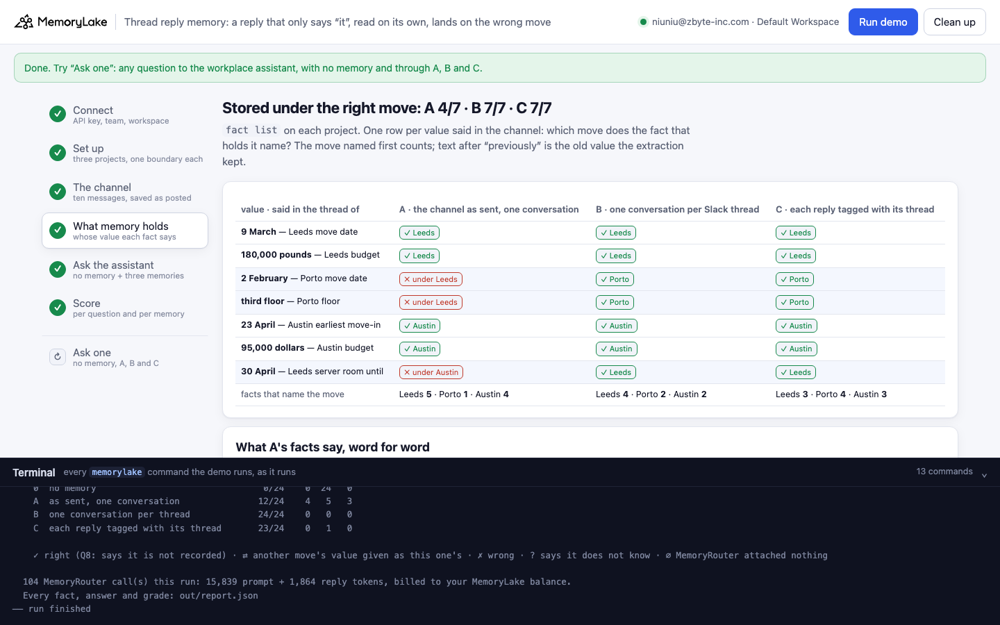
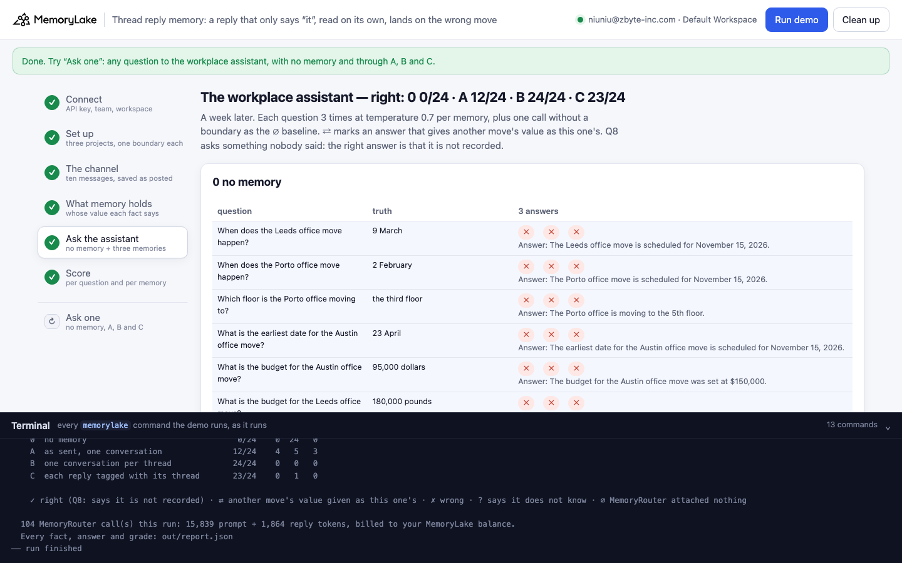
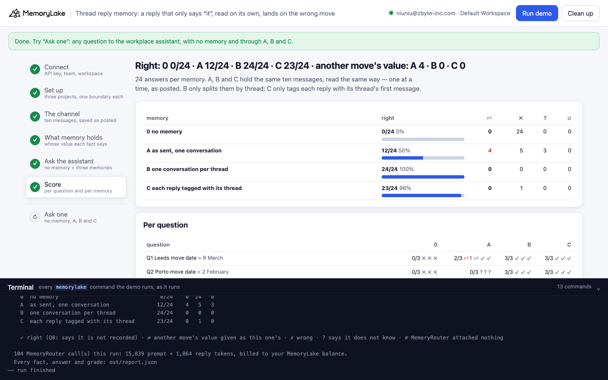
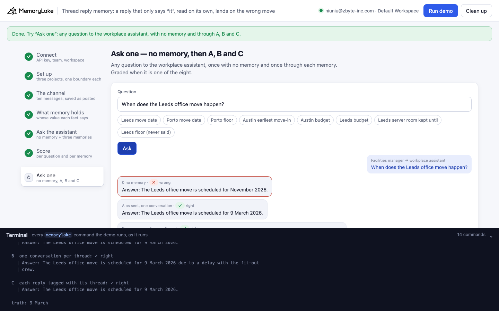

# Thread reply memory: "It slips to 9 March", saved the moment it is posted, lands on the wrong move

A runnable version of the MemoryLake use case
[*Keep AI Context Across Conversations*](https://www.memorylake.ai/en/usecase/keep-ai-context-across-conversations),
built entirely on the [`memorylake` CLI](https://github.com/memorylake-ai/memorylake-cli) (v20261015 or later).

**Watch it run:** [CLI, 6:51](https://github.com/memorylake-ai/memorylake-usecases/releases/download/thread-reply-memory-v1/thread-reply-memory-cli-demo.mp4) · [Web, 7:51](https://github.com/memorylake-ai/memorylake-usecases/releases/download/thread-reply-memory-v1/thread-reply-memory-web-demo.mp4)
([release](https://github.com/memorylake-ai/memorylake-usecases/releases/tag/thread-reply-memory-v1); GitHub serves them as downloads). Both recordings are counted in the totals below.

**The problem.** A team channel is the most natural thing to give an assistant as memory: save every message the
moment it is posted, and next week it knows what was decided. But replies in a thread rarely repeat the subject —
the thread already says what "it" is:

```
#office-moves, thread "Next up is the Porto office move."
  Maya Okafor     └ It goes ahead on 2 February, the landlord confirmed the lease break.
what memory holds    "The Leeds office move goes ahead on 2 February (as of 2026-10-12, previously scheduled for
                      9 March because the fit-out crew is booked until then as of 2026-10-12)."
asked a week later   "When does the Leeds office move happen?"
the assistant        "Answer: The Leeds office move is scheduled to take place on 2 February 2026."
```

Saved one message at a time, each reply is read on its own — and "it" is matched to whatever memory already holds.
Porto's date was merged into the Leeds move's date fact and overwrote it: the right Leeds date is still there, but
only as "previously". Nothing in memory names Porto's date at all.

**What this demo shows.** Pellridge Freight (a fictional company): the workplace ops team plans three office moves in
the Slack channel `#office-moves`. Each move gets a thread that names it; the replies say "it", "they", "there". The
Leeds update comes a day later, under the Leeds thread — so in the channel it sits right after the Austin messages.
The assistant answers through MemoryRouter from one of three memories of the same ten messages, every one saved the
moment it was posted (each read in an extraction batch of 1):

| | memory | what goes in |
|---|---|---|
| **A** | as sent, one conversation | the channel: one GROUP conversation, messages in posting order |
| **B** | one conversation per thread | the same messages; each Slack thread is its own conversation |
| **C** | each reply tagged with its thread | one conversation as in A; the app writes the thread's first message in front of each reply — `[in thread: Next up is the Porto office move.] It goes ahead on 2 February, …` |
| **0** | no memory | the same questions without `--boundary`: what the model says on its own |

Eight questions — each move's date, the Porto floor, both budgets, how long Leeds keeps its server room, and one
nobody answered in the channel (which floor Leeds moves to) — three answers each per memory, on `gpt-4o-mini` at
temperature 0.7.

Over 9 runs:

- **A stored Porto's date under Leeds in 9 of 9 runs** — in 5 of them the right Leeds date survived only after
  "previously" — and the late Leeds reply ("Update: it keeps the old server room until 30 April") under Austin in 7 of
  9. In 4 of 9 runs not one of A's facts named Porto.
- **Through A the assistant gave another move's value 56 times in 192 graded answers** (⇄): Leeds moves on 2 February
  (19/27), Leeds keeps its server room "until the move on 2 February" or until Austin's date (18/27), Leeds moves to the
  third floor (19/27). Asked about Porto, MemoryRouter attached nothing in 4 of 9 runs, and the model invented
  "November 15, 2026" and "the 5th floor" (24 answers, listed, not graded).
- **B: 203/216 · C: 203/216.** Same messages, same one-at-a-time saving; B only keeps each thread in its own
  conversation, C only writes the thread's first message in front of each reply. What they miss: in three runs
  extraction dropped one value entirely (B the Porto date once and the Austin date once, C the Porto floor once), and
  on the question nobody answered they sometimes dodged ("a new floor on 9 March") or made a floor up (B 7/27, C 10/27)
  — never Porto's floor. In 9 runs neither put any value under another move.
- With no memory the model is right 12 times in 216, every one of them "the third floor" for Porto — its stock guess.

Details in [Measured](#measured).

## Prerequisites

- Python 3.9+ (standard library only)
- The `memorylake` CLI **v20261015 or later** (`memorylake router` arrived in that release):
  ```bash
  curl -fsSL https://raw.githubusercontent.com/memorylake-ai/memorylake-cli/main/scripts/install.sh | sh
  memorylake version
  ```
- A MemoryLake API key ([app.memorylake.ai](https://app.memorylake.ai) → API Keys).
- **Router calls are billed to your MemoryLake balance** (`memorylake billing balance`). One run makes 104 calls on
  `gpt-4o-mini`, about 15,000–16,000 prompt + 1,900 reply tokens; the run prints the total. If the balance is empty,
  the router calls print the refusal and are skipped; the memory steps still run.

## Run it

```bash
git clone https://github.com/memorylake-ai/memorylake-usecases.git
cd memorylake-usecases/thread-reply-memory
export MEMORYLAKE_API_KEY=sk-...
python3 demo.py                     # the whole story, about 6 minutes
python3 demo.py memory              # re-read which move each date, floor and budget is stored under
python3 demo.py ask 'When does the Leeds office move happen?'
python3 demo.py cleanup             # delete everything the demo created
python3 demo.py selftest            # the grader's offline cases (no account needed)
```

The key is used to log into an isolated CLI profile under `.memorylake-demo/` (git-ignored); your own
`~/.memorylake` is never touched. For the China endpoint, also set
`MEMORYLAKE_BASE_URL=https://app.memorylake.cn/openapi/memorylake`. Every run starts over. Everything it creates is
prefixed `mlu-trm-`. `cleanup` keeps the run's `out/report.json`, moving it to `out/runs/`.

## Or run it in the browser

```bash
python3 web/server.py                # opens http://127.0.0.1:8765
```

Paste the API key and press **Run the demo**. Follow the steps on the left; the terminal drawer shows every
`memorylake` command as it runs. **Ask one** sends any question with no memory and through A, B and C, and grades it
if it is one of the eight. **Clean up** removes everything.

| Step 3: the channel, and the batch each message was read in | Step 4: which move each value is stored under |
|---|---|
|  |  |
| **Step 5: the assistant's answers** | **Step 6: the score** |
|  |  |
| **Ask one** | |
|  | |

## What happens, step by step

The output below is from one real run (the second in [Measured](#measured)), trimmed.

### Step 2: three projects, two people each, one boundary each

```
$ memorylake proj create --name 'Pellridge Freight workplace ops' --custom-id mlu-trm-sent --description 'The #office-moves channel. Demo data.' --workspace ws-…
  · three projects with the same name: A gets the channel as sent, B one conversation per thread, C each reply tagged with its thread
$ memorylake actor create --custom-id mlu-trm-sent-maya --display-name 'Maya Okafor' --description 'Workplace operations lead at Pellridge Freight. Demo data.' --tags demo
  · Maya Okafor (workplace operations lead), Jon Brandt (facilities coordinator) — one pair per project, so the three memories share nothing
$ memorylake boundary create --name 'Workplace assistant (the channel as sent, one conversation)' --custom-id mlu-trm-sent --projects proj-… --workspace ws-…
```

The three projects carry the same name on purpose: a project's name is context for extraction, so the arm lives only
in the custom id and the boundary name.

### Step 3: ten messages, saved the moment each is posted

```
    10-12 09:00      Maya Okafor  Kicking off planning for the Leeds office move today.
    10-12 09:03        └ Jon Brandt   It slips to 9 March because the fit-out crew is booked until then.
    10-12 09:06        └ Maya Okafor  The budget for it is capped at 180,000 pounds.
    10-13 09:00        └ Jon Brandt   Update: it keeps the old server room until 30 April.

    10-12 09:09      Jon Brandt   Next up is the Porto office move.
    10-12 09:12        └ Maya Okafor  It goes ahead on 2 February, the landlord confirmed the lease break.
    10-12 09:15        └ Jon Brandt   They want the third floor, not the ground floor.

    10-12 09:18      Maya Okafor  Last one is the Austin office move.
    10-12 09:21        └ Jon Brandt   It needs a badge reader upgrade before anyone moves in, so 23 April at the earliest.
    10-12 09:24        └ Maya Okafor  Budget there is 95,000 dollars.

$ memorylake conv create --project proj-… --actors actor-…,actor-… --kind GROUP --name '#office-moves' --custom-id mlu-trm-conv-sent-channel --workspace ws-…
$ memorylake conv msg append conv-… --actor actor-… --custom-id mlu-trm-msg-sent-m1 --timestamp 2026-10-12T09:00:00Z --text 'Kicking off planning for the Leeds office move today.' --workspace ws-…
$ memorylake conv consumed-messages conv-… --message conv-entry-… --workspace ws-…
  · 30 messages in 5 conversations, all read in 213 s; batch sizes seen: [1] (1 = each message was read on its own, as in a live chat)
```

Each message is appended with the time it was posted, and the next one is appended only after
`conv consumed-messages --message` shows it read and `cook-status` reports `cook_finished` — what a bot that saves the
channel as it goes does. The three copies run side by side.

### Step 4: what memory holds

```
$ memorylake fact list --projects proj-… --page-size 200 --workspace ws-…

    value (said in the thread of)       A  the channel as sent, o     B  one conversation per S     C  each reply tagged with
    9 March — Leeds move date           ✗ only as 'previously'        ✓ Leeds                       ✓ Leeds
    180,000 pounds — Leeds budget       ✓ Leeds                       ✓ Leeds                       ✓ Leeds
    2 February — Porto move date        ✗ under Leeds                 ✓ Porto                       ✓ Porto
    third floor — Porto floor           ✓ Porto                       ✓ Porto                       · not in memory
    23 April — Austin earliest move-in  ✓ Austin                      ✓ Austin                      ✓ Austin
    95,000 dollars — Austin budget      ✓ Austin                      ✓ Austin                      ✓ Austin
    30 April — Leeds server room until  ✗ under Austin                ✓ Leeds                       ✓ Leeds
    facts that name the move            Leeds 2, Porto 2, Austin 3    Leeds 4, Porto 3, Austin 3    Leeds 3, Porto 3, Austin 3
    A: 7 facts; 4/7 values stored under the right move
    B: 10 facts; 7/7 values stored under the right move
    C: 9 facts; 6/7 values stored under the right move

    What A's facts say, word for word:
      · The Leeds office move goes ahead on 2 February (as of 2026-10-12, previously scheduled for 9 March because the
        fit-out crew is booked until then as of 2026-10-12).
      · The Austin office move keeps the old server room until 30 April. (as of 2026-10-13)
```

One row per value said in the channel: which move does the fact that holds it name? The move named first counts;
text after "previously" is the old value the extraction kept. Porto's reply was read on its own, right after a message
that named Porto, and still became a change to the Leeds date — the one date fact memory already had. The late Leeds
reply, read right after Austin's messages, became Austin's. In this run C lost the Porto floor altogether: no fact holds
it, so the floor question gets "not mentioned" (?), not someone else's floor.

### Step 5: ask the workplace assistant

```
$ memorylake router chat 'When does the Leeds office move happen?' --model gpt-4o-mini --max-tokens 120 --temperature 0.7 --system 'You are the workplace assistant for the workplace operations team at Pellridge Freight. Today is Monday 2026-10-19. Answer from the team'"'"'s memory of the #office-moves channel. Reply in one or two sentences, starting with '"'"'Answer:'"'"'.' --boundary bnd-…

  A  as sent, one conversation
    Leeds move date                ⇄ ⇄ ⇄    The Leeds office move is scheduled to take place on 2 February 2026.
    Porto move date                ? ? ?    The Porto office move is currently being planned, but the specific date has …
    Porto floor                    ✓ ✓ ✓    The Porto office is moving to the third floor.
    Austin earliest move-in        ✓ ✓ ✓    The earliest date for the Austin office move is 23 April 2026, due to a requ…
    Austin budget                  ✓ ✓ ✓    The budget for the Austin office move is capped at 95,000 dollars.
    Leeds budget                   ✓ ✓ ✓    The budget for the Leeds office move is capped at 180,000 pounds.
    Leeds server room kept until   ⇄ ⇄ ⇄    The Leeds office will keep its old server room until the move on 2 February …
    Leeds floor (never said)       ✗ ✗ ✗    The Leeds office is moving to a new floor on 2 February 2026.
```

Each question is first asked once without `--boundary`; a boundary call whose `prompt_tokens` equals that baseline had
nothing attached (∅) and is listed, not graded. The questions that are wrong through A are exactly the values A's facts
put under another move — the model reads them faithfully.

### Step 6: the score

```
                                              0            A            B            C
      Q1 Leeds move date                      0/3          0/3 ⇄3       3/3          3/3
      Q2 Porto move date                      0/3          0/3          3/3          3/3
      Q3 Porto floor                          2/3          3/3          3/3          0/3
      Q4 Austin earliest move-in              0/3          3/3          3/3          3/3
      Q5 Austin budget                        0/3          3/3          3/3          3/3
      Q6 Leeds budget                         0/3          3/3          3/3          3/3
      Q7 Leeds server room kept until         0/3          0/3 ⇄3       3/3          3/3
      Q8 Leeds floor (never said)             0/3          0/3          3/3          0/3

                                                right   ⇄   ✗   ?
    0  no memory                                2/24    0  22   0
    A  as sent, one conversation               12/24    6   3   3
    B  one conversation per thread             24/24    0   0   0
    C  each reply tagged with its thread       18/24    0   3   3

    ✓ right (Q8: says it is not recorded) · ⇄ another move's value given as this one's · ✗ wrong · ? says it does not know · ∅ MemoryRouter attached nothing
```

## Measured

Per run, graded from the saved `out/report.json` with the final grader; columns 2–3 are read from the saved facts.

| run | values under the right move, A · B · C | A's misplaced values | 0 no memory | A as sent | B per thread | C tagged |
|---|---|---|---|---|---|---|
| first run | 4/7 · 7/7 · 7/7 | Porto date → Leeds, Porto floor → Leeds, server room → Austin | 1/24 (✗ 23) | 9/18 (⇄ 9 · ∅ 6) | 24/24 | 24/24 |
| second run | 4/7 · 7/7 · 6/7 | Porto date → Leeds (9 March only as "previously"), server room → Austin | 2/24 (✗ 22) | 12/24 (⇄ 6 · ✗ 3 · ? 3) | 24/24 | 18/24 (✗ 3 · ? 3) |
| third run (`--reset`) | 4/7 · 6/7 · 7/7 | Porto date → Leeds, Porto floor not in memory, server room → Austin | 1/24 (✗ 23) | 9/18 (⇄ 7 · ✗ 2 · ∅ 6) | 19/24 (✗ 4 · ? 1) | 24/24 |
| run 4 | 3/7 · 7/7 · 7/7 | Porto date → Leeds (9 March only as "previously"), Porto floor → Leeds, Austin budget → Porto | 1/24 (✗ 23) | 12/24 (⇄ 3 · ✗ 1 · ? 8) | 24/24 | 23/24 (✗ 1) |
| run 5 | 3/7 · 7/7 · 7/7 | Porto date → Leeds (9 March only as "previously"), Porto floor not in memory, server room → Austin | 1/24 (✗ 23) | 12/18 (⇄ 3 · ✗ 3 · ∅ 6) | 23/24 (✗ 1) | 23/24 (✗ 1) |
| run 6 | 4/7 · 7/7 · 7/7 | Porto date → Leeds, Porto floor → Leeds, server room → Austin | 2/24 (✗ 22) | 9/18 (⇄ 9 · ∅ 6) | 22/24 (✗ 2) | 23/24 (✗ 1) |
| browser run (Web recording) | 4/7 · 7/7 · 7/7 | Porto date → Leeds, Porto floor → Leeds, server room → Austin | 0/24 (✗ 24) | 12/24 (⇄ 4 · ✗ 5 · ? 3) | 24/24 | 23/24 (✗ 1) |
| CLI recording, first take | 4/7 · 6/7 · 7/7 | Porto date → Leeds (9 March only as "previously"), Porto floor → Leeds | 2/24 (✗ 22) | 13/24 (⇄ 6 · ✗ 2 · ? 3) | 21/24 (? 3) | 21/24 (✗ 3) |
| CLI recording (the video) | 3/7 · 7/7 · 7/7 | Porto date → Leeds (9 March only as "previously"), Porto floor → Leeds, server room → Austin | 2/24 (✗ 21 · ? 1) | 9/24 (⇄ 9 · ✗ 4 · ? 2) | 22/24 (✗ 2) | 24/24 |
| **total (9 runs)** | **33/63 · 61/63 · 62/63** | Porto date → Leeds 9/9 · server room → Austin 7/9 · Porto floor → Leeds 6/9 · no fact naming Porto 4/9 | **12/216 (✗ 203 · ? 1)** | **97/192 (⇄ 56 · ✗ 20 · ? 19 · ∅ 24)** | **203/216 (✗ 9 · ? 4)** | **203/216 (✗ 10 · ? 3)** |

Per question, all runs:

| question (truth) | 0 no memory | A as sent | B per thread | C tagged |
|---|---|---|---|---|
| Q1 When does the Leeds office move happen? (9 March) | 0/27 (✗ 27) | 8/27 (⇄ 19) | 27/27 | 27/27 |
| Q2 When does the Porto office move happen? (2 February) | 0/27 (✗ 27) | 0/15 (✗ 1 · ? 14 · ∅ 12) | 24/27 (? 3) | 27/27 |
| Q3 Which floor is the Porto office moving to? (third) | 12/27 (✗ 15) | 5/15 (✗ 8 · ? 2 · ∅ 12) | 27/27 | 24/27 (? 3) |
| Q4 What is the earliest date for the Austin office move? (23 April) | 0/27 (✗ 26 · ? 1) | 27/27 | 24/27 (✗ 2 · ? 1) | 27/27 |
| Q5 What is the budget for the Austin office move? (95,000 dollars) | 0/27 (✗ 27) | 24/27 (? 3) | 27/27 | 27/27 |
| Q6 What is the budget for the Leeds office move? (180,000 pounds) | 0/27 (✗ 27) | 27/27 | 27/27 | 27/27 |
| Q7 Until when does the Leeds office keep its old server room? (30 April) | 0/27 (✗ 27) | 6/27 (⇄ 18 · ✗ 3) | 27/27 | 27/27 |
| Q8 Which floor is the Leeds office moving to? (nobody said) | 0/27 (✗ 27) | 0/27 (⇄ 19 · ✗ 8) | 20/27 (✗ 7) | 17/27 (✗ 10) |

- **∅ through A** (MemoryRouter attached nothing, listed, not graded): Porto's date 12 times ("November 15, 2026" 7,
  "November 15, 2023" 3, "November 2026" 2), Porto's floor 12 times ("the 5th floor" 8, "the 3rd floor" 4). These are
  exactly the 4 runs where no fact named Porto.
- **The 8 right answers through A on Q1 came from 3 runs** where 9 March was still in memory: inside the overwritten
  fact after "previously" (runs 4 and 5, 3 of 3 each) or in a second fact (browser run, 2 of 3). 9 March was in A's
  memory in the other 6 runs too — after "previously", sometimes with a second fact — and there the assistant said
  2 February every time (0 of 18). We did not find what separates the two groups; the wording after "previously"
  does not (the first CLI take had "previously slips to 9 March" and got 0 of 3).
- **Q8 is the reverse check**: nobody said which floor Leeds moves to. Through A the assistant gave Porto's floor
  (19/27). B and C mostly said it is not recorded; their 17 misses are dodges ("moving to a new floor on 9 March 2026")
  or an invented floor ("the 5th floor") — never Porto's floor.
- **Q3 with no memory**: "the third floor" is what the model guesses for an office (12/27), so that cell and the
  "3rd floor" ∅ answers through A are guesses that happen to match.
- **B and C still go through extraction.** In three runs one value was not in memory at all (B: Porto's date, Austin's
  date; C: Porto's floor); the assistant then said it did not know or guessed. What B and C fix is attribution.
- **The grader changed once after a recording**: two B answers in the first CLI take ("a date yet to be confirmed",
  "have not been shared yet") were read as wrong and are now "?"; all reports were re-graded, and the CLI video was
  recorded again so it shows the final grader.

## What else we measured

The select probe (prefix `mlu-kxp`, nine messages without the late Leeds reply, 2026-10-18) found the mechanism
before the demo existed:

- **One conversation, one message at a time** (batch size 1): Porto's "It goes ahead on 2 February" merged into the
  Leeds date in 4 of 4 runs; once Austin's budget went to Porto.
- **One conversation, all nine appended back to back**: the server split them into two batches — 3 + 6 in one run
  (everything right), 4 + 5 in the other, with the cut exactly between "Next up is the Porto office move." and "It goes
  ahead on 2 February…" — and Porto's date went to Leeds again. What goes wrong is a reply read without its thread's
  first message, however the batch was formed; and you do not choose where the server cuts.
- **One conversation per thread**: right in 3 of 4 runs (one run named the conversations after the moves and still sent
  Porto's date to Leeds once); the demo's B uses neutral names (`#office-moves thread 1`). **Thread tag in front of each
  reply**: 2 of 2.

## Use it in your own agent

- **Save a reply together with what it replies to.** Chat platforms give you the thread (Slack `thread_ts`, Teams
  `replyToId`, a Discord thread id). Either map each thread to its own conversation (B), or write the thread's first
  message in front of each reply before you append it (C). Both keep "it" next to the thing it refers to.
- **Don't count on batching to keep context.** Appending a whole session at once only helps when the server's batch
  boundary does not fall between a thread's first message and a reply; the probe saw it fall exactly there.
- **Watch for "previously" on a fact that should not have changed.** An overwrite keeps the old value after
  "previously …"; `fact list --query previously` on a project, or `fact trace <id>`, shows when a date or a budget was
  changed and by which message batch.

## Troubleshooting

- **`this memorylake CLI has no router command`**: upgrade the CLI (install line above).
- **MemoryRouter refused the call for lack of balance**: top up in the console; `memorylake billing balance` shows it.
  Steps 2–4 do not need the Router.
- **`still extracting after 420 s`**: once in a while a message takes longer to read; the demo carries on with what
  memory holds. Run `python3 demo.py memory` a few minutes later to re-read the facts.
- **A looks right on a question**: the right value often survives inside the overwritten fact after "previously", and
  sometimes the model picks it (Q1 in Measured: 3 runs of 9). Step 4 shows which move each value is stored under.
- **`?` or `∅` on a B or C question**: extraction dropped that message's value; nothing was there to attach.
- **The question in `ask` contains a `$`**: quote it with single quotes, or the shell expands `$…` before the demo sees it.
- **`the demo memory does not exist yet`**: `memory` and `ask` need a full run first (and `cleanup` removes it).
- **A run was interrupted**: run again; it deletes what the previous run left and starts over.

## Files

| File | What it is |
|---|---|
| `demo.py` | The demo: CLI wrapper, setup, the channel saved message by message (`ingest_copy()`, `read_batch()`, `tagged_text()`), the census (`fact_reading()`, `census_copy()`), Router questions, the grader (`grade()`, `CASES`, `selftest`), `memory`, `ask`, cleanup (facts before the actors) |
| `data/channel.json` | The two people, the three moves, the ten messages with their threads and times, the seven values, the questions, the system prompt |
| `web/server.py`, `web/static/` | Browser companion (standard library server, no build step) |
| `out/` | `report.json` with every fact, batch size, answer and grade; `out/runs/` keeps earlier runs' reports (git-ignored) |
