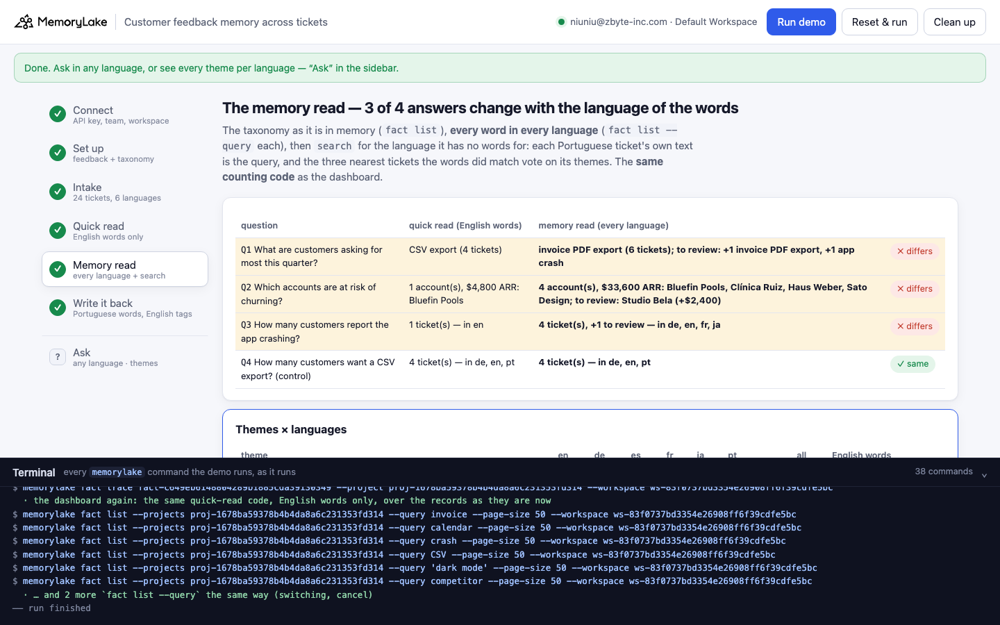

# Customer feedback memory across tickets

A runnable version of the MemoryLake use case
[*Give Support Teams Customer Feedback Memory That Reaches Product and Sales*](https://www.memorylake.ai/en/usecase/customer-feedback-memory-across-tickets),
built entirely on the [`memorylake` CLI](https://github.com/memorylake-ai/memorylake-cli).

**Watch it run:** (recording)

**The problem.** Support tickets are full of feedback that product and sales never see: feature requests, friction,
"we're looking at other providers". Keeping that feedback in shared memory fixes the reach. It does not fix the
counting. Customers write in their own language, and support answers in it. The dashboard that sorts the feedback
counts each theme with **English** words. Every record is true and every match is exact, yet a request that seven
customers made in six languages shows up once, and a churn signal written in German, Spanish or Japanese never
reaches the account manager.

**What this demo shows.** Tallyhook (a fictional SaaS for small service businesses) sells in six countries. Each
support ticket's feedback is pinned word for word in one MemoryLake project, in the customer's language: 24
tickets in English, German, Spanish, French, Japanese and Portuguese, with account, country, language, plan and ARR in
metadata. A second project holds the **feedback taxonomy**, one fact per theme listing the words that mark it in each
language. Ines from support operations wrote it on 2026-06-02. Brazil launched in September, so the taxonomy has no
Portuguese. Today, 2026-10-15, product asks what customers want most and customer success asks which accounts might
leave.

| Question | Quick read: the English words | Memory read: every language's words + `search` | |
|---|---|---|---|
| Q1 What are customers asking for most? | **CSV export** (4 tickets) | **invoice PDF export** (6 tickets; +1 Portuguese to review) | ✗ |
| Q2 Which accounts are at risk of churning? | **1 account, $4,800 ARR** | **4 accounts, $33,600 ARR** (+1 to review) | ✗ |
| Q3 How many customers report the app crashing? | **1** (English) | **4** in de, en, fr, ja (+1 to review) | ✗ |
| Q4 How many want a CSV export? (control) | 4 | 4 | ✓ |

Both reads run **the same counting code**: `fact list --query`, an exact, case-insensitive substring over every
record. The only difference is which words they count with. The quick read uses the taxonomy's English words. The
memory read uses every word in every language. "CSV" is spelled the same everywhere, so on Q4 the two reads agree.
"calendar" happens to be inside the Spanish *calendario*, which is why the English dashboard still finds 3 of the 5
calendar tickets.

For the language the taxonomy has no words for, the memory read uses `search`, which ranks by meaning across
languages. Each Portuguese ticket's own text is the query, and the three nearest tickets that the words did match vote
on its themes. *Padaria Lima* ("Precisamos baixar as notas fiscais em PDF…") lands next to the Spanish, English and
German invoice tickets, so search proposes **invoice PDF export, 3 of 3**. *Studio Bela* lands next to three crash
tickets, so search proposes **app crash, 3/3**. Two of those three neighbours are also churn risks, so search proposes
**churn risk, 2/3** as well, and that one is wrong. Search proposes; a person confirms. In step 6 Lucas, a
Portuguese-speaking agent, accepts the crash and rejects the churn. He also confirms the churn line in *Padaria Lima*
("…vamos procurar outro sistema"), which search did not propose.

Step 6 writes the review back where the next read will see it. The taxonomy gets its Portuguese words through
`fact update`, with the old text kept in `metadata.previous`. Every non-English ticket gets its themes appended in
English ("(Feedback themes, tagged 2026-10-15: invoice PDF export.)"), with the customer's words left first.
`fact list --query invoice` goes from 1 match to 7, and `fact trace` keeps both versions. The **same dashboard code**
then agrees with the memory read on 4 of 4.

```
setup ──────── proj create  (ticket feedback)          proj create  (feedback taxonomy)
intake ─────── fact add --project <feedback> '<ticket, as written>' …   (24 tickets, one call)
               fact update --metadata {account, country, lang, plan, arr, on, agent}
               fact add --project <taxonomy> '<theme: words per language>' …   + fact update --metadata {terms, …}
quick read ─── fact list --projects <feedback> --query '<English word>'      (each theme)
memory read ── fact list --projects <taxonomy>                              (the taxonomy as it is in memory)
               fact list --projects <feedback> --query '<word>'             (every word, every language)
               search '<ticket text>' --projects <feedback> --types fact    (each ticket in a language without words:
                                                                              its 3 nearest matched tickets vote)
write back ─── fact update <theme> --text '<…; pt: …>' --metadata {terms+pt, previous}
               fact update <ticket> --text '<as written> (Feedback themes, tagged …: …)' --metadata {themes, previous}
               fact list --query invoice (before / after) · fact trace <ticket> · the dashboard again
```

There are no conversations and no extraction. Every record is pinned word for word, both reads are plain code over
what the CLI returns, and no model decides anything. `search` only proposes candidates, and the review data
(`data/story.json` → `review`) stands in for Lucas.

**Five fresh runs** (one `--reset`, a resume run, three copies in parallel under different prefixes) gave identical
results every time: the same nearest neighbours, the same proposals and the same answers.

## Prerequisites

- **Python 3.9+** (standard library only, nothing to `pip install`)
- **The `memorylake` CLI** on your `PATH`:
  ```bash
  curl -fsSL https://raw.githubusercontent.com/memorylake-ai/memorylake-cli/main/scripts/install.sh | sh
  ```
- **A MemoryLake API key.** Sign up at [app.memorylake.ai](https://app.memorylake.ai), open **API Keys** and create a key.
  A free personal account is enough, because nothing here needs an agent or a model call.

## Run it

```bash
git clone https://github.com/memorylake-ai/memorylake-usecases.git
cd memorylake-usecases/ticket-feedback-memory
export MEMORYLAKE_API_KEY=sk-...           # China region: also export MEMORYLAKE_BASE_URL=https://app.memorylake.cn/openapi/memorylake
python3 demo.py
```

A run takes under two minutes. When you give a key, the demo logs into an isolated CLI profile under
`.memorylake-demo/` and never touches your own `~/.memorylake`. Everything it creates has the custom id prefix
`mlu-tfm-`.

```bash
python3 demo.py                      # again: puts back what step 6 rewrote, then replays the review morning
python3 demo.py --reset              # delete everything first, then start over
python3 demo.py themes               # every theme per language: English words vs every language's
python3 demo.py ask "解約を考えている顧客は？"   # search in any language; which hits the English dashboard would count
python3 demo.py cleanup              # delete both projects and every fact on them
```

## Run it in the browser

```bash
python3 web/server.py                # opens http://127.0.0.1:8765
```

Paste the key, connect and run. The page drives the same functions as `demo.py` and streams each step as it happens:
the taxonomy and every ticket, the English dashboard, the themes × languages matrix with search-by-example, and the
review and write-back. **Ask** searches the feedback in any language and marks each hit the English dashboard could
never count. The terminal drawer shows every `memorylake` command as it runs.



## What each step does

**Step 3, intake.** One `fact add` call carries all 24 tickets, then `fact update --metadata` runs on each one,
because `fact add` takes no metadata. The taxonomy goes in the same way:

```
    language    tickets  accounts
    English        9     Northwind Cleaning, Kestrel Fitness, Bluefin Pools, Orchard Dental, Copperleaf Studio, …
    German         5     Brauhaus Lenz, Optik Braun, Haus Weber, Schreinerei Vogt, Malerbetrieb Kaya
    Spanish        2     Ferretería Sol, Clínica Ruiz
    French         2     Atelier Morel, Lavoir Petit
    Japanese       3     Kobayashi Shoten, Sato Design, Yamada Seikotsuin
    Portuguese     3     Studio Bela, Oficina Rocha, Padaria Lima

    the taxonomy was written 2026-06-02; tickets arrive in 6 languages, the taxonomy has words for 5 (none for Portuguese)
```

**Step 4, the quick read.** Each theme is counted with its English word:

```
  requests, by tickets that contain the English word:
    CSV export              4  ████     de en pt
    calendar sync           3  ███      en es
    dark mode               3  ███      en
    app crash               1  █        en
    invoice PDF export      1  █        en

  Q2 Which accounts are at risk of churning?
  → quick read: 1 account(s), $4,800 ARR: Bluefin Pools
```

**Step 5, the memory read.** It counts with every word in every language, then runs `search` by example for the
Portuguese tickets:

```
  theme                                     en  de  es  fr  ja  pt   all  (English words only)
  invoice PDF export                         1   2   1   1   1  ·?     6  (1)
  calendar sync                              2   1   1   ·   1   ·     5  (3)
  app crash                                  1   1   ·   1   1  ·?     4  (1)
  CSV export                                 2   1   ·   ·   ·   1     4  (4)
  dark mode                                  3   ·   ·   ·   ·   ·     3  (3)
  churn risk (may switch to a competitor)    1   1   1   ·   1  ·?     4  (1)

    T-2131 Padaria Lima (pt) “Padaria Lima: Precisamos baixar as notas fiscais em PDF para a contab…”
      #2 T-2109 Ferretería Sol     (es)  invoice PDF export
      #3 T-2101 Northwind Cleaning (en)  invoice PDF export
      #4 T-2122 Schreinerei Vogt   (de)  invoice PDF export
      → proposes: invoice PDF export (3/3)

  Q2 Which accounts are at risk of churning?
  → quick read:  1 account(s), $4,800 ARR: Bluefin Pools
  → memory read: 4 account(s), $33,600 ARR: Bluefin Pools, Clínica Ruiz, Haus Weber, Sato Design; to review: Studio Bela (+$2,400)  ✗ differs
```

(#1 for each query is the ticket itself.)

**Step 6, write it back.**

```
  Lucas Prado (support agent, Sao Paulo) reads the Portuguese tickets:
    T-2125 Studio Bela      app crash                                ✓ (search proposed it)
    T-2130 Oficina Rocha    CSV export                               ✓ (the taxonomy matched it)
    T-2131 Padaria Lima     invoice PDF export                       ✓ (search proposed it)
    T-2131 Padaria Lima     churn risk (may switch to a competitor)  ✓ (search missed it)
    T-2125 Studio Bela      churn risk (may switch to a competitor)  ✗ rejected (search proposed it)

  `fact list --query 'invoice'` (exact substring, every record): before 1 — T-2101
                                  after  7 — T-2101, T-2104, T-2109, T-2113, T-2117, T-2122, T-2131

  Q2 Which accounts are at risk of churning?
    quick read:  5 account(s), $35,400 ARR: Bluefin Pools, Clínica Ruiz, Haus Weber, Padaria Lima, Sato Design
    memory read: 5 account(s), $35,400 ARR: Bluefin Pools, Clínica Ruiz, Haus Weber, Padaria Lima, Sato Design  ✓ same

  → the dashboard now agrees on 4 of 4: every ticket says its themes in the words the company counts with, and the taxonomy covers Portuguese
```

On a second run, `fact trace` shows more than one UPDATE: each run first puts back what the previous run's step 6
rewrote, so every run starts from the same morning.

## Use it with your own tickets

- Pin feedback **as written** and record the language in metadata. Translating at intake loses the customer's words,
  and the translation is itself a model's guess.
- Keep the taxonomy in memory, with words per language, so every team's tool counts with the same list. Count with all
  of it, not just the English column.
- Check coverage: list the languages your tickets arrive in and the languages your taxonomy has words for. Any
  difference is a blind spot no keyword can see into. `search` with the ticket's own text finds its neighbours there,
  and someone who reads the language confirms the result.
- `fact list --query` is exact and complete, so use it to **count**. `search` is semantic and returns the top k ranked
  by meaning; its `score` is just 1/rank. Use it to **find**, never to count.

## Troubleshooting

- **`the demo data does not exist yet`**: run `python3 demo.py` before `themes` or `ask`.
- **Japanese or German words don't match.** `--query` is an exact substring: 落ち matches 落ちます, and stürzt needs the
  umlaut. The taxonomy stores the forms that appear in real tickets.
- **Search proposes something else.** Neighbour ranks can move as your project grows. The demo prints the three
  neighbours and their themes, and a person confirms before anything is written.
- **`network hiccup; retry`**: read-only calls and `fact update` retry automatically. If a write fails, run again; the
  demo resumes.

## Files

| file | what |
|---|---|
| `demo.py` | the demo: `run` (default), `themes`, `ask`, `cleanup` |
| `data/story.json` | tickets, taxonomy, questions, the Portuguese review |
| `web/server.py` | local web companion (standard library HTTP + SSE), imports `demo.py` |
| `web/static/` | the page (no build step) |
