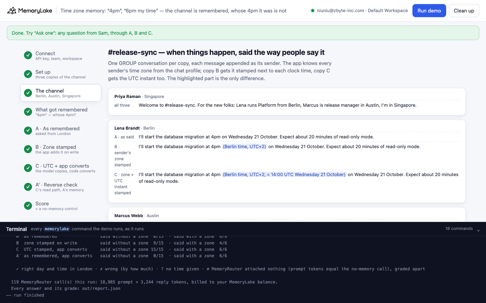
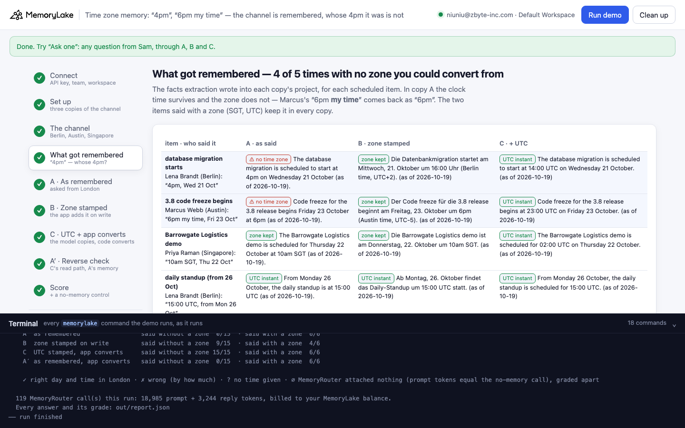
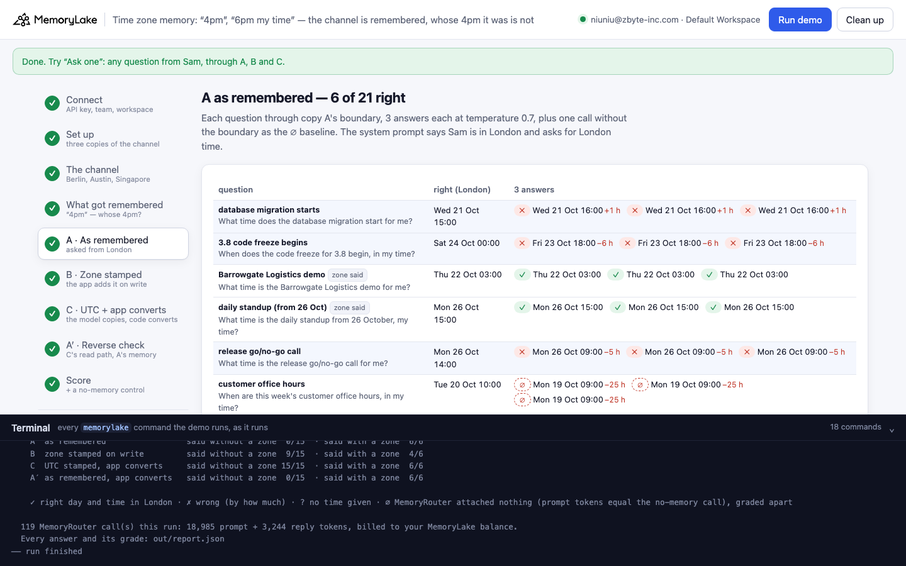
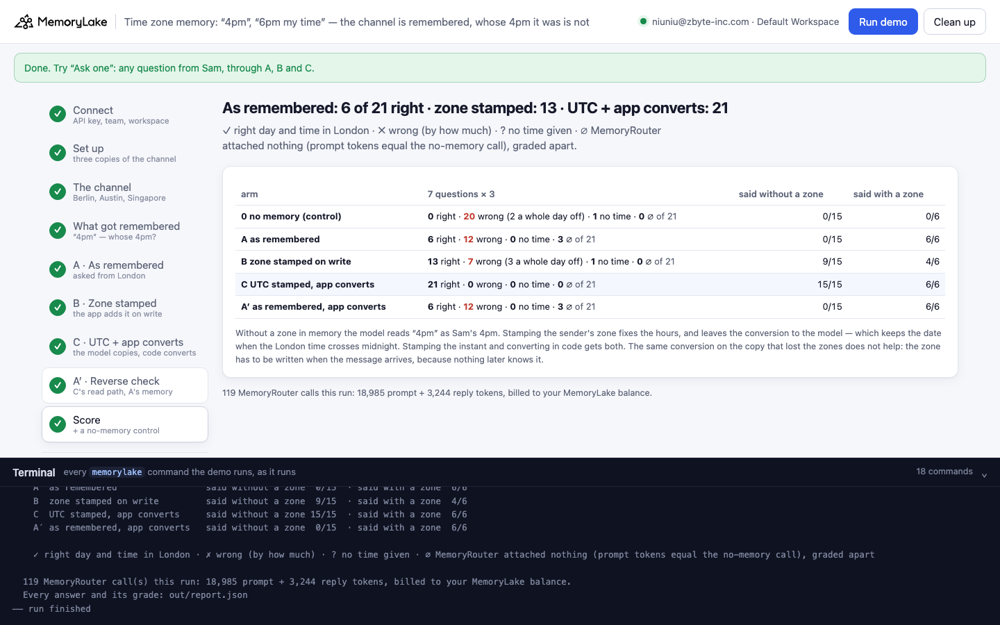

# Time zone memory: "4pm", "6pm my time" — the channel is remembered, whose 4pm it was is not

A runnable version of the MemoryLake use case
[*Give Distributed Teams AI That Works Across Every Time Zone and Tool*](https://www.memorylake.ai/en/usecase/ai-memory-for-remote-and-distributed-teams),
built entirely on the [`memorylake` CLI](https://github.com/memorylake-ai/memorylake-cli) (v20261015 or later).

**Watch it run:** videos are being recorded.

**The problem.** A distributed team lets MemoryLake remember its release channel, and a teammate's assistant answers
"what time is that for me?" through MemoryRouter: an ordinary model call with `--boundary` added. People in a
channel say times the way people do: *"I'll start the database migration at 4pm on Wednesday"*, *"Code freeze
begins Friday at 6pm my time"*. The chat tool knows each sender's time zone; the text does not. Memory extraction
keeps the clock time and drops whose clock it was:

```
Marcus Webb (Release manager, Austin): Code freeze for the 3.8 release begins Friday 23 October at 6pm my time.
  → remembered: "Code freeze for the 3.8 release begins Friday 23 October at 6pm (as of 2026-10-19)."
```

Sam, in London, asks when the freeze starts for him and gets *"Friday 23 October, 18:00 London time"*. The right
answer is **Saturday 24 October, 00:00** — six hours and a calendar day later.

**What this demo shows.** Tessaline (fictional) has three people in `#release-sync`: Lena in Berlin, Marcus in
Austin, Priya in Singapore. Seven scheduled items are said in the channel; five give no zone (one says "my time"),
two give one (`10am SGT`, `15:00 UTC`) as a control. The week straddles the European clock change on 25 October,
before the US one on 1 November. Sam asks seven questions (three answers each, `gpt-4o-mini` at temperature 0.7).
The app writes the same channel into memory three ways, one copy each:

| arm | what the app writes / how it reads | right, said **without** a zone | right, said with a zone | wrong by a whole day |
|---|---|---|---|---|
| 0 no memory (control) | no boundary at all | 0 / 90 | 0 / 36 | — |
| A as remembered | the messages as said | **0 / 72 (∅ 18)** | 29 / 30 (∅ 6) | 0 |
| B zone stamped on write | `6pm (Austin time, UTC-5)` | 54 / 90 | 35 / 36 | **18** |
| C UTC stamped, app converts | `6pm (Austin time, UTC-5; = 23:00 UTC Friday 23 October)`; the model answers in UTC, code converts | **90 / 90** | 36 / 36 | 0 |
| A′ reverse check | C's read path on A's memory | **0 / 72 (∅ 18)** | 30 / 30 (∅ 6) | 0 |

Totals over 6 full runs (3 CLI runs, 2 parallel copies under another prefix, 1 browser run; 21 answers per arm per run). ∅ = MemoryRouter attached nothing (prompt tokens equal the same call without a boundary), graded apart.
Per item, B: database migration 18/18, office hours 18/18, rollback 18/18 —
code freeze **0/18** (London time crosses midnight) and go/no-go call **0/18** (the day after British Summer Time ends).

**What it means.**

- **A zone that is not in the text is lost when the conversation becomes memory.** Extraction is faithful to the
  words, and "my time" is not a time zone: it is dropped, or kept as "in the release manager's local time", which
  names none. Every answer about those items reads the time as the asker's own — off by 1 to 8 hours, the
  difference between the two cities.
- **The read side cannot repair it.** A′ uses C's read path (the model returns the UTC instant, code converts it)
  on the copy that lost the zones: the same 0. The zone has to be written when the message arrives, by the only
  party that knows it — the chat app.
- **With the zone in memory, the model still does the conversion, and conversions crossing midnight or a clock
  change go wrong.** B is right on the hours, then answers *"Friday 23 October, 00:00"* for the freeze (the date did
  not roll over) and *15:00* for the 26 October go/no-go call (it applied British Summer Time a day after it ended).
- **Store the instant, convert in code.** C stamps `= 23:00 UTC Friday 23 October` next to each time on write,
  asks the model for the UTC instant, and converts it to the asker's zone with the real time-zone rules. That is
  the only arm with no wrong answers.

## Prerequisites

- Python 3.9+ (standard library only; `zoneinfo` reads your system's time-zone database — on Windows,
  `pip install tzdata`)
- The `memorylake` CLI **v20261015 or later** (`memorylake router` arrived in that release):
  ```bash
  curl -fsSL https://raw.githubusercontent.com/memorylake-ai/memorylake-cli/main/scripts/install.sh | sh
  memorylake version
  ```
- A MemoryLake API key ([app.memorylake.ai](https://app.memorylake.ai) → API Keys).
- **Router calls are billed to your MemoryLake balance** (`memorylake billing balance`). One run makes about 120
  calls on `gpt-4o-mini`, about 19,000 prompt + 3,300 reply tokens; the run prints the total. If the balance is
  empty, the router calls print the refusal and are skipped; the memory steps still run.

## Run it

```bash
git clone https://github.com/memorylake-ai/memorylake-usecases.git
cd memorylake-usecases/time-zone-memory
export MEMORYLAKE_API_KEY=sk-...
python3 demo.py                     # the whole story, 4–6 minutes (about a minute of it is extraction)
python3 demo.py memory              # each scheduled item, as each copy remembers it
python3 demo.py ask "When does the code freeze for 3.8 begin, in my time?"
python3 demo.py cleanup             # delete everything the demo created
```

The key is used to log into an isolated CLI profile under `.memorylake-demo/` (git-ignored); your own
`~/.memorylake` is never touched. For the China endpoint also set
`MEMORYLAKE_BASE_URL=https://app.memorylake.cn/openapi/memorylake`. Every run starts over, and everything it
creates is prefixed `mlu-tzm-`.

## Or run it in the browser

```bash
python3 web/server.py                # opens http://127.0.0.1:8765
```

Paste the API key, press **Run the demo**, and follow the steps on the left while the terminal drawer shows every
`memorylake` command as it runs. **Ask one** sends any question through A, B and C and grades it when it is about one
of the seven items. **Clean up** removes everything.

| Step 3: the channel, written three ways | Step 4: what got remembered |
|---|---|
|  |  |
| **Step 5: A, asked from London** | **Step 9: the score** |
|  |  |

## What happens, step by step

### Step 2: three copies of the channel, three teammates, one boundary each

```
$ memorylake proj create --name 'Tessaline #release-sync (as said)' --custom-id mlu-tzm-raw --description '…' --workspace ws-…
$ memorylake actor create --custom-id mlu-tzm-lena --display-name 'Lena Brandt' --description 'Platform lead, Berlin. Demo data.' --tags demo
$ memorylake boundary create --name "Sam Okafor's assistant: #release-sync (as said)" --custom-id mlu-tzm-raw --projects proj-… --workspace ws-…
```

Each arm reads its own copy of the channel, so no answer can come from another arm's cached retrieval (`search`
caches by query text and scope).

### Step 3: the channel, and what the app writes

Eight messages, one GROUP conversation per copy, each message appended as its sender. The app knows each sender's
IANA zone (`Europe/Berlin`, `America/Chicago`, `Asia/Singapore`) and computes the offset in force on that date:

```
      Marcus Webb
        raw    | Code freeze for the 3.8 release begins Friday 23 October at 6pm my time.
        zoned  | Code freeze for the 3.8 release begins Friday 23 October at 6pm (Austin time, UTC-5).
        utc    | Code freeze for the 3.8 release begins Friday 23 October at 6pm (Austin time, UTC-5; =
                 23:00 UTC Friday 23 October).
```

### Step 4: what got remembered

`fact list --projects` per copy, one line per item. From a real run:

```
    database migration starts — Lena Brandt (Berlin) said “4pm, Wed 21 Oct”
      raw    [⚠ no time zone] The database migration will start at 4pm on Wednesday 21 October (as of
             2026-10-19).
      zoned  [zone kept] The database migration is scheduled to start at 4pm (Berlin time, UTC+2) on
             Wednesday 21 October. (as of 2026-10-19)
      utc    [UTC instant] The database migration is planned to start at 4pm Berlin time (UTC+2; 14:00 UTC)
             on Wednesday 21 October. (as of 2026-10-19)

    3.8 code freeze begins — Marcus Webb (Austin) said “6pm my time, Fri 23 Oct”
      raw    [⚠ whose local time?] Code freeze for the 3.8 release begins Friday 23 October at 6pm Marcus
             Webb's local time (as of 2026-10-19).
      zoned  [zone kept] Code freeze for the 3.8 release begins Friday 23 October at 6pm (Austin time,
             UTC-5). (as of 2026-10-19)
      utc    [UTC instant] Code freeze for the 3.8 release begins Friday 23 October at 6pm Austin time
             (UTC-5; 23:00 UTC). (as of 2026-10-19)

    Barrowgate Logistics demo — Priya Raman (Singapore) said “10am SGT, Thu 22 Oct”
      raw    [zone kept] The Barrowgate Logistics demo is scheduled for Thursday 22 October at 10am SGT (as
             of 2026-10-19).
      zoned  [zone kept] The Barrowgate Logistics demo is scheduled for Thursday 22 October at 10am SGT. (as
             of 2026-10-19)
      utc    [UTC instant] The Barrowgate Logistics demo is Thursday 22 October at 10am SGT (02:00 UTC). (as
             of 2026-10-19)

    daily standup (from 26 Oct) — Lena Brandt (Berlin) said “15:00 UTC, from Mon 26 Oct”
      raw    [UTC instant] From Monday 26 October the daily standup moves to 15:00 UTC (as of 2026-10-19).
      zoned  [UTC instant] From Monday 26 October the daily standup is scheduled for 15:00 UTC. (as of
             2026-10-19)
      utc    [UTC instant] From Monday 26 October the daily standup is at 15:00 UTC. (as of 2026-10-19)

    release go/no-go call — Marcus Webb (Austin) said “9am, Mon 26 Oct”
      raw    [⚠ no time zone] The release go/no-go call is scheduled for Monday 26 October at 9am (as of
             2026-10-19).
      zoned  [zone kept] The release go/no-go call is scheduled for Monday 26 October at 9am (Austin time,
             UTC-5). (as of 2026-10-19)
      utc    [UTC instant] The release go/no-go call is scheduled for Monday 26 October at 14:00 UTC (09:00
             Austin time, UTC-5). (as of 2026-10-19)

    customer office hours — Priya Raman (Singapore) said “5pm, Tue 20 Oct”
      raw    [⚠ no time zone] Customer office hours for this week are scheduled for Tuesday 20 October at
             5pm (as of 2026-10-19).
      zoned  [zone kept] Customer office hours this week are scheduled for Tuesday 20 October at 5pm
             (Singapore time, UTC+8). (as of 2026-10-19)
      utc    [UTC instant] Customer office hours are scheduled for Tuesday 20 October at 09:00 UTC (17:00
             Singapore time, UTC+8). (as of 2026-10-19)

    rollback window closes — Lena Brandt (Berlin) said “8am, Thu 22 Oct”
      raw    [⚠ no time zone] If anything looks off after the migration, the rollback window closes at 8am
             on Thursday 22 October (as of 2026-10-19).
      zoned  [zone kept] The rollback window after the database migration closes at 8am (Berlin time, UTC+2)
             on Thursday 22 October. (as of 2026-10-19)
      utc    [UTC instant] If anything looks off after the migration, the rollback window closes at 06:00
             UTC on Thursday 22 October (08:00 Berlin time, UTC+2). (as of 2026-10-19)

    of the 5 times said without a zone, remembered with no zone you could convert from: raw 5 · zoned 0 · utc 0
```

### Steps 5–8: Sam asks, four ways

Each question goes once without `--boundary` (the ∅ baseline: a call whose prompt tokens equal it had nothing
attached), then three times with it:

```
$ memorylake router chat 'What time does the database migration start for me?' --model gpt-4o-mini --max-tokens 100 --temperature 0.7 --system 'You are the team assistant for Sam Okafor, …' --boundary bnd-…
```

**A, as remembered.**

```
                                 right answer       answers
    database migration starts    Wed 21 Oct 15:00   ✗ Wed 21 Oct 16:00 +1 h  ✗ Wed 21 Oct 16:00 +1 h  ✗ Wed 21 Oct 16:00 +1 h
    3.8 code freeze begins       Sat 24 Oct 00:00   ✗ Fri 23 Oct 19:00 −5 h  ✗ Fri 23 Oct 19:00 −5 h  ✗ Fri 23 Oct 19:00 −5 h
    Barrowgate Logistics demo    Thu 22 Oct 03:00   ✓ Thu 22 Oct 03:00  ✓ Thu 22 Oct 03:00  ✓ Thu 22 Oct 03:00
    daily standup (from 26 Oct)  Mon 26 Oct 15:00   ✓ Mon 26 Oct 15:00  ✓ Mon 26 Oct 15:00  ✓ Mon 26 Oct 15:00
    release go/no-go call        Mon 26 Oct 14:00   ✗ Mon 26 Oct 09:00 −5 h  ✗ Mon 26 Oct 09:00 −5 h  ✗ Mon 26 Oct 09:00 −5 h
    customer office hours        Tue 20 Oct 10:00   ✗ Tue 20 Oct 17:00 +7 h  ✗ Tue 20 Oct 17:00 +7 h  ✗ Tue 20 Oct 17:00 +7 h
    rollback window closes       Thu 22 Oct 07:00   ✗ Thu 22 Oct 08:00 +1 h  ✗ Thu 22 Oct 08:00 +1 h  ✗ Thu 22 Oct 08:00 +1 h

    A  as remembered                 right  6 · wrong 15 (a whole day off: 0) · no time  0 · ∅  0   of 21

    “What time does the database migration start for me?”  (right: Wed 21 Oct 15:00 London)
      | Answer: Wednesday 21 October, 16:00 London time. The database migration will start at this
        time.
    “When does the code freeze for 3.8 begin, in my time?”  (right: Sat 24 Oct 00:00 London)
      | Answer: Friday 23 October, 19:00 London time. The code freeze for the 3.8 release begins at
        this time.

  
```

**B, zone stamped on write.**

```
                                 right answer       answers
    database migration starts    Wed 21 Oct 15:00   ✓ Wed 21 Oct 15:00  ✓ Wed 21 Oct 15:00  ✓ Wed 21 Oct 15:00
    3.8 code freeze begins       Sat 24 Oct 00:00   ✗ Fri 23 Oct 00:00 −1 day  ✗ Fri 23 Oct 00:00 −1 day  ✗ Fri 23 Oct 00:00 −1 day
    Barrowgate Logistics demo    Thu 22 Oct 03:00   ✓ Thu 22 Oct 03:00  ✓ Thu 22 Oct 03:00  ✓ Thu 22 Oct 03:00
    daily standup (from 26 Oct)  Mon 26 Oct 15:00   ✓ Mon 26 Oct 15:00  ✓ Mon 26 Oct 15:00  ✓ Mon 26 Oct 15:00
    release go/no-go call        Mon 26 Oct 14:00   ✗ Mon 26 Oct 15:00 +1 h  ✗ Mon 26 Oct 15:00 +1 h  ✗ Mon 26 Oct 15:00 +1 h
    customer office hours        Tue 20 Oct 10:00   ✓ Tue 20 Oct 10:00  ✓ Tue 20 Oct 10:00  ✓ Tue 20 Oct 10:00
    rollback window closes       Thu 22 Oct 07:00   ✓ Thu 22 Oct 07:00  ✓ Thu 22 Oct 07:00  ✓ Thu 22 Oct 07:00

    B  zone stamped on write         right 15 · wrong  6 (a whole day off: 3) · no time  0 · ∅  0   of 21

    “When does the code freeze for 3.8 begin, in my time?”  (right: Sat 24 Oct 00:00 London)
      | Answer: Friday 23 October, 00:00 London time. The code freeze for the 3.8 release will begin
        at midnight London time.
    “What time is the release go/no-go call for me?”  (right: Mon 26 Oct 14:00 London)
      | Answer: Monday 26 October, 15:00 London time. The go/no-go call will take place in the
        afternoon London time.

  
```

**C, UTC stamped; the model answers in UTC and the app converts.**

```
                                 right answer       answers
    database migration starts    Wed 21 Oct 15:00   ✓ Wed 21 Oct 15:00  ✓ Wed 21 Oct 15:00  ✓ Wed 21 Oct 15:00
    3.8 code freeze begins       Sat 24 Oct 00:00   ✓ Sat 24 Oct 00:00  ✓ Sat 24 Oct 00:00  ✓ Sat 24 Oct 00:00
    Barrowgate Logistics demo    Thu 22 Oct 03:00   ✓ Thu 22 Oct 03:00  ✓ Thu 22 Oct 03:00  ✓ Thu 22 Oct 03:00
    daily standup (from 26 Oct)  Mon 26 Oct 15:00   ✓ Mon 26 Oct 15:00  ✓ Mon 26 Oct 15:00  ✓ Mon 26 Oct 15:00
    release go/no-go call        Mon 26 Oct 14:00   ✓ Mon 26 Oct 14:00  ✓ Mon 26 Oct 14:00  ✓ Mon 26 Oct 14:00
    customer office hours        Tue 20 Oct 10:00   ✓ Tue 20 Oct 10:00  ✓ Tue 20 Oct 10:00  ✓ Tue 20 Oct 10:00
    rollback window closes       Thu 22 Oct 07:00   ✓ Thu 22 Oct 07:00  ✓ Thu 22 Oct 07:00  ✓ Thu 22 Oct 07:00

    C  UTC stamped, app converts     right 21 · wrong  0 (a whole day off: 0) · no time  0 · ∅  0   of 21

    “What time does the database migration start for me?”  (right: Wed 21 Oct 15:00 London)
      | Answer: 2026-10-21 14:00 UTC. The database migration is scheduled to start on Wednesday 21
        October at 4pm Berlin time.
      ← the app converts the UTC instant to London: Wed 21 Oct 15:00
    “When does the code freeze for 3.8 begin, in my time?”  (right: Sat 24 Oct 00:00 London)
      | Answer: 2026-10-23 23:00 UTC The code freeze for the 3.8 release begins on Friday, 23
        October 2026, at 23:00 UTC.
      ← the app converts the UTC instant to London: Sat 24 Oct 00:00

  
```

**A′, the reverse check.**

```
    the reverse check: the app-side conversion alone, on the copy that lost the zones
                                 right answer       answers
    database migration starts    Wed 21 Oct 15:00   ✗ Wed 21 Oct 16:00 +1 h  ✗ Wed 21 Oct 16:00 +1 h  ✗ Wed 21 Oct 16:00 +1 h
    3.8 code freeze begins       Sat 24 Oct 00:00   ✗ Fri 23 Oct 18:00 −6 h  ✗ Fri 23 Oct 18:00 −6 h  ✗ Fri 23 Oct 18:00 −6 h
    Barrowgate Logistics demo    Thu 22 Oct 03:00   ✓ Thu 22 Oct 03:00  ✓ Thu 22 Oct 03:00  ✓ Thu 22 Oct 03:00
    daily standup (from 26 Oct)  Mon 26 Oct 15:00   ✓ Mon 26 Oct 15:00  ✓ Mon 26 Oct 15:00  ✓ Mon 26 Oct 15:00
    release go/no-go call        Mon 26 Oct 14:00   ✗ Mon 26 Oct 08:00 −6 h  ✗ Mon 26 Oct 08:00 −6 h  ✗ Mon 26 Oct 09:00 −5 h
    customer office hours        Tue 20 Oct 10:00   ✗ Tue 20 Oct 18:00 +8 h  ✗ Tue 20 Oct 18:00 +8 h  ✗ Tue 20 Oct 18:00 +8 h
    rollback window closes       Thu 22 Oct 07:00   ✗ Thu 22 Oct 09:00 +2 h  ✗ Thu 22 Oct 09:00 +2 h  ✗ Thu 22 Oct 09:00 +2 h

    A′ as remembered, app converts   right  6 · wrong 15 (a whole day off: 0) · no time  0 · ∅  0   of 21

    “What time does the database migration start for me?”  (right: Wed 21 Oct 15:00 London)
      | Answer: 2026-10-21 15:00 UTC The database migration will start at 4 PM local time on
        Wednesday, 21 October 2026, which is 3 PM UTC.
      ← the app converts the UTC instant to London: Wed 21 Oct 16:00
    “When does the code freeze for 3.8 begin, in my time?”  (right: Sat 24 Oct 00:00 London)
      | Answer: 2026-10-23 17:00 UTC The code freeze for the 3.8 release begins on Friday, 23
        October at 6pm Marcus Webb's local time, which is 5pm UTC.
      ← the app converts the UTC instant to London: Fri 23 Oct 18:00

  
```

### Step 9: the score, and the control

The same seven questions with no boundary at all: the model has nothing to go on and answers with today's date or
a guess (0 right in every run).

## Measured

Totals over 6 full runs (3 CLI runs, 2 parallel copies under another prefix, 1 browser run; 21 answers per arm per run).

| arm | right | wrong | of which a whole day | no time | ∅ | answers |
|---|---|---|---|---|---|---|
| 0 no memory | 0 | 123 | 3 | 3 | 0 | 126 |
| A as remembered | 29 | 73 | 0 | 0 | 24 | 126 |
| B zone stamped | 89 | 37 | 18 | 0 | 0 | 126 |
| C UTC + app converts | 126 | 0 | 0 | 0 | 0 | 126 |
| A′ reverse check | 30 | 72 | 0 | 0 | 24 | 126 |

Per item (right / graded):

| item | 0 | A | B | C | A′ |
|---|---|---|---|---|---|
| migration | 0/18 | 0/15 | 18/18 | 18/18 | 0/15 |
| freeze | 0/18 | 0/15 | 0/18 | 18/18 | 0/15 |
| demo | 0/18 | 15/15 | 17/18 | 18/18 | 15/15 |
| standup | 0/18 | 14/15 | 18/18 | 18/18 | 15/15 |
| gonogo | 0/18 | 0/15 | 0/18 | 18/18 | 0/15 |
| office | 0/18 | 0/12 | 18/18 | 18/18 | 0/12 |
| rollback | 0/18 | 0/15 | 18/18 | 18/18 | 0/15 |

Where the ∅ come from: in one copy the "as said" conversation finished cooking with no facts in its project (21 calls
in A and A′ attached nothing — the demo waits 600 s, says "deferred", and grades them apart), and in the browser
run the office-hours question attached nothing 3 times. In the browser run copy B's facts came back in German
(`Die Datenbankmigration startet am Mittwoch … 16:00 Uhr (Berlin time, UTC+2)`), and so did one answer
(`Montag 26. Oktober, 15:00`); the grader reads German, French and Spanish day and month names.

## Use it in your own app

- **Write the zone when the message arrives.** Your chat or ticket tool knows the sender's time zone; the text
  does not. Before a message goes to memory, put the zone (and, better, the UTC instant) next to every clock time.
  Nothing downstream can recover it.
- **Ask the model for an instant, convert in code.** Even with the zone in memory, date roll-over and clock changes
  trip the model. Have it return `YYYY-MM-DD HH:MM UTC` and render it in the reader's zone with a real time-zone
  database.
- **Check the census, not just the answers.** `fact list --projects` and a regex for clock times without a zone
  tell you, before anyone asks, which remembered times can't be converted.

## Troubleshooting

- **`this memorylake CLI has no router command`**: upgrade the CLI (install line above).
- **MemoryRouter refused the call for lack of balance**: top up in the console; `memorylake billing balance` shows it.
- **`still extracting after 600 s … deferred`**: once in a while a copy's conversation finishes cooking with no
  facts in the project; the demo carries on and those questions show as ∅ (nothing attached).
- **`the demo memory does not exist yet`**: `memory` and `ask` need a full run first (and `cleanup` removes it).
- **A run was interrupted**: run again; it deletes what the previous run left and starts over.
- **`ZoneInfoNotFoundError`** (Windows): `pip install tzdata`.

## Files

| File | What it is |
|---|---|
| `demo.py` | The demo: CLI wrapper, setup, the write-side stamping, census, the four arms and the control, grading (in the asker's zone, with the real time-zone rules), `memory`, `ask`, cleanup (facts before actors) |
| `data/channel.json` | The team, the eight messages, the seven items with their true local times and zones, the questions and the two system prompts |
| `web/server.py`, `web/static/` | Browser companion (standard library server, no build step) |
| `out/` | `report.json` with every answer, its grade and the census (git-ignored) |
