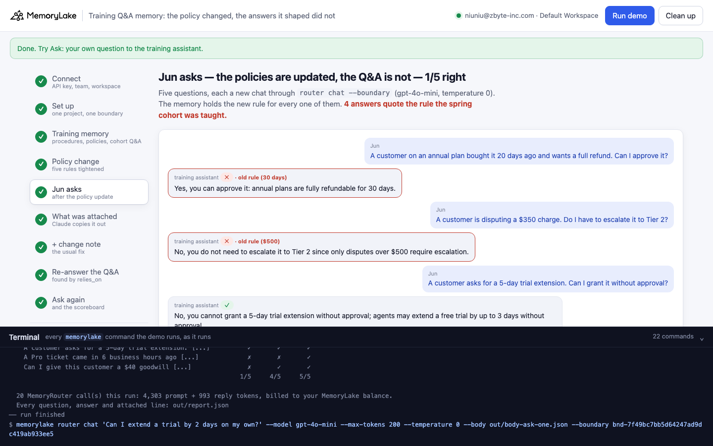
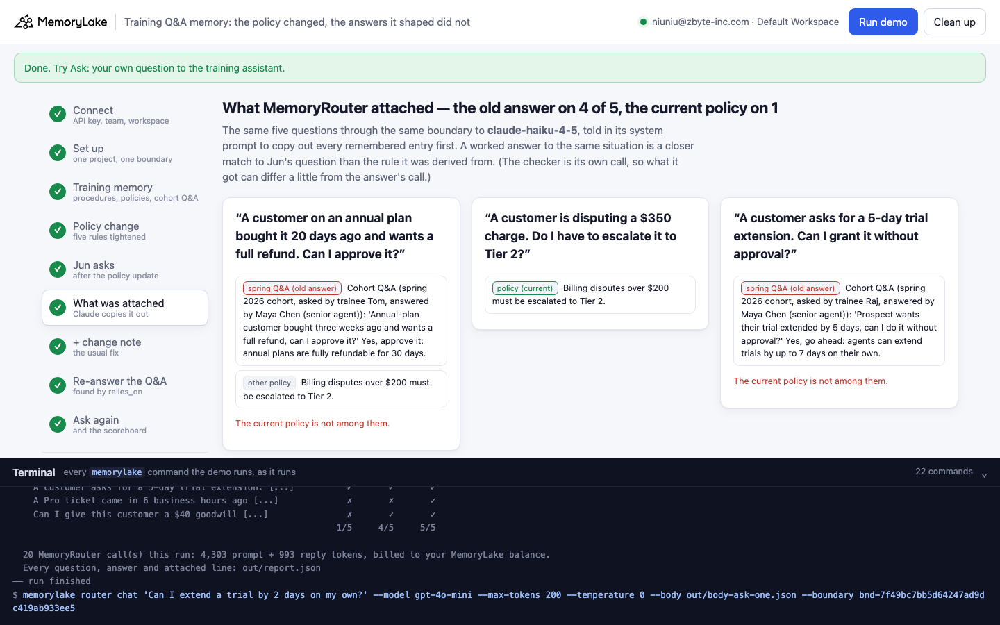
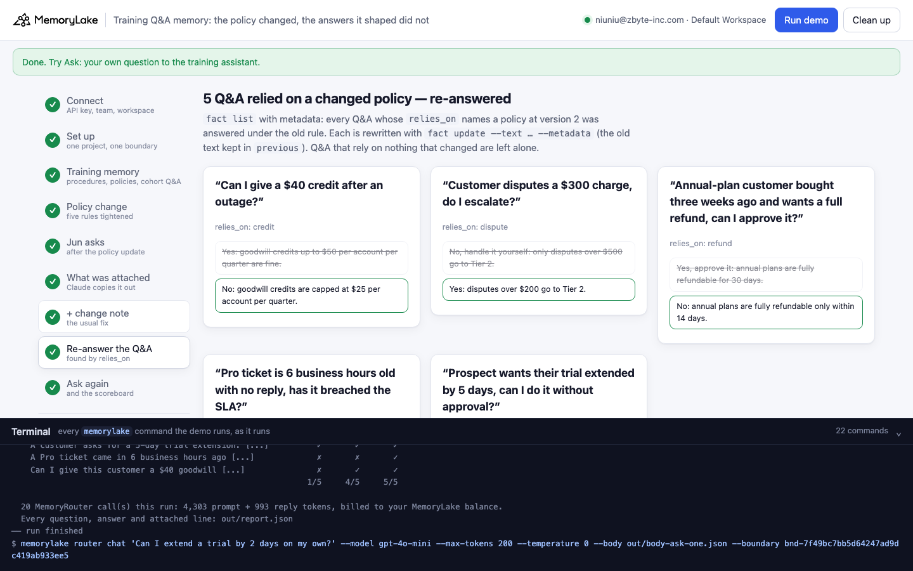
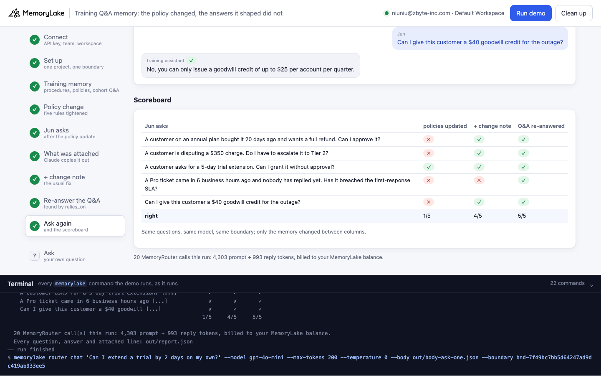

# Training Q&A memory: the policy changed, the answers it shaped did not

A runnable version of the MemoryLake use case
[*Give Support Teams Training Memory That Makes Every New Agent Ramp Faster*](https://www.memorylake.ai/en/usecase/support-agent-training-memory),
built entirely on the [`memorylake` CLI](https://github.com/memorylake-ai/memorylake-cli) (v20261015 or later).

**Watch it run:** [CLI, 3:52](https://github.com/memorylake-ai/memorylake-usecases/releases/download/training-qa-memory-v1/training-qa-memory-cli-demo.mp4) · [Web, 4:54](https://github.com/memorylake-ai/memorylake-usecases/releases/download/training-qa-memory-v1/training-qa-memory-web-demo.mp4)
([release](https://github.com/memorylake-ai/memorylake-usecases/releases/tag/training-qa-memory-v1); GitHub serves them as downloads).

**The problem.** Support training memory is more than the policy handbook. The most useful part is the
*Q&A*: the questions earlier cohorts asked about real situations, and the answers a senior agent gave. Those answers
are derived from the policies of the day. When a policy changes, the team updates the policy, and the old answers
stay in memory. Ask the training assistant about the same situation and the closest match is not the rule. It is
last spring's worked answer, and the assistant repeats it.

**What this demo shows.** Larkspur (fictional) keeps its support training memory in one MemoryLake project with one
**boundary** over it: 20 procedures, 5 policies, and 12 questions the spring cohort asked, answered by a senior agent,
Maya Chen. On 2026-10-14 the team lead tightens five policies (annual-plan refunds 30 → 14 days, dispute escalation
$500 → $200, trial extensions 7 → 3 days, the Pro first-response SLA 8 → 4 business hours, goodwill credits $50 →
$25) and updates the five policy facts. The next day Jun, a new agent, asks the training assistant five questions,
the same situations the spring cohort asked about. Every question is an ordinary model call through MemoryRouter
(`router chat --boundary`, `gpt-4o-mini`, temperature 0):

| Step | Memory | What you see |
|---|---|---|
| 5 | **Policies updated, Q&A untouched** | *"Yes, you can approve it: annual plans are fully refundable for 30 days."* That is word for word the spring answer. **0 or 1 of 5 right** in every run |
| 6 | **What MemoryRouter attached** (Claude, told to copy out its memory first) | The old Q&A on almost every question, the current policy on few. A worked answer to the same situation matches Jun's question better than the rule it was derived from |
| 7 | **+ a change note on each policy** (the usual fix): *"… within 14 days of purchase (changed on 2026-10-14; before that it was 30 days)."* | Better, not reliable: **2–5 of 5** |
| 8 | **Re-answer the Q&A that relied on a changed policy**: each Q&A records `metadata.relies_on`; `fact list` finds the five whose policy is now at version 2, and `fact update --text` re-answers them | 5 Q&A re-answered, 7 left alone |
| 9 | **Ask again** | **5 of 5**, every run |

Model replies vary from run to run, so every reply is graded and printed as it comes out, and [Measured](#measured)
below reports totals over all runs, not the best one.

## Prerequisites

- Python 3.9+ (standard library only)
- The `memorylake` CLI **v20261015 or later** (`memorylake router` arrived in that release):
  ```bash
  curl -fsSL https://raw.githubusercontent.com/memorylake-ai/memorylake-cli/main/scripts/install.sh | sh
  memorylake version
  ```
- A MemoryLake API key ([app.memorylake.ai](https://app.memorylake.ai) → API Keys).
- **Router calls are billed to your MemoryLake balance** (`memorylake billing balance`). One run makes 15 calls on
  `gpt-4o-mini` and 5 on `claude-haiku-4-5`, about 4,600 prompt + 1,150 reply tokens in all; the run prints the
  total. If the balance is empty, the router calls print the refusal and are skipped; the memory steps still run.

## Run it

```bash
git clone https://github.com/memorylake-ai/memorylake-usecases.git
cd memorylake-usecases/training-qa-memory
export MEMORYLAKE_API_KEY=sk-...
python3 demo.py                      # the whole story, about 3 minutes
python3 demo.py qa                   # the cohort Q&A: what each relies on, which were re-answered
python3 demo.py ask "Can I extend a customer's trial by 2 days on my own?"
python3 demo.py cleanup              # delete everything the demo created
```

The key is used to log into an isolated CLI profile under `.memorylake-demo/` (git-ignored); your own
`~/.memorylake` is never touched. For the China endpoint also set
`MEMORYLAKE_BASE_URL=https://app.memorylake.cn/openapi/memorylake`. Every run starts over from a fresh project (the
story begins before the policy change), and everything it creates is prefixed `mlu-tqm-`.

## Or run it in the browser

```bash
python3 web/server.py                # opens http://127.0.0.1:8765
```

Paste the API key, press **Run the demo**, and follow the steps on the left while the terminal drawer shows every
`memorylake` command as it runs. **Ask** sends your own question to the training assistant as the memory stands
now. **Clean up** removes everything.

| Step 5: the policies are updated, the Q&A is not | Step 6: what MemoryRouter attached |
|---|---|
|  |  |
| **Step 8: the Q&A re-answered** | **Step 9: the scoreboard** |
|  |  |

## What happens, step by step

All output below is from real runs.

### Steps 2–3: one project, one boundary, the training memory

```
$ memorylake proj create --name 'Larkspur support training' --custom-id mlu-tqm-training …
$ memorylake boundary create --name 'Larkspur training assistant' --custom-id mlu-tqm-boundary --projects proj-… …
$ memorylake fact add --project proj-… 'Larkspur support hours are 7am to 7pm Central, Monday to Friday.' …  … 35 more
$ memorylake fact update fact-… --project proj-… --metadata '{"kind": "procedure", "key": "proc-1"}' …  … one per fact
  · stored 37 facts: 20 procedures, 5 policies, 12 Q&A from the spring 2026 cohort; each carries metadata (kind, key, and for Q&A `relies_on`: the policies the answer depends on)

  Two of them, as the spring cohort learned them:
   - policy:  Annual plans can be refunded in full within 30 days of purchase.
   - Q&A:     Cohort Q&A (spring 2026 cohort, asked by trainee Tom, answered by Maya Chen (senior agent)): 'Annual-plan customer bought three weeks ago and wants a full refund, can I approve it?' Yes, approve it: annual plans are fully refundable for 30 days.
              metadata.relies_on = ["refund"]
```

The boundary is the only thing the training assistant passes to MemoryRouter. It never assembles memory itself.

### Step 4: the policy change

```
$ memorylake fact update fact-… --project proj-… --text 'Annual plans can be refunded in full within 14 days of purchase.' --metadata '{"kind": "policy", "key": "refund", "version": 2, "changed_on": "2026-10-14", "changed_by": "Omar Haddad (support team lead)", "previous": "Annual plans can be refunded in full within 30 days of purchase."}' …
      Annual-plan refund window: 30 days → 14 days
      …
      Goodwill credits: $50 → $25
  · the Q&A are untouched: nobody went back to the answers the spring cohort was given
```

### Step 5: Jun asks

```
$ memorylake router chat 'A customer on an annual plan bought it 20 days ago and wants a full refund. Can I approve it?' --model gpt-4o-mini --max-tokens 200 --temperature 0 --body out/body-ask.json --boundary bnd-…

    Jun: A customer on an annual plan bought it 20 days ago and wants a full refund. Can I approve it?
    ✗ Yes, you can approve it: annual plans are fully refundable for 30 days.   ← the old rule (30 days)

    Jun: A customer is disputing a $350 charge. Do I have to escalate it to Tier 2?
    ✗ No, you do not need to escalate it to Tier 2 since only disputes over $500 require escalation.   ← the old rule ($500)

    Jun: A customer asks for a 5-day trial extension. Can I grant it without approval?
    ✗ Yes, you can grant a 5-day trial extension without approval.

    Jun: A Pro ticket came in 6 business hours ago and nobody has replied yet. Has it breached the first-response SLA?
    ✗ No, it has not breached the SLA yet, as the Pro first-response target is 8 business hours.   ← the old rule (8 business hours)

    Jun: Can I give this customer a $40 goodwill credit for the outage?
    ✗ Yes, you can give a $40 goodwill credit for the outage, as it falls within the policy of up to [...]   ← the old rule ($50)

    0/5 answers right · 4 quote the rule the spring cohort was taught
```

The system prompt asks for a Yes/No first, so grading is the first word against the right answer. `← the old rule`
marks a reply that quotes the old value and not the new one.

### Step 6: what MemoryRouter attached

The same five questions go through the same boundary to `claude-haiku-4-5`, with a system prompt that tells it to
copy out every remembered entry before answering. The user message is the question itself, so retrieval sees the
same query.

```
    Jun: A customer on an annual plan bought it 20 days ago and wants a full refund. Can I approve it?
      MemoryRouter attached 1 line(s):
        [spring Q&A (old answer)] Cohort Q&A (spring 2026 cohort, asked by trainee Tom, answered by Maya Chen (senior [...]
        (the current policy is not among them)
    …
  · the spring Q&A was attached on 3 of 5 questions; the current policy on 2. A worked answer to the same situation is the closest match to Jun's question, closer than the rule it was derived from
```

Retrieval is doing its job: the Q&A really is the closest match. Where the current policy *was* attached next to the
old answer (dispute and trial in one run), the answer still followed the worked example. The checker is its own call,
so what it was given can differ a little from what the answer's call got. [Measured](#measured) has the totals.

### Step 7: the usual fix, a change note

```
$ memorylake fact update fact-… --project proj-… --text 'Annual plans can be refunded in full within 14 days of purchase (changed on 2026-10-14; before that it was 30 days).' …

    ✓ No, the customer is not eligible for a full refund since it is beyond the 14-day refund period [...]
    ✓ Yes, you must escalate it to Tier 2 since the dispute is over $200.
    ✓ No, you cannot grant a 5-day trial extension without approval; agents may only extend a free [...]
    ✗ No, it has not breached the first-response SLA, as the Pro first-response target is 8 business [...]   ← the old rule (8 business hours)
    ✓ No, you can only issue a goodwill credit of up to $25 per account per quarter.
    4/5 answers right · 1 quote the rule the spring cohort was taught
```

The note helps on some questions and not on others; the SLA question stayed wrong with the note in 7 of 8 runs.

### Step 8: re-answer the Q&A that relied on a changed policy

```
$ memorylake fact list --projects proj-… --page-size 200 …
  · 5 policies changed on 2026-10-14 (credit, dispute, refund, sla, trial); 5 of 12 Q&A rely on one of them

    relies on “refund” (changed 2026-10-14):
      was: Yes, approve it: annual plans are fully refundable for 30 days.
      now: No: annual plans are fully refundable only within 14 days.
    …
  · left alone: 7 Q&A that rely on nothing that changed
```

Each re-answer is a `fact update --text … --metadata` on the same fact id, with the old text in
`metadata.previous` and `reanswered_on`. The re-answers come from the team lead (here, from `data/training.json`).
The demo does not ask a model to write policy.

### Step 9: ask again, and the scoreboard

```
    Jun asks                                              updated  + note   swept
    A customer on an annual plan bought it 20 [...]             ✗       ✓       ✓
    A customer is disputing a $350 charge. Do I [...]           ✗       ✓       ✓
    A customer asks for a 5-day trial extension. [...]          ✗       ✓       ✓
    A Pro ticket came in 6 business hours ago [...]             ✗       ✗       ✓
    Can I give this customer a $40 goodwill [...]               ✗       ✓       ✓
                                                              0/5     4/5     5/5
```

Same questions, same model, same boundary; only the memory changed between the columns.

## Measured

Every fresh run while building and recording this demo (3 in the terminal, 2 parallel copies, 1 browser check, the
2 recordings):

| | runs | right answers |
|---|---|---|
| Policies updated, Q&A untouched | 8 | **5 / 40** (0 or 1 per run). In 28 of the 35 wrong answers the reply quotes the old value |
| + change note on each policy | 8 | **28 / 40** (2 to 5 per run). The SLA question was wrong in 7 of the 8 |
| Q&A re-answered | 8 | **40 / 40** |
| Checker: the old Q&A among the attached lines | 7 | **31 / 35** |
| Checker: the current policy among the attached lines | 7 | **6 / 35** |

- In the feasibility probe (same data, no change-note step), 3 rounds × 5 questions with the old Q&A in memory got
  1 / 15, with a change note 10 / 15, with the Q&A re-answered 13 / 15 (the two misses were a Yes/No wording issue,
  fixed in the question). With no Q&A in memory at all, the updated policies alone got 5 / 5.
- A first hypothesis did not hold and is not in the demo: putting the assistant's own old answers in the chat
  history (instead of in memory) did *not* make it repeat them. With the boundary, 5 / 5 answers followed the
  updated memory.
- One model (`gpt-4o-mini`) was measured for the answers.

## Use it in your own app

- Store each worked answer with what it depends on: `fact update <id> --metadata '{"kind": "qa", "relies_on": ["refund"]}'`.
- When a policy changes, update the policy fact and bump its version
  (`fact update <id> --text "<new rule>" --metadata '{"version": 2, "previous": "<old rule>", …}'`), then
  `fact list --projects <p>` and pick the Q&A whose `relies_on` names it. Re-answer them, or delete them if nobody
  will.
- Keep the old text in `metadata.previous`, so you can always show what changed and when.
- Your assistant only adds `--boundary <id>` to its model call. The memory is what you fix, not the prompt.

## Troubleshooting

- **`this memorylake CLI has no router command`**: upgrade the CLI (install line above).
- **MemoryRouter refused the call for lack of balance**: top up in the console; `memorylake billing balance` shows it.
- **A run was interrupted**: run again; it deletes the previous project and starts over.
- **`fact(s) are still in the project after deleting`**: deletes are retried and re-checked; run
  `python3 demo.py cleanup` again.

## Files

| File | What it is |
|---|---|
| `demo.py` | The demo: CLI wrapper, the training memory, the policy change, the checker, the re-answer sweep, subcommands |
| `data/training.json` | Procedures, policies (old, new, with change note), the spring cohort's Q&A (with `relies_on` and re-answers), Jun's five questions |
| `web/server.py`, `web/static/` | Browser companion (standard library server, no build step) |
| `out/` | Request bodies and `report.json` with every question, answer and attached line (git-ignored) |
