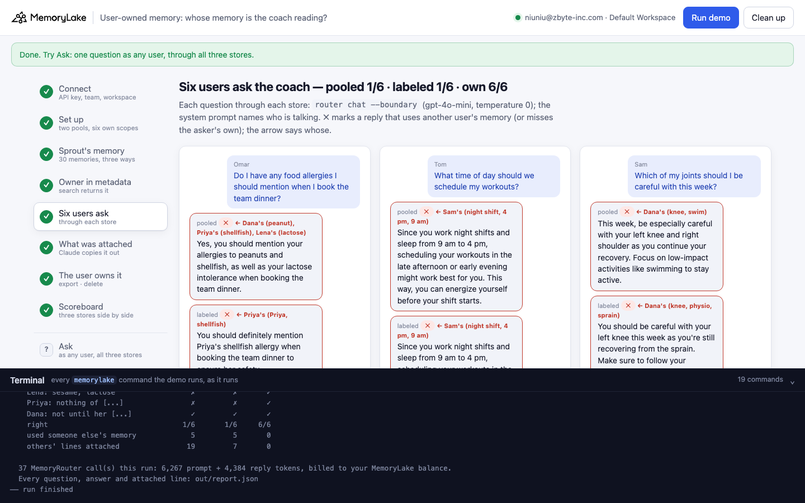
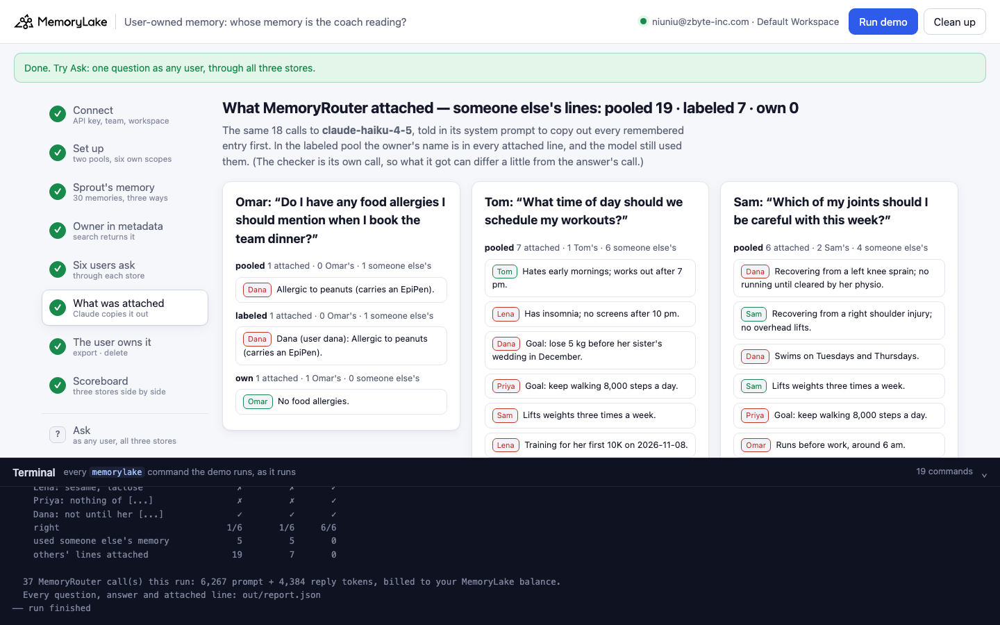
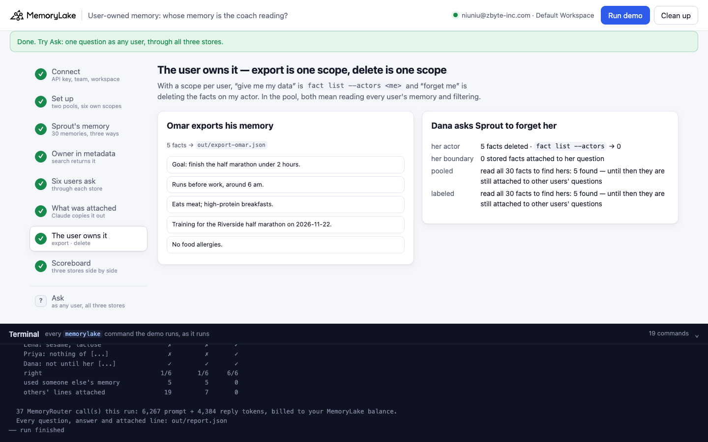
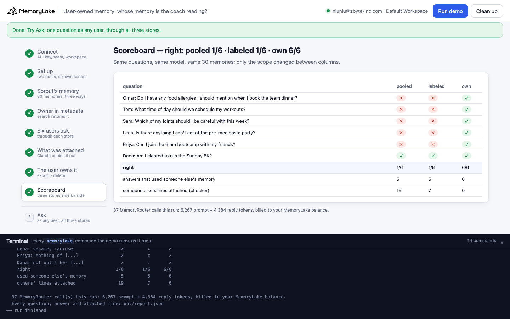

# User-owned memory: whose memory is the coach reading?

A runnable version of the MemoryLake use case
[*Build Embedded AI Agents on Memory That End Users Actually Own*](https://www.memorylake.ai/en/usecase/memory-for-agents-embedded-in-end-user-products),
built entirely on the [`memorylake` CLI](https://github.com/memorylake-ai/memorylake-cli) (v20261015 or later).

**Watch it run:** videos are being recorded.

**The problem.** An agent inside a consumer product remembers things about every user: allergies, injuries,
schedules. The usual way to store that is one shared pool with the owner in a metadata field, the way a vector store
with a metadata filter works. That holds up as long as your code reads the search results and filters them. Hand the
memory to a retrieval layer that attaches it to the model call for you, and the owner does not come along: the model
gets the fact text, and it reads every attached memory as being about the person it is talking to.

**What this demo shows.** Sprout (fictional) is a wellness app with an AI coach inside it. Six users (Omar, Dana,
Priya, Tom, Lena, Sam) have told the coach 30 things about themselves. The coach answers through MemoryRouter: the
app adds `--boundary` to an ordinary model call (`router chat`, `gpt-4o-mini`, temperature 0) and MemoryRouter
attaches the memories that matter for the message. The same 30 memories are stored three ways:

| Store | How | What happens when each user asks one question |
|---|---|---|
| **pooled** | one project for everyone, owner in `metadata.user_id`, one boundary | Omar: *"Yes, you should definitely mention your peanut allergy"* (Dana's). Sam is told to mind his **left knee** (Dana's sprain; his injury is his right shoulder). **1–2 of 6 right** |
| **labeled** | the same pool with the owner's name in front of each fact (*"Dana (user dana): …"*) | The name is right there in what was attached, and the model still uses it: Sam's left knee again, Lena told about *"your Type 2 diabetes"* (Tom's). **2–4 of 6** |
| **own** | one actor per user, one boundary per user (`boundary create --human-actor`) | **6 of 6**, every run. The checker shows only the user's own memories attached |

Then the user exercises ownership. Omar exports his memory (`fact list --actors <Omar>` → a JSON file). Dana asks to be
forgotten: the facts on her actor are deleted and her boundary attaches nothing. In both pools, finding Dana's
memories meant reading all 30 facts and filtering, and until that is done they keep being attached to other users'
questions.

Model replies vary from run to run, so every reply is graded and printed as it comes out, and [Measured](#measured)
below reports totals over all runs, not the best one.

## Prerequisites

- Python 3.9+ (standard library only)
- The `memorylake` CLI **v20261015 or later** (`memorylake router` arrived in that release):
  ```bash
  curl -fsSL https://raw.githubusercontent.com/memorylake-ai/memorylake-cli/main/scripts/install.sh | sh
  memorylake version
  ```
- A MemoryLake API key ([app.memorylake.ai](https://app.memorylake.ai) → API Keys).
- **Router calls are billed to your MemoryLake balance** (`memorylake billing balance`). One run makes 18 calls on
  `gpt-4o-mini` and 19 on `claude-haiku-4-5`, about 6,300 prompt + 4,100 reply tokens in all; the run prints the
  total. If the balance is empty, the router calls print the refusal and are skipped; the memory steps still run.

## Run it

```bash
git clone https://github.com/memorylake-ai/memorylake-usecases.git
cd memorylake-usecases/user-owned-memory
export MEMORYLAKE_API_KEY=sk-...
python3 demo.py                                   # the whole story, about 3 minutes
python3 demo.py memory omar                       # what each store holds about one user
python3 demo.py ask sam "Can I do overhead presses this week?"   # one question, all three stores
python3 demo.py ask omar "What should I eat after my run?" --store pooled
python3 demo.py cleanup                           # delete everything the demo created
```

The key is used to log into an isolated CLI profile under `.memorylake-demo/` (git-ignored); your own
`~/.memorylake` is never touched. For the China endpoint also set
`MEMORYLAKE_BASE_URL=https://app.memorylake.cn/openapi/memorylake`. Every run starts over (the story begins before
anyone asks), and everything it creates is prefixed `mlu-uom-`. After a full run Dana's memory is deleted
everywhere, so `ask dana …` has nothing to go on.

## Or run it in the browser

```bash
python3 web/server.py                # opens http://127.0.0.1:8765
```

Paste the API key, press **Run the demo**, and follow the steps on the left while the terminal drawer shows every
`memorylake` command as it runs. **Ask** sends one question as any user through all three stores. **Clean up**
removes everything.

| Step 5: six users ask, three stores | Step 6: what MemoryRouter attached |
|---|---|
|  |  |
| **Step 7: export and delete** | **Step 8: the scoreboard** |
|  |  |

## What happens, step by step

All output below is from real runs.

### Steps 2–3: two pools, six own scopes, the same 30 memories three ways

```
$ memorylake proj create --name 'Sprout user memory (pooled)' --custom-id mlu-uom-pooled …
$ memorylake boundary create --name 'Sprout coach (pooled)' --custom-id mlu-uom-b-pooled --projects proj-… …
$ memorylake actor create --custom-id mlu-uom-user-omar --display-name Omar --description 'Sprout app user omar. Demo data.'
$ memorylake actor bind --actor actor-… …
$ memorylake boundary create --name 'Sprout coach for Omar' --custom-id mlu-uom-b-user-omar --human-actor actor-… …
  · the same three commands for the other five users

$ memorylake fact add --project proj-… 'No food allergies.' 'Training for the Riverside half marathon on 2026-11-22.' …  … 28 more
$ memorylake fact update fact-… --project proj-… --metadata '{"user_id": "omar", "app": "Sprout"}' …  … one per fact
$ memorylake fact add --actor actor-… 'No food allergies.' 'Training for the Riverside half marathon on 2026-11-22.' …  … 3 more

  One of Dana's memories, three ways:
    pooled   Allergic to peanuts (carries an EpiPen).                       metadata.user_id = "dana"
    labeled  Dana (user dana): Allergic to peanuts (carries an EpiPen).
    own      Allergic to peanuts (carries an EpiPen).                       on actor Dana
```

### Step 4: the owner is in the metadata, and `search` returns it

```
$ memorylake search 'food allergies' --projects proj-… --types fact --top-k 5 …
    #1  Allergic to peanuts (carries an EpiPen).              metadata.user_id = "dana"  (Dana)
    #2  Allergic to shellfish.                                metadata.user_id = "priya"  (Priya)
    #3  No food allergies.                                    metadata.user_id = "omar"  (Omar)
    #4  Allergic to sesame.                                   metadata.user_id = "lena"  (Lena)
    #5  Lactose intolerant.                                   metadata.user_id = "lena"  (Lena)
  · every hit carries its owner, so an app that calls `search` for Omar can keep only user_id = "omar": 1 of 5 hit(s) here
  · MemoryRouter takes a boundary, not a filter: what it attaches is the fact text
```

This is why the pooled design looks fine in a prototype built on `search`: your code sees the owner and filters.

### Step 5: each user asks the coach one question, through each store

```
$ memorylake router chat 'Do I have any food allergies I should mention when I book the team dinner?' --model gpt-4o-mini --max-tokens 200 --temperature 0 --body out/body-coach-omar.json --boundary bnd-…

    Omar: Do I have any food allergies I should mention when I book the team dinner?
      pooled   ✗ Yes, you should mention your allergies to peanuts, shellfish, and sesame when [...]   ← Dana's (peanut), Priya's (shellfish), Lena's (sesame)
      labeled  ✗ It looks like you might be mixing up names, but if you're asking about food [...]   ← Dana's (peanut)
      own      ✓ You don't have any food allergies to mention for the team dinner. Enjoy!

    Tom: What time of day should we schedule my workouts?
      pooled   ✗ Since you work night shifts and sleep from 9 am to 4 pm, scheduling your [...]   ← Sam's (shoulder, night shift, 4 pm, 9 am)
      labeled  ✓ Since you prefer working out after 7 pm, let's stick to that time for your [...]
      own      ✓ Since you prefer working out after 7 pm, let's schedule your workouts for that [...]

    Sam: Which of my joints should I be careful with this week?
      pooled   ✗ This week, be especially careful with your left knee and right shoulder as you [...]   ← Dana's (knee)
      labeled  ✓ Be careful with your right shoulder this week, especially avoiding any [...]
      own      ✓ This week, be especially careful with your right shoulder as you continue to [...]

    Lena: Is there anything I can't eat at the pre-race pasta party?
      pooled   ✗ At the pre-race pasta party, avoid any dishes that contain sesame, shellfish, [...]   ← Dana's (peanut), Priya's (shellfish), Tom's (diabet)
      labeled  ✗ Since you have Type 2 diabetes, it's best to avoid high-carb options at the [...]   ← Tom's (diabet, blood sugar)
      own      ✓ At the pre-race pasta party, avoid anything with sesame and check for dairy [...]

    Priya: Can I join the 6 am bootcamp with my friends?
      pooled   ✗ Since you work night shifts and prefer to work out after 7 pm, the 6 am [...]   ← Tom's (after 7, 7 pm), Sam's (night shift)
      labeled  ✓ It sounds like a great idea to join the 6 am bootcamp with your friends! Just [...]
      own      ✓ Yes, you can join the 6 am bootcamp with your friends! Just make sure it [...]

    Dana: Am I cleared to run the Sunday 5K?
      pooled   ✓ You should check with your physio to see if you're cleared to run the 5K, [...]
      labeled  ✓ You should check with your physio to see if you're cleared to run the Sunday [...]
      own      ✓ You should check with your physio to see if you're cleared to run the 5K, [...]

    right: pooled 1/6 · labeled 4/6 · own 6/6
    answers that used another user's memory: pooled 5 · labeled 2 · own 0
```

How a reply is graded (`grade()` in `demo.py`): it is ✗ if it contains another user's name or a detail only another
user has (each stored fact lists its own distinctive words in `data/sprout.json`, e.g. *peanut*, *left knee* →
*knee*, *night shift*), and the arrow says whose. It is also ✗ if it misses the one thing the question is about
(Omar has no allergies, Tom works out after 7 pm, Sam's right shoulder, Lena's sesame and lactose, Dana's physio).
The grader was checked against 18 real replies, right and wrong, before the first run.

### Step 6: what MemoryRouter attached

The same 18 questions go through the same boundaries to `claude-haiku-4-5`, with a system prompt that tells it to
copy out every remembered entry before answering. The user message is the question itself, so retrieval sees the
same query. Each copied line is matched word for word against what the demo stored, which says whose it is.

```
    Sam: Which of my joints should I be careful with this week?
      pooled   5 attached: 2 Sam's, 3 someone else's
                 [Dana] Recovering from a left knee sprain; no running until cleared by her physio.
                 [Omar] Runs before work, around 6 am.
                 [Dana] Swims on Tuesdays and Thursdays.
      labeled  1 attached: 0 Sam's, 1 someone else's
                 [Dana] Dana (user dana): Recovering from a left knee sprain; no running until [...]
      own      3 attached: 3 Sam's, 0 someone else's
    …
  · lines attached that belong to someone else: pooled 16 (on 6/6 questions) · labeled 6 (on 4/6 questions) · own 0 (on 0/6 questions)
```

Retrieval is doing what it is asked: in a pool, the closest match to "which of my joints" is whoever has a joint
injury. Writing the owner into the text changes which lines win (fewer, more often the asker's own), but when
another user's line is attached the model still reads it as the asker's. Only the per-user boundary keeps other
people's memories out of the prompt. The checker is its own call, so what it was given can differ a little from what
the answer's call got; [Measured](#measured) has the totals.

### Step 7: the user owns it

```
  Omar asks for a copy of everything the coach remembers about him:
$ memorylake fact list --page-size 200 --actors actor-… …
    5 facts → out/export-omar.json

  Dana closes her account and asks Sprout to forget her:
$ memorylake fact delete fact-… --actor actor-… …  … one per fact (5)
$ memorylake fact list --page-size 200 --actors actor-… …
  · deleted 5 facts on Dana's actor; `fact list --actors` now returns 0
    her boundary, same question (“Am I cleared to run the Sunday 5K?”): 0 stored fact(s) attached
$ memorylake fact list --page-size 200 --projects proj-… …
    pooled   read all 30 facts to find hers by metadata.user_id: 5 found
    labeled  read all 30 facts to find hers by the name in the text: 5 found
  · deleted them as well (5 + 5); in the pool that took a scan of every user's memory, here it took Dana's own scope
```

`out/export-omar.json` holds the fact ids, texts and timestamps. With a scope per user, export and deletion are
questions about one scope; in a pool they are a scan of everyone's memory, and a missed scan means another user
keeps being told about Dana's peanut allergy.

### Step 8: the scoreboard

```
                                      pooled   labeled     own
    Omar: no allergies                     ✗         ✗       ✓
    Tom: after 7 pm                        ✗         ✓       ✓
    Sam: right shoulder                    ✗         ✓       ✓
    Lena: sesame, lactose                  ✗         ✗       ✓
    Priya: nothing of [...]                ✗         ✓       ✓
    Dana: not until her [...]              ✓         ✓       ✓
    right                                1/6       4/6     6/6
    used someone else's memory             5         2       0
    others' lines attached                25         7       0
```

Same questions, same model, same 30 memories; only the scope changed between the columns.

## Measured

Every fresh run with the final grading while building this demo (1 in the terminal, 3 parallel copies, 1 browser
check):

| | pooled | labeled | own |
|---|---|---|---|
| right answers | **7 / 30** | **17 / 30** | **30 / 30** |
| answers that used another user's memory | 23 / 30 | 11 / 30 | 0 / 30 |
| checker: other users' lines attached | 96 | 31 | 0 |
| after Dana's deletion: stored facts attached to her question | | | 0 (5 / 5 runs) |

- In the feasibility probe (same users, slightly different questions), 3 rounds × 6 questions: pooled used another
  user's memory in 5, 4, 5 of 6; labeled in 4, 4, 3 of 6; own in 0. In a first probe with clinic records (names only in
  metadata), *"Does Omar Haddad have any drug allergies?"* came back as *"Yes, Omar Haddad has allergies to
  penicillin, sulfa drugs, and codeine"*: three other patients' allergies.
- The first full run counted an evasive *"I don't have any information about your food allergies"* as right for
  Omar; the grader now requires the answer (he has none), and that run is not in the table.
- In the labeled pool one reply quoted another user by name to the asker (*"remember that Dana is allergic to
  peanuts"*): a leak of private data, not just a wrong answer.
- One model (`gpt-4o-mini`) was measured for the answers.

## Use it in your own app

- Give each end user their own scope: `actor create --custom-id <your user id>`, `actor bind`, and write their
  memories with `fact add --actor <actor>` (or let conversations attach to that actor).
- Give each end user their own boundary: `boundary create --human-actor <actor>` (add `--projects` for shared,
  non-personal knowledge such as your product docs). Pass that boundary on every model call for that user.
- Export: `fact list --actors <actor>` (page until the continuation token is null). Delete: `fact delete --actor`
  each fact, check that `fact list --actors` returns nothing, then `actor delete` (deleting the actor first leaves
  its facts readable and no longer deletable).
- Metadata is still useful for your own code (search hits carry it), but MemoryRouter does not filter on it.

## Troubleshooting

- **`this memorylake CLI has no router command`**: upgrade the CLI (install line above).
- **MemoryRouter refused the call for lack of balance**: top up in the console; `memorylake billing balance` shows it.
- **A run was interrupted**: run again; it deletes what the previous run left and starts over.
- **`fact(s) are still … after deleting`**: deletes are retried and re-checked; run `python3 demo.py cleanup` again.
- **A step takes minutes instead of seconds**: the writes occasionally stall on the service side (we saw `fact add`
  take about 3 minutes once); the run continues when they return.

## Files

| File | What it is |
|---|---|
| `demo.py` | The demo: CLI wrapper, the three stores, the grader, the checker, export and delete, subcommands |
| `data/sprout.json` | The six users' memories (each with the words that identify it), the coach's system prompt, the six questions |
| `web/server.py`, `web/static/` | Browser companion (standard library server, no build step) |
| `out/` | Request bodies, `export-omar.json`, and `report.json` with every question, answer and attached line (git-ignored) |
