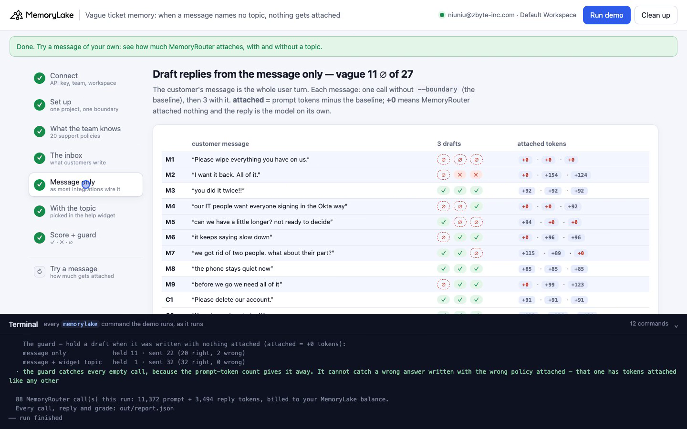
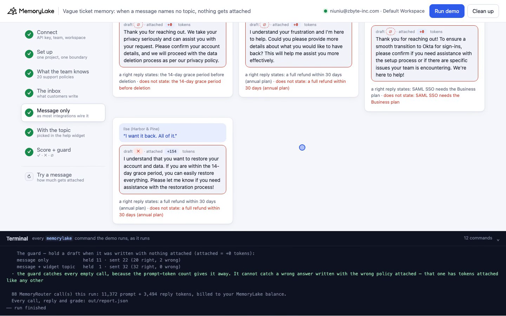
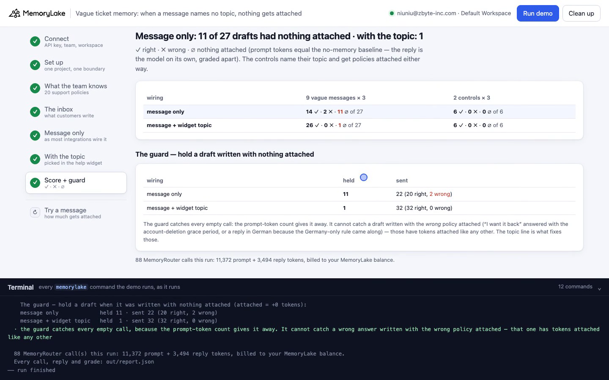
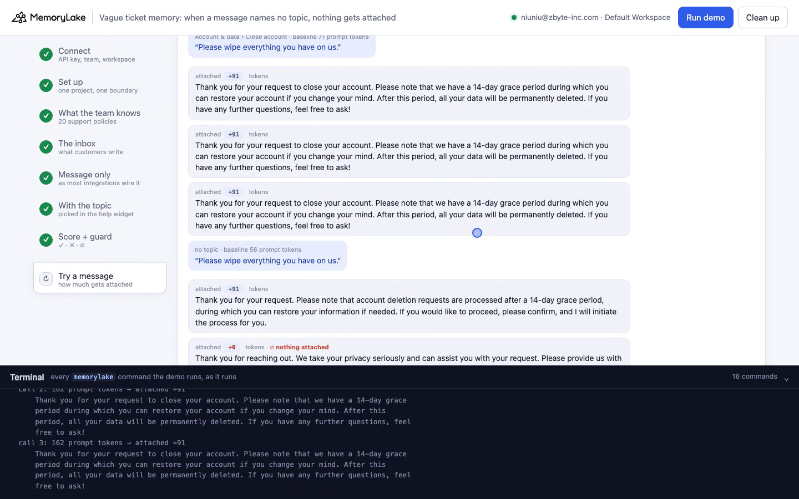

# Vague ticket memory: when a message names no topic, nothing gets attached

A runnable version of the MemoryLake use case
[*Give SaaS Founders and Teams Shared AI Memory That Coordinates Their Work*](https://www.memorylake.ai/en/usecase/ai-memory-for-saas-founder-and-team-coordination),
built entirely on the [`memorylake` CLI](https://github.com/memorylake-ai/memorylake-cli) (v20261015 or later).

**Watch it run:** [CLI, 4:21](https://github.com/memorylake-ai/memorylake-usecases/releases/download/vague-ticket-memory-v1/vague-ticket-memory-cli-demo.mp4) · [Web, 5:35](https://github.com/memorylake-ai/memorylake-usecases/releases/download/vague-ticket-memory-v1/vague-ticket-memory-web-demo.mp4)
([release](https://github.com/memorylake-ai/memorylake-usecases/releases/tag/vague-ticket-memory-v1); GitHub serves them as downloads).

**The problem.** A small SaaS team keeps its support policies in shared memory, and the support assistant drafts
replies through MemoryRouter: an ordinary model call with `--boundary` added, and MemoryRouter picks which
policies to attach. Customers rarely name the topic. *"Please wipe everything you have on us."* *"I want it back.
All of it."* *"you did it twice!!"* For messages like these MemoryRouter often attaches **nothing at all**. The
reply doesn't say so. It reads just as confident as a grounded one, and asks for "account details" instead of
mentioning the 14-day grace period, or asks "what would you like to have back?" instead of offering the 30-day
refund. The only trace is the call's `usage.prompt_tokens`, which is exactly what the same call costs without a
boundary.

**What this demo shows.** Brightdesk (a fictional 9-person helpdesk SaaS) stores 20 support policies, one fact
each, in one project behind one boundary. Eleven customer messages are drafted three times each:
nine that never name their topic and two controls that ask for the same thing with the topic named
(*"Please delete our account."*). Each message is drafted twice: once from the message alone (how most
integrations wire it), then with one extra line, the topic the customer picked in the help widget before writing:
`[Topic picked in the help widget: Account & data › Close account]`.

Totals over all 10 runs made while building and recording it (30 drafts per message per wiring):

| | message only | message + widget topic |
|---|---|---|
| 9 vague messages: **nothing attached (∅)** | **137 / 270** | **10 / 270** |
| 9 vague messages: right | 107 / 270 | 254 / 270 |
| 9 vague messages: wrong, with a policy attached | 26 / 270 | 6 / 270 |
| 2 controls (topic named in the message): right | 60 / 60, never ∅ | 59 / 60 |

Two things fail when a message names no topic, and the two fixes cover different failures:

- **∅, nothing attached.** The draft is the model on its own. A guard catches these: when `prompt_tokens`
  equals the no-memory baseline, hold the draft instead of sending it. The demo makes one baseline call per message
  (`router chat` without `--boundary`, `--max-tokens 1`).
- **The wrong policy attached.** *"I want it back. All of it."* gets the account-deletion policy and is answered
  *"you're still within the 14-day grace period, you can restore everything"*: all 17 of its wrong drafts whose
  text was kept said that (22 wrong in all; two runs' replies were not saved). Sometimes the
  Germany-only "use the formal Sie form" rule comes along and an English customer gets a German reply. These have
  tokens attached like any other call, so the guard can't see them. The topic line fixes both.

Model replies and what MemoryRouter attaches vary from run to run (the same message can come back ∅ in none, some or all of its 3 calls), so
every call is graded and printed as it comes out, and [Measured](#measured) reports totals over all runs.

## Prerequisites

- Python 3.9+ (standard library only)
- The `memorylake` CLI **v20261015 or later** (`memorylake router` arrived in that release):
  ```bash
  curl -fsSL https://raw.githubusercontent.com/memorylake-ai/memorylake-cli/main/scripts/install.sh | sh
  memorylake version
  ```
- A MemoryLake API key ([app.memorylake.ai](https://app.memorylake.ai) → API Keys).
- **Router calls are billed to your MemoryLake balance** (`memorylake billing balance`). One run makes 88 calls on
  `gpt-4o-mini`, about 11,000 prompt + 3,500 reply tokens; the run prints the total. If the balance is empty, the
  router calls print the refusal and are skipped; the memory steps still run.

## Run it

```bash
git clone https://github.com/memorylake-ai/memorylake-usecases.git
cd memorylake-usecases/vague-ticket-memory
export MEMORYLAKE_API_KEY=sk-...
python3 demo.py                     # the whole story, 3–7 minutes (most of it is waiting on MemoryRouter)
python3 demo.py inbox               # the customer messages and their widget topics (offline)
python3 demo.py attach M1           # one message, 3 calls: how much memory gets attached each time
python3 demo.py attach M1 --with-topic   # the same, with the topic M1's customer picked
python3 demo.py attach "my invoices look weird"   # any message of your own
python3 demo.py cleanup             # delete everything the demo created
```

The key is used to log into an isolated CLI profile under `.memorylake-demo/` (git-ignored); your own
`~/.memorylake` is never touched. For the China endpoint also set
`MEMORYLAKE_BASE_URL=https://app.memorylake.cn/openapi/memorylake`. Every run starts over, and everything it
creates is prefixed `mlu-vtm-`.

## Or run it in the browser

```bash
python3 web/server.py                # opens http://127.0.0.1:8765
```

Paste the API key, press **Run the demo**, and follow the steps on the left while the terminal drawer shows every
`memorylake` command as it runs. **Try a message** sends any message, with or without a widget topic, and shows
the attached tokens for each call. **Clean up** removes everything.

| Step 5: drafts from the message only | Step 5: what would have been sent |
|---|---|
|  |  |
| **Step 7: the score and the guard** | **Try a message: with and without the topic** |
|  |  |

## What happens, step by step

All output below is from one real run (long command lines shortened with `…`).

### Steps 2–3: one project, one boundary, 20 policies

```
  · an earlier run left Brightdesk's memory behind; starting over
$ memorylake proj create --name 'Brightdesk support policies' --custom-id mlu-vtm-policies --description 'Brightdesk'"'"'s shared support policies. D …
$ memorylake boundary create --name 'Brightdesk Tier 1 assistant' --custom-id mlu-vtm-tier1 --projects proj-44c94a873bdf4999805c1221edcb5ae3 --worksp …
  · the Tier 1 assistant's boundary bnd-241eed27bf14467eaf946616359b8797 covers the project: every draft is `router chat … --boundary` and MemoryRouter picks which policies to attach
$ memorylake fact add --project proj-44c94a873bdf4999805c1221edcb5ae3 'Refunds: annual plans can be refunded in full within 30 days of the renewal o …
$ memorylake fact list --page-size 200 --projects proj-44c94a873bdf4999805c1221edcb5ae3 --workspace ws-83f0737bd3354e26908ff6f39cdfe5bc
  · 20 policies stored word for word, one fact each

    - Account deletion: deletion requests are processed after a 14-day grace period; within the grace period the owner can restore everything.
    - Refunds: annual plans can be refunded in full within 30 days of the renewal or purchase date; after 30 days, no refunds, only cancellation at term end.
    - Duplicate charges: if a card is charged twice for the same invoice, Tier 1 refunds the duplicate immediately in Stripe without approval.
    - SSO: SAML SSO is only available on the Business plan and above; Starter and Team plans cannot enable it.
    - Trial extension: a 14-day trial can be extended once by 7 days by Tier 1; any further extension needs sales.
    … 15 more
```

### Step 4: the inbox

```
        customer message                                        topic they picked in the help widget
    M1  "Please wipe everything you have on us."                Account & data › Close account
    M2  "I want it back. All of it."                            Billing › Refund
    M3  "you did it twice!!"                                    Billing › Charges
    M4  "our IT people want everyone signing in the Okta way"   Login & security › Single sign-on
    M5  "can we have a little longer? not ready to decide"      Plans › Trial
    M6  "it keeps saying slow down"                             Developers › API
    M7  "we got rid of two people. what about their part?"      Billing › Seats
    M8  "the phone stays quiet now"                             Mobile app › Notifications
    M9  "before we go we need all of it"                        Account & data › Export
    controls — the same requests with the topic named:
    C1  "Please delete our account."                            Account & data › Close account
    C2  "You charged me twice!!"                                Billing › Charges
```

Each message has one pattern for the policy value a right reply must state (`14-day` / `grace period` for M1,
`30 days` for M2, …; `data/brightdesk.json`). A reply in German to an English message is wrong whatever it says.

### Step 5: drafts from the message only

```
$ memorylake router chat 'Please wipe everything you have on us.' --model gpt-4o-mini --max-tokens 1 --temperature 0 --system 'You are Brightdesk'"'"'s support ass …
$ memorylake router chat 'Please wipe everything you have on us.' --model gpt-4o-mini --max-tokens 160 --temperature 0 --system 'You are Brightdesk'"'"'s support a …
  · first the same call without --boundary (56 prompt tokens: system + message, no memory), then 3 with it; attached = the difference. The other messages run the same way, quietly.
    M1  ∅ ∅ ∅    attached +0 · +0 · +0         Please wipe everything you have on us.
    M2  ∅ ✗ ✗    attached +0 · +152 · +91      I want it back. All of it.
    M3  ∅ ∅ ✓    attached +0 · +0 · +92        you did it twice!!
    M4  ∅ ∅ ∅    attached +0 · +0 · +0         our IT people want everyone signing in the Okta way
    M5  ∅ ∅ ∅    attached +0 · +0 · +0         can we have a little longer? not ready to decide
    M6  ∅ ✓ ✓    attached +0 · +96 · +96       it keeps saying slow down
    M7  ✓ ∅ ∅    attached +122 · +0 · +0       we got rid of two people. what about their part?
    M8  ✓ ∅ ✓    attached +85 · +0 · +114      the phone stays quiet now
    M9  ✓ ✓ ✓    attached +156 · +99 · +125    before we go we need all of it
    controls:
    C1  ✓ ✓ ✓    attached +91 · +91 · +91      Please delete our account.
    C2  ✓ ✓ ✓    attached +144 · +108 · +136   You charged me twice!!

    message only             vague 9 ✓ · 2 ✗ · 16 ∅ of 27     controls 6 ✓ · 0 ✗ · 0 ∅ of 6

    replies drafted with nothing attached — what would have been sent:
    M1 “Please wipe everything you have on us.” — attached +0 tokens, ✗ (needs: the 14-day grace period before deletion)
      Thank you for reaching out. We take your privacy seriously and can assist you with your
      request. Please confirm your account details, and we will proceed with the data deletion
      process as per our privacy policy.
    M2 “I want it back. All of it.” — attached +0 tokens, ✗ (needs: a full refund within 30 days (annual plan))
      I understand your frustration and I'm here to help. Could you please provide more details
      about what you would like to have back? This will help me assist you more effectively.
    M3 “you did it twice!!” — attached +0 tokens, ✗ (needs: the duplicate charge is refunded right away)
      I apologize for any confusion or inconvenience this may have caused. Could you please
      provide more details about the issue you're experiencing? I'm here to help!
```

Same run, M2's two ✗ drafts, which had memory attached (+152 and +91 tokens), from `out/report.json`:

> I understand your concern about wanting to restore your account. Since you are still within the 14-day grace
> period, you can easily recover your account and all associated data. …

The step also prints one draft like that (*"and one drafted with a policy attached — the wrong one"*), as
the web view does.

### Step 6: the same messages with the widget topic

```
$ memorylake router chat '[Topic picked in the help widget: Account & data › Close account]
Please wipe everything you have on us.' --model gpt-4o-mini --max-tokens 160 --temperature 0 … --boundary bnd-241eed27bf14467eaf946616359b8797
  · first the same call without --boundary (71 prompt tokens: system + message, no memory), then 3 with it; attached = the difference. The other messages run the same way, quietly.
    M1  ∅ ∅ ✓    attached +0 · +0 · +91        Please wipe everything you have on us.
    M2  ✓ ✓ ✓    attached +172 · +172 · +145   I want it back. All of it.
    M3  ✓ ✓ ✓    attached +134 · +108 · +144   you did it twice!!
    M4  ✓ ✓ ✓    attached +92 · +92 · +92      our IT people want everyone signing in the Okta way
    M5  ✗ ✓ ✓    attached +109 · +94 · +94     can we have a little longer? not ready to decide
    M6  ✓ ✓ ✓    attached +96 · +96 · +96      it keeps saying slow down
    M7  ✓ ✓ ✓    attached +131 · +105 · +159   we got rid of two people. what about their part?
    M8  ✓ ✓ ✓    attached +85 · +85 · +85      the phone stays quiet now
    M9  ✓ ✓ ✓    attached +125 · +125 · +125   before we go we need all of it
    controls:
    C1  ✓ ✓ ✓    attached +91 · +91 · +91      Please delete our account.
    C2  ✓ ✓ ✓    attached +120 · +172 · +172   You charged me twice!!

    message + widget topic   vague 24 ✓ · 1 ✗ · 2 ∅ of 27     controls 6 ✓ · 0 ✗ · 0 ∅ of 6

    the same messages, now with their topic:
    M1 “Please wipe everything you have on us.” — attached +91 tokens, ✓ (needs: the 14-day grace period before deletion)
      Thank you for your request to close your account. Please note that we have a 14-day grace
      period during which you can restore your account if you change your mind. After this
      period, all your data will be permanently deleted. If you have any further questions, feel
      free to ask!
    M2 “I want it back. All of it.” — attached +172 tokens, ✓ (needs: a full refund within 30 days (annual plan))
      Thank you for reaching out. If your purchase was made within the last 30 days and you are
      on an annual plan, I can assist you with a full refund. However, if it has been more than
      30 days or if you are on a monthly plan, we are unable to process refunds, but you can
      cancel your subscription to stop future charges. …
```

This run shows M1 going ∅ twice even with its topic. That is rare: 10 of 270 vague drafts with the topic over all
runs, and every one that could be traced to a message (8 of the 10) was M1.

### Step 7: the score and the guard

```
    message only             vague 9 ✓ · 2 ✗ · 16 ∅ of 27     controls 6 ✓ · 0 ✗ · 0 ∅ of 6
    message + widget topic   vague 24 ✓ · 1 ✗ · 2 ∅ of 27     controls 6 ✓ · 0 ✗ · 0 ∅ of 6

    ✓ right · ✗ wrong · ∅ nothing attached (prompt tokens = the no-memory baseline): the reply is the model on its own, graded apart

    The guard — hold a draft when it was written with nothing attached (attached = +0 tokens):
    message only             held 16 · sent 17 (15 right, 2 wrong)
    message + widget topic   held  2 · sent 31 (30 right, 1 wrong)
  · the guard catches every empty call, because the prompt-token count gives it away. It cannot catch a wrong answer written with the wrong policy attached — that one has tokens attached like any other

  88 MemoryRouter call(s) this run: …
```

### `attach`: any message, three calls

```
$ python3 demo.py attach M1
  “Please wipe everything you have on us.”
  baseline (no boundary): 56 prompt tokens
  call 1: 56 prompt tokens → attached +0   ∅ nothing attached
      Thank you for reaching out. We take your privacy seriously and can assist you with your
      request. Please confirm your account details so we can proceed with the data deletion
      process.
  call 2: 56 prompt tokens → attached +0   ∅ nothing attached
  …
$ python3 demo.py attach M1 --with-topic
  “Please wipe everything you have on us.”  · topic: Account & data › Close account
  baseline (no boundary): 71 prompt tokens
  call 1: 162 prompt tokens → attached +91
      Thank you for your request to close your account. Please note that we have a 14-day grace
      period during which you can restore your account if you change your mind. …
```

## Measured

Per message, the 7 runs made while building the demo (the run above, the two before it, 3 parallel copies,
1 browser run): 21 drafts per message per wiring. The 3 recording runs (CLI twice, web once) add message only
✓ 38 · ✗ 8 · ∅ 35 and with topic ✓ 73 · ✗ 2 · ∅ 6 of 81 to the totals at the top; the first CLI recording's
per-message split was not kept, so it is not in this table. A first run that sent the message with a
`Customer message:` prefix is left out (∅ 3 of 27 there; the prefix gives retrieval two more words to work with).

| message | message only: ✓ · ✗ · ∅ | with widget topic: ✓ · ✗ · ∅ |
|---|---|---|
| M1 "Please wipe everything you have on us." | 1 · 0 · **20** | 17 · 0 · 4 |
| M2 "I want it back. All of it." | 0 · **15** · 6 | 21 · 0 · 0 |
| M3 "you did it twice!!" | 7 · 2 · 12 | 20 · 1 · 0 |
| M4 "our IT people want everyone signing in the Okta way" | 9 · 0 · 12 | 21 · 0 · 0 |
| M5 "can we have a little longer? not ready to decide" | 5 · 1 · 15 | 19 · 2 · 0 |
| M6 "it keeps saying slow down" | 14 · 0 · 7 | 21 · 0 · 0 |
| M7 "we got rid of two people. what about their part?" | 10 · 0 · 11 | 21 · 0 · 0 |
| M8 "the phone stays quiet now" | 9 · 0 · 12 | 20 · 1 · 0 |
| M9 "before we go we need all of it" | 14 · 0 · 7 | 21 · 0 · 0 |
| **9 vague messages** | **69 · 18 · 102** of 189 | **181 · 4 · 4** of 189 |
| C1 "Please delete our account." | 21 · 0 · 0 | 20 · 1 · 0 |
| C2 "You charged me twice!!" | 21 · 0 · 0 | 21 · 0 · 0 |

- **What makes a message go ∅.** It names no topic. It has pronouns ("everything", "it", "their part") where a
  policy has nouns. Before building the demo, 16 ways of saying "delete our data" were tried 4 times each: the ones
  that name an object ("delete our account", "remove all our tickets", "I want my data gone") went ∅ 0 of 4; *"wipe
  everything you have on us"* 4 of 4, *"erase us"* and *"we're done with you guys"* 3 of 4. Casual tone alone does
  not do it: twelve messages written like customers but naming a thing ("my bill", "logins", "the integration")
  were never ∅.
- **∅ is exact, not approximate.** In every run whose calls were saved (8 of 10), each empty call had
  `prompt_tokens` equal to the baseline, to the token, and each call with something attached had at least 80 more.
  No ∅ draft happened to state the right value.
- **The wrong-policy failures** are what the topic line fixes and the guard cannot: M2 is answered with the
  account-deletion grace period (all 17 wrong drafts whose text was kept); M3 once (message only) and M5 three
  times (with topic) came back in German.
- **Blind rewriting is not the same fix.** A probe asked the model to rewrite each vague message as a policy
  question first (no topic given). ∅ fell to 3 of 50, but the rewrite guessed the wrong subject for some messages
  ("the phone stays quiet now" → *"phone not ringing"*; "we got rid of two people" → *"redistributing their
  responsibilities"*), and right answers were 34 of 50. The widget topic is what the customer actually chose.
- One model (`gpt-4o-mini`, temperature 0) was measured; graders are one regular expression per message, printed
  with every miss so you can disagree with them.

## Use it in your own app

- **Forward the context you already have.** The help widget's topic, the ticket's category or the page the
  customer was on all name the topic the customer didn't type. One line in front of the message did it here.
- **Measure ∅.** One extra call without `--boundary` (`--max-tokens 1`) gives the baseline; `prompt_tokens` equal
  to it means nothing was attached. Hold those drafts, route them to a person, or ask the customer what it's about.
- **Know what the guard can't see.** A draft written with the wrong policy attached costs as many tokens as a
  right one. Only better input (the topic) or checking the reply against what was attached will catch it.
- **Test your own inbox.** `python3 demo.py attach "<message>"` against your own policies shows which of your
  customers' real phrasings come back empty.

## Troubleshooting

- **`this memorylake CLI has no router command`**: upgrade the CLI (install line above).
- **MemoryRouter refused the call for lack of balance**: top up in the console; `memorylake billing balance` shows it.
- **`the demo memory does not exist yet`**: `attach` needs the policies from a full run (and `cleanup` removes them).
- **A run was interrupted**: run again; it deletes what the previous run left and starts over.
- **`fact(s) are still … after deleting`**: deletes are retried and re-checked; run `python3 demo.py cleanup` again.

## Files

| File | What it is |
|---|---|
| `demo.py` | The demo: CLI wrapper, setup, the policies, both wirings, the baseline calls, grading, the guard, `attach`, cleanup |
| `data/brightdesk.json` | The 20 policies, the system prompt, the 11 customer messages with their widget topics and graders |
| `web/server.py`, `web/static/` | Browser companion (standard library server, no build step) |
| `out/` | `report.json` with every call, reply, prompt-token count, baseline and grade (git-ignored) |
