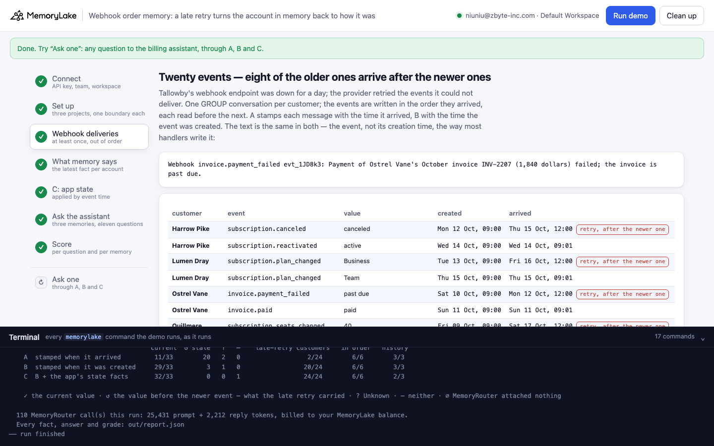
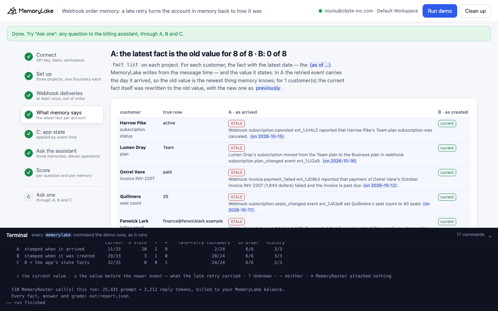
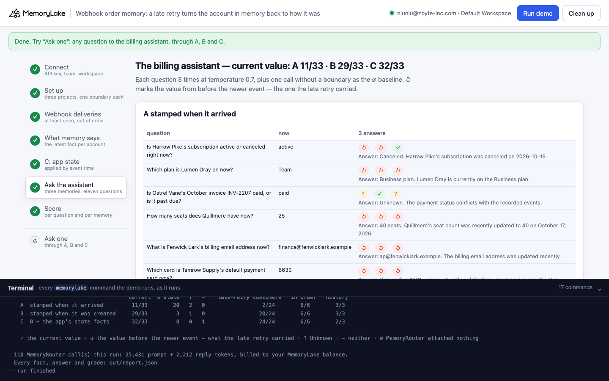
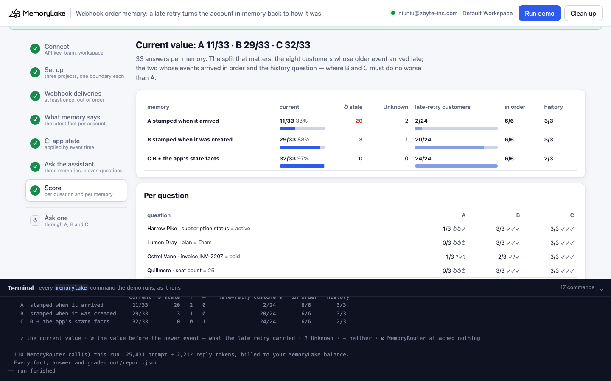
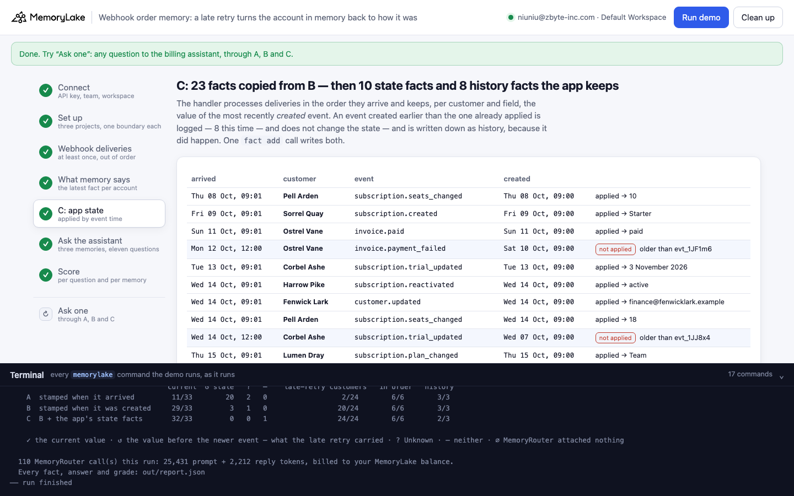
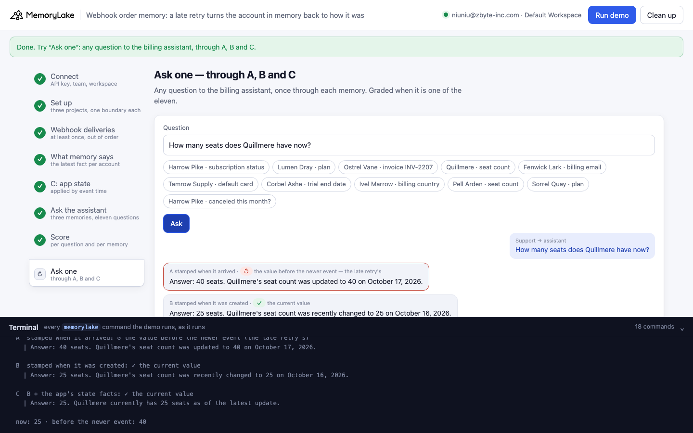

# Webhook order memory: a late webhook retry turns the account in memory back to how it was

A runnable version of the MemoryLake use case
[*Memory for Webhook-Triggered Agents*](https://www.memorylake.ai/en/usecase/memory-for-webhook-triggered-agents),
built entirely on the [`memorylake` CLI](https://github.com/memorylake-ai/memorylake-cli) (v20261015 or later).

**Watch it run:** videos coming with the `webhook-order-memory-v1` release.

**The problem.** Payment providers deliver webhooks *at least once* and *not in order*. When your endpoint is down,
the provider retries what it could not deliver, so an older event can arrive after a newer one. Most handlers write
each event into memory the moment it arrives, stamped with the time it arrived:

```
Fri 16 Oct 09:00  created   subscription.seats_changed  "Quillmere's seat count was set to 25 seats."  → arrives 09:01
Fri 09 Oct 09:00  created   subscription.seats_changed  "Quillmere's seat count was set to 40 seats."  → arrives Sat 17 Oct 12:00 (retry)
what memory holds afterwards:  "Quillmere's seat count was set to 40 seats in webhook event … (on 2026-10-17)"
                               "Quillmere's subscription seat count is set to 40 seats (as of 2026-10-17, previously 25 seats as of 2026-10-16)"   (some runs)
asked later:                   "How many seats does Quillmere have now?"
the billing assistant:         "Answer: 40 seats. Quillmere's seat count was recently updated to 40 on 2026-10-17."
```

MemoryLake dates each extracted fact from the message's timestamp. The late retry is the **newest** thing memory
has heard about the account, so its old value becomes the current one. Sometimes the current fact is even rewritten
in place, with the true value demoted to "previously". Stamping each message with the event's own creation time
(the provider sends it) fixes most of this, but not all of it: the older event is now written *after* a newer one
yet dated *before* it, and extraction sometimes drops one of the two. In one run the cancellation vanished from
memory; in another, the newer plan change did.

**What this demo shows.** Tallowby (a fictional SaaS company) writes its payment provider's webhooks into memory;
its billing assistant answers from that memory through MemoryRouter. After a day-long outage, eight customers'
older events arrive 27 hours after the newer ones; two customers' events arrive in order. The same twenty events go
into three memories:

| | memory | what the billing assistant reads |
|---|---|---|
| **A** | one message per event, `--timestamp` = when it **arrived** (the usual handler) | facts dated by arrival: the late retry looks newest |
| **B** | the same messages, `--timestamp` = when the event was **created** | facts dated by event time, minus whatever extraction drops |
| **C** | B's extracted facts copied word for word (`fact list` → `fact add`), plus facts the app writes itself: one **state fact** per customer (the value of the most recently *created* event; an older event that arrives later never changes it) and one **history fact** per event it did not apply | the same as B, plus the state the app computed by event time |

Eleven questions — eight about customers whose older event arrived late ("How many seats does Quillmere have now?"),
two about customers whose events arrived in order, one about the past ("Was Harrow Pike's subscription canceled at
any point this month?") — three answers each per memory, on `gpt-4o-mini` at temperature 0.7.

Over 10 runs: in A, the latest-dated fact about the account states the **old value for 79 of 80** late-retry
customers (rewritten in place for 8); in B, the current value for 77 of 80, and the older event survives at all for
only 67 of 80. Current-value questions on the late-retry customers: **A 34/240** (↺ the late retry's value 183),
**B 193/240**, **C 238/240**. Customers whose events arrived in order: A 60/60, B 59/60, C 60/60. The cost is on the
past: the history question is right **A 21/30, B 17/30, C 9/30**. Details in [Measured](#measured).

## Prerequisites

- Python 3.9+ (standard library only)
- The `memorylake` CLI **v20261015 or later** (`memorylake router` arrived in that release):
  ```bash
  curl -fsSL https://raw.githubusercontent.com/memorylake-ai/memorylake-cli/main/scripts/install.sh | sh
  memorylake version
  ```
- A MemoryLake API key ([app.memorylake.ai](https://app.memorylake.ai) → API Keys).
- **Router calls are billed to your MemoryLake balance** (`memorylake billing balance`). One run makes 110 calls on
  `gpt-4o-mini`, about 24,000 prompt + 2,200 reply tokens; the run prints the total. If the balance is empty, the
  router calls print the refusal and are skipped; the memory steps still run.

## Run it

```bash
git clone https://github.com/memorylake-ai/memorylake-usecases.git
cd memorylake-usecases/webhook-order-memory
export MEMORYLAKE_API_KEY=sk-...
python3 demo.py                     # the whole story, about 6 minutes
python3 demo.py memory              # re-read what A's and B's facts say about each account
python3 demo.py ask 'How many seats does Quillmere have now?'
python3 demo.py cleanup             # delete everything the demo created
```

The key is used to log into an isolated CLI profile under `.memorylake-demo/` (git-ignored); your own
`~/.memorylake` is never touched. For the China endpoint, also set
`MEMORYLAKE_BASE_URL=https://app.memorylake.cn/openapi/memorylake`. Every run starts over. Everything it creates is
prefixed `mlu-wom-`. `cleanup` keeps the run's `out/report.json`, moving it to `out/runs/`.

## Or run it in the browser

```bash
python3 web/server.py                # opens http://127.0.0.1:8765
```

Paste the API key and press **Run the demo**. Follow the steps on the left; the terminal drawer shows every
`memorylake` command as it runs. **Ask one** sends any question through A, B and C and grades it if it is one of the
eleven. **Clean up** removes everything.

| Step 3: the deliveries | Step 4: what memory says now |
|---|---|
|  |  |
| **Step 6: the assistant's answers** | **Step 7: the score** |
|  |  |
| **Step 5: C, the app's state and history facts** | **Ask one** |
|  |  |

## What happens, step by step

The output below is from one real run (the "third run (--reset)" in [Measured](#measured)), trimmed.

### Step 2: three projects, one webhook actor, one boundary each

```
$ memorylake proj create --name 'Tallowby billing events' --custom-id mlu-wom-delivered --description 'Tallowby billing events. Demo data.' --workspace ws-…
  · three projects with the same name: A and B get the webhook messages, C gets B's facts plus the app's state and history facts
$ memorylake actor create --custom-id mlu-wom-bot --display-name billing-webhook --description 'Webhook handler that writes payment-provider events into memory. Demo data.' --tags demo
$ memorylake boundary create --name 'Billing assistant (stamped with the time each event arrived)' --custom-id mlu-wom-delivered --projects proj-… --workspace ws-…
  · one boundary per project — what the billing assistant reads through MemoryRouter
```

The three projects share one plain name: a project's name is context for extraction, so it must not differ between
the arms. The arm is in the `custom_id` and the boundary name.

### Step 3: twenty webhook events, delivered at least once and out of order

```
    Tallowby's webhook endpoint was down for a day; the provider retried the events it could not deliver.

    customer       event (what happened)                         created          arrived
    Harrow Pike    subscription.canceled → canceled              Mon 12 Oct 09:00 Thu 15 Oct 12:00   ← retry, after the newer one
    Harrow Pike    subscription.reactivated → active             Wed 14 Oct 09:00 Wed 14 Oct 09:01
    Quillmere      subscription.seats_changed → 40               Fri 09 Oct 09:00 Sat 17 Oct 12:00   ← retry, after the newer one
    Quillmere      subscription.seats_changed → 25               Fri 16 Oct 09:00 Fri 16 Oct 09:01
    …              (eight customers like this)
    Pell Arden     subscription.seats_changed → 10               Thu 08 Oct 09:00 Thu 08 Oct 09:01
    Pell Arden     subscription.seats_changed → 18               Wed 14 Oct 09:00 Wed 14 Oct 09:01
    …              (two customers in order)

    Webhook invoice.payment_failed evt_1JD8k3: Payment of Ostrel Vane's October invoice INV-2207 (1,840 dollars) failed; the invoice is past due.
$ memorylake conv create --project proj-… --actors actor-… --kind GROUP --name 'Harrow Pike billing events' --custom-id mlu-wom-conv-delivered-harrow --workspace ws-…
$ memorylake conv msg append conv-… --actor actor-… --custom-id evt_1JK9d7 --timestamp 2026-10-14T09:01:00Z --text 'Webhook subscription.reactivated evt_1JK9d7: Harrow Pike'"'"'s …' --workspace ws-…
$ memorylake conv consumed-messages conv-… --message conv-entry-… --workspace ws-…
  · 20 conversations, 40 messages, all read in 193 s
```

One GROUP conversation per customer and memory. The events are written in the order they arrived, and each is read
(`conv consumed-messages --message` + `cook-status`) before the next is written, as a handler would. The message
text is the event, the way most handlers write it: type, id, what happened — not when it was created. A and B
differ only in `--timestamp`.

### Step 4: what memory says about each account now

```
$ memorylake fact list --projects proj-… --page-size 200 --workspace ws-…

    customer       field                 true now                      A · as arrived  B · as created
    Harrow Pike    subscription status   active                        STALE           current
    Lumen Dray     plan                  Team                          STALE           current
    Ostrel Vane    invoice INV-2207      paid                          STALE           current
    Quillmere      seat count            25                            STALE           current
    …
    Pell Arden     seat count            18                            current         current            (arrived in order)

    A: the latest fact about each customer not shown as current
      · Lumen Dray [STALE]: Lumen Dray's subscription is on the Business plan (as of 2026-10-16, previously on the
      · Team plan as of 2026-10-15).
      · Quillmere [STALE]: Quillmere's seat count was set to 40 seats in webhook event subscription.seats_changed
      · evt_1JA3p8. (on 2026-10-17)
      · Tamrow Supply [STALE]: Tamrow Supply's default payment card was set to the Visa ending 1881 (as of 2026-10-16,
      · previously the Mastercard ending 6630 as of 2026-10-15).
      …
    A: of the 8 customers whose older event arrived late — current 0 · stale 8 · tie 0 · missing 0; a fact rewritten to the old value (with the new one as 'previously') for 2; …
    B: of the 8 customers whose older event arrived late — current 8 · stale 0 · tie 0 · missing 0; …
```

For each customer, the demo takes the fact with the latest date (the "(as of …)" / "(on …)" MemoryLake writes from
the message time) and reads which value it states — the part before any "previously", without "from X" phrases.
In A the retry carries the day it arrived, so the old value is the newest thing memory knows.

### Step 5: C — the app keeps each account's state by event time

```
    The handler's own log, in arrival order:
      Sun 11 Oct 09:01  Ostrel Vane    invoice.paid                    created Sun 11 Oct 09:00  applied → paid
      Mon 12 Oct 12:00  Ostrel Vane    invoice.payment_failed          created Sat 10 Oct 09:00  NOT applied: older than evt_1JF1m6
      …
$ memorylake fact list --projects proj-… --page-size 200 --workspace ws-…
$ memorylake fact add 'Webhook subscription.plan_changed evt_1JM8d2 indicates Sorrel Quay'"'"'s …' … --project proj-… --workspace ws-…
$ memorylake fact add 'Billing state for Harrow Pike, subscription status: active. Set by …' … --project proj-… --workspace ws-…
      · Billing state for Harrow Pike, subscription status: active. Set by subscription.reactivated evt_1JK9d7,
      · created 2026-10-14 09:00 UTC, the most recently created event for this field. Events created earlier still
      · happened and stay in the history; they do not change the current value, even when they arrived later.
      · Billing history for Ostrel Vane, invoice INV-2207: past due, from invoice.payment_failed evt_1JD8k3, created
      · 2026-10-10 09:00 UTC. It happened, but it arrived on 2026-10-12 after a newer event had been applied, so it is
      · history, not the current value.
```

The handler processes deliveries as they arrive and keeps, per customer and field, the event with the latest
`created`. That is the standard webhook rule (compare the event's version, not its arrival), done in ten lines of
`app_state()`. C copies B's extracted facts word for word, so B and C differ only by what the app wrote.

### Step 6: ask the billing assistant

```
  A  stamped when it arrived
    Lumen Dray · plan                        ↺ ↺ ↺    Answer: Business plan. Lumen Dray is currently subscribed to the Busin…
    Quillmere · seat count                   ↺ ↺ ↺    Answer: 40 seats. Quillmere's seat count was recently updated to 40.
    Tamrow Supply · default card             ↺ ↺ ↺    Answer: Visa ending 1881. Tamrow Supply's default payment card is curr…
    Pell Arden · seat count                  ✓ ✓ ✓    Answer: 18 seats. Pell Arden currently has 18 seats as of October 14, …
  B  stamped when it was created
    Quillmere · seat count                   ↺ ↺ ↺    Answer: 40 seats. Quillmere's seat count was recently updated to 40.
    Corbel Ashe · trial end date             ↺ ↺ ↺    Answer: 20 October 2026. Corbel Ashe's trial is set to end on 20 Octob…
  C  B + the app's state facts
    Quillmere · seat count                   ✓ ✓ ✓    Answer: 25 seats. Quillmere currently has 25 seats as of October 16, 2…
```

`router chat --boundary <memory>`, system prompt "Reply in one line that starts with "Answer: <the current value>""
(the grader reads that line). Each question also runs once without a boundary: a boundary call with exactly as many
prompt tokens had nothing attached (∅, not graded; none occurred in these runs).

### Step 7: the score

```
                                      current  ↺ stale   ?   –    late-retry customers   in order   history
    A  stamped when it arrived         15/33        15   3   0                  7/24        6/6        2/3
    B  stamped when it was created     25/33         7   1   0                 17/24        5/6        3/3
    C  B + the app's state facts       33/33         0   0   0                 24/24        6/6        3/3
```

## Measured

Per run. "A: latest fact is the old value" and "B: latest fact current" are about the 8 late-retry customers, read
from the saved facts; "older event in memory at all" counts customers for whom any fact in B states the older value.
Answers are graded from the saved `out/report.json` with the current grader: late-retry customers (24 answers), in
order (6), history (3); ↺ = the late retry's value, ? = Unknown, – = neither.

| run | A: latest fact is the old value | B: latest fact current | B: older event in memory at all | A stamped when it arrived | B stamped when created | C B + app facts |
|---|---|---|---|---|---|---|
| first run ¹ | 8/8 (1 rewritten in place) | 8/8 | 6/8 | late 2/24 · in order 6/6 · history 2/3 (↺ 22 · ? 1) | late 17/24 · in order 6/6 · history 3/3 (↺ 4 · ? 3) | late 24/24 · in order 6/6 · history 0/3 (↺ 3) |
| second run ² | 8/8 (1 rewritten in place) | 8/8 | 7/8 | late 0/24 · in order 6/6 · history 3/3 (↺ 20 · ? 4) | late 22/24 · in order 6/6 · history 3/3 (↺ 2) | late 24/24 · in order 6/6 · history 3/3 |
| PREFIX copy 1 ² | 8/8 (1 rewritten in place) | 7/8 (Ivel Marrow stale) | 5/8 | late 1/24 · in order 6/6 · history 3/3 (↺ 20 · ? 3) | late 20/24 · in order 6/6 · history 0/3 (↺ 5 · ? 2) | late 24/24 · in order 6/6 · history 0/3 (↺ 1 · ? 2) |
| PREFIX copy 2 ² | 8/8 (1 rewritten in place) | 7/8 (Lumen Dray stale) | 7/8 | late 3/24 · in order 6/6 · history 1/3 (↺ 19 · ? 4) | late 15/24 · in order 6/6 · history 0/3 (↺ 7 · ? 5) | late 22/24 · in order 6/6 · history 0/3 (↺ 3 · – 2) |
| PREFIX copy 3 ² | 8/8 | 8/8 | 7/8 | late 1/24 · in order 6/6 · history 2/3 (↺ 21 · ? 3) | late 20/24 · in order 6/6 · history 0/3 (↺ 2 · ? 5) | late 24/24 · in order 6/6 · history 0/3 (↺ 2 · – 1) |
| PREFIX copy 4 ² | 8/8 | 8/8 | 7/8 | late 5/24 · in order 6/6 · history 3/3 (↺ 17 · ? 2) | late 18/24 · in order 6/6 · history 0/3 (↺ 3 · ? 6) | late 24/24 · in order 6/6 · history 0/3 (↺ 2 · – 1) |
| third run (--reset) | 8/8 (2 rewritten in place) | 8/8 | 6/8 | late 7/24 · in order 6/6 · history 2/3 (↺ 15 · ? 3) | late 17/24 · in order 5/6 · history 3/3 (↺ 7 · ? 1) | late 24/24 · in order 6/6 · history 3/3 |
| PREFIX copy 5 | 7/8 (1 rewritten in place) | 8/8 | 7/8 | late 6/24 · in order 6/6 · history 1/3 (↺ 15 · ? 5) | late 24/24 · in order 6/6 · history 2/3 (? 1) | late 24/24 · in order 6/6 · history 1/3 (– 2) |
| PREFIX copy 6 | 8/8 | 7/8 (Lumen Dray tie) | 7/8 | late 5/24 · in order 6/6 · history 2/3 (↺ 16 · ? 4) | late 16/24 · in order 6/6 · history 3/3 (↺ 6 · ? 2) | late 24/24 · in order 6/6 · history 0/3 (↺ 1 · – 2) |
| PREFIX copy 7 | 8/8 (1 rewritten in place) | 8/8 | 8/8 | late 4/24 · in order 6/6 · history 2/3 (↺ 18 · ? 3) | late 24/24 · in order 6/6 · history 3/3 | late 24/24 · in order 6/6 · history 2/3 (– 1) |
| **total** | **79/80** (8 rewritten) | **77/80** | **67/80** | **late 34/240** · in order 60/60 · history 21/30 (↺ 183 · ? 32) | **late 193/240** · in order 59/60 · history 17/30 (↺ 36 · ? 25) | **late 238/240** · in order 60/60 · history 9/30 |

C was built in three steps, and A and B are the same in all of them: ¹ the state fact said "events that arrived later
but were created earlier were not applied" — the model then answered the history question "No" (3/3); ² the state
fact says older events "still happened and stay in the history", but C has no history facts — history 3/15; from the
third run on, C also has one history fact per event the app did not apply — history 6/12. The PREFIX copies are the
same demo run side by side under another prefix (`mlu-wom1-` … `mlu-wom4-`).

What goes wrong in B (event-time stamps), across the 10 runs: the newer event's fact disappears (Ivel Marrow's
Netherlands, Lumen Dray's Team: only the older value is left), or the older event's fact disappears (13 of 80 — most
often the Harrow Pike cancellation, which then makes the history question unanswerable), and with both facts present
the model still picks the wrong one now and then (Quillmere 40 in the third run, though the facts are dated 10-09 and
10-16).

## What else we measured

Probes before the demo (four customers, the same pairs of events; 2026-10-18):

- **When the message text carries the creation time** ("Webhook subscription.seats_changed (event created 2026-10-09
  09:00 UTC): …"), the fact still gets the arrival date, but the creation time stays in the fact's text and the
  model orders by it: with arrival-time stamps the assistant still gave the current value in most answers. Most handlers do not
  write the creation time into the text, which is why the demo doesn't.
- **Raw JSON payloads** (`{"id": …, "type": …, "created": 1792054800, "summary": …}`) behave like plain text with
  arrival stamps: 11 of 12 answers gave the old value. The epoch `created` became a fact of its own ("The billing event
  … has created timestamp 1792054800").
- **A retry six hours later, the same day**: the old and new facts carry the same date (a tie); the 27-hour gap in
  the demo is a provider retry after a day-long outage.

## Use it in your own agent

- **Stamp each message with the event's `created`, not the arrival time.** `conv msg append --timestamp` is what
  MemoryLake dates the extracted facts by. It is the cheap fix, and in these runs it took the late-retry customers
  from 34/240 to 193/240.
- **Keep the current state yourself, by event version.** The standard webhook rule — apply an event only if it is
  newer than the one you already applied — belongs in the handler, not in extraction. Write the result as one
  `fact add` per entity and field, saying which event set it. 238/240.
- **Write down what you did not apply.** An older event that arrives late still happened. If memory is also asked
  about the past, record it as history: extraction alone dropped it in 13 of 80 cases.
- **State facts pull every question toward the present.** With them, the model answered "Was the subscription
  canceled this month?" with the current status ("Answer: Active", 13 of 30) or with "No" / "Unknown" (12 of 30). For questions about the past, query
  the history (`fact list --query`) instead of asking the state.

## Troubleshooting

- **`this memorylake CLI has no router command`**: upgrade the CLI (install line above).
- **MemoryRouter refused the call for lack of balance**: top up in the console; `memorylake billing balance` shows it.
  Steps 2–5 do not need the Router.
- **`still extracting after 300 s`**: once in a while a message takes longer to read; the demo carries on with what
  memory holds. Run `python3 demo.py memory` a few minutes later to re-read the facts.
- **A looks right this time**: extraction varies; in some runs an old fact is dated the same day as the new one and
  the model happens to pick the new one. That is why the table above adds up several runs.
- **The question in `ask` contains a `$`**: quote it with single quotes, or the shell expands `$…` before the demo sees it.
- **`the demo memory does not exist yet`**: `memory` and `ask` need a full run first (and `cleanup` removes it).
- **A run was interrupted**: run again; it deletes what the previous run left and starts over.

## Files

| File | What it is |
|---|---|
| `demo.py` | The demo: CLI wrapper, setup, deliveries (`deliveries()`, `ingest_one()`, `wait_read()`), the census (`census_one()`, `asserted()`), the app's state (`app_state()`, `state_text()`, `history_text()`), Router questions, the grader (`grade()`), `memory`, `ask`, cleanup (facts before the actor) |
| `data/events.json` | The ten customers, their two events each (id, type, created, text, value), which ones arrive late, the questions and the value patterns, the system prompt |
| `web/server.py`, `web/static/` | Browser companion (standard library server, no build step) |
| `out/` | `report.json` with every fact, the app's log, every answer and grade; `out/runs/` keeps earlier runs' reports (git-ignored) |
