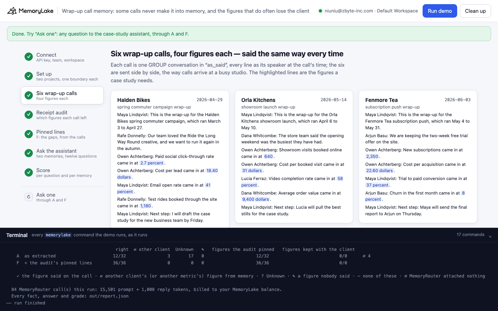
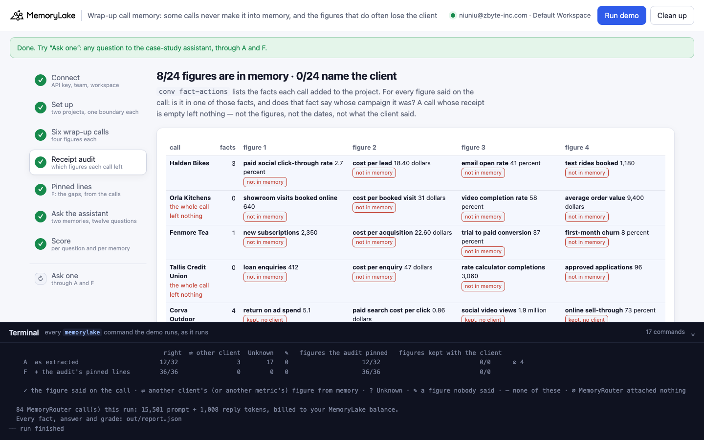
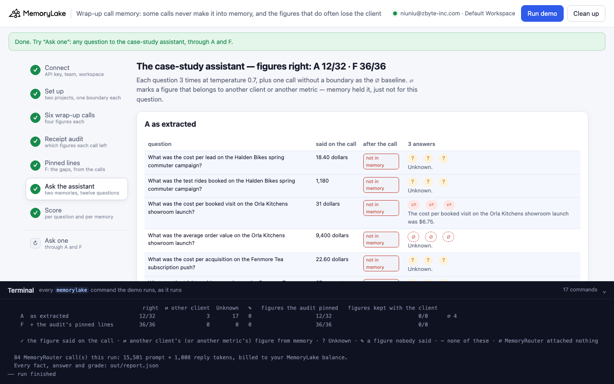
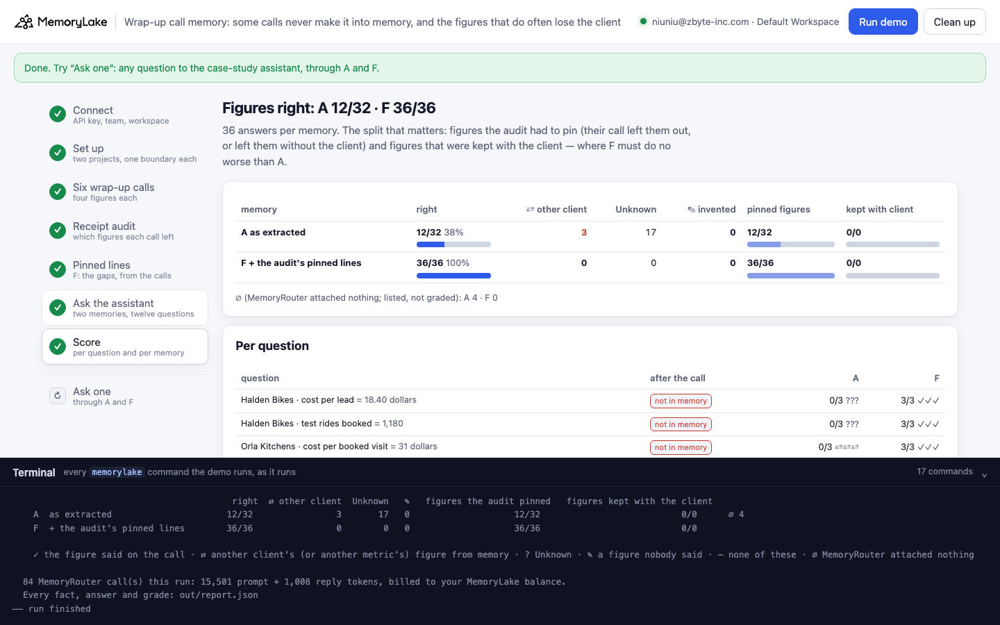
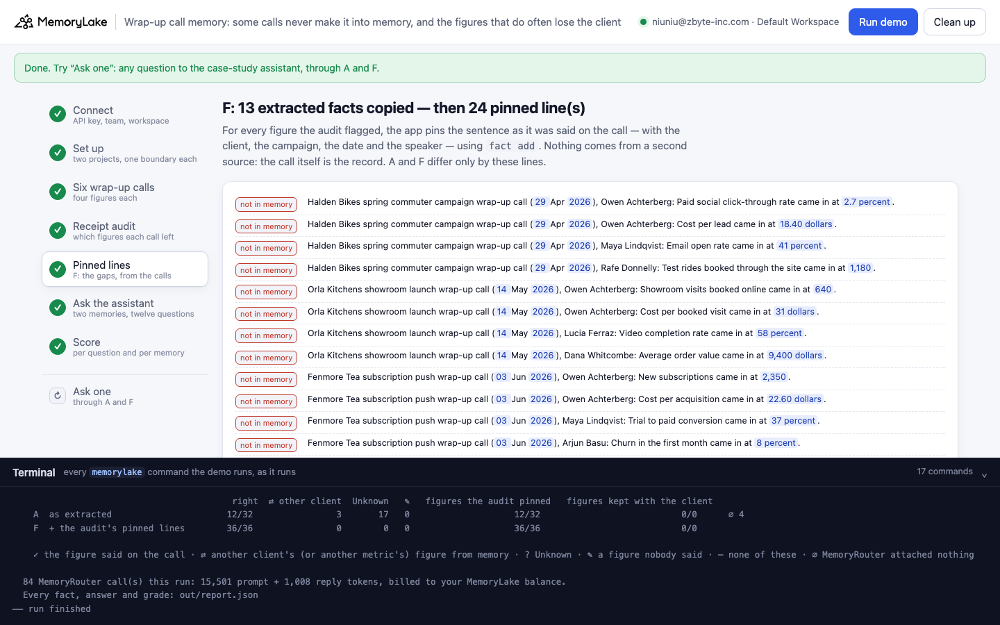
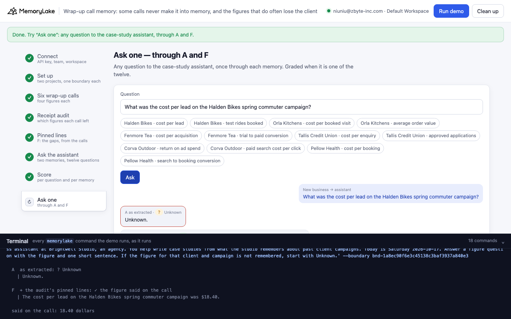

# Wrap-up call memory: some calls never make it into memory, and the figures that do often lose the client

A runnable version of the MemoryLake use case
[*Case Study Memory for Agency Teams*](https://www.memorylake.ai/en/usecase/case-study-memory-for-agency-teams),
built entirely on the [`memorylake` CLI](https://github.com/memorylake-ai/memorylake-cli) (v20261015 or later).

**Watch it run:** recording in progress

**The problem.** An agency holds a wrap-up call at the end of every client campaign, and the new-business team
writes case studies from what those calls left in memory. The figures are said the way people say them:

```
29 Apr, Halden Bikes wrap-up:   "Cost per lead came in at 18.40 dollars."   (and three more figures)
16 Sep, Pellow Health wrap-up:  "Cost per booking came in at 6.75 dollars." (and three more figures)
what the calls left in memory:  Halden Bikes: nothing at all   (the whole call: no figures, no dates, nothing)
                                "Cost per booking came in at 6.75 dollars (as of 2026-09-16)."   (no client)
asked later:                    "What was the cost per lead on the Halden Bikes spring commuter campaign?"
the case-study assistant:       "Unknown."
```

MemoryLake extracts most calls whole. Now and then a call leaves **nothing** behind: `cook-status` says finished,
the transcript is there, the project has no fact from it, and nothing anywhere says so. Of the figures that are kept,
many come back **without the client's name**. Ask the case-study assistant about a lost call and it says "Unknown",
which reads exactly like a figure nobody ever reported. Now and then it gives another client's unnamed figure
instead: "The cost per booking on the Pellow Health clinic finder relaunch was 31 dollars" (Orla's cost per booked
visit, kept without the client, while Pellow's call was lost).

**What this demo shows.** Each conversation has a receipt: `conv fact-actions` lists the facts that conversation
added to the project. After the calls are extracted, the app audits every call against its receipt — for each
figure said on the call, is it in one of those facts, and does that fact name the client? — and pins the lines that
are missing or unnamed, word for word, with the client, campaign, date and speaker. No second data source: the call
is the record. Two memories, read through MemoryRouter:

| | memory | what the case-study assistant reads |
|---|---|---|
| **A** | the six calls, as extracted | whatever each call left; nothing from a lost call |
| **F** | A's extracted facts copied word for word, plus the audit's pinned lines (`fact add`) | the same, plus every figure that was missing or unnamed, with its client |

Twelve figure questions ("What was the cost per lead on the Halden Bikes spring commuter campaign?"), two per client,
three answers each per memory, on `gpt-4o-mini` at temperature 0.7.

Over 5 runs: **6 of 30 calls** left nothing at all; of the figures said, **73/120** were kept and **29/120** in a fact naming the client. Figure questions answered right: **A 108/170 (? 61 · ⇄ 1) · ∅ 10**, **F 180/180**. On the figures memory had already kept with their client, both memories scored the same (A 42/42, F 42/42): pinning cost nothing. Details in [Measured](#measured).

## Prerequisites

- Python 3.9+ (standard library only)
- The `memorylake` CLI **v20261015 or later** (`memorylake router` arrived in that release):
  ```bash
  curl -fsSL https://raw.githubusercontent.com/memorylake-ai/memorylake-cli/main/scripts/install.sh | sh
  memorylake version
  ```
- A MemoryLake API key ([app.memorylake.ai](https://app.memorylake.ai) → API Keys).
- **Router calls are billed to your MemoryLake balance** (`memorylake billing balance`). One run makes 84 calls on
  `gpt-4o-mini`, about 15,000 prompt + 1,000 reply tokens; the run prints the total. If the balance is empty, the
  router calls print the refusal and are skipped; the memory steps and the audit still run.

## Run it

```bash
git clone https://github.com/memorylake-ai/memorylake-usecases.git
cd memorylake-usecases/wrap-up-call-memory
export MEMORYLAKE_API_KEY=sk-...
python3 demo.py                     # the whole story, about 4 minutes
python3 demo.py memory              # re-read each call's receipt: which figures it left, and whose
python3 demo.py ask 'What was the cost per booked visit on the Orla Kitchens showroom launch?'
python3 demo.py cleanup             # delete everything the demo created
```

The key is used to log into an isolated CLI profile under `.memorylake-demo/` (git-ignored); your own
`~/.memorylake` is never touched. For the China endpoint, also set
`MEMORYLAKE_BASE_URL=https://app.memorylake.cn/openapi/memorylake`. Every run starts over. Everything it creates is
prefixed `mlu-wcm-`. `cleanup` keeps the run's `out/report.json`, moving it to `out/runs/`.

## Or run it in the browser

```bash
python3 web/server.py                # opens http://127.0.0.1:8765
```

Paste the API key and press **Run the demo**. Follow the steps on the left; the terminal drawer shows every
`memorylake` command as it runs. **Ask one** sends any question through A and F and grades it if it is one of the
twelve. **Clean up** removes everything.

| Step 3: six wrap-up calls | Step 4: the receipt audit |
|---|---|
|  |  |
| **Step 6: the assistant's answers** | **Step 7: the score** |
|  |  |
| **Step 5: the pinned lines (F)** | **Ask one** |
|  |  |

## What happens, step by step

The output below is from one real run (the "second run (--reset)" in [Measured](#measured)), trimmed.

### Step 2: two projects, nine actors, one boundary each

```
$ memorylake proj create --name 'Brightwell Studio client work' --custom-id mlu-wcm-as_said --description 'Brightwell Studio client work. Demo data.' --workspace ws-…
  · two projects: “as_said” gets the six wrap-up calls; “audited” gets what “as_said” extracted, plus the lines the audit pins
  · 3 studio people and 6 client contacts: Maya Lindqvist · Owen Achterberg · Lucia Ferraz · Rafe Donnelly · Dana Whitcombe · Arjun Basu · Grace Okafor · Nils Sorensen · Imogen Hart
$ memorylake boundary create --name 'Case-study assistant (the calls as extracted)' --custom-id mlu-wcm-as_said --projects proj-… --workspace ws-…
```

Both projects carry the same plain name. A project's name is context for extraction: in four earlier runs where the
names ended in " · A" and " · F", fewer calls were kept (see [What else we measured](#what-else-we-measured)).

### Step 3: six wrap-up calls, four figures each

```
    Wed 29 Apr 2026  Halden Bikes — spring commuter campaign wrap-up
        Maya Lindqvist: This is the wrap-up for the Halden Bikes spring commuter campaign, which ran March 3 to April 27.
        Rafe Donnelly: Our team loved the Ride the Long Way Round creative, and we want to run it again in the autumn.
        Owen Achterberg: Paid social click-through rate came in at 2.7 percent.
        Owen Achterberg: Cost per lead came in at 18.40 dollars.
        Maya Lindqvist: Email open rate came in at 41 percent.
        Rafe Donnelly: Test rides booked through the site came in at 1,180.
        Maya Lindqvist: Next step: I will draft the case study for the new business team by Friday.
    …  Orla Kitchens (14 May) · Fenmore Tea (3 Jun) · Tallis Credit Union (8 Jul) · Corva Outdoor (12 Aug) · Pellow Health (16 Sep)
```

Each call is one GROUP conversation in "as_said" (`conv create --kind GROUP`, `conv msg append` per line as its
speaker, at the call's time). The six are sent side by side and the demo waits for `conv cook-status` to report
`cook_finished` on each.

### Step 4: audit each call's receipt

```
$ memorylake conv fact-actions conv-… --project proj-… --page-size 100 --workspace ws-…

    call                   facts   figures kept   … naming the client
    Halden Bikes               0   0/4          0/4   ← the whole call left nothing
    Orla Kitchens              4   2/4          0/4
          · showroom visits booked online: kept without the client — “Showroom visits booked online came in at 640. (as of 2026-05-14)”
          · cost per booked visit: kept without the client — “Cost per booked visit came in at 31 dollars. (as of 2026-05-14)”
    Fenmore Tea                5   4/4          4/4
    Tallis Credit Union        0   0/4          0/4   ← the whole call left nothing
    Corva Outdoor              3   2/4          2/4
    Pellow Health              4   4/4          2/4
          · appointments booked through the finder: kept without the client — “Appointments booked through the finder came in at 5,200 (as of 2026-09-16).”
          · cost per booking: kept without the client — “Cost per booking came in at 6.75 dollars (as of 2026-09-16).”

    12/24 figures said on the calls are in memory; 8/24 in a fact that names the client. 16 line(s) to pin.
```

`conv fact-actions <conv> --project <project>` lists the facts one conversation added (or updated) in that project.
The audit is plain code: a figure is kept when its number appears in one of the call's facts (dates stripped first),
and named when that fact also contains the client's name. It also reads the nine people's facts, so a figure that
landed on a person rather than the project would be reported as such (none did in these runs). Halden's and Tallis's
receipts are empty. Where we looked at a lost call's conversation, it held all seven messages and reported
`cook_finished: true`, and a re-read of the receipts 14 minutes later still showed nothing: the call is simply not
in memory.

### Step 5: F, the same memory plus the pinned lines

```
$ memorylake fact list --projects proj-… --page-size 200 --workspace ws-…
$ memorylake fact add 'Churn in the first month for the Fenmore Tea subscription push was 8%. (as of 2026-06-03)' … --project proj-…
$ memorylake fact add 'Halden Bikes spring commuter campaign wrap-up call (29 Apr 2026), Owen Achterberg: Cost per lead came in at 18.40 dollars.' … --project proj-…
  · “audited”: the 16 facts MemoryLake extracted into “as_said”, copied word for word, then 16 pinned line(s)
      · [missing] Halden Bikes spring commuter campaign wrap-up call (29 Apr 2026), Owen Achterberg: Cost per lead came in at 18.40 dollars.
      · [unnamed] Orla Kitchens showroom launch wrap-up call (14 May 2026), Owen Achterberg: Cost per booked visit came in at 31 dollars.
      · [missing] Tallis Credit Union first-home loan campaign wrap-up call (08 Jul 2026), Grace Okafor: Approved applications came in at 96.
      …
```

F differs from A only by these lines, so extraction's run-to-run variation is the same on both sides.

### Step 6: ask the case-study assistant

```
$ memorylake router chat 'What was the cost per lead on the Halden Bikes spring commuter campaign?' --model gpt-4o-mini --max-tokens 90 --temperature 0.7 --system '…' --boundary bnd-…

  A  as extracted
    Halden Bikes · cost per lead                 ? ? ?    Unknown.
    Orla Kitchens · cost per booked visit        ✓ ✓ ✓    The cost per booked visit on the Orla Kitchens showroom launch was…
    Tallis Credit Union · approved applications  ∅ ∅ ∅    Unknown.
    Corva Outdoor · return on ad spend           ? ? ?    Unknown.
  F  + the audit's pinned lines
    Halden Bikes · cost per lead                 ✓ ✓ ✓    The cost per lead on the Halden Bikes spring commuter campaign was…
    Tallis Credit Union · approved applications  ✓ ✓ ✓    The approved applications on the Tallis Credit Union first-home lo…
```

Each question is also sent once without `--boundary`; a boundary call with the same prompt-token count had nothing
attached (∅) and is listed, not graded.

### Step 7: the score

```
                                          right  ⇄ other client  Unknown   ✎   figures the audit pinned   figures kept with the client
    A  as extracted                      15/32                0       17   0                     6/23                           9/9      ∅ 4
    F  + the audit's pinned lines        36/36                0        0   0                    27/27                           9/9
```

✓ the figure said on the call · ⇄ another client's (or another metric's) figure from memory · ? Unknown · ✎ a figure
nobody said · ∅ MemoryRouter attached nothing. "Figures kept with the client" is the reverse check: where memory
already held the figure with its client, pinning must not make anything worse.

## Measured

Figure questions answered right (✓) per run, graded; ∅ (MemoryRouter attached nothing) listed separately. A's ? = Unknown, ⇄ = another client's figure, ✎ = a figure nobody said. Every reply is re-graded from the saved `out/report.json` with the current grader.

| run | calls that left nothing | figures kept · naming the client | A as extracted | F + pinned lines |
|---|---|---|---|---|
| PREFIX copy 1 | Tallis Credit Union | 16/24 · 8/24 | 24/36 (? 12) | 36/36 |
| PREFIX copy 2 | Halden Bikes, Pellow Health | 16/24 · 4/24 | 24/35 (? 10 · ⇄ 1) · ∅ 1 | 36/36 |
| first run | Halden Bikes | 13/24 · 5/24 | 21/33 (? 12) · ∅ 3 | 36/36 |
| second run (--reset) | Halden Bikes, Tallis Credit Union | 12/24 · 8/24 | 15/32 (? 17) · ∅ 4 | 36/36 |
| browser run | — | 16/24 · 4/24 | 24/34 (? 10) · ∅ 2 | 36/36 |
| **total** | 6 of 30 calls | 73/120 · 29/120 | **108/170** (? 61 · ⇄ 1) · ∅ 10 | **180/180** |

On the figures the audit pinned: A 66/128, F 138/138. The PREFIX copies are the same demo run side by side under another prefix (`mlu-wcm4-`, `mlu-wcm5-`).

Per call and run — figures kept · naming the client ("0 facts" = the call left nothing):

| call | PREFIX copy 1 | PREFIX copy 2 | first run | second run (--reset) | browser run |
|---|---|---|---|---|---|
| Halden Bikes | 0/4 · 0/4 | 0 facts | 0 facts | 0 facts | 0/4 · 0/4 |
| Orla Kitchens | 4/4 · 0/4 | 4/4 · 0/4 | 4/4 · 1/4 | 2/4 · 0/4 | 4/4 · 0/4 |
| Fenmore Tea | 4/4 · 4/4 | 4/4 · 0/4 | 2/4 · 2/4 | 4/4 · 4/4 | 4/4 · 4/4 |
| Tallis Credit Union | 0 facts | 4/4 · 4/4 | 1/4 · 1/4 | 0 facts | 4/4 · 0/4 |
| Corva Outdoor | 4/4 · 4/4 | 4/4 · 0/4 | 4/4 · 1/4 | 2/4 · 2/4 | 0/4 · 0/4 |
| Pellow Health | 4/4 · 0/4 | 0 facts | 2/4 · 0/4 | 4/4 · 2/4 | 4/4 · 0/4 |

## What else we measured

Probes before the demo (separate projects, the speakers' actors read too; 2026-10-17):

- **One call, five project names, two copies each.** A 10-line wrap-up call with six figures, into projects named
  "Halden Bikes", "… spring campaign", "… meeting notes", "… campaign results", "… case study": the two copies under
  the *same* name differed as much as any two names did (0/6 and 6/6 under "Halden Bikes"). One copy kept no fact
  at all, not even on the speakers.
- **Six calls in one project, three copies:** 14 of 18 calls kept all four figures, 3 kept none of them (two of
  those left no fact at all), 1 kept one.
- **One call at a time** (each cooked before the next is sent), two copies: 9 of 12 calls kept all four figures,
  2 kept none, 1 kept one. Sending the calls side by side is not what loses them.
- **The project's name.** Four demo runs made while the projects were named "Brightwell Studio client work · A" /
  "· F" kept 36 of 96 figures (10 of 24 calls left nothing); the runs above, with the plain name, keep more. These
  four runs are not in the table. Their F still answered 144/144, A 54/100 graded with 44 ∅, and 6 answers gave
  another client's figure — "The cost per booked visit on the Orla Kitchens showroom launch was $6.75", Pellow's
  unnamed cost per booking, every time Orla's call was lost and Pellow's figure was kept without the client.
- **Calls stay lost.** Re-reading the receipts 7 and 14 minutes after a run showed exactly the same facts.

## Use it in your own agent

- **Every conversation has a receipt; read it.** `conv fact-actions` tells you what a conversation left in memory.
  An empty receipt for a call that clearly said things is the only signal you get that it was lost.
- **Audit against what was said, not against what you expect.** The figures are in the transcript; a regular
  expression over the transcript and the receipt is enough to find the missing ones. No second source needed.
- **Pin the line, with its owner.** `fact add` the sentence as it was said, prefixed with the client, the campaign,
  the date and the speaker. A figure without its client is half-lost: the assistant can attach it to the wrong one.
- **Pinning costs nothing where memory was already right.** On figures that were kept with the client, A and F
  scored the same in every run.

## Troubleshooting

- **`this memorylake CLI has no router command`**: upgrade the CLI (install line above).
- **MemoryRouter refused the call for lack of balance**: top up in the console; `memorylake billing balance` shows it.
  The audit and the pinned lines do not need the Router.
- **`still extracting after 420 s`**: once in a while a call takes longer; the demo carries on and audits what memory
  holds at that point. Run `python3 demo.py memory` a few minutes later to re-read the receipts.
- **Every call was kept this time**: extraction varies; in some runs no call is lost and few figures lose their
  client. The audit then pins little and A answers like F. That is why the table above adds up several runs.
- **The question in `ask` contains a `$`**: quote it with single quotes, or the shell expands `$…` before the demo sees it.
- **`the demo memory does not exist yet`**: `memory` and `ask` need a full run first (and `cleanup` removes it).
- **A run was interrupted**: run again; it deletes what the previous run left and starts over.

## Files

| File | What it is |
|---|---|
| `demo.py` | The demo: CLI wrapper, setup, the calls (`ingest_call()`), the receipt audit (`receipt()`, `audit()`), the pinned lines (`pin_text()`, `write_audited()`), Router questions, the grader (`grade()`, `borrowed()`), `memory`, `ask`, cleanup (facts before actors) |
| `data/calls.json` | People, the six calls (lines, speakers, times), each call's four figures (value, pattern, line) and the two asked about, the system prompt |
| `web/server.py`, `web/static/` | Browser companion (standard library server, no build step) |
| `out/` | `report.json` with every receipt, pinned line, answer and grade; `out/runs/` keeps earlier runs' reports (git-ignored) |
